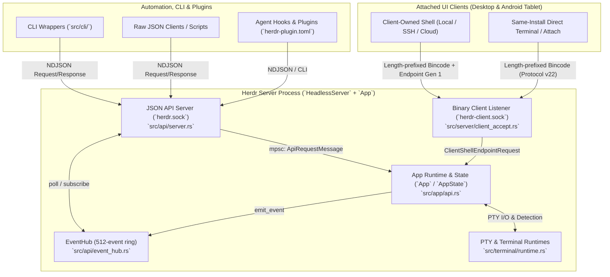
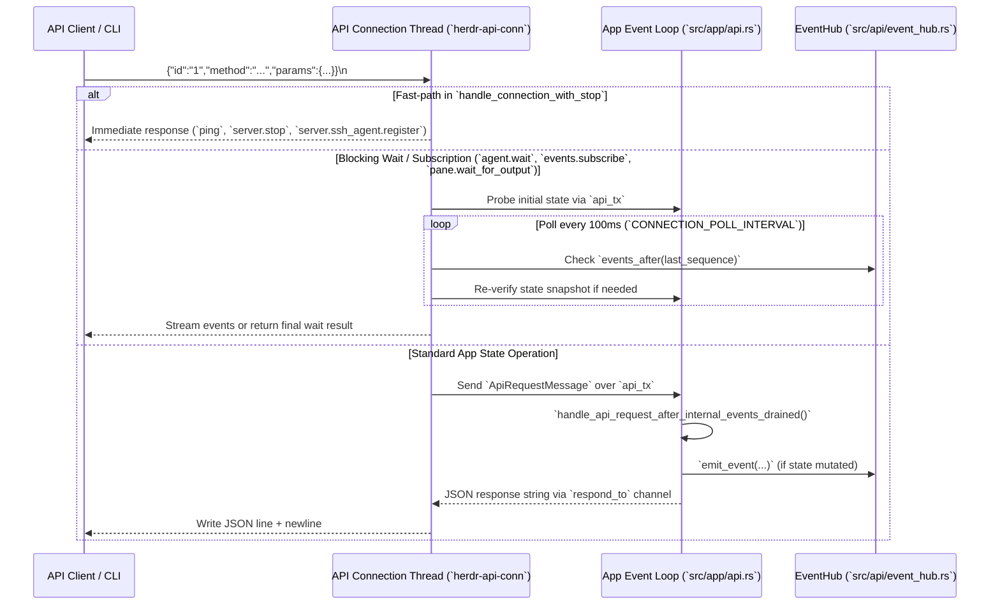
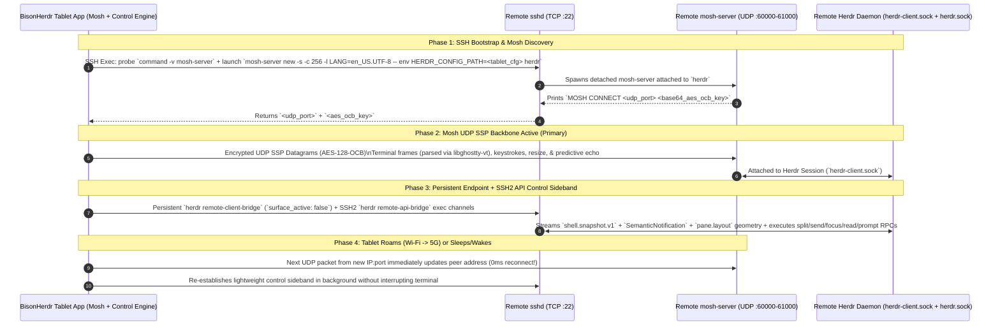
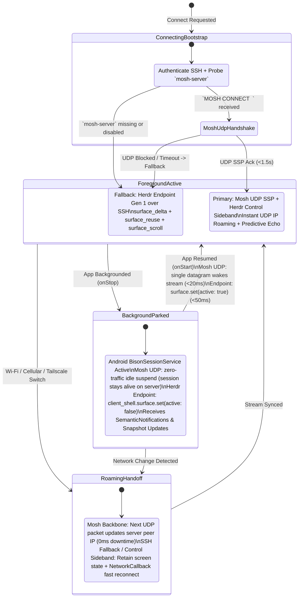
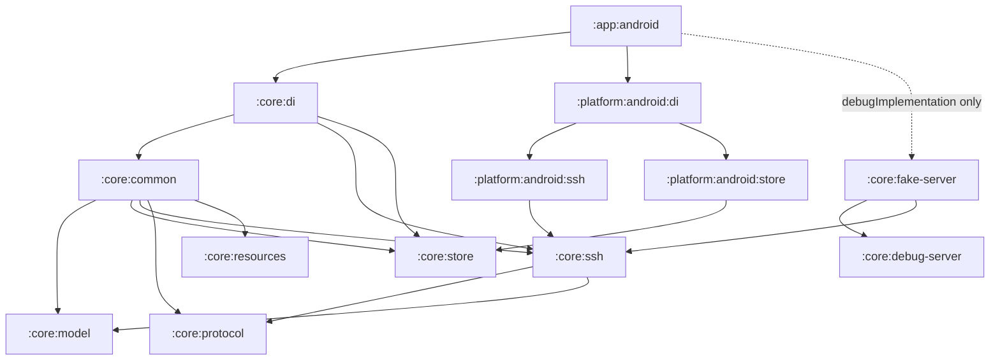

# 01 — BisonHerdr (Herdr Tablet & Android) Core App Design

This document consolidates the complete reference for **Herdr's Server API & Protocol Surface** and the **Architecture & UX Design Specification** for **BisonHerdr** (`com.toxicbakery.app.bison`), the native Android / Tablet client for Herdr.

> **Status.** This document describes the target design. Some parts do not ship in this version. The Mosh UDP backbone (Part IV), the Rust JNI core, `russh`, and `libghostty-vt` rendering over JNI are planned. Item 13 of [`02-ssh-defects-issue-20.md`](02-ssh-defects-issue-20.md) records this decision, and [issue #22](https://github.com/ToxicBakery/BisonHerdr/issues/22) holds the work for Mosh.
>
> The SSH path over JSch is the only transport of this version, and Compose draws the Herdr `PaneSurfaceFrame` cells. This path does not run `herdr remote-client-bridge`. Each machine has one JSch session to its host, and a ProxyJump machine also has a session to its bastion. The host session has two persistent `sh` channels that run `herdr api snapshot` and `herdr remote-api-bridge` requests (`pane.read`, `pane.send_input`, and others). The client reads the visible panes each 400 ms while the surface lease is on. The surface lease pauses this poll in the client, and the app does not send `client_shell.surface.set` to the server.
>
> Of the SSH features in section E of Part V, only the hardware security keys do not work yet. [Issue #23](https://github.com/ToxicBakery/BisonHerdr/issues/23) holds that work.

---

## Part I: Executive Summary & Problem Statement

Mobile and tablet terminal clients often fail coding-agent workflows, because they treat a tablet like a small desktop terminal over a fragile TCP socket. **BisonHerdr** (`com.toxicbakery.app.bison`) is a **native Kotlin + Jetpack Compose touch-first terminal multiplexer and multi-machine agent control center**. It uses Herdr's API over SSH. This version runs `herdr api snapshot` and `herdr remote-api-bridge` requests, and the target design adds Herdr's **Endpoint Generation 1** protocol.

| Pain Point in Existing Mobile/Android Apps | Root Cause | BisonHerdr Architecture Solution |
| :--- | :--- | :--- |
| **Reconnects every time the app is backgrounded** | Tying SSH socket lifecycle to the Android `Activity`; streaming full terminal frames in the background drains battery or gets killed by the OS. | **Android `ForegroundService` + Herdr `surface_interest` Lease:** On `onStop()`, the app sends `client_shell.surface.set { active: false }`. The server stops streaming terminal cell diffs while keeping the control channel open at near-zero bandwidth. On `onStart()`, sending `active: true` paints the fresh screen **with no SSH reconnect**. In this version, the lease pauses the poll of the client (`herdr api snapshot` and `pane.read`), and the app does not send `client_shell.surface.set`. |
| **No Mosh / poor roaming across Wi-Fi, 5G & Tailscale** | Raw TCP/SSH drops blank out the terminal screen and wait 30–120s for kernel TCP timeouts. | **Retained Surface State + `NetworkCallback` Session Check:** The last committed `PaneSurfaceFrame` and `ClientShellSnapshot` stay on screen with a non-intrusive `"Reconnecting..."` pill. On a new default network, `ConnectivityManager.NetworkCallback` starts a check of each SSH session: a keepalive and `exec true`, with a limit of 3 s. When the check fails, the app connects again at once and reads the surface again. On `onLost`, the app closes the SSH sockets, so that no attempt waits for a TCP timeout. |
| **Painful typing, modifiers (`Ctrl`/`Alt`/`Esc`), & prompt input** | Soft keyboards (`setComposingText`) fight raw PTY input mode; voice dictation and autocorrect mangle terminal TUI prompts. | **Two-Tier Input Bar:** (1) Pro Touch Accessory Bar with sticky/chorded modifiers and trackpad cursor scrubbing, plus (2) an expandable **Native Compose Prompt Composer** supporting full Android voice dictation, autocorrect, multi-line editing, and image paste (planned) before atomic submission via `agent.prompt` or `pane.send_input`. |
| **Clunky workspace, tab & split-pane navigation** | Desktop keyboard shortcuts (`prefix+w`, `prefix+h/j/k/l`) require awkward multi-key chords on touchscreens. | **Native Compose Shell Chrome + Direct Split Gestures:** Herdr's server renders *only* the pane grid (`PaneSurfaceFrame`). Android renders the Sidebar, Tab Bar, draggable BSP split handles (`layout.set_split_ratio`), and double-tap pane zoom (`pane.zoom`) natively in Compose. |
| **Hard to see or act on `blocked` / `done` coding agents** | Agents are buried across multiple SSH hosts, workspaces, and split panes. | **Unified Multi-Machine Agent Rail + Blocked Action Strip:** Aggregates `ClientShellAgent` states across all connected SSH machines. When viewing a `blocked` agent, a contextual action bar provides 1-tap `Approve (Enter)`, `Cancel (Esc)`, `y`, `n`, and option number buttons. |

---

## Part II: Herdr Server API Surface & Protocol Architecture

Herdr cleanly separates **shared session/runtime authority** (owned by the server) from **TUI presentation** (owned by attached clients) and **external automation** (CLI wrappers, scripts, coding agents, and plugins).

### 1. Multi-Layered Communication Overview



| Layer | Transport & Framing | Primary Source Files | Purpose |
| :--- | :--- | :--- | :--- |
| **1. Public JSON Socket API** | Newline-delimited JSON (`\n`) over Unix domain socket / Windows named pipe (`herdr.sock`), or over SSH via `herdr remote-api-bridge` | `src/api/server.rs`, `src/api/schema.rs` | External control, scripting, agent orchestration, event subscriptions, and hook reporting. |
| **2. CLI & Schema Projection** | Declarative macro projection onto `clap` args and `schemars` JSON Schema | `src/cli/projection.rs`, `src/api/schema/operations.rs` | Keeps CLI flags (`herdr workspace`, `herdr pane`, `herdr agent`) and `herdr api schema --json` 1:1 with wire types. |
| **3. Client-Owned Shell Endpoint Protocol (Gen 1)** | `[u32LE length][bincode]` outer frames carrying forward-compatible JSON control envelopes (`EndpointControl`), or over SSH via `herdr remote-client-bridge` | `src/protocol/endpoint.rs`, `src/server/headless/endpoint_requests.rs` | Cross-version compatible UI client protocol for Local, SSH, and Cloud connections (`ENDPOINT_PROTOCOL_GENERATION = 1`). |
| **4. Private Binary Wire Protocol** | `[u32LE length][bincode]` (`PROTOCOL_VERSION = 22`) over `herdr-client.sock` | `src/protocol/wire.rs` | Same-install high-throughput frame rendering, direct terminal attach/observe/control, Kitty graphics, and live binary handoff. |

---

### 2. Public JSON Socket API (`herdr.sock`)

#### 2.1 Socket Discovery & SSH Bridge
On a Herdr host, the API socket path resolves in the following order (`src/api/mod.rs`, `src/session.rs`):
1. Explicit CLI `--session <name>` (`~/.config/herdr/sessions/<name>/herdr.sock`)
2. `HERDR_SOCKET_PATH` environment variable override
3. `HERDR_SESSION=<name>` environment variable
4. Default session socket (`~/.config/herdr/herdr.sock`)

For remote connections over SSH, Herdr provides two built-in stdio bridges:
- **`herdr remote-api-bridge`** (`src/remote.rs`): Connects stdio directly to `herdr.sock` for NDJSON API requests and event subscriptions.
- **`herdr remote-client-bridge [--idle-timeout-v1]`** (`src/remote/host.rs`): Autostarts the remote Herdr server daemon if not running, verifies `ENDPOINT_PROTOCOL_GENERATION == 1`, registers any forwarded SSH agent, and bridges stdio to `herdr-client.sock`.

#### 2.2 Wire Envelope & Request Lifecycle
Every request on `herdr.sock` is a single UTF-8 JSON line (max 1 MiB, 5-second initial read timeout):

```json
{"id": "req_1", "method": "pane.split", "params": {"direction": "right", "focus": true}}
```

- **Request (`src/api/schema.rs`):** `Request { id: String, #[serde(flatten)] method: Method }` where `Method` is tagged by `#[serde(tag = "method", content = "params")]`.
- **Success Response (`src/api/schema/response.rs`):**
  ```json
  {"id": "req_1", "result": {"type": "pane_info", "pane": { ... }}}
  ```
- **Error Response (`src/api/schema/response.rs`):**
  ```json
  {"id": "req_1", "error": {"code": "pane_not_found", "message": "pane not found"}}
  ```



#### 2.3 Complete Operation Catalog (102 Operations)
Declared in `src/api/schema.rs` via `define_operations!`. Each operation defines:
- `changes_ui`: Marks UI render state dirty when `true`.
- `client_shell`: Permits invocation over the Client-Owned Shell command lane (`ClientShellEndpointRequest`) when `true`.

##### Server, Session & Client Control
| Method | Params Struct | Response `result.type` | `changes_ui` | `client_shell` | Description |
| :--- | :--- | :--- | :---: | :---: | :--- |
| `ping` | `PingParams` | `pong` | `false` | `false` | Returns server `version`, `protocol` (`22`), and `ServerCapabilities`. |
| `server.stop` | `EmptyParams` | `ok` | `false` | `false` | Initiates graceful server shutdown (`ShutdownReason::ApiStop`). |
| `server.live_handoff` | `ServerLiveHandoffParams` | `ok` | `false` | `false` | Transfers live PTYs and session state to a newly upgraded Herdr binary. |
| `server.reload_config` | `EmptyParams` | `config_reload` | `true` | `true` | Reloads `config.toml` and returns status + diagnostics. |
| `server.ssh_agent.register` | `ServerSshAgentRegisterParams` | `ok` (held open) | `false` | `false` | Registers a remote forwarded SSH agent socket for the lifetime of the API connection. |
| `server.agent_manifests` | `EmptyParams` | `agent_manifest_status` | `false` | `false` | Lists active agent detection manifests, versions, overrides, and remote check status. |
| `server.reload_agent_manifests` | `EmptyParams` | `agent_manifest_reload` | `true` | `false` | Reloads detection manifests from disk and resets active detectors. |
| `notification.show` | `NotificationShowParams` | `notification_show` | `true` | `false` | Shows a toast (`title`, optional `body`, `position`, `sound`); rate-limited to 1/sec. |
| `product_announcement.dismiss` | `ProductAnnouncementDismissParams` | `ok` | `true` | `true` | Dismisses an active product announcement matching `(version, id)`. |
| `release_notes.dismiss` | `ReleaseNotesDismissParams` | `ok` | `true` | `true` | Marks release notes for `version` as seen. |
| `command.invoke` | `CommandInvokeParams` | `ok` | `true` | `true` | Executes a configured custom command or keybinding action by `command_id`. |
| `client.window_title.set` | `ClientWindowTitleSetParams` | `client_window_title` | `false` | `false` | Overrides the foreground client's outer terminal window title via OSC 0. |
| `client.window_title.clear` | `EmptyParams` | `client_window_title` | `false` | `false` | Restores automatic window title management (`ui.window_title`). |
| `client_shell.surface.set` | `ClientShellSurfaceSetParams` | `client_shell_surface_set` | `false` | `true` | Toggles whether a client-shell connection receives active pane surface frames (`active: bool`). |
| `session.snapshot` | `EmptyParams` | `session_snapshot` | `false` | `false` | Returns a complete `SessionSnapshot` (workspaces, tabs, panes, layouts, agents). |
| `popup.close` | `EmptyParams` | `ok` | `true` | `false` | Closes the currently open modal popup terminal, if any. |

##### Workspaces & Git Worktrees
| Method | Params Struct | Response `result.type` | `changes_ui` | `client_shell` | Description |
| :--- | :--- | :--- | :---: | :---: | :--- |
| `workspace.create` | `WorkspaceCreateParams` | `workspace_created` | `true` | `true` | Creates a workspace (`cwd`, `label`, `focus`, `env`) and returns workspace, tab, and root pane. |
| `workspace.list` | `EmptyParams` | `workspace_list` | `false` | `false` | Lists all open `WorkspaceInfo` records. |
| `workspace.get` | `WorkspaceTarget` | `workspace_info` | `false` | `false` | Inspects a single workspace by ID (`w1` or `1`). |
| `workspace.focus` | `WorkspaceTarget` | `workspace_info` | `true` | `true` | Switches active focus to the target workspace. |
| `workspace.rename` | `WorkspaceRenameParams` | `workspace_info` | `true` | `true` | Sets a custom label on a workspace. |
| `workspace.move` | `WorkspaceMoveParams` | `workspace_list` | `true` | `true` | Moves a single workspace to `insert_index`. |
| `workspace.move_block` | `WorkspaceMoveBlockParams` | `workspace_list` | `true` | `true` | Atomically reorders a block of `workspace_ids` before `before_workspace_id`. |
| `workspace.report_metadata` | `WorkspaceReportMetadataParams` | `workspace_info` | `true` | `false` | Patches display tokens (`$key`) on a workspace with optional `seq` and `ttl_ms`. |
| `workspace.close` | `WorkspaceCloseParams` | `ok` | `true` | `true` | Closes a workspace (requires `close_group: true` if primary checkout has open linked worktrees). |
| `worktree.list` | `WorktreeListParams` | `worktree_list` | `false` | `true` | Discovers Git worktrees for a workspace or `cwd` asynchronously. |
| `worktree.create` | `WorktreeCreateParams` | `worktree_created` | `true` | `true` | Creates/checks out a linked Git worktree and opens it as a Herdr workspace. |
| `worktree.open` | `WorktreeOpenParams` | `worktree_opened` | `true` | `true` | Opens an existing Git worktree by `path` or `branch` as a Herdr workspace. |
| `worktree.remove` | `WorktreeRemoveParams` | `worktree_removed` | `true` | `true` | Runs `git worktree remove` on a linked worktree workspace without deleting its branch. |

##### Tabs & Layouts
| Method | Params Struct | Response `result.type` | `changes_ui` | `client_shell` | Description |
| :--- | :--- | :--- | :---: | :---: | :--- |
| `tab.create` | `TabCreateParams` | `tab_created` | `true` | `true` | Creates a new tab in a workspace (`workspace_id`, `cwd`, `label`, `focus`, `env`). |
| `tab.list` | `TabListParams` | `tab_list` | `false` | `false` | Lists tabs (all or filtered by `workspace_id`). |
| `tab.get` | `TabTarget` | `tab_info` | `false` | `false` | Gets `TabInfo` for `tab_id` (e.g. `w1:t1`). |
| `tab.focus` | `TabTarget` | `tab_info` | `true` | `true` | Focuses the specified tab. |
| `tab.rename` | `TabRenameParams` | `tab_info` | `true` | `true` | Renames a tab. |
| `tab.move` | `TabMoveParams` | `tab_list` | `true` | `true` | Moves a tab to `insert_index` within its workspace. |
| `tab.close` | `TabTarget` | `ok` | `true` | `true` | Closes a tab and its panes. |
| `layout.export` | `LayoutExportParams` | `layout_export` | `false` | `false` | Exports a portable BSP tree (`LayoutDescription`) for a tab. |
| `layout.apply` | `LayoutApplyParams` | `layout_apply` | `true` | `false` | Creates or replaces a tab from a declarative `LayoutNode` tree. |
| `layout.set_split_ratio` | `LayoutSetSplitRatioParams` | `layout_split_ratio_set` | `true` | `true` | Updates the split ratio at a binary tree `path` (`Vec<bool>`). |

##### Panes
| Method | Params Struct | Response `result.type` | `changes_ui` | `client_shell` | Description |
| :--- | :--- | :--- | :---: | :---: | :--- |
| `pane.list` | `PaneListParams` | `pane_list` | `false` | `false` | Lists panes (all or scoped to `workspace_id`). |
| `pane.current` | `PaneCurrentParams` | `pane_current` | `false` | `false` | Returns `caller_pane_id` if given, or the currently focused pane. |
| `pane.get` | `PaneTarget` | `pane_info` | `false` | `false` | Returns `PaneInfo` for `pane_id` (e.g. `w1:p1`). |
| `pane.focus` | `PaneTarget` | `pane_info` | `true` | `true` | Focuses a pane (and its containing workspace/tab). |
| `pane.focus_direction` | `PaneFocusDirectionParams` | `pane_focus_direction` | `true` | `true` | Moves focus `left`, `right`, `up`, or `down` within the tab layout. |
| `pane.split` | `PaneSplitParams` | `pane_info` | `true` | `true` | Splits a pane `right` or `down` with optional `ratio`, `cwd`, `focus`, `right_click`, `env`. |
| `pane.swap` | `PaneSwapParams` | `pane_swap` | `true` | `true` | Swaps two panes in the same tab (by direction or explicit IDs). |
| `pane.move` | `PaneMoveParams` | `pane_move` | `true` | `false` | Moves a live pane to another tab, a new tab, or a new workspace without killing its PTY. |
| `pane.zoom` | `PaneZoomParams` | `pane_zoom` | `true` | `true` | Toggles, enables, or disables single-pane zoom on a tab. |
| `pane.resize` | `PaneResizeParams` | `pane_resize` | `true` | `true` | Resizes a pane boundary in `direction` by `amount`. |
| `pane.layout` | `PaneLayoutParams` | `pane_layout` | `false` | `false` | Returns `PaneLayoutSnapshot` with cell rects for panes and splits. |
| `pane.neighbor` | `PaneNeighborParams` | `pane_neighbor` | `false` | `false` | Finds the neighboring pane in `direction` plus the layout snapshot. |
| `pane.edges` | `PaneEdgesParams` | `pane_edges` | `false` | `false` | Reports which outer edges (`left`, `right`, `up`, `down`) have neighbors. |
| `pane.process_info` | `PaneProcessInfoParams` | `pane_process_info` | `false` | `false` | Inspects shell PID, foreground process group, TTY, and foreground process tree. |
| `pane.scroll` | `PaneScrollParams` | `pane_info` | `true` | `true` | Scrolls a pane viewport to `offset_from_bottom`. |
| `pane.clear` | `PaneTarget` | `ok` | `true` | `true` | Clears screen and scrollback for a pane. |
| `pane.edit_scrollback` | `PaneTarget` | `ok` | `true` | `true` | Opens the pane's scrollback buffer in `$EDITOR` inside an overlay pane. |
| `pane.selection.read` | `PaneSelectionReadParams` | `pane_selection` | `false` | `true` | Reads selected text between `anchor` and `cursor` validated against `content_revision`. |
| `pane.copy_motion` | `PaneCopyMotionParams` | `pane_copy_motion` | `false` | `true` | Computes vim-style word/line/paragraph copy-mode cursor motion on the server buffer. |
| `pane.copy_search` | `PaneCopySearchParams` | `pane_copy_search` | `false` | `true` | Searches scrollback content in copy mode and returns match ranges. |
| `pane.input.set` | `PaneInputSetParams` | `pane_info` | `true` | `true` | Sets right-click behavior (`herdr` menu vs `pane` mouse passthrough). |
| `pane.link.resolve` | `PaneLinkActivateParams` | `pane_link_resolved` | `false` | `true` | Resolves clickable URL/OSC8/plugin link regions at `(viewport_row, col)`. |
| `pane.link.activate` | `PaneLinkActivateParams` | `pane_link_activated` | `false` | `true` | Activates a link at `(viewport_row, col)` (via plugin link handler or URL opener). |
| `pane.rename` | `PaneRenameParams` | `pane_info` | `true` | `true` | Sets or clears a custom pane label. |
| `pane.send_text` | `PaneSendTextParams` | `ok` | `false` | `false` | Writes literal text into a pane's PTY input queue. |
| `pane.send_keys` | `PaneSendKeysParams` | `ok` | `false` | `false` | Encodes and sends key chords (`Enter`, `Esc`, `ctrl+c`, `shift+tab`, etc.) to a pane. |
| `pane.send_input` | `PaneSendInputParams` | `ok` | `false` | `false` | Sends text followed by key chords (backing `herdr pane run`). |
| `pane.read` | `PaneReadParams` | `pane_read` | `false` | `false` | Reads terminal text/ANSI from `visible`, `recent`, `recent_unwrapped`, or `detection` buffer. |
| `pane.wait_for_output` | `PaneWaitForOutputParams` | `output_matched` | `false` | `false` | Blocks until a substring or regex matches in the pane's output buffer or `timeout_ms` elapses. |
| `pane.report_agent` | `PaneReportAgentParams` | `pane_info` | `true` | `false` | Reports authoritative semantic agent state (`idle`, `working`, `blocked`, `unknown`) and optional session/resume argv. |
| `pane.report_agent_session` | `PaneReportAgentSessionParams` | `pane_info` | `true` | `false` | Reports native session ID/path and optional `resume_argv` without claiming state authority. |
| `pane.report_metadata` | `PaneReportMetadataParams` | `pane_info` | `true` | `false` | Patches display-only `title`, `display_agent`, `state_labels`, and `$tokens` with optional `ttl_ms` and `seq`. |
| `pane.clear_agent_authority` | `PaneClearAgentAuthorityParams` | `pane_info` | `true` | `false` | Clears hook state authority on a pane so screen detection resumes. |
| `pane.release_agent` | `PaneReleaseAgentParams` | `pane_info` | `true` | `false` | Releases an agent's ownership of a pane on graceful exit. |
| `pane.close` | `PaneTarget` | `ok` | `true` | `true` | Closes a pane (and its tab/workspace if it was the last pane). |

##### Coding Agents
| Method | Params Struct | Response `result.type` | `changes_ui` | `client_shell` | Description |
| :--- | :--- | :--- | :---: | :---: | :--- |
| `agent.list` | `EmptyParams` | `agent_list` | `false` | `false` | Lists all detected or hook-registered coding agents (`AgentInfo`). |
| `agent.get` | `AgentTarget` | `agent_info` | `false` | `false` | Resolves an agent by handle name, `pane_id`, or `terminal_id`. |
| `agent.read` | `AgentReadParams` | `pane_read` | `false` | `false` | Reads terminal output from the target agent's pane. |
| `agent.explain` | `AgentTarget` | `agent_explain` | `false` | `false` | Evaluates the server's active detection manifest against the pane's bottom-buffer snapshot and explains rule gates. |
| `agent.send_keys` | `AgentSendKeysParams` | `ok` | `true` | `false` | Sends key chords to a resolved agent pane. |
| `agent.rename` | `AgentRenameParams` | `agent_info` | `true` | `false` | Assigns or clears a unique handle name on an agent. |
| `agent.focus` | `AgentTarget` | `agent_info` | `true` | `false` | Focuses the workspace, tab, and pane of the target agent. |
| `agent.start` | `AgentStartParams` | `agent_started` | `true` | `false` | Launches a supported coding agent CLI in an idle shell pane, assigns `name`, and waits for interactive readiness. |
| `agent.prompt` | `AgentPromptParams` | `agent_prompted` | `true` | `false` | Submits a prompt to an agent (rejecting if `blocked`) and optionally waits for a settled target state (`until`, `timeout_ms`) in one atomic call. |
| `agent.wait` | `AgentWaitParams` | `agent_info` | `false` | `false` | Pins the resolved agent occupant (`terminal_id`) and waits until its status matches `until` (`idle`, `done`, `blocked`, `working`). |
| `agent.view.set` | `AgentViewSetParams` | `agent_view` | `true` | `false` | Installs a declarative filter/sort projection (`AgentViewFilter`, `AgentViewSort`) for the UI Agents list. |
| `agent.view.clear` | `AgentViewClearParams` | `agent_view` | `true` | `false` | Clears the active agent view projection (unconditionally or if owned by `source`). |

##### Events, Integrations & Plugins
| Method | Params Struct | Response `result.type` | `changes_ui` | `client_shell` | Description |
| :--- | :--- | :--- | :---: | :---: | :--- |
| `events.subscribe` | `EventsSubscribeParams` | `subscription_started` | `false` | `false` | Acknowledges with `subscription_started`, then streams matching `EventEnvelope` / `SubscriptionEventEnvelope` lines until disconnect. |
| `events.wait` | `EventsWaitParams` | `wait_matched` | `false` | `false` | Blocks until a single matching event occurs or `timeout_ms` elapses. |
| `integration.list` | `EmptyParams` | `integration_list` | `false` | `true` | Lists all 17 built-in coding agent integrations (`IntegrationTarget`) and their installation state. |
| `integration.install` | `IntegrationInstallParams` | `integration_install` | `false` | `true` | Installs Herdr hook scripts/configs for a target agent CLI. |
| `integration.uninstall` | `IntegrationUninstallParams` | `integration_uninstall` | `false` | `false` | Removes Herdr hook scripts/configs for a target agent CLI. |
| `plugin.link` | `PluginLinkParams` | `plugin_linked` | `false` | `false` | Links a `herdr-plugin.toml` manifest into `plugins.json` and runs startup hooks if enabled. |
| `plugin.list` | `PluginListParams` | `plugin_list` | `false` | `false` | Lists installed plugins, their manifests, source metadata, and warnings. |
| `plugin.unlink` | `PluginUnlinkParams` | `plugin_unlinked` | `true` | `false` | Unlinks a plugin and removes its owned views/panes. |
| `plugin.enable` | `PluginSetEnabledParams` | `plugin_enabled` | `false` | `false` | Enables a linked plugin. |
| `plugin.disable` | `PluginSetEnabledParams` | `plugin_disabled` | `true` | `false` | Disables a linked plugin. |
| `plugin.action.list` | `PluginActionListParams` | `plugin_action_list` | `false` | `false` | Lists actions declared across installed plugins. |
| `plugin.action.invoke` | `PluginActionInvokeParams` | `plugin_action_invoked` | `true` | `false` | Spawns a plugin action command with `HERDR_PLUGIN_CONTEXT_JSON` and logs execution. |
| `plugin.log.list` | `PluginLogListParams` | `plugin_log_list` | `false` | `false` | Returns recent plugin action/hook execution logs (`stdout`, `stderr`, `exit_code`). |
| `plugin.pane.open` | `PluginPaneOpenParams` | `plugin_pane_opened` / `ok` | `true` | `false` | Opens a plugin `[[panes]]` entrypoint as `overlay`, `popup`, `split`, `tab`, or `zoomed`. |
| `plugin.pane.focus` | `PluginPaneFocusParams` | `plugin_pane_focused` | `true` | `false` | Focuses an open plugin pane. |
| `plugin.pane.close` | `PluginPaneCloseParams` | `plugin_pane_closed` | `true` | `false` | Closes an open plugin pane. |

---

### 3. Event Hub, Subscriptions & Waits

1. **Bounded Ring Buffer (`EventHub`, `src/api/event_hub.rs`):**
   - Stores up to **512** (`EventHub::MAX_EVENTS`) `EventEnvelope` items with a monotonic `u64` sequence number.
   - Emits 26 lifecycle event kinds (`workspace.*`, `worktree.*`, `tab.*`, `pane.*`, `layout.updated`).
2. **Overrun Detection (`events_lost`):**
   - If a subscriber falls more than 512 events behind, `events_after_checked` returns `EventHistoryError::Lost`.
   - The server writes an error response with `error.code: "events_lost"` and closes the subscription connection so clients never silently operate on stale state.
   - **Recovery Pattern:** Open a new `events.subscribe` stream, wait for `subscription_started`, fetch `session.snapshot` on a separate connection, and treat subsequent events as invalidation signals.
3. **Occupant-Pinned Agent Waits (`src/api/wait.rs`):**
   - `agent.wait` pins `terminal_id`, `name`, and `agent` kind. If the process exits or is replaced, it fails fast with `agent_not_running`.
   - `agent.prompt` with `wait` atomically submits the prompt, verifies transition to `working` or `blocked` within 5,000 ms (`AGENT_PROMPT_EFFECT_TIMEOUT_MS`), and then waits for the settled target status (`idle`, `done`, `blocked`).

---

### 4. Client-Owned Shell Endpoint Protocol (Generation 1)

Defined in `src/protocol/endpoint.rs` and `src/protocol/wire.rs`, Generation 1 decouples client UI builds from server runtime builds across Local, SSH, and Cloud connections.

#### 4.1 Framing & Handshake
All messages on `herdr-client.sock` (and `herdr remote-client-bridge`) use `[u32LE length][bincode payload]` framing (`MAX_FRAME_SIZE` = 2 MiB, or `MAX_GRAPHICS_FRAME_SIZE` = 32 MiB when Kitty graphics are active).

1. **Client → Server (`EndpointClientHello`):**
   Sent inside `ClientMessage::EndpointControl { kind: "endpoint.hello.v1", data }`:
   ```json
   {
     "generation": 1,
     "cell_width_px": 18,
     "cell_height_px": 36,
     "surface_size": { "cols": 140, "rows": 42 },
     "pixel_mouse": true,
     "direct_graphics": false,
     "endpoint_keybindings": false,
     "mouse_capture": true,
     "surface_active": true,
     "surface_reuse": true,
     "surface_delta": true,
     "surface_scroll": true,
     "snapshot_codecs": ["shell.snapshot.v1"],
     "surface_codecs": ["shell.surface.v1"],
     "input_codecs": ["shell.input.semantic.v1"],
     "blob_codecs": ["shell.blob.v1"]
   }
   ```
2. **Server → Client (`EndpointServerWelcome`):**
   Sent inside `ServerMessage::EndpointControl { kind: "endpoint.welcome.v1", data }`:
   - Negotiates the four core codecs (`shell.snapshot.v1`, `shell.surface.v1`, `shell.input.semantic.v1`, `shell.blob.v1`).
   - Lists supported `methods` (`client_shell_method_names()`).
   - Advertises `capabilities`:
     - `surface_reuse`, `surface_delta`, `surface_scroll`
     - `surface_interest`
     - `presentation_effects_fence`
     - `health_check`
     - `agent_view_projection`
     - `agent_completions`

#### 4.2 Ongoing Control, Surface, and Input Streams
- **Shell State Snapshots (`shell.snapshot.v1`):**
  Delivered via `ServerMessage::EndpointControl { kind: "shell.snapshot.v1", data }`. Contains `ClientShellSnapshot`:
  - `boot_id` and monotonic `revision`
  - `focused_workspace_id`, `focused_tab_id`, `focused_pane_id`
  - `workspaces: Vec<ClientShellWorkspace>` (with Git branch, ahead/behind, worktree info, tokens, `agent_status`)
  - `tabs: Vec<ClientShellTab>` (with `zoomed`, `focused`, `agent_status`)
  - `panes: Vec<ClientShellPane>` (with `cwd`, `foreground_cwd`, `right_click_passthrough`)
  - `agents: Vec<ClientShellAgent>` (with `agent_status`, `state_change_seq`, `state_labels`, `tokens`)
  - `commands: Vec<ClientShellCommand>` (custom commands & keybindings)
- **Active Tab Surface (`PaneSurfaceFrame` & Deltas):**
  - Full surfaces arrive via `ServerMessage::PaneSurface(PaneSurfaceFrame)` or `ServerMessage::EndpointControl { kind: "endpoint.surface-reuse.v1", data }` (UTF-8 JSON `SurfaceReuse<PaneSurfaceFrame>` retaining the baseline cell grid).
  - Incremental updates arrive via `ServerMessage::PaneSurfacePatch(PaneSurfacePatch)`, `"endpoint.surface-delta.v1"` (unpadded Base64 of `bincode`-serialized `SurfaceDelta`), or `"endpoint.surface-scroll.v1"` (unpadded Base64 of `u8` scroll count + `10-byte` `SurfaceScroll` shift headers + framed `ServerMessage::PaneSurfacePatch`).
  - When `presentation_effects_fence` is negotiated and the server sends `"endpoint.presentation.sync.v1"`, the client commits the first coherent `PaneSurfaceFrame` for the new epoch and replies with `ClientMessage::EndpointControl { kind: "endpoint.presentation.ready.v1", data }`.
  - Includes origin-relative `FrameData` cells, `panes: Vec<PaneSurfacePane>` (exact `rect`, `inner_rect`, `scrollbar_rect`, `scroll` metrics, `mouse_reporting`), `splits: Vec<PaneSurfaceSplit>` (`hit_rect` and BSP `path`), `popup: Option<Box<ClientShellPopupSurface>>`, and `graphics: SurfaceGraphicsScene` (Kitty RGBA/PNG assets and placements).
- **Semantic Input (`ClientShellPaneInput` & `ClientShellPopupInput`):**
  - Sends `Vec<ClientPaneInputEvent>` (`Key`, `TextCommit`, `Mouse`, `Paste`) directly to a target `pane_id` or popup `terminal_id` (works even while `surface_active == false` for background notification actions).
- **Client-Shell Command Lane (`ClientShellEndpointRequest`) & SSH2 Multiplexed `herdr remote-api-bridge` Sideband (100% Unmodified Herdr Server):**
  - Over `herdr remote-client-bridge` (`herdr-client.sock`), the client receives continuous `ClientShellSnapshot` (`shell.snapshot.v1`) and `SemanticNotification` updates, sends `ClientShellPaneInput` (`Key`, `TextCommit`, `Mouse`, `Paste`—even while `surface_active == false`), and invokes any of the 33 built-in `client_shell`-enabled API methods (`ClientMessage::ClientShellEndpointRequest { boot_id, request }`, serialized one-in-flight at a time while `surface_active == true`) with chunked JSON responses via `ServerMessage::ClientShellEndpointResponseChunk`.
  - Because `herdr.sock` (`herdr remote-api-bridge`) processes one JSON request per socket connection (or streams `events.subscribe` until disconnect), the tablet's SSH transport opens lightweight multiplexed SSH2 `exec` channels (`herdr remote-api-bridge`) over the existing authenticated SSH connection whenever it needs a dedicated `events.subscribe` stream or one-shot RPCs for methods outside the `client_shell` subset (`agent.read`, `pane.read`, `agent.prompt`, `pane.send_input`, `pane.layout`) or while `surface_active == false`.

---

## Part III: Android & Tablet Client UX Design — "Zen Canvas" (Design 2)

> **Status: target design.** Part III describes the target UX. **This version:** the workspace screen is a column. The top HUD has two rows, and the split-thumb bar is at the bottom when the setting is on. The panes use all of the area between them, and the HUD and the bar do not cover the panes. The app sets no frame rate.

### 1. Edge-to-Edge "Zen Canvas" Layout with Floating HUDs (Jetpack Compose)

The app uses the **Design 2 ("Zen Canvas")** architecture: **the full-bleed hardware-accelerated terminal grid gets most of the tablet display (target: 96%+ of the screen; no code measures it)**, with zero permanent sidebars or bulky toolbars stealing columns or rows. All multi-machine navigation, workspace/tab switching, agent triage, and touch modifiers live in **translucent floating HUD pills, a slide-over Agent Command Drawer, and ergonomic split-thumb clusters**:

```
+----------------------------------------------------------------------------------------------------+
|  ( ● workbox · MOSH UDP :60004 · 11ms › herdr-core (1/3) ▾ )   ( 🔴 1 Blocked · ☰ Agents ) ( ◫ )  |
|                                                                +----------------------------------+|
|  ╭─ Claude Code · Pane #1 (Focused) ────────────────────────╮  | Federated Agent Command Center ✕ ||
|  │ Host: workbox (Mosh UDP SSP :60004) · Local Echo: ON     │  | ┌──────────────────────────────┐ ||
|  ╰──────────────────────────────────────────────────────────╯  | │ 🔴 Claude Code · workbox #1  │ ||
|                                                                | │ Allow Bash: `just test`?     │ ||
|  ● Inspecting platform/android/di/SshModule.kt                 | │ [ ✓ Approve ]  [ ✕ Reject ]  │ ||
|  ● Verified Kodein bindSingleton wiring for MoshUdpEngine      | └──────────────────────────────┘ ||
|                                                                | ┌──────────────────────────────┐ ||
|  ⚠ Permission Prompt — Pane #1                                 | │ 🟠 Codex CLI · gpu-rig #2    │ ||
|    Run `./gradlew :app:android:assembleDebug`?                 | │ Compiling libghostty-vt...   │ ||
|    ❯ [1] Approve (Enter)   [2] Always allow   [3] Cancel (Esc) | └──────────────────────────────┘ ||
|                                                                +----------------------------------+|
|  Prompt > █                                                    | $ mosh-server new -s -c 256      ||
|                                                                | MOSH CONNECT 60004 4k9X2vL8...   ||
|                                                                | ✓ Zero-drop UDP roaming armed.   ||
|                                                                                                    |
|  [Esc][Tab][Ctrl][Alt][^C]   ( ❯ Approve and run tests... [✓ Approve] [Send ⏎] )   [←][↓][↑][→][⏎] |
+----------------------------------------------------------------------------------------------------+
```

1. **Full-Bleed Terminal Canvas (target: 96%+ of the screen; no code measures it):**
   - Renders the multi-pane BSP split grid edge-to-edge across the entire tablet screen, with a crisp `2.dp` accent focus border on the active pane.
   - Floating top-And-bottom HUD elements use translucent Material 3 glass surfaces (`backdrop-filter` / `Surface` with alpha + `1.dp` border) that sit over padding zones or auto-fade to 40% opacity while typing.
2. **Floating Top HUD Islands:**
   - **Left Host & Space Switcher Pill (`● workbox · MOSH UDP :60004 · 11ms › herdr-core (1/3) ▾`):**
     - Displays the active host, live transport backbone badge (`MOSH · UDP`, `MOSH ROAMED`, or `SSH · TCP`), RTT latency, active workspace/worktree, and tab index. In this version, the badge always shows the SSH path. The pill shows the measured poll time: the time of one SSH command batch, which is more than the network round trip. The Mosh badges are planned ([issue #22](https://github.com/ToxicBakery/BisonHerdr/issues/22)).
     - Tapping opens a compact floating popover sheet to switch hosts (`workbox`, `gpu-rig`, `cloud-vm`), switch/create workspaces & Git worktrees (`workspace.focus`, `workspace.create`, `worktree.create`), or switch tabs (`tab.focus`, `tab.create`).
   - **Right Agent Attention Pill (`🔴 1 Blocked · 1 Working · ☰ Agents`) & Split Pill (`◫ Splits`):**
     - Pulses when any agent across any federated machine enters `Blocked` or finishes (`Done`).
     - Tapping toggles the **Slide-Over Floating Agent Command Center Drawer** on the right side of the canvas without leaving or resizing the underlying terminal panes.
     - The **Slide-Over Agent Command Center** lists all active agents across all connected machines sorted by priority (`Blocked` → `Done` → `Working` → `Idle`), fetching live bottom-buffer snippets via `agent.read` (using `source: "visible"` for `Working`/`Blocked` agents so alternate-screen TUIs never fail with `agent_not_idle`) or `pane.read` and providing **inline one-tap `[ ✓ Approve ]` (`ClientShellPaneInput` / `agent.send_keys`), `[ ✕ Reject ]`, and `[ Jump to Pane ]` (`pane.focus` / `agent.focus`) buttons**.
3. **Ergonomic Split-Thumb Floating Bottom Controls:**
   - Designed specifically for holding a tablet with two hands (or typing on a split/floating keyboard):
   - **Left Thumb Cluster:** `[Esc]`, `[Tab]`, sticky/chorded `[Ctrl]`, `[Alt]`, `[^C]` (plus customizable quick keys like `[^B]`, `[/]`, `[|]`).
   - **Right Thumb Cluster:** Swipeable directional arrow cluster `[←]`, `[↓]`, `[↑]`, `[→]` + `[⏎ Enter]`.
   - **Center Floating Prompt Composer Pill (`❯ ... [✓ Approve] [Send ⏎]`):**
     - Sits ergonomically between the left and right thumb pads.
     - Shows contextual one-tap **`[ ✓ Approve ]`** / **`[ ✕ Reject ]`** buttons whenever the focused pane's agent is `Blocked`.
     - Tapping the prompt input expands into a multi-line native Compose `OutlinedTextField` card supporting **Gboard swipe typing, Android Voice Dictation, multi-line editing, image clipboard paste (`ClientMessage::ClipboardImage`, planned), and an offline prompt queue during a reconnect**.
     - Submitting sends the prompt atomically (`agent.prompt` over a `herdr remote-api-bridge` SSH exec channel or `ClientShellPaneInput` `Paste` + `Enter`, tracking subsequent state transitions reactively via `shell.snapshot.v1`).

---

### 2. Touch-First Split & Viewport Gestures

1. **Direct BSP Divider Dragging:**
   - `PaneSurfaceFrame.splits` provides the exact cell `hit_rect` and binary tree `path: Vec<bool>` for every split divider. On the planned Mosh UDP backbone, `deriveSplitsFromLayout` in `:core:protocol` (`PaneLayoutDerivation.kt`) derives the equivalent `PaneSurfaceSplit` list from `PaneLayoutSnapshot` (`pane.layout`), parsing `path: Vec<bool>` from `PaneLayoutSplit.id` (e.g., `"s0:root"`, `"s1:lr"`), computing the 1-cell divider `hit_rect` from `direction`, `ratio`, and subtree `rect`, and collapsing to the single focused pane when `zoomed == true`.
   - The Compose overlay inflates each divider's touch target to `24.dp`. Dragging renders a live preview splitter line and sends `layout.set_split_ratio` on release.
2. **Double-Tap / Spread to Zoom a Pane:**
   - Double-tapping a pane header or performing a two-finger expand gesture inside a split pane invokes `pane.zoom { pane_id, mode: "toggle" }`, maximizing that pane across the full Zen Canvas.
3. **Per-Host Pinch-to-Zoom Font Size:**
   - Two-finger pinch adjusts the terminal cell font size (`cell_width_px`, `cell_height_px`), dynamically recalculating `ClientSurfaceSize { cols, rows }` and sending `ClientMessage::ClientShellResize` (and Mosh UDP window resize).
4. **Inertial Touch Scrollback & Selection:**
   - One-finger vertical swipe scrolls the pane with native Android fling physics via `pane.scroll { pane_id, offset_from_bottom }`.
   - Long-pressing text enters native touch selection mode backed by `pane.selection.read` and `pane.copy_search`.

---

### 3. Built-in Color Themes (`Gruvbox Dark` Default + All 18 Herdr Palettes & `OLED Pitch Black` in Settings)

All 18 color palettes from Herdr's `src/app/state.rs` (`Palette`) plus `OLED Pitch Black` (`oled-black`) are built into `:core:common/theme` and selectable in **User Settings** (persisted in `AppSettingsStore` via `:core:store`), with **`Gruvbox Dark` (`gruvbox`) as the default out-of-the-box theme**. Since the Android app acts as the outer terminal host, each theme also defines an explicit `Terminal BG` token alongside Herdr's `Palette` tokens:

| Theme ID | Display Name | Variant | Default? | Panel BG | Terminal BG | Accent | Text | Green | Red | Mauve / Secondary |
|---|---|---|---|---|---|---|---|---|---|---|
| **`gruvbox`** | **Gruvbox Dark** | Dark | **✓ Default** | `#282828` | `#1d2021` | `#d79921` | `#ebdbb2` | `#b8bb26` | `#fb4934` | `#d3869b` |
| `catppuccin` | Catppuccin Mocha | Dark | Option | `#181825` | `#11111b` | `#89b4fa` | `#cdd6f4` | `#a6e3a1` | `#f38ba8` | `#cba6f7` |
| `tokyo-night` | Tokyo Night | Dark | Option | `#1a1b26` | `#13141c` | `#7aa2f7` | `#c0caf5` | `#9ece6a` | `#f7768e` | `#bb9af7` |
| `vesper` | Vesper (Minimal) | Dark | Option | `#1a1a1a` | `#101010` | `#ffc799` | `#ffffff` | `#99ffe4` | `#ff8080` | `#ffd1a8` |
| `rose-pine` | Rosé Pine | Dark | Option | `#191724` | `#12101b` | `#c4a7e7` | `#e0def4` | `#31748f` | `#eb6f92` | `#c4a7e7` |
| `kanagawa` | Kanagawa Wave | Dark | Option | `#1f1f28` | `#16161d` | `#7e9cd8` | `#dcd7ba` | `#76946a` | `#c34043` | `#957fb8` |
| `nord` | Nord Frost | Dark | Option | `#2e3440` | `#242933` | `#88c0d0` | `#eceff4` | `#a3be8c` | `#bf616a` | `#b48ead` |
| `dracula` | Dracula | Dark | Option | `#282a36` | `#1e1f29` | `#bd93f9` | `#f8f8f2` | `#50fa7b` | `#ff5555` | `#ff79c6` |
| `one-dark` | One Dark | Dark | Option | `#282c34` | `#1e222a` | `#61afef` | `#abb2bf` | `#98c379` | `#e06c75` | `#c678dd` |
| `solarized` | Solarized Dark | Dark | Option | `#002b36` | `#001e26` | `#268bd2` | `#93a1a1` | `#859900` | `#dc322f` | `#d33682` |
| `oled-black` | OLED Pitch Black | Dark | Option | `#050508` | `#000000` | `#60a5fa` | `#f1f5f9` | `#34d399` | `#fb7185` | `#c084fc` |
| `terminal` | Classic 16-Color | Dark | Option | `#121212` | `#000000` | `#5c9cff` | `#e5e5e5` | `#00cd00` | `#ff5555` | `#cd00cd` |
| `gruvbox-light` | Gruvbox Light | Light | Option | `#fbf1c7` | `#f9f5d7` | `#076678` | `#3c3836` | `#79740e` | `#9d0006` | `#8f3f71` |
| `catppuccin-latte` | Catppuccin Latte | Light | Option | `#eff1f5` | `#ffffff` | `#1e66f5` | `#4c4f69` | `#40a02b` | `#d20f39` | `#8839ef` |
| `tokyo-night-day` | Tokyo Night Day | Light | Option | `#e1e2e7` | `#f0f1f5` | `#2e7de9` | `#3760bf` | `#587539` | `#f52a65` | `#7847bd` |
| `one-light` | One Light | Light | Option | `#fafafa` | `#ffffff` | `#4078f2` | `#383a42` | `#50a14f` | `#e45649` | `#a626a4` |
| `solarized-light` | Solarized Light | Light | Option | `#fdf6e3` | `#fefbf1` | `#268bd2` | `#657b83` | `#859900` | `#dc322f` | `#d33682` |
| `kanagawa-lotus` | Kanagawa Lotus | Light | Option | `#f2ecbc` | `#f7f3d7` | `#4d699b` | `#545464` | `#6f894e` | `#c84053` | `#624c83` |
| `rose-pine-dawn` | Rosé Pine Dawn | Light | Option | `#faf4ed` | `#fffaf3` | `#907aa9` | `#464261` | `#286983` | `#b4637a` | `#907aa9` |

- **Per-Host Theme Override (Optional):** Users can set their global theme in Settings (defaulting to `Gruvbox Dark`) and optionally assign a distinct theme per machine (e.g., `Gruvbox Dark` on `workbox`, `Tokyo Night` on `gpu-rig`, `Rosé Pine` on `prod-bastion`) for instant visual context awareness.

---

## Part IV: Mosh UDP Connection Backbone, Always-On Backgrounding & Roaming

> **Status: target design.** All of Part IV is the target design, and this includes the SSH fallback. This version does not include Mosh. The app always uses the SSH path that the status note at the top of this document describes. The surface lease and the `NetworkCallback` session check are the answer to roaming in this version. The **This version** markers below tell where this version is different. [Issue #22](https://github.com/ToxicBakery/BisonHerdr/issues/22) holds the work and the acceptance list for a real Mosh path.

### 1. Mosh (`mosh-server` / UDP SSP) as the Primary Connection Backbone

When `mosh-server` is available on the remote machine and UDP is reachable, **Mosh is used as the primary connection backbone**, paired with Herdr's Endpoint & API sideband (`herdr remote-client-bridge` + multiplexed SSH2 `herdr remote-api-bridge` exec channels) against **100% unmodified upstream Herdr servers**. When `mosh-server` is unavailable or UDP is blocked by a captive portal/firewall, the app automatically falls back to Herdr's SSH Endpoint Bridge (`herdr remote-client-bridge` with `surface_active: true`).

**This version:** the SSH path does not run `herdr remote-client-bridge`. It runs `herdr api snapshot` and `herdr remote-api-bridge` requests on persistent `sh` channels, and it polls the visible panes.



#### Why Mosh Backbone + Herdr Sideband is the Ultimate Tablet Architecture
1. **True Zero-Handshake UDP Roaming (Mosh SSP):**
   - Once bootstrapped via SSH (`MOSH CONNECT <port> <key>`), the Mosh session runs purely over **UDP** using Mosh's State Synchronization Protocol (SSP) encrypted with AES-128-OCB.
   - When you walk out of Wi-Fi range onto 5G, switch VPNs/Tailscale, or close the tablet cover for hours, the very first UDP datagram sent from the tablet's new IP address updates `mosh-server`'s source address. **The terminal never disconnects, never re-runs SSH key exchange, and never drops a keystroke.**
2. **Client-Side Predictive Echo on High-Latency Links:**
   - Mosh's SSP engine predicts printable typing and cursor movement locally on the tablet and underlines tentative predictions until acknowledged by the remote frame diff—eliminating typing lag on cellular or cross-continent connections.
3. **Unified `PaneSurfaceFrame` Synthesis Against Unmodified `herdr` (`HERDR_CONFIG_PATH` + `pane.layout` Geometry):**
   - When launched by the tablet under `mosh-server`, the bootstrap script passes `HERDR_CONFIG_PATH` pointing to an ephemeral tablet config (`onboarding = false`, `ui.sidebar_start_collapsed = true`, `ui.sidebar_collapsed_mode = "hidden"`, `ui.mobile_width_threshold = 0`, `ui.hide_tab_bar_when_single_tab = true`, `ui.tab_bar_position = "top"`, `ui.pane_borders = "off"`, `ui.pane_outer_borders = false`, `ui.pane_scrollbars = false`, `ui.pane_gaps = false`) so unmodified `herdr` hides its sidebar, mobile header, startup overlays, and inner ASCII box-drawing borders/scrollbars without altering the user's personal `~/.config/herdr/config.toml`. When `tab_count > 1`, the planned Mosh client requests `rows + 1` on the Mosh PTY and strips row `0` (the 1-row top tab bar) so 100% of the synthesized viewport is dedicated to pure pane cells, while Compose renders all borders, scrollbars, and split dividers natively at 120Hz.
   - In the planned Mosh client, a VT emulator (for example `libghostty-vt`) parses the Mosh SSP framebuffer. The client combines the result with the Control Sideband's `pane.layout` (`PaneLayoutSnapshot`) to emit a standard `PaneSurfaceFrame` onto `PaneSurfaceBus`. The app does not have a VT emulator in this version. As a result, **the Compose Zen Canvas UI, split-divider dragging, and touch overlays work identically whether connected via Mosh UDP or the SSH Endpoint fallback.**
   - **Synchronized Workspace & Tab Focus in Mosh Mode:** Because each `herdr-client.sock` connection maintains its own independent `ClientShellLocation`, sending focus RPCs over a second `herdr-client.sock` connection would not switch `mosh-server`'s active tab. Instead, when Mosh UDP is active, all focus/navigation RPCs (`workspace.focus`, `tab.focus`, `pane.focus`, `agent.focus`, `workspace.create { focus: true }`, `tab.create { focus: true }`) are dispatched over `herdr remote-api-bridge` (`herdr.sock`), which triggers `focus_all_shell_clients_on_default_target()` on the unmodified Herdr server and immediately switches the Mosh `herdr` client's view.
   - By pairing the **Mosh UDP Backbone** with the **Herdr Control Sideband** (`herdr remote-client-bridge` + multiplexed SSH2 `herdr remote-api-bridge` exec channels), the tablet gets **both**:
     - **Mosh UDP Backbone:** Unbreakable terminal rendering, instant wake-from-sleep, and local predictive echo.
     - **Herdr Control Sideband:** Live `ClientShellSnapshot` (`shell.snapshot.v1`) and `SemanticNotification` streams, `events.subscribe` for `layout.updated`, background agent prompt previews (`agent.read` with `source: "visible"` / `pane.read`), native pane split/zoom gestures (`pane.split`, `pane.zoom`, `layout.set_split_ratio`), and structured prompt injection (`agent.prompt`, `pane.send_input`, `ClientShellPaneInput`).
   - **Graceful Degradation During Network Transitions:** If a network switch temporarily breaks the TCP control sideband, **the Mosh UDP terminal remains 100% live and interactive** while the background service transparently reconnects the TCP sideband.

#### Automatic Transport Negotiation & Fallback (`AutoPreferMosh`)
Each `HostMachine` profile supports a configurable `TransportMode` (`AutoPreferMosh` default, `MoshOnly`, or `SshEndpointOnly`) plus optional custom `moshServerPath` and `moshUdpPortRange` (`60000..61000` default):

| Step | Action | Outcome |
|---|---|---|
| **1. Probe & Bootstrap** | Over the initial SSH session, run `command -v mosh-server` (or configured custom path). If found, invoke `mosh-server new -s -c 256 -p <port_range> -- env HERDR_CONFIG_PATH=<tablet_cfg> herdr` and parse `MOSH CONNECT <port> <key>`. | Obtains UDP port and 128-bit AES-OCB session key. |
| **2. UDP Reachability Handshake (`1,500 ms` budget)** | Send initial Mosh SSP heartbeat datagram to `<host>:<udp_port>` and await SSP ack. | If acked within `1.5s`, **lock in `TransportActive.MoshBackbone`** (badge: `MOSH · UDP`). |
| **3. Automatic SSH Endpoint Fallback** | If `mosh-server` is not installed on the remote host, or if a strict corporate/hotel firewall drops UDP packets on `60000–61000`: | Immediately fall back to **`TransportActive.SshEndpoint`** (`herdr remote-client-bridge` over SSH TCP with `surface_delta` + `NetworkCallback` roaming) and show a non-intrusive status badge (`SSH · TCP (Mosh UDP unavailable)`). |

**This version:** the app only looks for `mosh-server` (step 1, `command -v`), except for an SSH-only machine. It always selects the SSH path, and steps 2 and 3 do not occur.

---

### 2. Connection Lifecycle State Machine



**This version:** the SSH state does not use Herdr Endpoint Gen 1 or `client_shell.surface.set`. In the background, the surface lease pauses the poll of the client (`herdr api snapshot` and `pane.read`). On a resume, the app shows the last frame, and the next poll reads the new state. No code measures a resume time. After a network change, the app checks each session and connects again when the check fails (section 4).

### 3. Zero-Bandwidth Background Parking (`Mosh Suspend` + `surface_interest`)

Both transport backbones are engineered so backgrounding the tablet app consumes **zero terminal rendering bandwidth** while never losing your session:

1. **When Connected via Mosh UDP Backbone (`MoshBackboneActive`):**
   - Mosh's SSP protocol is naturally pull/ack-driven: when the tablet app enters `BackgroundParked` (`onStop()`), the Mosh client stops sending frame acknowledgments and pauses its UDP heartbeat timer.
   - `mosh-server` on the remote host immediately pauses frame diff transmission (consuming 0 bytes/sec on cellular) while keeping the `herdr` session and `mosh-server` process alive indefinitely.
   - The instant the user wakes the tablet (`onStart()`), a single UDP SSP datagram resumes synchronization from the last acknowledged state number and paints the latest screen in `<20ms`.
2. **When Connected via SSH Endpoint Fallback (`SshEndpointActive`):**
   - Sends `{"id": "bg_lease", "method": "client_shell.surface.set", "params": {"active": false}}`.
   - On the Herdr server (`src/server/headless/surface_interest.rs`), `set_client_shell_surface_active(client_id, false)` stops all `PaneSurfaceFrame` / `PaneSurfacePatch` rendering traffic while keeping the control socket open.
   - **This version:** the app does not send `client_shell.surface.set`. On `onStop()`, the surface lease pauses the poll of the client (`herdr api snapshot` and `pane.read`), and the SSH session stays open. On `onStart()`, the app shows the last frame at once, and the next poll reads the new state.
   - On `onStart()`, sending `client_shell.surface.set { active: true }` pushes a fresh coherent `PaneSurfaceFrame` without re-running the SSH handshake, followed by `ClientMessage::EndpointControl { kind: "endpoint.presentation.ready.v1", data }` once the frame is committed to release the server's `presentation_effects_fence`.
3. **Actionable Android System Notifications (`BisonSessionService`):**
   - Runs as a `specialUse` `ForegroundService` (*"BisonHerdr: 2 machines (SSH)"*). The ongoing notification has a **Disconnect All** action. The service stops itself after 30 s with no connected machine, no connection in progress, and no started activity.
   - When an agent transitions to `Blocked` or `Done` (`SemanticNotification` or `ClientShellSnapshot` agent status change), posts a native Android notification with direct `PendingIntent` actions. **This version:** only the demo server sends these agent events, so a real host gives no agent alert. Agent alerts for real hosts are planned. The actions:
     - **Approve (`Enter`)** — sends `Enter` to the blocked pane in the background (via `ClientMessage::ClientShellPaneInput` or a `herdr remote-api-bridge` `pane.send_keys` / `agent.send_keys` exec channel).
     - **Reject (`Esc`)** — sends `Esc` to the blocked pane in the background.
     - **Inline Reply (`RemoteInput`)** — lets the user type or dictate a reply directly from the notification shade or smartwatch.
   - **Agent alerts for real hosts:** [Issue #53](https://github.com/ToxicBakery/BisonHerdr/issues/53) holds the work.

### 4. Roaming & Network Handoff Resilience

1. **Instant IP Roaming on Mosh UDP:**
   - Switching from home Wi-Fi to 5G cellular, or toggling a Tailscale/WireGuard tunnel, requires **zero reconnection** on the Mosh UDP backbone. Mosh's SSP layer authenticates each datagram via its AES-128-OCB sequence number and transparently migrates the remote peer endpoint.
2. **Proactive `ConnectivityManager.NetworkCallback` for the SSH Session (this version):**
   - The SSH session of each machine uses TCP. A TCP stream can stall for 30–120 seconds when the tablet's source IP changes.
   - `BisonSessionService` registers a `ConnectivityManager.NetworkCallback` for the default network. On `onAvailable` and `onLinkPropertiesChanged`, `SshTransportManager.onNetworkAvailable` checks each connected machine a maximum of one time each second. The check sends an SSH keepalive and runs `exec true`, with a limit of 3 s. When the check fails, the session supervisor connects again at once, with no delay.
   - On `onLost`, `SshTransportManager.onNetworkLost` sets `RoamingReconnect` and closes the SSH sockets. Thus no attempt waits for a TCP timeout on the old network. The reconnect loop then waits for the next `onAvailable`.
   - The reconnect loop of `SessionSupervisor` also starts when a session closes. It waits 1, 2, 4, 8, 16, and then 30 s between failed attempts, with a random jitter of up to 25 percent (`ReconnectBackoff`). It tries again only after a network failure. A changed or unknown host key, a failed login, or a missing key stops the loop. The app then shows the cause until the user connects again.
   - **Planned with Mosh ([issue #22](https://github.com/ToxicBakery/BisonHerdr/issues/22)):** a Mosh UDP wakeup datagram on the new network interface. Then `mosh-server` learns the new IP address at once.
3. **Retained Surface Store & Optimistic Prompt Queueing:**
   - The last terminal frame and `ClientShellSnapshot` remain rendered on screen at all times—never blanked out by a modal disconnect screen.
   - Prompts submitted in the **Native Prompt Composer** during a network handoff are queued locally with their machine and pane. The app sends them in sequence after the reconnect, or after a network check that passes.

---

## Part V: Technical Stack, Project Structure (`SnapshotPB` Pattern) & Kodein DI

The Android/KMP client (**BisonHerdr**, package namespace `com.toxicbakery.app.bison`) follows the exact multi-module architecture, Gradle build-logic conventions, state management patterns, and **Kodein (`org.kodein.di`)** dependency injection structure established in `SnapshotPB`.

### 1. Layered Module Graph & Directory Structure

Following `SnapshotPB/settings.gradle.kts` (`enableFeaturePreview("TYPESAFE_PROJECT_ACCESSORS")`), the root of `/home/ian/workspace/herdr-tablet` hosts the Gradle multi-module project (`composite/`, `app/android/`, `core/*`, `platform/android/*`) and the standalone Rust reference workspace (`rust/`):

- **App Target Strategy:** `:app:android` (`applicationId = "com.toxicbakery.app.bison"`, `minSdk = 31`, `compileSdk = 37`, `targetSdk = 37`, plus `:app:android:baseline`) is the sole `app/` target built right now, while **all `:core:*` modules use `kotlinMultiplatform` (`commonMain` / `commonTest`)** under `com.toxicbakery.app.bison.*` so the vast majority of the codebase remains 100% platform-agnostic and portable to Desktop, iOS, or Web later without refactoring.
- **Local Network Permission (Android 17):** With `targetSdk = 37`, a TCP or UDP connection to the local network needs the `ACCESS_LOCAL_NETWORK` runtime permission. Without it, Android drops the packets, and a TCP connect fails after its timeout. Android 17 (`ConnectivityService` at `android-17.0.0_r1`) makes a list for each interface. The list has the on-link prefix of each address of the interface. An IPv4 prefix must be in the five private and CGNAT ranges. An IPv6 prefix must have a length that is more than 0. It also has multicast and broadcast. Android drops a packet only when its address is in the list of the interface that sends it.
  - Thus a Tailscale or WireGuard peer behind a `/32` VPN address needs no permission. A host on a different subnet behind a router also needs no permission. An own address of the device needs no permission, because Linux sends the packet through the loopback interface, which has no list.
  - A network with an HTTP proxy has no list, and a global HTTP proxy turns the protection off on all networks.
  - `LocalNetworkAddresses` (`:core:ssh`) has these rules. `LocalNetworkGuard` (`:platform:android:ssh`) gets the addresses of all networks with a network callback (`DeviceNetworks`), and checks the first host of the route before each socket. When Android stops each address of the host, the socket fails at once. A `.local` host also fails at once while a network has the protection. When a connect to a private address times out with no permission, the guard gives the same cause with `timedOut`.
  - A connect from the app asks for the permission through `LocalNetworkAccess`, and `MainActivity` shows the dialog. After a time-out to a private address, the connect also asks. After a grant, it does all login steps one more time, also the key prompt. A reconnect never asks, because the app can be in the background. The reconnect loop stops, and the machine shows `NeedsUserCause.LocalNetworkPermission` until the user connects again.
  - After a grant, the app connects again each machine that waits for the permission. A later Mosh UDP socket uses `LocalNetworkGuard.requireAccess` with the address of the SSH peer.
- **No Upstream `herdr` Submodule:** The temporary `herdr/` checkout used for protocol discovery is removed completely. The one Rust crate in `rust/` (`herdr-protocol`) is a standalone Apache-2.0 reference crate owned by this repository. It describes the wire types of **unmodified upstream Herdr servers**. Gradle does not build it, and the app does not use it.

```text
/home/ian/workspace/herdr-tablet/
├── settings.gradle.kts               # Root Gradle settings (TYPESAFE_PROJECT_ACCESSORS)
├── build.gradle.kts                  # Root plugin declarations & Git-derived projectVersion
├── gradle/libs.versions.toml         # Version catalog (Kotlin, Compose Multiplatform, Kodein, Nav3)
├── composite/                        # Pre-published build-logic plugin (composite/m2) with SHA-256 source digest version
│   └── src/main/kotlin/com/toxicbakery/app/bison/composite/
│       ├── CompositePlugin.kt
│       ├── task/LocalizationCheckTask.kt
│       └── util/
│           ├── OptIn.kt              # Central configureOptIns() for KMP & Android modules
│           ├── StringResource.kt
│           └── Version.kt            # Calendar/Git-derived projectVersion & projectVersionCode()
├── rust/                             # Reference only: Gradle does not build it, CI runs cargo test + clippy
│   ├── Cargo.toml                    # Standalone Rust workspace (herdr-protocol)
│   ├── README.md                     # Status of the workspace
│   └── herdr-protocol/               # Reference crate for the Herdr wire types (Endpoint Gen 1, wire, surface_delta/reuse/scroll)
├── app/
│   └── android/                      # Android app entry (Application, MainActivity, BisonSessionService)
│       ├── baseline/                 # Android Baseline Profile generator (:app:android:baseline)
│       ├── src/main/kotlin/com/toxicbakery/app/bison/
│       │   ├── Application.kt        # DIAware root, binds Application & StoreIOProviderAndroid(overrides = true)
│       │   ├── AppModule.kt          # Imports coreDiModule, platformModule, screenModule, debugModule
│       │   ├── AppTheme.kt
│       │   ├── activity/MainActivity.kt
│       │   ├── service/BisonSessionService.kt
│       │   └── screen/ScreenModule.kt
│       ├── src/debug/kotlin/com/toxicbakery/app/bison/
│       │   ├── activity/DemoActivity.kt   # Launches MainActivity with EXTRA_FAKE_SERVER ("BisonHerdr Demo")
│       │   └── debug/DebugModule.kt       # Imports fakeServerModule (debug-only compile guarantee)
│       └── src/release/kotlin/com/toxicbakery/app/bison/
│           └── debug/DebugModule.kt       # Binds inert NoDebugServer (zero fake code in release APK)
├── core/                             # All :core:* modules are Kotlin Multiplatform (commonMain / commonTest)
│   ├── app-version/                  # Leaf KMP module with generated AppVersion stamp (avoids invalidating :core:common)
│   ├── common/                       # Shared Compose UI ("Zen Canvas" Design 2), Themes (Gruvbox default), Nav3, ViewModels, Delegates
│   ├── debug-server/                 # DebugServer seam (+ inert NoDebugServer); always on classpath
│   ├── fake-server/                  # FakeHerdrServer behind DebugServer seam; debugImplementation only!
│   ├── di/                           # Kodein DI root (coreDiModule -> sshCoreModule, storeModule, viewModelModule)
│   ├── model/                        # @Serializable domain models (HostMachine, SshAuthMethod, ProxyJumpConfig, AppSettings, ...)
│   ├── protocol/                     # KMP Herdr protocol (Endpoint Gen 1 JSON/Bincode, Surface Delta assembler, pane.layout splits)
│   ├── resources/                    # Compose Multiplatform resources (strings.xml, icons, JetBrains Mono NerdFont)
│   ├── ssh/                          # KMP Transport abstractions: SshRequestManager, SshStateManager, MoshSessionEngine, HardwareKeySigner
│   ├── store/                        # MachineStore, AppSettingsStore, StoreIOProvider, AppJson (atomic Mutex + kotlinx-io)
│   └── util/                         # Shared pure KMP utilities
└── platform/
    └── android/
        ├── di/                       # Android platformModule (imports sshModule)
        ├── ssh/                      # Android JSch SSH client, SshTransportManager, Keystore, ProxyJump, YubiKey/FIDO2 and Mosh (planned)
        └── store/                    # StoreIOProviderAndroid (Context file IO + ContentResolver)
```

#### Strict Layered Dependency Flow

- **Rule:** `core/*` modules **never** import from `platform/*` or `app/*`. Shared code declares interfaces and event buses; platform code provides implementations wired via **Kodein** at runtime.
- **`core:di` depends on `core:common`** (to bind ViewModels and Delegates), never the reverse.

---

### 2. Dependency Injection with Kodein (`org.kodein.di`)

All dependency injection uses **Kodein** (`kodein-di`, `kodein-di-framework-compose`, `kodein-di-framework-compose-runtime`), matching `SnapshotPB`:

#### A. Root Core Module (`:core:di` — `DI.kt`, `SshCoreModule.kt`, `StoreModule.kt`)
```kotlin
// core/di/src/commonMain/kotlin/com/toxicbakery/app/bison/di/DI.kt
package com.toxicbakery.app.bison.di

import com.toxicbakery.app.bison.store.appJson
import org.kodein.di.DI
import org.kodein.di.bindSingleton

val coreDiModule = DI.Module("coreDiModule") {
    import(sshCoreModule)
    import(storeIOProviderModule)
    import(storeModule)
    import(viewModelModule)

    // App-wide Json singleton configured with ignoreUnknownKeys = true and coerceInputValues = true
    // so new optional server fields or unknown enum values in Herdr JSON payloads never fail deserialization.
    bindSingleton { appJson }
}
```

```kotlin
// core/di/src/commonMain/kotlin/com/toxicbakery/app/bison/di/SshCoreModule.kt
package com.toxicbakery.app.bison.di

import com.toxicbakery.app.bison.ssh.EndpointSnapshotBus
import com.toxicbakery.app.bison.ssh.PaneSurfaceBus
import com.toxicbakery.app.bison.ssh.SemanticNotificationBus
import com.toxicbakery.app.bison.ssh.SshDebugLog
import com.toxicbakery.app.bison.ssh.SshRequestManager
import com.toxicbakery.app.bison.ssh.SshStateManager
import org.kodein.di.DI
import org.kodein.di.bindSingletonOf

val sshCoreModule = DI.Module("sshCoreModule") {
    bindSingletonOf(::SshStateManager)
    bindSingletonOf(::SshRequestManager)
    bindSingletonOf(::SshDebugLog)
    bindSingletonOf(::EndpointSnapshotBus)
    bindSingletonOf(::PaneSurfaceBus)
    bindSingletonOf(::SemanticNotificationBus)
}
```

```kotlin
// core/di/src/commonMain/kotlin/com/toxicbakery/app/bison/di/StoreModule.kt
package com.toxicbakery.app.bison.di

import com.toxicbakery.app.bison.store.AppSettingsStore
import com.toxicbakery.app.bison.store.MachineStore
import org.kodein.di.DI
import org.kodein.di.bindSingleton
import org.kodein.di.instance

expect val storeIOProviderModule: DI.Module

internal val storeModule = DI.Module("storeModule") {
    bindSingleton {
        MachineStore(
            storeIOProvider = instance(),
            json = instance(),
        )
    }
    bindSingleton {
        AppSettingsStore(
            storeIOProvider = instance(),
            json = instance(),
        )
    }
}
```

#### B. ViewModel & Delegate Module (`:core:di` — `ViewModelModule.kt`)
ViewModels stay thin and receive runtime navigation arguments via Kodein's `bindFactory`, while shared business logic lives in singleton Delegate interfaces (`MachineViewModelDelegate`, `AgentActionDelegate`, `SurfaceSessionDelegate`):

```kotlin
// core/di/src/commonMain/kotlin/com/toxicbakery/app/bison/di/ViewModelModule.kt
package com.toxicbakery.app.bison.di

import com.toxicbakery.app.bison.common.screen.delegate.AgentActionDelegate
import com.toxicbakery.app.bison.common.screen.delegate.AgentActionDelegateImpl
import com.toxicbakery.app.bison.common.screen.delegate.MachineViewModelDelegate
import com.toxicbakery.app.bison.common.screen.delegate.MachineViewModelDelegateImpl
import com.toxicbakery.app.bison.common.screen.machine.ConfigureMachineViewModel
import com.toxicbakery.app.bison.common.screen.machine.ConnectingMachineViewModel
import com.toxicbakery.app.bison.common.screen.workspace.WorkspaceTerminalViewModel
import org.kodein.di.DI
import org.kodein.di.bindFactory
import org.kodein.di.bindSingleton
import org.kodein.di.instance

val viewModelModule = DI.Module("viewModelModule") {
    bindFactory<String, WorkspaceTerminalViewModel> { machineId: String ->
        WorkspaceTerminalViewModel(
            machineId = machineId,
            machineStore = instance(),
            sshStateManager = instance(),
            paneSurfaceBus = instance(),
            machineViewModelDelegate = instance(),
            agentActionDelegate = instance(),
        )
    }
    bindFactory<String, ConfigureMachineViewModel> { machineId: String ->
        ConfigureMachineViewModel(
            machineId = machineId,
            machineStore = instance(),
            machineViewModelDelegate = instance(),
        )
    }
    bindFactory<String, ConnectingMachineViewModel> { machineId: String ->
        ConnectingMachineViewModel(
            machineId = machineId,
            sshStateManager = instance(),
            machineStore = instance(),
            machineViewModelDelegate = instance(),
        )
    }
    bindSingleton<MachineViewModelDelegate> {
        MachineViewModelDelegateImpl(
            machineStore = instance(),
            sshRequestManager = instance(),
            endpointSnapshotBus = instance(),
        )
    }
    bindSingleton<AgentActionDelegate> {
        AgentActionDelegateImpl(
            sshRequestManager = instance(),
            semanticNotificationBus = instance(),
        )
    }
}
```

#### C. Platform Android DI Module (`:platform:android:di` — `PlatformModule.kt`, `SshModule.kt`)
```kotlin
// platform/android/di/src/main/kotlin/com/toxicbakery/app/bison/di/PlatformModule.kt
package com.toxicbakery.app.bison.di

import org.kodein.di.DI

val platformModule = DI.Module("platformModule") {
    import(sshModule)
}

// platform/android/di/src/main/kotlin/com/toxicbakery/app/bison/di/SshModule.kt (shortened)
internal val sshModule = DI.Module("sshModule") {
    bindSingleton {
        MoshUdpEngine(
            sshDebugLog = instance(),
            paneSurfaceBus = instance(),
        )
    }
    bindSingleton {
        RealSshBackend(
            sshStateManager = instance(),
            sshDebugLog = instance(),
            endpointSnapshotBus = instance(),
            paneSurfaceBus = instance(),
            semanticNotificationBus = instance(),
            keystoreKeyManager = instance(),
            knownHostsStore = instance(),
            secretStore = instance(),
            machineStore = instance(),
        )
    }
    // The debugModule of each build type binds SshBackend: release binds RealSshBackend only.
    bindSingleton {
        SshTransportManager(
            backend = instance(),
            moshUdpEngine = instance(),
            sshStateManager = instance(),
            sshDebugLog = instance(),
            paneSurfaceBus = instance(),
            proxyJumpTunnel = instance(),
        )
    }
}
```

#### D. Android Application, Activity & Compose Wiring (`:app:android`)
```kotlin
// app/android/src/main/kotlin/com/toxicbakery/app/bison/Application.kt
package com.toxicbakery.app.bison

import com.toxicbakery.app.bison.store.StoreIOProvider
import com.toxicbakery.app.bison.store.StoreIOProviderAndroid
import com.toxicbakery.logging.Arbor
import com.toxicbakery.logging.LogCatSeedling
import org.kodein.di.DI
import org.kodein.di.DIAware
import org.kodein.di.bindProvider
import org.kodein.di.instance

class Application : android.app.Application(), DIAware {

    override val di: DI by DI.lazy {
        bindProvider<Application> { this@Application }
        import(appModule)

        // Inject Android-specific StoreIOProvider
        bindProvider<StoreIOProvider>(overrides = true) {
            StoreIOProviderAndroid(
                context = instance<Application>()
            )
        }
    }

    override fun onCreate() {
        super.onCreate()
        if (BuildConfig.DEBUG) {
            Arbor.sow(LogCatSeedling())
        }
        log.d { "BisonHerdr Application started" }
    }

    companion object {
        private val log = Arbor.tag("Application")
    }
}
```

In `MainActivity.kt`, `closestDI()` resolves the `Application`'s Kodein container, and `withDI(di)` exposes it to the Compose tree so any `@Composable` can use `rememberInstance()` and `rememberViewModel(arg = ...)`:

```kotlin
// Inside MainActivity.onCreate:
setContent {
    withDI(di) {
        AppTheme {
            Box(Modifier.safeDrawingPadding()) {
                App(onExitRequested = { finish() })
            }
        }
    }
}

// Inside any @Composable screen in :core:common:
@Composable
fun WorkspaceTerminalScreen(
    navigationController: NavigationController,
    machineId: String,
) {
    val viewModel: WorkspaceTerminalViewModel by rememberViewModel(arg = machineId)
    val machineStore: MachineStore by rememberInstance()
    // ...
}
```

---

### 3. Core Architectural Patterns (`SnapshotPB` Conventions)

#### A. `SshRequestManager` + `SshStateManager` Cross-Layer Bus Pattern
Just as `SnapshotPB` isolates BLE behind `BluetoothRequestManager` and `BluetoothStateManager`, shared code in `:core:common` never touches Android services, sockets, or `ConnectivityManager` directly:
- **`SshRequestManager`** exposes a `bus: Flow<SshRequest>` from a buffered `Channel` (capacity 64). A request waits in the channel until the collector receives it, and each request goes to one collector only:
  - `SshRequest.Connect(machineId)`
  - `SshRequest.Disconnect(machineId)`
  - `SshRequest.SetSurfaceLease(machineId, active: Boolean)`
  - `SshRequest.SendEndpointCommand(machineId, request: ClientShellEndpointRequest)`
  - `SshRequest.SendPaneInput(machineId, paneId, event: ClientPaneInputEvent)`
  - `SshRequest.ResizeShell(machineId, cols: UShort, rows: UShort)`
- **`BisonSessionService`** is the only collector of `sshRequestManager.bus`. It collects the bus inside `runCatching` (re-throwing `CancellationException` so one failed request never kills the collector coroutine) and dispatches to `debugServer.handle(request)` or `sshTransportManager`.
- **`SshStateManager`** exposes reactive `StateFlow`s consumed by ViewModels:
  - `connectedMachines: StateFlow<Set<String>>`
  - `activeTransportBackbone: StateFlow<Map<String, ActiveBackbone>>` (`SshEndpoint(rttMs, fallbackReason)` for each machine in this version, where `rttMs` is the measured poll time. When the host has `mosh-server`, `fallbackReason` tells that Mosh is not available in this version. `MoshUdp(udpPort, rttMs, localEchoEnabled)` is planned ([issue #22](https://github.com/ToxicBakery/BisonHerdr/issues/22)), and no backend makes it.)
  - `connectionProgress: StateFlow<Map<String, ConnectionProgress>>` (4-step progress: `AuthenticatingSsh` → `BootstrappingMoshOrBridge` → `VerifyingUdpOrHello` → `SyncingHerdrSnapshot`, surfaced in `ConnectingMachineScreen`)
  - `roamingState: StateFlow<Map<String, RoamingStatus>>` (`Healthy`, `SurfaceParked`, `RoamingReconnect`)

#### B. Atomic `MachineStore` & `AppSettingsStore` with `Mutex`, `kotlinx-io`, and `awaitLoaded()`
Modeled directly on `SnapshotPB`'s `DeviceStore`:
- Holds `knownMachines: StateFlow<List<HostMachine>>` and mutates it exclusively via side-effect-free `MutableStateFlow.update {}` CAS blocks.
- Tracks initial load completion via `private val initialLoad = CompletableDeferred<Unit>()` and exposes `suspend fun awaitLoaded()` + `isLoaded: StateFlow<Boolean>` so background services (`BisonSessionService`) never mistake an uninitialized store for an empty host list.
- Serializes disk writes with a coroutine `Mutex` on `storeIoDispatcher` (`expect`/`actual`), writing atomically to a temporary file before moving over `machines.json` / `settings.json`, and moving corrupt files aside without clobbering user data.

#### C. Compile-Time Isolated Simulated Server (`:core:debug-server` + `:core:fake-server`)
Modeled on `SnapshotPB`'s `DebugBoard` / `FakeBoard`:
- `:core:debug-server` defines the `DebugServer` interface and `NoDebugServer` inert object.
- `:core:fake-server` implements `FakeHerdrServer`, simulating multiple SSH hosts (`workbox`, `gpu-rig`), workspaces, BSP split layouts, live terminal cell animations, and coding agents (`claude`, `codex`) cycling through `working`, `blocked` (with permission prompts), and `done`.
- `:app:android` depends on `:core:fake-server` via `debugImplementation(projects.core.fakeServer)`.
- In debug builds, tapping the **BisonHerdr Demo** launcher icon (`DemoActivity`) launches `MainActivity` with `EXTRA_FAKE_SERVER = true`. Release builds bind `NoDebugServer` in `src/release/kotlin/.../DebugModule.kt`, guaranteeing at compile time that no fake server code ships in production.
- `SimulatedSshBackend` and `SelectingSshBackend` are in the `src/debug` source set of `:platform:android:ssh`. The debug `DebugModule` uses the simulated backend only for the machines that `FakeHerdrServer` made. The host name has no effect. The release `DebugModule` binds `RealSshBackend` for all machines.
- `ReleaseDebugModuleTest` in `src/testRelease` of `:app:android` checks that the release `DebugModule` gives `RealSshBackend` as the `SshBackend`, `NoDebugServer` as the `DebugServer`, and `CredentialValidator` as the `CredentialChecker`. The `android` CI target runs `testReleaseUnitTest`.
- The `:app:android:checkReleaseClasses` task (`CheckReleaseClassesTask` in the composite build logic) reads the R8 mapping file of the release build. It fails when the release build has a class that only a debug build can have, or when it does not have `RealSshBackend` and `NoDebugServer`. Each class that only the debug build has must match a name in the debug-only list of the task. Thus a new debug-only class gets a name. A later move of the class to a main source set fails the check when R8 keeps the class. The `android` CI target runs the task after `assembleRelease`.

#### D. Type-Safe Navigation with `androidx.navigation3`
Modeled on `SnapshotPB/core/common/.../navigation/Screens.kt` and `Controller.kt`:
```kotlin
sealed class ScreenKey : NavKey

@Serializable
data object ScreenKeyMachineFederation : ScreenKey()

@Serializable
data class ScreenKeyWorkspaceTerminal(
    val machineId: String,
    val workspaceId: String? = null,
) : ScreenKey()

@Serializable
data class ScreenKeyConnectingMachine(
    val machineId: String,
) : ScreenKey()

@Serializable
data class ScreenKeyMachineConfigure(
    val machineId: String,
) : ScreenKey()
```
- `App.kt` hosts `NavDisplay` with `rememberNavBackStack`, `rememberSaveableStateHolderNavEntryDecorator()`, and `rememberViewModelStoreNavEntryDecorator()`.
- Responsive tablet layout uses `fitsTwoPanes(maxWidth, maxHeight)` (`maxWidth > maxHeight && maxWidth >= 600.dp`) to automatically adapt between landscape multi-pane tablet mode and compact single-column mode.

#### E. Protocol Core, SSH Authentication Suite & Rendering Subsystems

1. **Herdr Protocol Core (`:core:protocol`, Kotlin Multiplatform):**
   - Has the pure Kotlin models of the Endpoint Generation 1 handshake (`endpoint.hello.v1` / `endpoint.welcome.v1`) and of `ClientShellSnapshot` (`shell.snapshot.v1`). It also has the stateful cell buffer reconstruction (`PaneSurfaceFrame` + `endpoint.surface-delta.v1` / `endpoint.surface-reuse.v1` / `endpoint.surface-scroll.v1`). No code runs the handshake in this version. The real path puts the data of `herdr api snapshot` and `pane.read` into `ClientShellSnapshot` and `PaneSurfaceFrame`.
   - The standalone **`rust/herdr-protocol`** crate is a tested reference for the same wire types (`wire`, `endpoint`, `surface_delta`, `surface_reuse`, `surface_scroll`, plus `AgentStatus`, `WindowsKeyRecord`, `ToastHerdrPosition`, and `RgbColor`, with zero TUI or OS daemon dependencies). Gradle does not build it, and the app does not link it.
   - **Planned, not in this version:** a Rust JNI core with a **clean-room Apache-2.0 Mosh UDP SSP (`AES-128-OCB`, RFC 7253 + Protobuf `mosh.transport` / `mosh.host` / `mosh.user`) client engine**, client-side predictive echo, instant source-IP roaming, and `PaneSurfaceFrame` synthesis from a VT emulator (`libghostty-vt`) + `pane.layout`. It must use only permissive crates (never link or copy GPLv3 `mosh` code). [Issue #22](https://github.com/ToxicBakery/BisonHerdr/issues/22) holds the work.

2. **Full v1 SSH Authentication, ProxyJump & Hardware Key Suite (`:core:ssh` + `:platform:android:ssh` + JSch):**
   - **Android Keystore Private Keys:** The app makes `Ed25519` (Android 13 and later), `RSA` 4096, and `ECDSA` P-256 keys in `AndroidKeyStore`. A custom JSch `Identity` (`AndroidKeystoreJschIdentity`) signs with them. The app shows the OpenSSH public key for `authorized_keys`. An optional biometric unlock shows a `BiometricPrompt` before the login. After a strong biometric or the device screen lock, the key can sign for 30 s. This version cannot import a PEM or OpenSSH private key file, and it makes no RSA 2048 key.
   - **Password & Keyboard-Interactive Authentication:** The app encrypts each password with an `AndroidKeyStore` AES-GCM key (`AndroidKeystoreSecretStore`), and `machines.json` keeps only a `secret:` reference. A `keyboard-interactive` login shows each prompt of the server to the user. This version has no key passphrase, because it has no key files. No code reads `SshAuthMethod.Password.keyPassphraseRef`.
   - **Known Hosts (Trust on First Use):** The first connection to a `host:port` asks the user to accept its host key. A changed host key stops the connection, and the error names the old and the new fingerprint. The machine settings list the saved host keys, with a delete action.
   - **Tailscale / WireGuard & SSH Jump Hosts (`ProxyJump`):** The app connects directly to Tailscale `100.x.y.z` and MagicDNS host names as real SSH hosts. It also connects through a multi-hop SSH bastion (`ProxyJump` over a JSch `direct-tcpip` channel) for all SSH channels of the machine. The app sends the target host name as the user typed it, and the bastion resolves it. Thus a bastion that uses Tailscale MagicDNS resolves a MagicDNS short name. The bastion login uses the password or key of the machine.
   - **Hardware Security Keys (YubiKey / FIDO2 over NFC & USB-C, planned):** This version does not offer the option, and it does not connect a machine that uses it. [Issue #23](https://github.com/ToxicBakery/BisonHerdr/issues/23) holds the work for OpenSSH FIDO2 resident and non-resident keys (`sk-ssh-ed25519@openssh.com`, `sk-ecdsa-sha2-nistp256@openssh.com`) over Android NFC / USB CTAP2 with yubikit-android, bridged into JSch through a custom `Identity`. When a hardware key signature is requested during SSH auth, `SshRequest.PromptHardwareKeyTouch` triggers a floating sheet prompting the user to tap or touch their YubiKey.

3. **Hardware-Accelerated Compose Terminal Canvas (`:core:common/.../terminal/`):**
   - Renders `FrameData` cells using pre-shaped monospace glyph atlases, truecolor RGB (`0x02_RR_GG_BB`), 256-color palette (`0x01_00_00_XX`), curly underlines, Kitty graphics placements (`SurfaceGraphicsAsset`), and interactive split-handle overlays.

---

## Part VI: Implementation Phasing & Roadmap

### Phase 1: Standalone Rust Protocol & VT Crates (`vendor/libghostty-vt`, `rust/`), Remove Reference `herdr/` Checkout, & KMP Multi-Module Scaffold
- Extract `vendor/libghostty-vt`, `rust/ghostty-vt` (with Android NDK `aarch64-linux-android` / `x86_64-linux-android` target mappings in `build.rs`), and the standalone pure `rust/herdr-protocol` crate into the root repository, then remove the temporary `herdr/` submodule and `.gitmodules`.
- **Status:** done. Later, item 13 of [`02-ssh-defects-issue-20.md`](02-ssh-defects-issue-20.md) deleted `vendor/libghostty-vt` and `rust/ghostty-vt`. Only `rust/herdr-protocol` stays, as a reference crate.
- Scaffold the KMP Gradle root in `/home/ian/workspace/herdr-tablet` (`settings.gradle.kts`, `build.gradle.kts`, `gradle/libs.versions.toml`, and `composite/` build-logic plugin under `com.toxicbakery.app.bison`).
- Scaffold KMP `:core:*` modules (`:core:model`, `:core:store` with `MachineStore` + `AppSettingsStore` defaulting to `Gruvbox Dark`, `:core:ssh`, `:core:protocol`, `:core:debug-server`, `:core:fake-server`, `:core:resources`, `:core:common`, `:core:di`) and Android modules (`:platform:android:store`, `:platform:android:ssh`, `:platform:android:di`, `:app:android`, `:app:android:baseline`).

### Phase 2: Hybrid Rust JNI Core (`rust/herdr-mobile-core`), Mosh UDP Backbone & SSH Auth Suite
- **Rust JNI core: not started.** The prototype `rust/herdr-mobile-core` crate did not build and is deleted (item 13 of [`02-ssh-defects-issue-20.md`](02-ssh-defects-issue-20.md)). [Issue #22](https://github.com/ToxicBakery/BisonHerdr/issues/22) holds the work. The target: a Rust JNI core exposing `russh` SSH2 channel multiplexing, Herdr's Endpoint Generation 1 `bincode` / `surface_delta` state machine, and the clean-room Apache-2.0 Mosh UDP SSP + `libghostty-vt` client over JNI.
- **Mosh bootstrap: planned** ([issue #22](https://github.com/ToxicBakery/BisonHerdr/issues/22)). The target: SSH bootstrap (`command -v mosh-server` + `mosh-server new -s -c 256 -- env HERDR_CONFIG_PATH=<tablet_cfg> herdr` with `pane_borders = "off"`, `pane_outer_borders = false`, `pane_scrollbars = false`, `pane_gaps = false`), `MOSH CONNECT <port> <key>` parser, Mosh focus RPCs via `herdr.sock`, and automatic fallback to `herdr remote-client-bridge`. This version checks only for `mosh-server` and tells the result.
- **SSH path: done.** One JSch session to the host of each machine, and one more to the bastion of a ProxyJump machine. The host session has two persistent `sh` channels that run `herdr api snapshot` and `herdr remote-api-bridge` requests. This version does not use the `herdr remote-client-bridge` Endpoint Gen 1 stream.
- **SSH authentication suite: done, except the hardware keys.** This part has Android Keystore Ed25519/RSA-4096/ECDSA-P256 keys, encrypted passwords, keyboard-interactive prompts, and known hosts. It also has Tailscale hosts and `ProxyJump` bastion hopping over a `direct-tcpip` channel ([issue #20](https://github.com/ToxicBakery/BisonHerdr/issues/20)). **YubiKey/FIDO2 NFC/USB signing: planned** ([issue #23](https://github.com/ToxicBakery/BisonHerdr/issues/23)).
- **Service and roaming: done for the SSH path.** This part has `BisonSessionService` (`ForegroundService` with `specialUse`), the `ConnectivityManager.NetworkCallback` session check, and the reconnect loop with backoff. It also has a background surface lease that pauses the poll (`herdr api snapshot` and `pane.read`). The `client_shell.surface.set` request is not sent in this version, and the `Mosh Suspend` part is planned ([issue #22](https://github.com/ToxicBakery/BisonHerdr/issues/22)).

### Phase 3: "Zen Canvas" (Design 2) UI, Terminal Renderer & All 19 Color Themes (`:core:common`)
- Build the hardware-accelerated Compose `TerminalSurfaceCanvas` (cells, cursor shapes, scrollbars, Kitty graphics, and touch hit-testing) and wire all 18 Herdr color palettes + `OLED Pitch Black` with **`Gruvbox Dark` as default**.
- Build the **Design 2 ("Zen Canvas")** floating chrome: Top Host/Mosh/Workspace HUD Pill, Right Agent Attention Pill + Slide-Over Federated Agent Command Center Drawer, and draggable BSP split dividers (`layout.set_split_ratio`, `pane.zoom`, `pane.split`).

### Phase 4: Split-Thumb Floating Controls, Prompt Composer & Notifications
- Build the ergonomic **Left & Right Split-Thumb Floating Key Clusters** (sticky/chorded `Ctrl`/`Alt`/`Shift`/`Esc`/`Tab` + swipe arrow trackpad).
- Build the **Center Floating Prompt Composer Pill** (expanding into a multi-line native Compose `OutlinedTextField` with voice dictation, image paste (planned), and an offline prompt queue) + inline Blocked-Agent `✓ Approve` / `✕ Reject` buttons and actionable Android System Notifications.

### Definition of Done (All Phases)
- **Zero-Warning Builds:** Every Gradle/Kotlin build (`./gradlew build`) and the Cargo checks of `rust/herdr-protocol` (`cargo test -p herdr-protocol`, `cargo clippy -p herdr-protocol --all-targets -- -D warnings`) must complete **with zero warnings** and zero errors.
- **Verified Commits on `main`:** Each completed phase or logical unit of work is verified and committed directly to `main` with a clean working tree.
