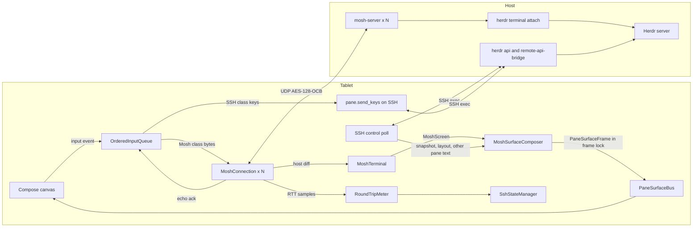

# Plan: Mosh UDP backbone (issue #22)

This plan gives the design and the delivery order for
[issue #22](https://github.com/ToxicBakery/BisonHerdr/issues/22). The user decided to build the full Mosh
path. The plan uses `main` at `ad4af8f`, upstream Herdr 0.9.5 at
[`2713feb`](https://github.com/herdrdev/herdr/tree/2713feb56e9c9db33992db0a262c68f7426d46dd), and
`mosh-server` 1.4.0. Each decision gives the evidence, the result, and the reasons.

This is revision 2. Review round 1 and the decisions of the user changed it. The section
[Changes after review round 1](#changes-after-review-round-1) lists each change.

## Summary of decisions

| # | Question | Decision |
|---|----------|----------|
| 1 | What `mosh-server` runs | One `mosh-server` for each visible pane. It runs `herdr terminal attach <terminal_id>` after a UDP gate. The Mosh screen is exactly one Herdr pane. The app never takes a pane from a different attach client. |
| 2 | Language and place | Pure Kotlin. A new KMP module `:core:mosh` holds the wire format, the SSP, the emulator, the frame composer, and the key encoder. `:platform:android:ssh` holds the start over SSH, the Android network bind, and the engine. The plan has no Rust, JNI, NDK, or Zig. |
| 3 | VT emulator | A new Kotlin emulator for the small set of controls that `mosh-server` sends in its diffs. Its screen state is copy-on-write. |
| 4 | Crypto | BouncyCastle `OCBBlockCipher` with `AESEngine.newInstance()`. BouncyCastle 1.86 is already a dependency. |
| 5 | Keys | Hybrid. Text, Enter, Backspace, Tab, Esc, and Ctrl keys go over Mosh. Keys that depend on the mode of the pane go over SSH `pane.send_keys`. An order barrier keeps the two paths in sequence. |
| 6 | Integration | `negotiateBackbone` returns `ActiveBackbone.MoshUdp` only after a decrypted reply and a successful attach. When no reply comes in 3 s, the app uses the SSH endpoint path and shows the reason. The SSH control lane of a Mosh machine reconnects lazily in the background, and 5 s after a network change in the foreground. A flag keeps Mosh off in release builds until the last pull request. |
| 7 | Session policy | Short and polite. No `--takeover`. The app detaches 3 minutes after it goes to the background. `MOSH_SERVER_NETWORK_TMOUT=900`. The UI shows the size lock. |
| 8 | Tests | JVM tests against a real local `mosh-server`, and key tests against a real Herdr 0.9.5 binary, on Linux CI. |

The plan has 12 pull requests and 29.5 engineer-days. An independent clean-room review before the last pull
request adds about 1 day. Issue #22 gives 29 engineer-days for a Rust path with fewer features.

## Decisions of the user

| Topic | Decision |
|-------|----------|
| Keys | Hybrid, with an order barrier. Mode-dependent keys go over SSH. While SSH is down after a network change, these keys go over Mosh in CSI form as a best effort. |
| Network change | Lazy reconnect. Mosh panes continue with no SSH. The app opens SSH again at the first SSH-only operation, or when the app comes to the foreground. |
| Network change in the foreground | A visible app must not show old agent status and layout. When the default network changes in the foreground, the app reconnects the control lane after the new network is stable for 5 s. |
| Kitty mode | Esc and the Ctrl keys stay on Mosh. A kitty flag 1 program gets their legacy bytes. This is a known limit with a test. Shift+Enter and the other modified keys stay on SSH. |
| Session policy | No `--takeover`. A pane in use by a different attach client uses the `pane.read` path and shows a mark. Detach 3 minutes after the app goes to the background. `MOSH_SERVER_NETWORK_TMOUT=900`. Show the size lock. |
| Herdr version | 0.9.0 or later. |
| Speculative local echo | Out of scope. It becomes a follow-up issue. |
| Target SDK 37 | A separate pull request raises the target SDK and adds `ACCESS_LOCAL_NETWORK`. The Mosh UDP socket to a LAN host also needs that permission on target 37. |

## Evidence

### How the app gets a pane today

The SSH path does not open a Herdr client connection. It polls.

- `RealHerdrSshClient` keeps two persistent `sh` channels for each machine: `WorkerLane.Input` and
  `WorkerLane.Poll` (`RealHerdrSshClient.kt:156-159`, `2122-2147`). Pull request #12 added these lanes.
- The poll loop runs each 400 ms (`LIVE_POLL_INTERVAL_MS`, `RealHerdrSshClient.kt:2995`). It runs
  `herdr api snapshot`, and one `herdr remote-api-bridge` call for each visible pane with
  `pane.read { source: "visible", format: "ansi" }` (`RealHerdrSshClient.kt:691-704`, `1621-1633`).
- `buildCompositeSurfaceFrame` parses the ANSI text of each pane into one `PaneSurfaceFrame`
  (`RealHerdrSshClient.kt:2523-2635`).
- A keystroke goes out as `pane.send_text`, `pane.send_keys`, or `pane.send_input` on the input lane. One
  `pane.read` of the pane follows it (`RealHerdrSshClient.kt:903-944`).
- The app never runs `herdr remote-client-bridge`. `setSurfaceLease` only writes
  `client_shell.surface.set` to the debug log (`SshTransportManager.kt:364-372`).
- Seven functions publish frames on `PaneSurfaceBus` (see [decision 6](#decision-6-integration)). Pull
  request #39 adds a frame lock for each machine (`MachineFrames`, `SshBackend.withFrameLock`).
- The pane object of `herdr api snapshot` has a `terminal_id` field
  ([`panes.rs:499-501`](https://github.com/herdrdev/herdr/blob/2713feb56e9c9db33992db0a262c68f7426d46dd/src/api/schema/panes.rs#L499-L501)).
  The app model `ClientShellPane` does not read it yet (`ShellSnapshotModels.kt:130-141`).

### How Herdr shows a terminal to a client

- A plain `herdr` command starts a server or attaches a thin client
  ([`main.rs:802`](https://github.com/herdrdev/herdr/blob/2713feb56e9c9db33992db0a262c68f7426d46dd/src/main.rs#L802)).
  The thin client gets rendered frames from the server and copies them to its terminal
  ([`client/mod.rs:1-13`](https://github.com/herdrdev/herdr/blob/2713feb56e9c9db33992db0a262c68f7426d46dd/src/client/mod.rs#L1-L13)).
- The `TerminalHello` message of a thin client has the size, the cell size, and the mouse mode only
  ([`wire.rs:466-473`](https://github.com/herdrdev/herdr/blob/2713feb56e9c9db33992db0a262c68f7426d46dd/src/protocol/wire.rs#L466-L473)).
  It has no UI configuration.
- In a black-box test, `mosh-server new -- env HERDR_CONFIG_PATH=tablet.toml herdr` showed pane borders.
  `tablet.toml` set `pane_borders = "off"` and `pane_outer_borders = false`. Thus the server drew the
  chrome from its own configuration, and the tablet configuration in `01-core-app-design.md:480` had no
  effect.
- `herdr terminal attach <terminal_id> [--takeover]` attaches a client to one terminal
  ([`cli.rs:555-565`](https://github.com/herdrdev/herdr/blob/2713feb56e9c9db33992db0a262c68f7426d46dd/src/cli.rs#L555-L565)).
  The server draws only that terminal, with no chrome
  ([`render_stream.rs:578`](https://github.com/herdrdev/herdr/blob/2713feb56e9c9db33992db0a262c68f7426d46dd/src/server/render_stream.rs#L578)).
- At attach, the server resizes the terminal to the size of the client and locks that size
  ([`headless.rs:1817-1838`](https://github.com/herdrdev/herdr/blob/2713feb56e9c9db33992db0a262c68f7426d46dd/src/server/headless.rs#L1817-L1838)).
  The lock goes away when the attach client exits
  ([`headless.rs:972-980`](https://github.com/herdrdev/herdr/blob/2713feb56e9c9db33992db0a262c68f7426d46dd/src/server/headless.rs#L972-L980)).
- One terminal has one attach client. Without `--takeover`, a second attach fails with "already has an
  attached client; retry with --takeover". With a read in progress, an attach fails with "has a read in
  progress; retry"
  ([`headless.rs:1770-1811`](https://github.com/herdrdev/herdr/blob/2713feb56e9c9db33992db0a262c68f7426d46dd/src/server/headless.rs#L1770-L1811)).
- In an attach client, Ctrl+B is a prefix. Ctrl+B and then `q` detaches. Ctrl+B two times sends one
  Ctrl+B. A complete bracketed paste skips this prefix rule
  ([`attach.rs:63-125`](https://github.com/herdrdev/herdr/blob/2713feb56e9c9db33992db0a262c68f7426d46dd/src/client/attach.rs#L63-L125)).
- The server sends a complete bracketed paste to the pane as one paste. It sends other attach input as raw
  bytes
  ([`pane_input.rs:187-200`](https://github.com/herdrdev/herdr/blob/2713feb56e9c9db33992db0a262c68f7426d46dd/src/server/pane_input.rs#L187-L200)).
- `pane.send_keys` encodes each key with the key modes of the pane, for example DECCKM and the kitty
  keyboard flags
  ([`panes.rs:2035-2057`](https://github.com/herdrdev/herdr/blob/2713feb56e9c9db33992db0a262c68f7426d46dd/src/app/api/panes.rs#L2035-L2057),
  [`api_helpers.rs:34-46`](https://github.com/herdrdev/herdr/blob/2713feb56e9c9db33992db0a262c68f7426d46dd/src/app/api_helpers.rs#L34-L46)).
- Herdr 0.5.10 added terminal attach. Herdr 0.6.3 added scrollback with the mouse wheel and PageUp. Herdr
  0.9.0 added the `ui.mouse_capture` rule and one paste for a multi-line paste
  ([`CHANGELOG.md`](https://github.com/herdrdev/herdr/blob/2713feb56e9c9db33992db0a262c68f7426d46dd/CHANGELOG.md)).
- Direct terminal attach works on Unix hosts only
  ([`platform/mod.rs:318`](https://github.com/herdrdev/herdr/blob/2713feb56e9c9db33992db0a262c68f7426d46dd/src/platform/mod.rs#L318)).
- Herdr publishes `herdr-linux-x86_64` for each release, for example v0.9.5. CI can download it.

### Black-box tests against `mosh-server` 1.4.0

Two independent test clients in scratch directories talked to a real local `mosh-server` and to an isolated
Herdr 0.9.5 server. The clients are not in the repository. Each test used `127.0.0.1`.

1. The server accepted the first packet of the client. The first authentic reply came after 5 ms.
2. Keystrokes, a resize, and a change to a new client socket (a new local port) worked. After the socket
   change, the next reply came in 12 ms.
3. With `herdr terminal attach`, the Mosh screen held only the pane shell, at the 60x12 size that the
   client sent.
4. When the application exits, the server sends the target state `2^64 - 1`.
5. While the client sent nothing, the server sent about one datagram each second for about 40 s. Then it
   stopped. One datagram from a new socket started the replies again.
6. With `MOSH_SERVER_NETWORK_TMOUT=5`, a server with a silent client exited between 3 s and 9 s. A server
   with no client at all exits about 60 s after its start.
7. The server changes `ESC O A` to `ESC [ A` when its application did not set DECCKM. Its application is
   the attach client, not the pane program. A curses program in keypad mode got `ESC [ A` as three bytes,
   not `KEY_UP`. Thus the tablet cannot encode the arrow keys for the pane over Mosh.
8. A kitty-mode program got `CSI 13;2u` for Shift+Enter through `pane.send_keys`.
9. A bracketed paste with 400 `0x02` bytes reached the pane as one paste with all 400 bytes.
10. A census of the host bytes from random output, `htop`, and `vim` found only the controls in the
    table of [decision 3](#decision-3-the-vt-emulator).
11. A truecolor full paint at 250x80 gave 729 KB of host bytes in one instruction. A different paint gave
    180 fragments of 1252-byte datagrams.
12. A client that always sent the acknowledged state 0 got diffs from state 1, not a full paint. A resize
    to the same size gave only an echo ack. A resize to a new size gave a full paint.
13. A program in `mosh-server` asked for the cursor position (`CSI 6n`) after each test character. The
    server answered from its own screen with glibc 2.43. The regional indicators U+1F1E6 to U+1F1FF had
    width 1. U+00AD had width 1. U+1160 and U+1E5EE had width 0.
14. With an attach failure, `mosh-server` still replied. It sent the error text and then the end state.
15. `mosh-server new -- sh -c 'IFS= read -r _ && exec <command>'` ran the command only after the first
    authentic reply and one gate key from the client.

### The Zig build of `libghostty-vt`

- The vendored copy in `8cf8063` cannot build from a clean checkout. The `.gitignore` rule `**/build/`
  dropped `vendor/libghostty-vt/src/build/`, and `build.zig:4` imports `src/build/main.zig`.
- The upstream Ghostty source at the vendored commit `44f2a44d` fails with Zig 0.17.0. Its `build.zig:27`
  uses `b.build_root`, which Zig 0.17 removed. Its `requireZig` check refuses all versions other than 0.16.
- With Zig 0.16.0, the same source built `libghostty-vt.so` for `aarch64-linux-android` in 108 s with a
  cold cache. The stripped library is 1.9 MB (0.8 MB with gzip) for one ABI.
- The C API in `terminal.h` has no function that copies a terminal state.

## Decision 1: What `mosh-server` runs

**Decision.** Start one `mosh-server` for each visible pane of the tablet. Each server runs a gate and
then `herdr terminal attach <terminal_id>`. The Mosh screen is then the screen of one Herdr pane, at the
size that the tablet gives to that pane.

**Options.**

| Option | Result |
|--------|--------|
| A. `mosh-server new -- herdr` (a full thin client, the design in `01-core-app-design.md:455-482`) | Rejected. In the test, the server drew its own chrome from its own configuration. The app must cut panes out of one screen with rectangles from a separate `pane.layout` call. A focus RPC on `herdr.sock` moves all clients of the user. |
| B. `mosh-server new -- herdr terminal attach <terminal_id>`, one for each visible pane | **Selected.** The test showed the exact pane screen with no chrome. The tablet keeps control of the layout. Herdr keeps the pane state, so a Mosh session is a view only. |
| C. `mosh-server new -- herdr remote-client-bridge` | Rejected. The bridge sends a `bincode` stream, not a terminal screen. |

**The start script.** The app runs one script on a one-shot `exec` channel for each batch of panes. The
pull request writes the exact text and its tests. The script has these parts:

- Use the server path of the machine: `HostMachine.moshServerPath`, else `mosh-server`.
- Use `-l LANG=C.UTF-8`. When the output has the locale error of `mosh-server`, run the batch again with
  `-l LANG=en_US.UTF-8`.
- Use `-s` only when `SSH_CONNECTION` is set. Then the server binds to the address that the SSH client
  used.
- Set `MOSH_SERVER_NETWORK_TMOUT=900`.
- Use the port range of the machine (`HostMachine.DEFAULT_MOSH_UDP_PORT_RANGE` is `60000:61000`).
- Run this command in each server:
  `sh -c 'IFS= read -r _ && exec herdr [--session <name>] terminal attach <terminal_id>'`.
  The command waits for one gate key, so no attach occurs before UDP works.
- Do not use `--takeover`.
- Write the pane ID before each output line, and send stderr to stdout. The app reads
  `MOSH CONNECT <port> <key>` and `[mosh-server detached, pid = <pid>]` for each pane.
- Keep the PIDs in `$HOME/.cache/bison-herdr/mosh-<installId>.pids`. `installId` is the `device.id` marker
  of `MachineStore` (`MachineStore.kt:261-298`). On a full connect, stop the PIDs of the last run of this
  install first.
- Stop a PID only when `ps -p <pid> -o args=` shows `mosh-server`. After a host restart, the system can give
  an old PID to a different process.

**Attach check.** A decrypted reply proves only that UDP works. For each session, the client does these
steps:

1. Send the first state with the size of the pane. Send it again each 250 ms. Wait for the first authentic
   reply for at most 3 s.
2. Send the gate key `\n`.
3. Wait 500 ms. The attach works when the session sends no end state and the screen has no text
   "terminal attach failed".
4. When the screen has "already has an attached client", stop the session. The pane uses the
   `pane.read` path and shows the mark "pane in use on another device". Do not try again for that pane
   until it leaves the screen. This text also has the word "retry", so check it first.
5. When the screen has "has a read in progress", start that session again. Do this at most 3 times,
   200 ms apart.

**Size.** The tablet computes the cell rectangle of each pane from `pane.layout`, scaled to its viewport,
as `buildCompositeSurfaceFrame` does today. The client sends that size before the gate and after each
change. Herdr then resizes the pane and locks the size while the attach client runs. Each Mosh pane shows
a lock mark with the text "size set by this tablet".

**What stays on SSH.**

| Operation | Path with Mosh |
|-----------|----------------|
| Screen of a visible pane | Mosh |
| Text, Enter, Backspace, Tab, Esc, Ctrl keys, paste, and mouse events | Mosh |
| Arrows, function keys, and other mode-dependent keys | SSH `pane.send_keys` ([decision 5](#decision-5-keys-and-input)) |
| Pane size | Mosh resize. Herdr locks the size. |
| Scrollback of a pane | Mosh. The attach client scrolls on a wheel event. |
| A composer prompt to a pane with a Mosh session | Mosh, as a bracketed paste and `\r` |
| A prompt to a named agent (`agent.prompt`) | SSH |
| Snapshot, layout, tabs, agents, agent status | SSH poll each 1 s, with no `pane.read` for a pane with a Mosh session |
| Focus, split, close, zoom, rename, split ratio | SSH (`herdr remote-api-bridge`) |
| Start of `mosh-server`, and a stop by PID | SSH |
| Detach of an attach client | Mosh (`0x02` and then `q`) |
| Agent text for notifications | The Mosh screen for a pane with a Mosh session. Else `pane.read`. |

**Limits.**

- Herdr 0.9.0 or later. The app reads `herdr --version` before it starts a session.
- A Unix host. Direct attach does not work on Windows.
- No ProxyJump. UDP cannot pass the SSH bastion. Such a machine uses the SSH endpoint path with the reason
  "Mosh cannot pass a ProxyJump bastion".
- At most 8 Mosh sessions for each machine. A pane over the limit uses `pane.read` on SSH.

## Decision 2: Language and place

**Decision.** Write the Mosh client in Kotlin. Put the logic in a new KMP module `:core:mosh`. Put the
Android parts in `:platform:android:ssh`.

| Criterion | Kotlin in `:core:mosh` | Rust prototype over JNI |
|-----------|------------------------|-------------------------|
| Build | Gradle only | `cargo-ndk`, rustup Android targets, a Gradle native step, and Zig 0.16 for the emulator |
| CI time | `apt-get install mosh` (about 15 s), a Herdr download, and JVM tests | A Rust and Zig build for each ABI (108 s cold for `libghostty-vt` alone), and caches |
| Tests with a real `mosh-server` | JVM unit tests on Linux CI | Cargo tests for the codec. The JNI path needs a device or a host build of the library. |
| APK size | About 0.2 MB of DEX. BouncyCastle is already in the APK. | 1.9 MB stripped for each ABI for `libghostty-vt`, plus the Rust library |
| Module rules | `:core:mosh` imports no `:platform:*` module | The JNI bridge must live in `:platform:*` |

**Module layout.**

- `:core:mosh` targets `android` and `jvm`, as the other `:core:*` modules do. `commonMain` holds all
  logic and takes the time from an injected `TimeSource`.
- Two platform parts use JVM APIs: the OCB cipher (BouncyCastle) and zlib (`java.util.zip`). Declare each
  as a common interface with an `expect fun` factory, as `:core:common` does (`ClipEntries.kt:6`). Do not
  use an `expect class`, because Kotlin marks it as Beta with a warning.
- Put the `actual fun` factories and the UDP port in `src/jvmShared/kotlin`. Add that directory to both
  `jvmMain` and `androidMain` with `kotlin.srcDir`. When the build or the IDE import shows a problem, keep
  two copies instead.
- The UDP port class `JvmDatagramPort` uses a plain `java.net.DatagramSocket`. Android can bind that socket
  to a network with `Network.bindSocket(DatagramSocket)`. The port takes a `socketBinder` function from the
  platform.

## Decision 3: The VT emulator

**Decision.** Write a new Kotlin emulator, `MoshTerminal`, for the controls that `mosh-server` sends in
its diffs. Do not write a full xterm emulator.

The server runs the application in its own emulator. It sends a diff that changes the old client screen
into the new screen. Thus the client never sees the raw output of the application. It sees only the
controls that the server uses to draw a diff, and the census found a small, fixed set.

| Option | Result |
|--------|--------|
| New Kotlin emulator for the diff controls | **Selected.** Small, JVM-testable, and copy-on-write for the received states. |
| `libghostty-vt` over Zig and JNI (MIT) | Rejected. It needs Zig 0.16 exactly, a JNI bridge, and 1.9 MB for each ABI. Its C API cannot copy a state. |
| JediTerm (Apache-2.0 option of an LGPLv3 or Apache-2.0 dual license) | Rejected. It is a full xterm emulator for a Swing UI. We found no API for a cheap copy of a screen state. |
| ConnectBot `termlib` (Apache-2.0) over libvterm (MIT) | Rejected. It needs JNI and an NDK build, and it brings its own Compose view. |
| Termux `terminal-emulator` | Rejected. The `termux-app` repository is GPLv3-only. Its exception gives Apache-2.0 only to the code from Jackpal Android-Terminal-Emulator, so the license of each Termux change is not clear. It is also a full emulator with no state copy. |

**Controls that the emulator must apply** (census of `mosh-server` 1.4.0 host bytes):

| Kind | Controls |
|------|----------|
| C0 | BEL `0x07`, BS `0x08`, LF `0x0A`, CR `0x0D` |
| Cursor | CUP `CSI row;col H` and `CSI H` |
| Erase | EL `CSI K`, ED `CSI 2 J` (in a full repaint), ECH `CSI n X` |
| Scroll | DECSTBM `CSI top;bottom r` and `CSI r`. LF at the bottom margin scrolls the region up. |
| SGR | `0`, `1`, `2`, `3`, `4`, `5`, `7`, `8`, `9`, `21`, `30`-`37`, `40`-`47`, `38;5;n`, `48;5;n`, `38;2;r;g;b`, `48;2;r;g;b`. Each SGR starts with `0`. |
| Modes | `?25` cursor, `?5` reverse video, `?1000` `?1001` `?1002` `?1003` `?1004` `?1005` `?1006` `?1015` mouse, `?2004` bracketed paste |
| OSC | `0`, `1`, `2` (title), `52` (clipboard), each with BEL at the end |
| Text | UTF-8, wide cells (2 columns), zero-width characters on the cell before, autowrap at the right margin |

**Rules for the emulator.**

- Apply the standard ECMA-48 and xterm function of each control in the table. Accept the other SGR values
  (`22`-`29`, `39`, `49`, `90`-`97`, `100`-`107`) with the xterm function, because a different server
  version can send them.
- Ignore each other control, and count it in a debug counter. Never throw on input from the network.
- Keep the xterm "last column" state: a character in the last column sets a wrap flag. The next printable
  character wraps. CR, BS, and CUP clear the flag. The emulator oracle test checks this rule.
- Keep the title, the bell count, the clipboard writes, and the modes in the state. A clipboard write needs
  a user option (default off), because a host can put text on the device clipboard.

**Width rules.** The server computes each width with its own libc. The client must agree.

- Width 2: the code points with East_Asian_Width W or F. Do not add a separate emoji rule.
- Width 0: General_Category Mn, Me, and Cf, except U+00AD. Also U+200B, the medial and final jamo
  U+1160 to U+11FF, and U+D7B0 to U+D7FF.
- Width 1: all other code points, also U+00AD and the regional indicators U+1F1E6 to U+1F1FF.
- Use the newest Unicode data files at the time of the pull request. The width probe on the CI host is the
  judge.

**State model.** `MoshScreen` is an immutable value: a list of rows, the cursor, the pen, the modes, and
the title. A row is an immutable array of cells. `MoshTerminal.apply(screen, hostBytes)` returns a new
screen. It copies the row list and only the rows that the diff changes. Each kept state thus costs one row
list, not a full screen.

**Recovery.** The protocol has no request for a full paint (black-box fact 12). The "Refresh pane" action
sends a resize to one row less, and then the correct size, over Mosh. The second resize gives a full paint
and needs no SSH. The pane program gets two size changes, and most programs then draw their screen again.

## Decision 4: Crypto and wire format

**Crypto.** Use `org.bouncycastle.crypto.modes.OCBBlockCipher` with two `AESEngine.newInstance()` values.
The constructor `new AESEngine()` is deprecated in BouncyCastle 1.86 and gives a warning. Use a 12-byte
nonce and a 128-bit tag. BouncyCastle 1.86 (`bcprov-jdk18on`, the MIT-style Bouncy Castle Licence) is
already in `libs.versions.toml`. Android and the JDK have no public OCB in their JCA providers. The tests
check BouncyCastle against the sample results in Appendix A of
[RFC 7253](https://www.rfc-editor.org/rfc/rfc7253).

**Names.** The wire has field numbers, not names. The code of this app uses its own names:

| Field | Our name | Role (from black-box tests) |
|-------|----------|-----------------------------|
| 1 | `version` | Always 2 |
| 2 | `fromState` | The state that the diff starts from |
| 3 | `toState` | The state that the diff makes |
| 4 | `ackState` | The newest state of the peer that the sender has |
| 5 | `keepState` | The oldest state that the sender can still use as `fromState` |
| 6 | `diff` | The diff |
| 7 | `noise` | Random bytes with a random length |

**Wire facts.** Each fact has a source. P is the [Mosh paper](https://mosh.org/mosh-paper.pdf) (USENIX ATC
2012). B is a black-box test. M is the `mosh-server` banner and its man page. The prototype in `8cf8063` is
not a source (see [Clean-room rules](#clean-room-rules)).

| # | Fact | Source |
|---|------|--------|
| 1 | `mosh-server new` prints `MOSH CONNECT <port> <key>` on stdout and `[mosh-server detached, pid = <pid>]` on stderr. The key is 22 base64 characters with no `=` at the end: 16 bytes. | B, M |
| 2 | A datagram is an 8-byte header, the OCB ciphertext, and a 16-byte tag. Header bit 63 is the direction: 0 from the client, 1 from the server. Bits 0-62 are the sequence number. The header is big-endian. | B |
| 3 | The nonce is 4 zero bytes and then the 8-byte header. The mode is AES-128-OCB with no associated data. | B, P 2.2 |
| 4 | The plaintext is a 16-bit timestamp (milliseconds modulo 65536), a 16-bit timestamp reply (`0xFFFF` for none), and one fragment. | B, P 2.2 |
| 5 | A fragment is a 64-bit instruction ID, a 16-bit fragment number with bit 15 as the "final" flag, and the content. The content of all fragments of one ID, in order, is the zlib stream of one instruction. | B |
| 6 | The instruction is a protobuf message with fields 1 to 7 of the names table. The numbers are unsigned varints. | B |
| 7 | The client diff has field 1 repeated. Each entry has field 2 (keys: field 4, bytes) or field 3 (size: field 5 columns, field 6 rows). | B |
| 8 | The server diff has field 1 repeated. Each entry has field 2 (bytes: field 4), field 3 (size: fields 5 and 6), or field 7 (echo ack: field 8). | B |
| 9 | The host bytes are a diff between two screens, not the raw output of the application. | P 2.3, B |
| 10 | The server sends to the source address of each authentic datagram with a sequence number higher than all before. The client keeps one sequence counter for the session, also across sockets. | P 2.2, B |
| 11 | The target state `2^64 - 1` tells that the session ended. | B |
| 12 | The server sends a heartbeat about each 3 s while it gets datagrams. It stops about 40 s after the last client datagram. `MOSH_SERVER_NETWORK_TMOUT` stops a server with a silent client. | B, P 2.2 |
| 13 | The RTT estimate is the TCP algorithm with a minimum RTO of 50 ms. The timestamp reply includes the time that the peer held the timestamp. | P 2.2 |
| 14 | Delayed ack: 100 ms. The server waits a collection interval of 8 ms after the first change. Minimum frame interval: SRTT / 2. Maximum frame rate: 50 Hz. | P 2.3 |
| 15 | The echo ack is the newest user state that the application of the server got at least 50 ms before. Its value is a user state number. | P 3.2, B |
| 16 | The server changes `ESC O A`-`D` to `ESC [ A`-`D` when its application did not set DECCKM. | B |
| 17 | The server can diff from a state that it sent but that the client did not acknowledge. | B |

**Values that this plan selects.** These values are not from Mosh. They are the choices of this client.

| Value | Choice | Reason |
|-------|--------|--------|
| Maximum RTO | 1000 ms | A keystroke does not wait more than 1 s for a retransmission. |
| Maximum frame interval | 250 ms | The paper uses this value in its traces. |
| New socket after silence | 10 s with no authentic datagram | A NAT can drop the old port entry. A new local port gets a new entry. |
| UDP budget at connect | 3 s, with a send each 250 ms | A cellular RTT can be more than 1 s under load. |
| Received states kept | All states at or after the `keepState` of the server, at most 32 | The server can diff from a state that the client did not acknowledge (fact 17). |
| Size limits | 1024 fragments, 8 MiB after zlib | A 250x80 truecolor paint used 729 KB and 180 fragments (fact 11). Only an authentic packet gets to zlib. |

**Sender rules (client to server).** The user state is the list of the user events (keys and sizes). The
state number increases by one for each sent state that adds events.

1. A state with new events: `fromState` is the newest state that the server acknowledged. `toState` is the
   current state. The diff holds all events after `fromState`.
2. The real-server test with loss must prove that each event reaches the pane one time.
3. A heartbeat or an ack: `fromState` and `toState` are the newest state that the server acknowledged.
4. `keepState` is the newest state that the server acknowledged.
5. Send again after the RTO while the server did not acknowledge the current state.
6. Send a new user state at once when the last send is older than the frame interval. Else send it at the
   end of the interval. The frame interval is SRTT / 2, in the range 20 ms to 250 ms.

**Receiver rules (server to client).**

1. Drop each datagram that does not decrypt. Do not log its content.
2. Take the timestamp, the timestamp reply, and `ackState` from each authentic datagram. Do this also when
   the client cannot apply the diff.
3. Apply the diff only when the client has `fromState` and does not have `toState`. Keep the new state.
4. Remove the states before the `keepState` of the server.
5. Acknowledge the newest state after the delayed ack interval, or at once with the next user state.
6. Take an RTT sample from each timestamp reply that is less than 5 s old.

## Decision 5: Keys and input

**Decision.** Hybrid keys. The tablet sends a key over Mosh only when its bytes do not depend on the
modes of the pane. Each other key goes over SSH `pane.send_keys`, and Herdr encodes it for the pane.

**Why.** The attach client sends raw bytes to the pane. The tablet sees only the modes of the attach
client in the Mosh screen, not the modes of the pane. A curses program in keypad mode thus got `ESC [ A`
as three bytes (black-box fact 7). `pane.send_keys` encodes the key with the DECCKM and kitty flags of the
pane (black-box fact 8).

**Classes.**

| Class | Keys | Path and bytes |
|-------|------|----------------|
| Mosh | Text from the keyboard or the composer | UTF-8 bytes |
| Mosh | Paste | Always `CSI 200~` text `CSI 201~`. Herdr wraps the paste again for the pane. Do not double `0x02` in a paste. |
| Mosh | Enter, Backspace, Tab, Esc | `\r`, `0x7F`, `\t`, `0x1B` |
| Mosh | Ctrl+A to Ctrl+Z, Ctrl+Space, Ctrl+`[` `\` `]` `^` `_` | The C0 byte. Ctrl+B is `0x02 0x02`, because the attach client uses `0x02` as a prefix. |
| Mosh | Mouse click and wheel | SGR mouse events. The attach client changes them for the pane, or scrolls the scrollback. |
| SSH | Arrows, Home, End, PageUp, PageDown, Insert, Delete, F1 to F12 | `pane.send_keys` with the key names of `mapKeyEventToHerdrKeySpec` (`RealHerdrSshClient.kt:1674`) |
| SSH | Shift+Tab, Shift+Enter, Ctrl+Enter, and each key with Alt, Super, or a Ctrl or Shift that is not in the Mosh rows | `pane.send_keys` |

**Known limit: kitty mode.** Kitty keyboard flag 1 changes the bytes of Esc and of the Ctrl keys to
`CSI u` forms. Over Mosh, a kitty flag 1 program gets the legacy bytes, for example `0x1B` for Esc and
`0x01` for Ctrl+A. Most programs accept the legacy bytes. A test on a real Herdr records the bytes that
such a program gets, so that a change of this behavior shows. Shift+Enter and the other modified keys stay
on SSH, and Herdr encodes them for the pane.

**Order barrier.** One ordered input queue for each pane holds both classes.

1. A Mosh key goes into the Mosh user stream at once, when no SSH call is in flight for the pane. The
   queue records the user state number of its last byte.
2. Before an SSH key, the queue waits for an echo ack that is equal to or higher than that state number.
   The echo ack tells that the attach client got the bytes at least 50 ms before (fact 15). The attach
   client sends input to Herdr at once over its Unix socket.
3. When no echo ack comes in 1 s after the server acknowledged the state, the queue continues after that
   acknowledgment.
4. The queue then sends the SSH keys in one `pane.send_keys` call on the input lane. SSH keys that come
   during the wait go into the same call.
5. Later Mosh keys stay in the queue until the call returns, also when the call fails.
6. For a pane with a Mosh session, no `pane.read` follows the call. The Mosh screen shows the result.

**Latency cost.** RTT is the round trip time, and H is the run time of the Herdr command on the host.

| Case | Added delay |
|------|-------------|
| SSH key with no recent Mosh key | 1 RTT + H, the same as the SSH path today |
| SSH key just after a Mosh key | Up to 1 RTT + 50 ms for the echo ack, then 1 RTT + H |
| Mosh key just after an SSH key | The rest of the SSH call, then 0.5 RTT |
| Text with no SSH key near it | 0.5 RTT to the server, the normal Mosh delay |

A cursor move with the arrow keys thus has the delay of the SSH path today. Text, Enter, and the Ctrl keys
get the Mosh delay. Auto-repeat of an arrow key merges into one call for each round trip.

**SSH lane closed.** After a network change, the SSH control lane can be closed (decision 6). Then an SSH
key goes over Mosh at once, in the xterm form for a terminal with no special modes. Examples: `CSI A` for
Up, `CSI 1;5C` for Ctrl+Right, `CSI 5~` for PageUp, `CSI Z` for Shift+Tab, and `ESC x` for Alt+x. This
is a best effort: a curses program in keypad mode does not read `CSI A` as an arrow. The key also starts
the lazy reconnect. When the SSH lane is open again, the queue uses the SSH path again.

## Decision 6: Integration

**Connect.** `SshTransportManager.runConnectSteps` stays the same (`SshTransportManager.kt:266-303`).
`RealSshBackend.negotiateBackbone` (`RealSshBackend.kt:134-141`) gets a Mosh branch:

1. When the flag is off or the mode is `SshEndpointOnly`, return `SshEndpoint` as today.
2. When the route has a bastion, return `SshEndpoint` with the bastion reason.
3. When UDP failed on this network to this host in the last 10 minutes, return `SshEndpoint` with the
   stored reason. The key of the memory is the Android network and the host IP address.
4. Check the server path and `herdr --version` in one batch. When a check fails, return `SshEndpoint` with
   the reason, for example "Herdr 0.8.2 is too old for Mosh (needs 0.9.0)".
5. Read the snapshot. Find the visible panes and their `terminal_id` values.
6. Run the start script for the visible panes. Parse the port, the key, and the PID of each pane.
7. Open a `MoshConnection` for each pane to the IP address of the SSH socket peer, not to a new DNS result.
8. Do the attach check of decision 1 for each session.
9. Return `ActiveBackbone.MoshUdp` when the focused pane passes the check. The `rttMs` is the first
   measured RTT. A pane that fails the check uses the `pane.read` path with its mark.
10. When no session gets an authentic reply in 3 s, stop the servers by PID over SSH. Store the UDP failure
    for this network. Return `SshEndpoint` with the reason "No UDP reply from `<ip>:<port>` in 3 s. The
    network can block UDP."
11. A `MoshOnly` machine returns `null` in the case of step 10. The manager shows the same text in
    `NeedsUserCause.Other`.

No pane gets a size lock on a network that blocks UDP, because the gate key never arrives. The servers
exit about 60 s after their start with no client, also when the stop by PID fails.

`ActiveBackbone.MoshUdp` gets `sessionCount`, with a default value so that old JSON still loads. A new
`MoshMachineState` in `SshStateManager` holds the state of the control lane: `Open`, `Offline`, or
`NeedsLogin`. It also holds a mark for each pane: `Mosh`, `InUseElsewhere`, `OverLimit`, or `Failed`.

**Frames.** For a Mosh machine, the engine is the only source of frame content. It publishes in the frame
lock of the machine (`backend.withFrameLock`, pull request #39), at most each 16 ms. Each current publisher
gets a rule:

| Publisher on `main` | Today | Rule for a Mosh machine |
|---------------------|-------|-------------------------|
| `RealHerdrSshClient.resizeViewport` (`RealHerdrSshClient.kt:647-664`) | Publishes the cached frame at the new size | Gives the viewport to the engine. Publishes nothing. |
| `refreshSnapshotAndSurface` (`676-818`) | Publishes the frame of the poll | Control mode. Publishes the snapshot only. Gives the layout and the `pane.read` text of the other panes to the engine. Records no poll time. |
| `sendPaneInput` (`977-1033`) | Publishes an optimistic edit | No optimistic edit. The input queue of decision 5 takes the event. |
| `republishCachedSurface` (`1429-1441`) | Publishes after a scroll | A Mosh pane scrolls over Mosh. For a different pane, gives the new text to the engine. |
| `updateFocusedPaneSurfaceFromInput` (`1459-1487`) | Publishes the `pane.read` after an input | No `pane.read` after a key to a Mosh pane. For a different pane, gives the text to the engine. |
| `applyOptimisticPaneFocus` (`1489-1512`) | Publishes a focus change | The engine applies the focus. |
| `SshTransportManager.setSurfaceLease` (`SshTransportManager.kt:364-397`) | Publishes a copy with a new epoch | Keep. In the frame lock, it copies the newest frame on the bus, which is an engine frame. |

The old `MoshUdpEngine.synthesizeAndPublishFrame` (`MoshUdpEngine.kt:257-353`) goes away. Pull request 8
starts after pull request #39 merges. When #39 does not merge, pull request 8 adds the lock first.

**RTT.** Each session gives its RTT samples to the current `RoundTripMeter` (`RoundTripMeter.kt:25-70`).
The meter publishes at most one value each second through `SshStateManager.setRoundTripTime`. The
control-mode poll of a `MoshUdp` machine records no poll time, so that the two kinds of samples do not mix
(`RealHerdrSshClient.kt:297`, `703`, `821-823`). The meter starts a new average when the backbone changes.
The UI shows "RTT n ms" for `MoshUdp` and "poll n ms" for `SshEndpoint`. When no authentic datagram came
for 5 s and the session is not parked, the UI shows "Last reply n s ago".

**Lazy control lane.** For a Mosh machine, `SessionSupervisor` gets a lazy mode with these states. The
UI state of `MoshMachineState` follows them: `Live` is `Open`, and `NeedsLogin` is `NeedsLogin`. All
other states are `Offline`.

| State | The supervisor | Next state |
|-------|----------------|------------|
| `Live` | The SSH session is open. The control poll runs. | `Dormant` when the session closes. `NetworkSettle` on a network change in the foreground. |
| `Dormant` | No session and no attempt. The control poll pauses. The UI shows "control lane offline", and the agent status shows as old. | `Reconnecting` on a trigger. `NetworkSettle` on a network change in the foreground. |
| `NetworkSettle` | The app is in the foreground, and the default network changed. A 5 s timer runs. | `NetworkSettle` again with a new timer on each new network change. When the timer ends: a liveness check from `Live`, or `Reconnecting` from `Dormant`. `Reconnecting` at once on a trigger. `Dormant` when the app goes to the background or the network is lost. |
| `Reconnecting` | The current loop of attempts with the current delays | `Live` on success. `NeedsLogin` when the login needs the user. `Dormant` when the app is in the background and no SSH-only operation waits. |
| `NeedsLogin` | No attempt. The UI shows "control lane needs login". | `Reconnecting` on a tap on the mark, on an SSH-only operation in the foreground, or when the app comes to the foreground. |

- A network change is `onAvailable` or `onLinkPropertiesChanged`. `onLost` gives `Dormant`.
- The liveness check is the current check: a keepalive message and one `exec true`, with a 3 s limit. When
  it fails, the supervisor goes to `Reconnecting`. A Tailscale address can keep the SSH session open, and
  then the check passes and the state stays `Live`.
- When the app comes to the foreground in `Live`, the manager runs the liveness check once.
- These triggers start a reconnect:
  - An RPC through `sendEndpointCommand`, or a prompt to a named agent.
  - An SSH key.
  - The start of a Mosh session for a new visible pane, or a `pane.read` for a pane with no Mosh session.
  - A tap on the mark, or the move of the app to the foreground.
- The paused control poll does not start a reconnect.
- In the background, no operation starts a reconnect that needs the user. The prompt queue keeps the
  prompts that need SSH.

**Network events.** `BisonSessionService` gives the `Network` object of each callback to the manager
(`BisonSessionService.kt:95-110`).

- `onAvailable` and `onLinkPropertiesChanged`: the engine opens a new socket for each Mosh session. It
  binds the socket with `Network.bindSocket` and sends one datagram at once. A parked session changes its
  socket at the next unpark.
- For a Mosh machine in the background, the manager does not run the SSH liveness check and does not
  call `reconnectNow`. In the foreground, the supervisor goes to `NetworkSettle`.
- `onLost`: the Mosh sessions stay open, and their timers continue. The manager closes the SSH sockets as
  today (`SshTransportManager.kt:618-630`). For a Mosh machine, the supervisor goes to `Dormant`.

**A login that needs the user.** A `TimeBound` key needs a biometric prompt at each login
(`RealSshBackend.kt:93-100`). Today, a reconnect that needs the user calls `stopForUser`, and
`releaseConnection` stops the Mosh session (`SshTransportManager.kt:122-130`, `318-336`). For a Mosh
machine:

- `onNeedsUser` keeps the Mosh sessions. It sets the control lane to `NeedsLogin`, and the UI shows the mark
  "control lane needs login".
- Split `releaseConnection` into `releaseControlLane` and the full release. `onNeedsUser` uses only
  `releaseControlLane`.
- The app shows no prompt in the background.
- The prompt shows when the user taps the mark, or when the user starts an SSH-only operation in the
  foreground. The move to the foreground starts an attempt, and that attempt can show the prompt.

**Background.** `setSurfaceLease(active = false)` parks the sessions. A parked session sends nothing, and
the server stops after about 40 s (fact 12). `client_shell.surface.set` has no effect on this path,
because the tablet has no thin client.

**Detach.** After 3 minutes in the background, the engine sends `0x02` and then `q` over each Mosh session.
It waits up to 2 s for the end state. The attach client exits, Herdr removes the size lock, and
`mosh-server` ends. A session with no reply ends after `MOSH_SERVER_NETWORK_TMOUT` (900 s). The next
foreground move reconnects SSH and starts new sessions.

**Target SDK 37.** On target SDK 37, a socket to a local network address needs `ACCESS_LOCAL_NETWORK`.
This applies to the SSH socket and to the Mosh UDP socket. A separate pull request raises the target SDK
and adds the permission. When the permission is denied, the engine returns `SshEndpoint` with the reason
"Local network access is off". The device test card of pull request 12 has a LAN host on a target 37 build.

**Feature flag.** Add `MoshFeatureFlag(enabled: Boolean)`.

- `app/android/src/release/.../DebugModule.kt` binds `false` until the last pull request.
- `app/android/src/debug/.../DebugModule.kt` binds the value of a "Mosh (experimental)" switch. Only
  debug builds show the switch in the settings screen.
- With the flag off, the code path is the code path of today. The tests construct the backend with the
  flag on.
- The last pull request binds `true` in release, removes the switch, and enables the `MoshOnly` choice
  (`ConfigureMachineScreen.kt:261`).

## Decision 7: Tests and CI

**Unit tests for each layer** (`:core:mosh` `commonTest`, virtual time):

- Wire: the RFC 7253 sample results and datagram round trips. Fragment split and join with order, loss,
  duplicates, and limits. The protobuf codec with unknown fields. The zlib limit. A bad tag, a short
  packet, and fuzz input.
- SSP: a simulated network that drops, delays, duplicates, and reorders datagrams. Assert these results:
  - The timers: heartbeat 3 s, delayed ack 100 ms, RTO bounds, and frame interval.
  - Each key reaches the server one time, and the screen converges.
  - The count of kept states stays in its bound.
  - A new socket opens after 10 s of silence, and the end state stops the session.
- Emulator: one test for each control in the decision 3 table. Tests for the wrap flag, wide characters,
  zero-width characters, and the scroll region. Golden diff streams from the real server.
- Keys: each row of the class table, the `0x02` rule, the paste rule, and the CSI forms of the SSH-lane
  fallback. The order barrier with a fake Mosh session and a fake SSH call: mixed sequences, a late echo
  ack, a failed call, and auto-repeat.
- Surface: layout to rectangles, colors to `CellData`, the cursor, the modes, and the pane marks.

**Real `mosh-server` tests** (`:core:mosh` `jvmTest`). A `MoshServerFixture` starts
`mosh-server new -i 127.0.0.1 -- <command>`, parses the banner, and stops the PID at the end. The server
picks a free port. The tests:

1. Handshake: the first authentic reply has version 2 and host bytes.
2. Keys: `echo` output shows on the emulator screen. A test with loss proves that each event arrives one
   time.
3. Size: a resize to a new size gives a full paint. "Refresh pane" gives a full paint.
4. Socket change: in the middle of the session, close the socket and open a new one on a new local port.
   The output continues. A second variant sends through a local UDP relay that changes its source port.
5. Blocked UDP: a `DatagramPort` that drops all datagrams. The connect fails after 3 s with the reason.
6. Silence and wake: no sends for 2 s, then one datagram from a new socket. The replies start again.
7. End of session: `exit` in the shell gives the end state.
8. Emulator oracle: run a seeded generator of random output in two sessions. Client A acknowledges each
   state. Client B never acknowledges a host state. B keeps all received states, because the server can
   diff from a state that B did not acknowledge (fact 17). The final screens of A and B must be equal.
9. Width probe: a program in `mosh-server` writes each test code point and asks for the cursor position
   (`CSI 6n`). The server answers from its own screen, and the program prints the width. The test
   compares each width with `CellWidth`. The sample has U+00AD, U+200B, U+200D, U+0301, U+20DD, U+FE0F,
   U+1160, U+11A8, U+D7B0, U+1E5EE, U+1F1E6, U+1F1FA, U+231A, U+4E00, U+AC00, U+FF21, U+1F600, U+1F3FB,
   U+00B7, and U+E000.
10. Large paint: a 250x80 truecolor full paint arrives with no limit error.

**Integration tests** (`:platform:android:ssh` `test`, JVM). They use the current `TestSshServer`, a real
`mosh-server`, and a fake `herdr` script in `TestSshServer.binDirectory`. The fake script answers
`--version`, `api snapshot` (a fixture with `terminal_id`), `remote-api-bridge`, and `terminal attach`. Its
attach runs `sh` with a known prompt, or prints a chosen attach error. The tests:

1. With the flag on, `negotiateBackbone` returns `MoshUdp` only after a decrypted reply and a successful
   attach. A key shows on the published `PaneSurfaceFrame`.
2. With the flag off, the result is the same as today.
3. Blocked UDP gives `SshEndpoint` with the reason, and no gate key goes out. `MoshOnly` gives the
   `NeedsUser` cause. A second connect on the same network uses the stored failure.
4. Attach errors: "already has an attached client" gives the `InUseElsewhere` mark and the `pane.read`
   path, with no second attempt. "has a read in progress" gives a second attempt. No test sends
   `--takeover`.
5. Frames: a `PaneSurfaceBus` that records each frame. Run the poll, a resize, Mosh keys, SSH keys, a
   scroll, and a focus change on a Mosh machine. Each frame for the machine on the bus must be an engine
   frame or its lease copy.
6. Network change in the background and in the foreground (see below).
7. Login that needs the user: a `TimeBound` key and a closed SSH session. In the background, no prompt
   shows, and the Mosh session continues. In the foreground, the attempt asks for the prompt.
8. Background: no datagram goes out while parked. After 3 minutes (virtual time for the timer), the engine
   sends the detach, and the fake attach exits.
9. The bastion route and an old Herdr version give the reasons.

**The network change tests.** A localhost test with no change of path proves nothing, so the tests change
the path. In each test, the SSH session goes through a local TCP relay, and the Mosh datagrams go through a
local UDP relay. The test counts the SSH sessions that `TestSshServer` opens. The "IP change" closes the
TCP relay connection hard, so the SSH session dies. It also moves the UDP relay to a new source port. Then
the test calls `onNetworkAvailable`.

*Foreground variant.*

1. The app is in the foreground. The test makes the IP change.
2. The test types text and Enter. The output shows on the frame within 2 s. At that time, the session
   count has not changed. This proves that the terminal needs no SSH.
3. 5 s after the change, the session count increases by exactly one.
4. A second IP change 3 s after the first one starts the timer again. The count then increases by exactly
   one, 5 s after the second change.

*Background variant.*

1. The surface lease is off, so the app is in the background. The test makes the IP change.
2. For 60 s, the test does no SSH-only operation. The session count does not change, and the supervisor
   makes no attempt. The Mosh sessions stay open and parked.
3. The test sets the lease on. The Mosh screen paints after one datagram, and the session count increases
   by exactly one.

A unit test with virtual time covers each transition of the state table.

**Key tests on a real Herdr.** CI downloads the pinned `herdr-linux-x86_64` asset of v0.9.5 and checks its
SHA-256. The test starts an isolated Herdr server with its own config directory and a short socket path.
The panes run two small probe programs:

- A Python curses program in keypad mode. The tablet sends "ab", Up, "c" through the hybrid path, with a
  UDP relay that delays each datagram 100 ms. The program must get `a`, `b`, `KEY_UP`, `c` in this order
  in 50 runs.
- A raw-mode program that turns on the kitty keyboard flag 1. It must get `CSI 13;2u` for Shift+Enter, and
  the text and Enter in order with it.
- The same program records the bytes for Esc and Ctrl+A over Mosh. The test expects the legacy bytes `0x1B`
  and `0x01`, and documents the known limit of decision 5.
- A third run closes the SSH lane and checks that Up arrives as `CSI A` over Mosh.

**Tests that need `mosh-server` or Herdr.** When `BISON_REQUIRE_MOSH` is `1`, a test fails when
`mosh-server` is absent. When `BISON_HERDR_BIN` is set, the real Herdr tests run, and CI sets it. Else a
test skips with a message. CI never skips.

**CI changes** (`.github/workflows/validation.yml`).

```yaml
      # The real mosh-server tests need mosh-server on the runner.
      - name: Install mosh
        run: sudo apt-get update && sudo apt-get install -y --no-install-recommends mosh

      # The key tests need a real Herdr. Pin the release and its SHA-256.
      - name: Download Herdr
        if: matrix.target == 'android'
        run: |
          curl -fsSL -o "$RUNNER_TEMP/herdr" https://github.com/herdrdev/herdr/releases/download/v0.9.5/herdr-linux-x86_64
          echo "<sha256>  $RUNNER_TEMP/herdr" | sha256sum -c -
          chmod +x "$RUNNER_TEMP/herdr"
          echo "BISON_HERDR_BIN=$RUNNER_TEMP/herdr" >> "$GITHUB_ENV"

      - name: Build ${{ matrix.target }}
        env:
          BISON_REQUIRE_MOSH: '1'
        run: ./gradlew ${{ matrix.tasks }} --stacktrace -Dorg.gradle.console=plain
```

- Add `:core:mosh:check` to the task list of the `jvm` target.
- The `android` target already runs `:platform:android:ssh:testDebugUnitTest`. Add
  `:app:android:licenseeRelease` (pull request 1).
- The plan adds no native code, so CI needs no NDK, Rust, or Zig step.

## Clean-room rules

The `mosh` source is GPLv3. This app is Apache-2.0. These rules apply to each pull request of this plan.

**The prototype.** The provenance of `rust/herdr-mobile-core/src/mosh_ssp.rs` in `8cf8063` is unknown. One
commit (`4792096`) added it, with no record of its sources. Its comments use the names of the Mosh schema
(`mosh_ssp.rs:68-84`). Thus:

- Do not copy, port, or read its code for the implementation.
- Use a fact from it only after a black-box test confirms the fact again.
- Use the names of the names table in decision 4, not the names of the prototype or of Mosh.

**Permitted sources.**

- The Mosh paper (USENIX ATC 2012) and the pages on [mosh.org](https://mosh.org).
- The `mosh-server` and `mosh-client` man pages and banner text.
- RFC 7253 (OCB), RFC 6298 (RTT), the
  [Protocol Buffers wire format](https://protobuf.dev/programming-guides/encoding/) page, and ECMA-48.
- Black-box tests: our own client against a real `mosh-server`, and the bytes that the server sends.
- The Herdr source (Apache-2.0).

**Prohibited.**

- Do not open, copy, translate, or paraphrase any file of the `mosh` source tree. This includes the
  `.proto` files and the `src/network`, `src/statesync`, `src/terminal`, and `src/frontend` directories.
- Do not paste `mosh` source into a prompt, an issue, or a review.
- Do not ship or link any part of the `mosh` package or the Termux emulator. The tests run `mosh-server`
  as a separate process only.
- Do not add a GPL, AGPL, or LGPL-only dependency.

**Process.**

- The wire facts table of decision 4 is the specification. Each pull request that adds a protocol fact
  adds it to that table with its source.
- A fact with no public source must have a black-box test before the code uses it.
- Each pull request description has the line "No GPL Mosh source was read or copied for this change."
- Pull request 1 adds a license check that stops the build on a dependency without an allowed license.
- Before pull request 12, an independent reviewer compares `:core:mosh` with the Mosh source tree. The
  reviewer has no other role in this work and writes no code for it later. Pull request 12 records the
  result: the files that the reviewer compared, and each similarity with its resolution.

## Architecture

**Modules.**

```
:core:mosh (new, KMP: android + jvm)
  wire/     MoshKey, Datagram, Fragment, FragmentAssembler, ProtoReader, ProtoWriter,
            Instruction, UserDiff, HostDiff, MoshCipher and Zlib (interfaces with expect fun factories)
  ssp/      RttEstimator, UserStream, HostStateStore, SspTransport (pure state machine),
            MoshConnection (coroutine loop), DatagramPort (interface)
  term/     MoshTerminal (parser), MoshScreen (copy-on-write state), CellWidth
  surface/  MoshSurfaceComposer (screens, pane text, and layout -> PaneSurfaceFrame)
  input/    KeyClassifier, MoshKeyEncoder, CsiFallbackEncoder, OrderedInputQueue
  src/jvmShared/kotlin: actual fun factories (BouncyCastle, java.util.zip), JvmDatagramPort
  depends on :core:protocol, kotlinx-coroutines, bcprov (jvm and android)

:platform:android:ssh
  MoshBootstrap      start script, banner parser, attach check, stop by PID
  MoshUdpEngine      rewrite: sessions, frames in the frame lock, input queues, park, detach, network change
  RealSshBackend     Mosh branch of negotiateBackbone, UDP failure memory
  RealHerdrSshClient one-shot exec, peer IP, control-mode poll, the publisher rules, SSH key calls
  SessionSupervisor  lazy mode with the Dormant, NetworkSettle, and NeedsLogin states
  SshTransportManager lease to park, network events, NeedsUser rule, releaseControlLane

:core:ssh       MoshSessionEngine contract with pane IDs, MoshMachineState in SshStateManager
:core:protocol  ClientShellPane.terminalId; delete the tablet config and the Mosh focus rule
:core:model     ActiveBackbone.MoshUdp.sessionCount
```

**Data flow.**



## Risks

| # | Risk | Effect | Mitigation |
|---|------|--------|------------|
| 1 | The width table and the libc of a host do not agree | A cell moves until the next full paint | Width rules from fact 13. Width probe on CI. "Refresh pane". |
| 2 | An emulator rule differs from the server rule | A wrong screen until the next full paint | Emulator oracle test. "Refresh pane". |
| 3 | A kitty flag 1 program gets the legacy bytes of Esc and the Ctrl keys | The program can read a different key | A known limit. Most programs accept the legacy bytes. A test on a real Herdr documents the bytes. |
| 4 | The order barrier adds delay | An SSH key after text waits up to 1 RTT + 50 ms | The latency table. Only mixed sequences pay it. |
| 5 | After a network change in the foreground, the agent status and the layout are old for a short time | The user sees old data for about 5 s and one reconnect | The 5 s settle and then a reconnect. The "control lane offline" mark shows the state. |
| 6 | A desktop client sees the pane at the tablet size | The desktop layout looks wrong | The UI shows the lock. Detach after 3 minutes in the background. No `--takeover`. |
| 7 | A `mosh-server` stays on the host | Processes and ports on the host | 60 s exit with no client, `MOSH_SERVER_NETWORK_TMOUT=900`, the detach, and the PID file with the `ps` check |
| 8 | A network blocks UDP, or a NAT drops the port entry | No Mosh, or a stall | The gate, the 3 s budget, the failure memory, the heartbeat, and a new socket after 10 s |
| 9 | A later Herdr changes the attach client | Wrong keys or a failed attach | The version check, the real Herdr tests with a pinned binary, and the device test card |
| 10 | An implementer writes `mosh` code from memory | GPL code in an Apache-2.0 app | Clean-room rules and the independent review before pull request 12 |
| 11 | `Network.bindSocket` with the UDP socket does not work on a device | The socket uses the old network | A plain `DatagramSocket`. The device test card checks it. |
| 12 | Licensee does not work with AGP 9.4.1 or 9.5.0, or it does not know the license names of JSch ("Revised BSD", ISC) | Pull request 1 fails or warns | Pull request 1 checks both. Fallback: a script that reads the POM licenses. |
| 13 | The shared `jvmShared` directory gives a build warning or a bad IDE import | Zero-warning rule fails, or a confused IDE | Keep two copies in `jvmMain` and `androidMain`. |
| 14 | R8 removes a class that the Mosh path needs | A release build fails at run time | The device test card runs a minified release build. |

## Order of pull requests

Each pull request comes from its own worktree and branch, as `CLAUDE.md` requires. Each one keeps `main`
green with zero warnings. Until pull request 12, the flag keeps Mosh off in release builds.

| Order | Branch | Scope | Size | Depends on |
|-------|--------|-------|------|------------|
| 1 | `chore/license-guard` | License check for all dependencies | 1 day | none |
| 2 | `feat/mosh-wire` | `:core:mosh` module, wire format, crypto, first real-server test | 2 days | none |
| 3 | `feat/mosh-ssp` | SSP state machine, timers, RTT | 3 days | 2 |
| 4 | `feat/mosh-connection` | UDP port, connection loop, real-server tests | 2 days | 3 |
| 5 | `feat/mosh-terminal` | Kotlin emulator, width rules, screen state | 3 days | 2 |
| 6 | `feat/mosh-surface-input` | Frame composer, key classes, encoders, order queue | 2.5 days | 5 (the input part needs only 2) |
| 7 | `feat/mosh-bootstrap` | Start script, gate, attach check, stop by PID, old code removal | 2.5 days | 4 |
| 8 | `feat/mosh-engine` | Engine, `negotiateBackbone`, publisher rules, fallback, flag, state model | 3.5 days | 4, 6, 7, and #39 |
| 9 | `feat/mosh-hybrid-keys` | Order barrier with SSH keys, real Herdr tests in CI | 3 days | 8 |
| 10 | `feat/mosh-lazy-control` | Lazy supervisor states, foreground settle, network events, `NeedsUser` rule, background detach | 3.5 days | 8 |
| 11 | `feat/mosh-ui` | RTT and contact text, marks, size lock, debug switch | 2 days | 8 |
| 12 | `feat/mosh-enable` | Flag on, documents, device test card, clean-room record | 1.5 days | 9, 10, 11, the independent review, and the target SDK 37 pull request when it merges first |

**Lanes that can run in parallel.**

| Lane | Pull requests in order |
|------|------------------------|
| License | 1 |
| Transport | 2, 3, 4, 7 |
| Terminal | 5, 6 (the input part of 6 can start after 2) |
| App | 8, then 9, 10, and 11 in parallel, then 12 |

Pull requests 9 and 10 both change `SshTransportManager` and `MoshUdpEngine`. Expect small merge conflicts.
Pull request 8 adds `MoshMachineState`, so that 9, 10, and 11 do not wait for each other.

### 1. `chore/license-guard`

- **Files.** `gradle/libs.versions.toml`, `app/android/build.gradle.kts`, `.github/workflows/validation.yml`.
- **Scope.** Add the Licensee Gradle plugin (`app.cash.licensee`, Apache-2.0) to `:app:android`. Allow
  Apache-2.0, MIT, BSD-2-Clause, BSD-3-Clause, ISC, and the Bouncy Castle Licence URL. Add `allowUrl`
  entries for the license names of JSch. Add `:app:android:licenseeRelease` to the `android` CI target.
- **Checks.** Run the plugin with AGP 9.4.1 and 9.5.0. When it fails or warns, use a small script that
  reads the POM licenses of the release runtime classpath.
- **Tests.** The task passes on `main`. A test commit with a GPL dependency fails the task. Do not merge
  the test commit.
- **Done.** CI runs the check. The check lists no unknown license.

### 2. `feat/mosh-wire`

- **Files.** `settings.gradle.kts`, `core/mosh/build.gradle.kts`, `core/mosh/src/commonMain/.../wire/*`,
  `core/mosh/src/jvmShared/kotlin/...` (cipher and zlib factories), `core/mosh/src/commonTest/...`,
  `core/mosh/src/jvmTest/.../MoshServerFixture.kt` and `HandshakeTest.kt`, `validation.yml`.
- **Scope.** Facts 1 to 8 of decision 4 with the names table. Key parse, datagram seal and open,
  fragments, protobuf codec, and zlib with the limits. Add `:core:mosh:check` and the "Install mosh" step.
- **Tests.** RFC 7253 sample results. Round trips. Bad input. One real-server test with a plain
  `java.net.DatagramSocket`: the client sends one size state and decrypts the first reply.
- **Done.** The first real-server test passes on CI. No production code calls the module.

### 3. `feat/mosh-ssp`

- **Files.** `core/mosh/src/commonMain/.../ssp/*` except `MoshConnection`, `commonTest`.
- **Scope.** `SspTransport` as a pure state machine with the time as input. `UserStream`, `HostStateStore`
  (generic over the host state), and `RttEstimator`. The sender and receiver rules and the timer values of
  decision 4.
- **Tests.** The simulated network tests of decision 7 with virtual time.
- **Done.** All timer and loss tests pass. The module has no I/O.

### 4. `feat/mosh-connection`

- **Files.** `ssp/MoshConnection.kt`, `ssp/DatagramPort.kt`, `jvmShared/.../JvmDatagramPort.kt`,
  `jvmTest/...`.
- **Scope.** The coroutine loop over `SspTransport` and a `DatagramPort`. Flows for the host state, the
  echo ack, the RTT samples, the last contact time, and the end of session. `roam()` opens a new socket
  with the same sequence counter. `park(Boolean)`.
- **Tests.** Real-server tests 1 to 7 of decision 7.
- **Done.** The socket change and the blocked UDP tests pass on CI.

### 5. `feat/mosh-terminal`

- **Files.** `core/mosh/src/commonMain/.../term/*`, `commonTest`, `jvmTest` for the oracle and the width
  probe, fixture files of recorded diff streams.
- **Scope.** `MoshTerminal`, `MoshScreen`, `CellWidth`, and the recovery resize of decision 3.
- **Tests.** One test for each control. The golden streams. Real-server tests 8, 9, and 10.
- **Done.** The oracle test passes with three seeds. The width probe shows no difference on the CI host
  for any sample code point.

### 6. `feat/mosh-surface-input`

- **Files.** `core/mosh/src/commonMain/.../surface/*`, `input/*`, `commonTest`.
- **Scope of the composer.** `MoshSurfaceComposer` uses the layout scale of `buildCompositeSurfaceFrame`.
  It puts each Mosh screen or pane text into its rectangle, and adds splits from `deriveSplitsFromLayout`.
  It sets the cursor of the focused pane, the title, reverse video, and the pane marks.
- **Scope of the input.** `KeyClassifier`, `MoshKeyEncoder`, and `CsiFallbackEncoder` per the class table.
  `OrderedInputQueue` with the barrier rules, behind interfaces for the Mosh session and the SSH call.
- **Tests.** Unit tests for each rule. A test that compares the composer frame and the frame of
  `buildCompositeSurfaceFrame` for one layout.
- **Done.** All rules have a test.

### 7. `feat/mosh-bootstrap`

- **Files.**
  - `platform/android/ssh/build.gradle.kts` (`implementation(projects.core.mosh)`).
  - `platform/android/ssh/.../MoshBootstrap.kt`, and `RealHerdrSshClient.kt` (one-shot exec, peer IP).
  - `core/store/.../MachineStore.kt` (read the `device.id` marker as the install ID).
  - `core/protocol/.../ShellSnapshotModels.kt` (`terminalId`).
  - `core/protocol/.../MoshBootstrapConfig.kt`: delete `buildTabletHerdrConfigToml` and
    `isFocusRpcRequiringApiSocketInMoshMode`, with their tests.
  - `SshTransportManager.kt`: delete `buildMoshServerBootstrapCommand` and `REMOTE_TABLET_CONFIG_PATH`
    (`SshTransportManager.kt:852-864`).
  - Tests and a fake `herdr` script.
- **Scope.** The start script and the attach check of decision 1. The parser of the tagged banner and PID
  lines. The stop by PID with the `ps` check. The version and path checks, and the bastion rule.
- **Tests.** Script text tests (quotes, server path, session name, port range, locale). Parser tests with
  server error text. An integration test with `TestSshServer`, the fake `herdr`, and a real
  `mosh-server`. It covers two panes, the gate, and a decrypted reply from each. It also covers the attach
  errors and the stop of both PIDs.
- **Done.** No `mosh-server` process stays after the tests.

### 8. `feat/mosh-engine`

- **Files.**
  - `MoshUdpEngine.kt`: replace it. Delete the old prediction, layout, and frame code
    (`MoshUdpEngine.kt:40-378`).
  - `RealSshBackend.kt`, and `RealHerdrSshClient.kt` (control-mode poll, the publisher rules, no poll time).
  - `SshTransportManager.kt`: replace the old Mosh branches at lines `414-419`, `532-534`, `575-582`, and
    `690-694` with the new rules.
  - `core/ssh/.../SshDebugLogAndEngines.kt` (`MoshSessionEngine` with pane IDs) and `SshStateManager.kt`
    (`MoshMachineState`).
  - `core/model/.../AppSettingsAndTransport.kt` (`sessionCount`).
  - The users of `NOT_AVAILABLE`, `MOSH_SERVER_FOUND`, and `fallbackReasonFor`: `SimulatedSshBackend.kt`,
    `FakeHerdrServer.kt`, `ConnectionPathsE2ETest.kt`, `BackboneReportTest.kt`, and `SshPlatformTest.kt`.
  - `platform/android/di/.../SshModule.kt`, both `DebugModule.kt` files (`MoshFeatureFlag`), and tests.
- **Scope.** The connect steps, the frame rules in the frame lock, the RTT rule, the UDP failure memory,
  and the fallback of decision 6. Mosh keys only: SSH keys go over SSH with no barrier until pull request 9.
- **Tests.** Integration tests 1, 2, 3, 4, 5, and 9 of decision 7.
- **Done.** With the flag on, a test connects through SSH and Mosh and shows a key on the frame. With the
  flag off, all current tests pass with no change.

### 9. `feat/mosh-hybrid-keys`

- **Files.** `MoshUdpEngine.kt`, `RealHerdrSshClient.kt` (SSH key calls with no `pane.read` for a Mosh
  pane), `SshTransportManager.kt`, `validation.yml` (Herdr download), tests with a `HerdrFixture`.
- **Scope.** Connect `OrderedInputQueue` to the Mosh sessions and to `pane.send_keys`. The SSH-lane
  fallback of decision 5, and the reconnect that an SSH key starts.
- **Tests.** The key tests on a real Herdr of decision 7.
- **Done.** The curses order test passes 50 runs on CI. The kitty test gets `CSI 13;2u`.

### 10. `feat/mosh-lazy-control`

- **Files.** `SessionSupervisor.kt`, `SshTransportManager.kt`, `RealHerdrSshClient.kt`, `MoshUdpEngine.kt`,
  `BisonSessionService.kt` (pass the `Network`), tests with the TCP and UDP relays.
- **Scope.** The state table of the lazy control lane, with the 5 s settle in the foreground. The network
  events, the `NeedsUser` rule, `releaseControlLane`, and the background detach of decision 6. Composer
  prompts to a Mosh pane go over Mosh.
- **Tests.** Integration tests 6, 7, and 8 of decision 7, and the unit test of each state transition.
- **Done.** Both network change tests pass on CI. The foreground variant gives exactly one new SSH session
  after the 5 s settle. The background variant gives none until the app comes to the foreground.

### 11. `feat/mosh-ui`

- **Files.** `core/common/.../PollTimeText.kt` (rename to `BackboneLatencyText.kt`), the HUD pill, the pane
  header, `ConfigureMachineScreen.kt`, the settings screen (debug switch),
  `core/resources/.../values/strings.xml`.
- **Scope.** "RTT n ms" for Mosh and "poll n ms" for SSH. "Last reply n s ago". The marks "control lane
  offline", "control lane needs login", and "pane in use on another device". The size lock mark. The
  "Refresh pane" action. The debug switch, and the `MoshOnly` choice when the flag is on.
- **Tests.** Unit tests of the text functions and the view-model state. The view-model changes use the MVI
  pattern of `ConfigureMachineViewModel`.
- **Done.** `:core:resources:localizationCheck` and `lint` pass.

### 12. `feat/mosh-enable`

- **Files.** The release `DebugModule.kt`, `ConfigureMachineScreen.kt`, `app/android/proguard-rules.pro`,
  `README.md`, `CLAUDE.md`, `docs/plans/01-core-app-design.md`, `scripts/e2e/` (a manual test card).
- **Scope.** Bind the flag to `true` in release builds. Remove the debug switch. Delete the JNI rule and
  its comment at `proguard-rules.pro:1-3`, because the app has no native code. Correct the documents (see
  below). Record the result of the independent clean-room review.
- **Device test card.** A minified release build. Wi-Fi to cellular with a real Herdr host. A LAN host on
  a target SDK 37 build. A curses program and a kitty-mode program. The background detach after 3 minutes.
- **Tests.** The full CI suite. A person runs the device test card and adds the result to the pull request.
- **Done.** The CI suite and the device test card pass for each acceptance item of issue #22.

**Follow-up issue.** Speculative local echo from section 3.2 of the paper, with epochs and the echo ack.
The app has the `predictiveEchoUnderlines` option already. This work is not in issue #22.

## Acceptance map

| Acceptance item of issue #22 | Pull request |
|------------------------------|--------------|
| The app connects to an unmodified `mosh-server` and shows the terminal output. | 8 (protocol proof in 2 and 4) |
| `negotiateBackbone` returns `ActiveBackbone.MoshUdp` only after the client decrypts a reply from `mosh-server`. | 8 |
| The RTT on the backbone comes from measured round trips, not from a fixed value. | 3 (estimator), 8 (backbone), 11 (text) |
| **Text changed.** See the new text below. | 10 (test), 12 (device test card) |
| When the network blocks UDP, the app uses the SSH endpoint path and shows the reason. | 8 |
| CI builds all native code and runs a test against a real `mosh-server`. | 2 (first test), 4, 5, 8. The plan adds no native code. |
| The code contains no GPL Mosh code. Each dependency has a permissive license. | 1 (check), 12 (independent review record), and the clean-room rules in all |
| All Gradle and Cargo builds complete with zero warnings. | All |

**New text for the network change item.** The old text is "The session continues after a change from
Wi-Fi to cellular. The app does not open a new SSH connection." The new text:

> After a change from Wi-Fi to cellular, each pane on the Mosh backbone continues to show output and to
> accept text input. The app opens no new SSH connection for this. The app opens a new SSH connection only
> in three cases. The first case is the first operation that needs SSH. The second case is a move of the
> app to the foreground. The third case is a new network that is stable for 5 s while the app is in the
> foreground.

## Corrections to other documents

Pull request 12 makes these corrections.

- `01-core-app-design.md:455-482` and `493-495`: replace the full thin client and the tablet config with
  one `herdr terminal attach` session for each visible pane. Remove the claim that a client
  `HERDR_CONFIG_PATH` hides the chrome. Remove the rule that sends focus RPCs to `herdr.sock` in Mosh mode.
- `01-core-app-design.md:543-546`: the server stops about 40 s after the last client datagram, not at once.
- `01-core-app-design.md:481`: the emulator is `MoshTerminal` in Kotlin, not `libghostty-vt`.
- `README.md:18`, `20`, `29`, and `39`: Mosh is in the app. The emulator is Kotlin.
- `CLAUDE.md` section 2: Mosh is no longer planned. Keep "planned" for `libghostty-vt`.
- The KDoc of `SshTransportManager` (`SshTransportManager.kt:36-65`): the real path polls with
  `pane.read`. It does not open `herdr remote-client-bridge`.

## Changes after review round 1

| Review item | Change | Where |
|---------|--------|-------|
| B1, keys | Hybrid keys with an order barrier and a CSI fallback | Decision 5, pull request 9 |
| M1, network change | Lazy reconnect and the new acceptance text. A test with TCP and UDP relays. | Decision 6, decision 7, pull request 10 |
| M2, login that needs the user | Keep Mosh on `NeedsUser`. `releaseControlLane`. No prompt in the background. | Decision 6 |
| M3, size limits | 1024 fragments and 8 MiB. A 250x80 truecolor test. | Decision 4, decision 7 |
| M4, session policy | No `--takeover`, the in-use mark, the 3-minute detach, `MOSH_SERVER_NETWORK_TMOUT=900`, and the lock mark | Decision 1, decision 6 |
| M5, publishers | A rule for each of the seven publishers, the frame lock of #39, and a test | Decision 6 |
| M6, clean room | The prototype is not a source. Our own names. An independent review before pull request 12. | Clean-room rules, decision 4 |
| m1, width | New width rules and probe code points | Decision 3, decision 7 |
| m2, paste | No `0x02` rule in a paste. The client always wraps a paste. | Decision 5 |
| m3, attach check | The 500 ms check, the error texts, and the retry | Decision 1 |
| m4, RTT | No poll time for a `MoshUdp` machine | Decision 6 |
| m5, oracle | Client B keeps all received states | Decision 7 |
| m6, recovery | "Refresh pane" by a resize, with no SSH | Decision 3 |
| m7, UDP before attach | The gate key, the 3 s budget, and the failure memory | Decision 1, decision 6 |
| m8, deprecation | `AESEngine.newInstance()` | Decision 4 |
| m9, file lists | The files that were not in the lists, the deletions, the install ID, and the server path | Pull requests 7, 8, and 12 |
| Nits | SGR 2, 9, and 21. The Termux reason. `C.UTF-8`. The 60 s exit. STE fixes. | Decisions 1, 3, and 6 |
| Unverified items | `DatagramSocket`, the Licensee checks, and the IDE import are risks with tests | Risks 11 to 13 |
| Answers to the questions of revision 2 | Esc and the Ctrl keys stay on Mosh as a known limit. A network change in the foreground reconnects the control lane after 5 s. | Decision 5, decision 6, pull request 10 |

## Open questions

None. The user answered the two questions of revision 2. Decision 5 has the kitty rule, and decision 6
has the foreground rule.
