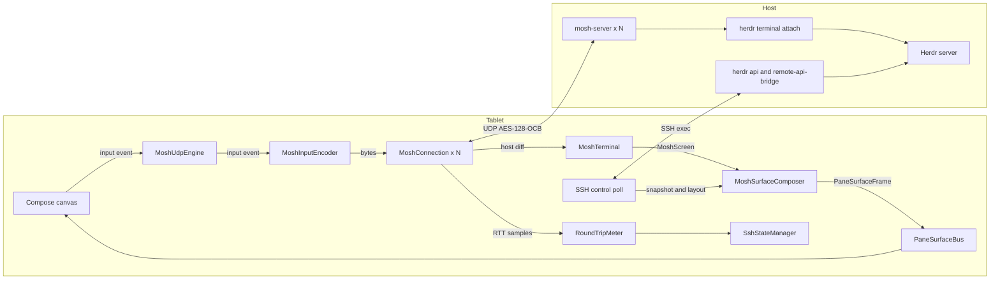

# Plan: Mosh UDP backbone (issue #22)

This plan gives the design and the delivery order for
[issue #22](https://github.com/ToxicBakery/BisonHerdr/issues/22). The user decided to build the full Mosh
path. The plan uses `main` at `ad4af8f`, upstream Herdr 0.9.5 at
[`2713feb`](https://github.com/herdrdev/herdr/tree/2713feb56e9c9db33992db0a262c68f7426d46dd), and
`mosh-server` 1.4.0. Each decision gives the evidence, the result, and the reasons. The last sections give
the pull requests, the acceptance map, and the open questions.

## Summary of decisions

| # | Question | Decision |
|---|----------|----------|
| 1 | What `mosh-server` runs | One `mosh-server` for each visible pane. It runs `herdr terminal attach <terminal_id> --takeover`, so the Mosh screen is exactly one Herdr pane. The snapshot, the layout, the agents, and the focus stay on SSH. |
| 2 | Language and place | Pure Kotlin. A new KMP module `:core:mosh` holds the wire format, the SSP, the emulator, and the frame composer. `:platform:android:ssh` holds the start over SSH, the Android network bind, and the engine. The plan has no Rust, no JNI, no NDK, and no Zig. |
| 3 | VT emulator | A new Kotlin emulator for the small set of controls that `mosh-server` sends in its diffs. Its screen state is copy-on-write, so the client can keep each received state at a low cost. |
| 4 | Crypto | BouncyCastle `OCBBlockCipher` (AES-128-OCB3). BouncyCastle 1.86 is already a dependency of `:platform:android:ssh`. |
| 5 | Integration | `negotiateBackbone` returns `ActiveBackbone.MoshUdp` only after the client decrypts a reply. The RTT comes from the SSP timestamps. When no reply comes in 2 s, the app uses the SSH endpoint path and shows the reason. A flag keeps Mosh off in release builds until the last pull request. |
| 6 | Tests | JVM tests against a real local `mosh-server` on Linux CI. They cover the handshake, keystrokes, resize, a socket change, blocked UDP, and the emulator. |

The plan has 11 pull requests and 22.5 engineer-days. Issue #22 gives 29 engineer-days for the Rust
path. The Kotlin path removes the toolchain step (3 days) and the JNI bridge (1 day). BouncyCastle removes
the OCB work.

## Evidence

### How the app gets a pane today

The SSH path does not open a Herdr client connection. It polls.

- `RealHerdrSshClient` keeps two persistent `sh` channels for each machine: `WorkerLane.Input` and
  `WorkerLane.Poll` (`RealHerdrSshClient.kt:156-159`, `2122-2147`). Pull request #12 added these lanes.
- The poll loop runs each 400 ms (`LIVE_POLL_INTERVAL_MS`, `RealHerdrSshClient.kt:2995`). It runs
  `herdr api snapshot`, and one `herdr remote-api-bridge` call for each visible pane with
  `pane.read { source: "visible", format: "ansi" }` (`RealHerdrSshClient.kt:691-704`, `1621-1633`).
- `buildCompositeSurfaceFrame` parses the ANSI text of each pane into one `PaneSurfaceFrame`
  (`RealHerdrSshClient.kt:2523-2635`).
- A keystroke goes out as `pane.send_text`, `pane.send_keys`, or `pane.send_input` on the input lane. One
  `pane.read` of the pane follows it (`RealHerdrSshClient.kt:903-944`).
- The app never runs `herdr remote-client-bridge`. `setSurfaceLease` only writes
  `client_shell.surface.set` to the debug log (`SshTransportManager.kt:364-372`). The KDoc of
  `SshTransportManager` and `01-core-app-design.md` describe a bridge that the code does not open.
- The pane object of `herdr api snapshot` has a `terminal_id` field
  ([`panes.rs:499-501`](https://github.com/herdrdev/herdr/blob/2713feb56e9c9db33992db0a262c68f7426d46dd/src/api/schema/panes.rs#L499-L501)).
  The app model `ClientShellPane` does not read it yet (`ShellSnapshotModels.kt:130-141`).

### How Herdr shows a terminal to a client

- A plain `herdr` command starts a server or attaches a thin client
  ([`main.rs:802`](https://github.com/herdrdev/herdr/blob/2713feb56e9c9db33992db0a262c68f7426d46dd/src/main.rs#L802)).
  The thin client gets rendered frames from the server and copies them to its terminal
  ([`client/mod.rs:1-13`](https://github.com/herdrdev/herdr/blob/2713feb56e9c9db33992db0a262c68f7426d46dd/src/client/mod.rs#L1-L13)).
- The `TerminalHello` message of a thin client has the size, the cell size, and the mouse mode only
  ([`wire.rs:466-473`](https://github.com/herdrdev/herdr/blob/2713feb56e9c9db33992db0a262c68f7426d46dd/src/protocol/wire.rs#L466-L473)).
  It has no UI configuration. Thus the server draws the chrome from its own `config.toml`.
- A black-box test confirmed this. `mosh-server new -- env HERDR_CONFIG_PATH=tablet.toml herdr` showed
  pane borders, although `tablet.toml` sets `pane_borders = "off"` and `pane_outer_borders = false`. The
  tablet configuration in `01-core-app-design.md:480` thus has no effect.
- `herdr terminal attach <terminal_id> [--takeover]` attaches a client to one terminal
  ([`cli.rs:555-565`](https://github.com/herdrdev/herdr/blob/2713feb56e9c9db33992db0a262c68f7426d46dd/src/cli.rs#L555-L565)).
  The server draws only that terminal, with no chrome
  ([`render_stream.rs:578`](https://github.com/herdrdev/herdr/blob/2713feb56e9c9db33992db0a262c68f7426d46dd/src/server/render_stream.rs#L578)).
- At attach, the server resizes the terminal to the size of the client and locks that size
  ([`headless.rs:1817-1838`](https://github.com/herdrdev/herdr/blob/2713feb56e9c9db33992db0a262c68f7426d46dd/src/server/headless.rs#L1817-L1838)).
  The lock goes away when the attach client exits
  ([`headless.rs:972-980`](https://github.com/herdrdev/herdr/blob/2713feb56e9c9db33992db0a262c68f7426d46dd/src/server/headless.rs#L972-L980)).
- One terminal has one attach client. `--takeover` closes the old attach client
  ([`headless.rs:1787-1811`](https://github.com/herdrdev/herdr/blob/2713feb56e9c9db33992db0a262c68f7426d46dd/src/server/headless.rs#L1787-L1811)).
- In an attach client, Ctrl+B is a prefix. Ctrl+B and then `q` detaches. Ctrl+B two times sends one Ctrl+B
  ([`attach.rs:63-125`](https://github.com/herdrdev/herdr/blob/2713feb56e9c9db33992db0a262c68f7426d46dd/src/client/attach.rs#L63-L125)).
- Herdr 0.5.10 added terminal attach. Herdr 0.6.3 added scrollback with the mouse wheel and PageUp. Herdr
  0.9.0 added the `ui.mouse_capture` rule and one paste for a multi-line paste
  ([`CHANGELOG.md`](https://github.com/herdrdev/herdr/blob/2713feb56e9c9db33992db0a262c68f7426d46dd/CHANGELOG.md)).
- Direct terminal attach works on Unix hosts only
  ([`platform/mod.rs:318`](https://github.com/herdrdev/herdr/blob/2713feb56e9c9db33992db0a262c68f7426d46dd/src/platform/mod.rs#L318)).

### Black-box tests against `mosh-server` 1.4.0

A Python test client in a scratch directory talked to a real local `mosh-server`. The client came from
the public sources in [Clean-room rules](#clean-room-rules) and from the Apache-2.0 prototype. The client
is not in the repository. Each test used a server on `127.0.0.1`.

1. The server accepted the first packet of the client. The first authentic reply came after 5 ms.
2. Keystrokes, a resize, and a change to a new client socket (a new local port) all worked. After the
   socket change, the next reply came in 12 ms.
3. With `herdr terminal attach` on an isolated Herdr server, the Mosh screen held only the pane shell, at
   the 60x12 size that the client sent. The shell prompt wrapped at column 60.
4. When the application exits, the server sends `new_num = 2^64 - 1`.
5. While the client sent nothing, the server sent about one datagram each second for about 40 s. Then it
   stopped. One datagram from a new socket started the replies again in less than 1 ms.
6. With `MOSH_SERVER_NETWORK_TMOUT=5`, a server with a silent client exited between 3 s and 9 s.
7. The server changes the arrow key `ESC O A` to `ESC [ A` when the application did not set DECCKM. It
   sends `ESC O A` when the application set DECCKM. It sends `ESC [ A` unchanged in both modes.
8. A census of the host bytes from three random generator runs, `htop`, and `vim` found only the controls
   in the table of [decision 3](#decision-3-the-vt-emulator).

### The Zig build of `libghostty-vt`

- The vendored copy in `8cf8063` cannot build from a clean checkout. The `.gitignore` rule `**/build/`
  dropped `vendor/libghostty-vt/src/build/`, and `build.zig:4` imports `src/build/main.zig`.
- The upstream Ghostty source at the vendored commit `44f2a44d` fails with Zig 0.17.0. Its `build.zig:27`
  uses `b.build_root`, which Zig 0.17 removed. Its `requireZig` check refuses all versions other than 0.16.
- With Zig 0.16.0 (the `ziglang` 0.16.0 Python wheel), the same source built `libghostty-vt.so` for
  `aarch64-linux-android` in 108 s with a cold cache. The stripped library is 1.9 MB (0.8 MB with gzip)
  for one ABI.
- The C API in `terminal.h` has `new`, `free`, `reset`, `resize`, `vt_write`, and read functions. It has
  no function that copies a terminal state.

## Decision 1: What `mosh-server` runs

**Decision.** Start one `mosh-server` for each visible pane of the tablet. Each server runs
`herdr terminal attach <terminal_id> --takeover`. The Mosh screen is then the screen of one Herdr pane,
at the size that the tablet gives to that pane.

**Options.**

| Option | Result |
|--------|--------|
| A. `mosh-server new -- herdr` (a full thin client, the design in `01-core-app-design.md:455-482`) | Rejected. The server draws its own chrome, borders, and tab bar from its own config. The app must cut panes out of one screen with rectangles from a separate `pane.layout` call, and the two can disagree for a frame. A focus RPC on `herdr.sock` moves all clients, also the desktop clients of the user. |
| B. `mosh-server new -- herdr terminal attach <terminal_id> --takeover`, one for each visible pane | **Selected.** The black-box test showed the exact pane screen with no chrome. The tablet keeps full control of the layout, as on the SSH path today. A Mosh session is a view only, because Herdr keeps the pane state. The app can thus stop and start a session at a low cost. |
| C. `mosh-server new -- herdr remote-client-bridge` | Rejected. The bridge sends a `bincode` stream, not a terminal screen. |

**The start command.** The app runs one script on a one-shot `exec` channel for each batch of panes. The
script has these parts. The pull request writes the exact text and its tests.

- Find a UTF-8 locale with `locale -a`. Prefer `C.utf8`, then `en_US.utf8`. `mosh-server` stops when the
  locale is not UTF-8.
- Use `-s` only when `SSH_CONNECTION` is set. Then the server binds to the address that the SSH client
  used.
- Set `MOSH_SERVER_NETWORK_TMOUT` (default 3600 s). A server with no client then exits on its own.
- Use the port range of the machine: `-p 60000:61000` (`HostMachine.DEFAULT_MOSH_UDP_PORT_RANGE`).
- Add `--session <name>` before `terminal attach` when the machine has `herdrSessionName`.
- Write the pane ID before each output line, and send stderr to stdout. The app then reads
  `MOSH CONNECT <port> <key>` and `[mosh-server detached, pid = <pid>]` for each pane.
- Keep the PIDs in `$HOME/.cache/bison-herdr/mosh-<installId>.pids`. On a full connect, the script stops
  the PIDs of the last run of this install first. `--takeover` also replaces an old attach client.
- Stop a PID only when `ps -p <pid> -o args=` shows `mosh-server`. After a host restart, the system can
  give an old PID to a different process.

**Size.** The tablet computes the cell rectangle of each pane from `pane.layout`, scaled to its viewport,
as `buildCompositeSurfaceFrame` does today. The client sends that size in the first Mosh state and after
each change. Herdr then resizes the pane and locks the size while the attach client runs.

**Input to the attach client.**

- Send each arrow key as SS3 (`ESC O A` to `ESC O D`). The server converts it for the application.
- Send each Ctrl+B (`0x02`) as two bytes `0x02 0x02`. The attach client sends one `0x02` to the pane. A
  single `0x02` followed by `q` detaches the attach client.
- The attach client turns on mouse mode 1003 and SGR mode 1006, and the pane can turn on bracketed paste
  2004. The Mosh diff carries these modes. The client encodes a scroll gesture as an SGR wheel event and
  wraps a paste when mode 2004 is on. The attach client then scrolls the Herdr scrollback.

**What stays on SSH.**

| Operation | Path with Mosh |
|-----------|----------------|
| Screen of a visible pane | Mosh |
| Keystrokes, paste, and mouse events to a visible pane | Mosh |
| Pane size | Mosh resize. Herdr locks the size. |
| Scrollback of a pane | Mosh. The attach client scrolls on a wheel event or PageUp. |
| A composer prompt to a pane with a Mosh session | Mosh, as a bracketed paste and `\r` |
| A prompt to a named agent (`agent.prompt`) | SSH |
| Snapshot, layout, tabs, agents, agent status | SSH poll each 1 s (not 400 ms), with no `pane.read` for a pane with a Mosh session |
| Focus, split, close, zoom, rename, split ratio | SSH (`herdr remote-api-bridge`) |
| Start and stop of `mosh-server` | SSH |
| Agent text for notifications | The Mosh screen for a pane with a Mosh session. Else `pane.read`. |

**A network change.** A TCP connection cannot keep its socket after the IP address changes. Thus the
SSH session closes after a change from Wi-Fi to cellular (a Tailscale address stays the same, and there
the SSH session can continue). The Mosh sessions do not need SSH:

1. The client opens a new UDP socket on the new default network and sends one datagram for each session.
2. The server takes the new address from that authentic datagram. The screen and the keystrokes continue
   with no new SSH connection and no new `mosh-server`.
3. Only the SSH operations in the table above wait. The current `SessionSupervisor` opens the SSH session
   again in the background. A tab change or a new split can start a new Mosh session only after that.
   [Question 1](#open-questions) asks the user to confirm this result for the acceptance item.

**Limits.**

- Herdr 0.9.0 or later. The app reads `herdr --version` before it starts a session.
- A Unix host. Direct attach does not work on Windows.
- No ProxyJump. UDP cannot pass the SSH bastion. A machine with a bastion uses the SSH endpoint path with
  the reason "Mosh cannot pass a ProxyJump bastion".
- At most 8 Mosh sessions for each machine. A pane over the limit uses `pane.read` on SSH.
- While the tablet is attached, a desktop client of the user sees the pane at the tablet size.
  [Question 2](#open-questions) asks the user to accept this.

## Decision 2: Language and place

**Decision.** Write the Mosh client in Kotlin. Put the logic in a new KMP module `:core:mosh`. Put the
Android parts in `:platform:android:ssh`.

| Criterion | Kotlin in `:core:mosh` | Rust prototype over JNI |
|-----------|------------------------|-------------------------|
| Build | Gradle only | `cargo-ndk`, rustup Android targets, a Gradle native step, and Zig 0.16 for the emulator |
| CI time | `apt-get install mosh` (about 15 s) and JVM tests | A Rust and Zig build for each ABI (108 s cold for `libghostty-vt` alone), and caches |
| Tests with a real `mosh-server` | JVM unit tests on Linux CI | Cargo tests for the codec. The JNI path needs a device or a host build of the library. |
| APK size | About 0.2 MB of DEX. BouncyCastle is already in the APK. | 1.9 MB stripped for each ABI for `libghostty-vt`, plus the Rust library |
| Reuse | The models, `PaneSurfaceFrame`, and `RoundTripMeter` are Kotlin | Seven of nine JNI exports repeat Kotlin code (item 13 of `02-ssh-defects-issue-20.md`) |
| Module rules | `:core:mosh` imports no `:platform:*` module | The JNI bridge must live in `:platform:*` |

**Module layout.**

- `:core:mosh` targets `android` and `jvm`, as the other `:core:*` modules do. `commonMain` holds all
  logic and takes the time from an injected `TimeSource`.
- Three small platform parts use JVM APIs: the OCB cipher (BouncyCastle), zlib (`java.util.zip`), and the
  UDP port (`java.nio.channels.DatagramChannel`). Put them in `src/jvmShared/kotlin`, and add that
  directory to both `jvmMain` and `androidMain` with `kotlin.srcDir`. This avoids a custom source set
  hierarchy and its warning. When the build shows a warning, keep two copies instead.
- Declare the cipher and zlib as common interfaces with an `expect fun` factory, as `:core:common` does
  (`ClipEntries.kt:6`). Put the `actual fun` declarations in `src/jvmShared/kotlin`. Do not use an
  `expect class`, because Kotlin marks it as Beta with a warning.
- The UDP port is an interface (`DatagramPort`) that the platform passes in.

## Decision 3: The VT emulator

**Decision.** Write a new Kotlin emulator, `MoshTerminal`, for the controls that `mosh-server` sends in
its diffs. Do not write a full xterm emulator.

The server runs the application in its own emulator. It sends to the client a diff that changes the old
client screen into the new screen. The client applies the diff to the screen of state `old_num`. Thus the
client never sees the raw output of the application. It sees only the controls that the server uses to
draw a diff, and the census found a small, fixed set.

| Option | Result |
|--------|--------|
| New Kotlin emulator for the diff controls | **Selected.** Small, JVM-testable, and copy-on-write for the received states. |
| `libghostty-vt` over Zig and JNI (MIT) | Rejected. It needs Zig 0.16 exactly, a JNI bridge, and 1.9 MB for each ABI. Its C API cannot copy a state. |
| JediTerm (Apache-2.0 option of an LGPLv3 or Apache-2.0 dual license) | Rejected. It is a full xterm emulator for a Swing UI. We found no API for a cheap copy of a screen state. |
| ConnectBot `termlib` (Apache-2.0) over libvterm (MIT) | Rejected. It needs JNI and an NDK build, and it brings its own Compose view. |
| Termux `terminal-emulator` | Not permitted. The `termux-app` repository is GPLv3-only. |

**Controls that the emulator must apply** (census of `mosh-server` 1.4.0 host bytes):

| Kind | Controls |
|------|----------|
| C0 | BEL `0x07`, BS `0x08`, LF `0x0A`, CR `0x0D` |
| Cursor | CUP `CSI row;col H` and `CSI H` |
| Erase | EL `CSI K`, ED `CSI 2 J` (in a full repaint), ECH `CSI n X` |
| Scroll | DECSTBM `CSI top;bottom r` and `CSI r`. LF at the bottom margin scrolls the region up. |
| SGR | `0`, `1`, `3`, `4`, `5`, `7`, `8`, `30`-`37`, `40`-`47`, `38;5;n`, `48;5;n`, `38;2;r;g;b`, `48;2;r;g;b`. Each SGR starts with `0`. |
| Modes | `?25` cursor, `?5` reverse video, `?1000` `?1001` `?1002` `?1003` `?1004` `?1005` `?1006` `?1015` mouse, `?2004` bracketed paste |
| OSC | `0`, `1`, `2` (title), `52` (clipboard), each with BEL at the end |
| Text | UTF-8, wide cells (2 columns), zero-width marks (Unicode Mn and Me) on the cell before, autowrap at the right margin |

**Rules for the emulator.**

- Apply the standard ECMA-48 and xterm function of each control in the table. Accept the other SGR values
  (`2`, `9`, `21`-`29`, `39`, `49`, `90`-`97`, `100`-`107`) with the xterm function, because a different
  server version can send them.
- Ignore each other control, and count it in a debug counter. Never throw on input from the network.
- Keep the xterm "last column" state: a character in the last column sets a wrap flag. The next printable
  character wraps. CR, BS, and CUP clear the flag. The differential test below checks this rule.
- Use a width table for Unicode 15.1. East Asian Wide, Fullwidth, and emoji presentation are 2. The
  zero-width marks (Unicode Mn, Me, and Cf) are 0. The server computes the width with its own libc.
  Most diffs place the cursor with CUP, so a width difference has a small effect.
- Keep the title, the bell count, the clipboard writes, and the modes in the state. The surface uses the
  mouse and paste modes for input, the reverse video mode for the colors, and the title for the pane
  header. A clipboard write needs a user option (default off), because a host can put text on the
  device clipboard.

**State model.** `MoshScreen` is an immutable value: a list of rows, the cursor, the pen, the modes, and
the title. A row is an immutable array of cells. `MoshTerminal.apply(screen, hostBytes)` returns a new
screen. It copies the row list and only the rows that the diff changes. The SSP receiver keeps each
received state that the server can still diff from (decision 4). Each kept state costs one row list, not
a full screen.

## Decision 4: Crypto and wire format

**Crypto.** Use `org.bouncycastle.crypto.modes.OCBBlockCipher` with two `AESEngine` instances. Use a
12-byte nonce and a 128-bit tag. BouncyCastle 1.86 (`bcprov-jdk18on`, the MIT-style Bouncy Castle
Licence) is already in `libs.versions.toml` for Ed25519. Android has no public OCB in its JCA providers,
and the JDK has none. Keep the OCB code of the prototype as a reference only. The tests check
BouncyCastle against the sample results in Appendix A of [RFC 7253](https://www.rfc-editor.org/rfc/rfc7253).

**Wire facts.** Each fact has a source. P is the
[Mosh paper](https://mosh.org/mosh-paper.pdf) (USENIX ATC 2012). B is a black-box test of this plan. X is
the Apache-2.0 prototype `mosh_ssp.rs` in `8cf8063`. M is the `mosh-server` banner and its man page.

| # | Fact | Source |
|---|------|--------|
| 1 | `mosh-server new` prints `MOSH CONNECT <port> <key>` on stdout and `[mosh-server detached, pid = <pid>]` on stderr. The key is 22 base64 characters with no `=` at the end: 16 bytes. | B, M |
| 2 | A datagram is an 8-byte header, the OCB ciphertext, and a 16-byte tag. Header bit 63 is the direction: 0 from the client, 1 from the server. Bits 0-62 are the sequence number. The header is big-endian. | B, X |
| 3 | The nonce is 4 zero bytes and then the 8-byte header. The mode is AES-128-OCB with no associated data. | B, X, P 2.2 |
| 4 | The plaintext is a 16-bit timestamp (milliseconds modulo 65536), a 16-bit timestamp reply (`0xFFFF` for none), and one fragment. | B, P 2.2 |
| 5 | A fragment is a 64-bit instruction ID, a 16-bit fragment number with bit 15 as the "final" flag, and the content. The content of all fragments of one ID, in order, is the zlib stream of one instruction. | B |
| 6 | The instruction is a protobuf message: 1 `protocol_version` (2), 2 `old_num`, 3 `new_num`, 4 `ack_num`, 5 `throwaway_num`, 6 `diff` (bytes), 7 `chaff` (random bytes). The numbers are unsigned varints. | B |
| 7 | The client diff is a message with field 1 repeated. Each entry has field 2 (keystroke: field 4, bytes) or field 3 (resize: field 5 width, field 6 height). | B |
| 8 | The server diff is a message with field 1 repeated. Each entry has field 2 (host bytes: field 4), field 3 (resize: fields 5 and 6), or field 7 (echo ack: field 8). | B |
| 9 | The host bytes are a diff between two screens, not the raw output of the application. | P 2.3, B (CUP skips and SGR that starts with `0`) |
| 10 | The server sends to the source address of each authentic datagram with a sequence number higher than all before. The client keeps one sequence counter for the session, also across sockets. | P 2.2, B |
| 11 | `new_num = 2^64 - 1` tells that the session ended. | B |
| 12 | The server sends a heartbeat about each 3 s while it gets datagrams. It stops about 40 s after the last client datagram. `MOSH_SERVER_NETWORK_TMOUT` stops a server with a silent client. | B, P 2.2 |
| 13 | The RTT estimate is the TCP algorithm with a minimum RTO of 50 ms. The timestamp reply includes the time that the peer held the timestamp. | P 2.2 |
| 14 | Delayed ack: 100 ms. The server waits a collection interval of 8 ms after the first change. Minimum frame interval: SRTT / 2. Maximum frame rate: 50 Hz. | P 2.3 |
| 15 | The echo ack is the last keystroke state that the application got at least 50 ms before. | P 3.2, B |
| 16 | The server changes `ESC O A`-`D` to `ESC [ A`-`D` when the application did not set DECCKM. | B |

**Values that this plan selects.** These values are not from Mosh. They are the choices of this client.

| Value | Choice | Reason |
|-------|--------|--------|
| Maximum RTO | 1000 ms | A keystroke does not wait more than 1 s for a retransmission. |
| Maximum frame interval | 250 ms | The paper uses this value in its traces. |
| New socket after silence | 10 s with no authentic datagram | A NAT can drop the old port entry. A new local port gets a new entry. |
| UDP budget at connect | 2 s | A cellular RTT can be more than 1 s under load. The old budget of 1.5 s was too short. |
| Received states kept | All states at or after the server `throwaway_num`, at most 32 | The server can diff from a state that the client got but did not acknowledge yet. |
| Size limits | 64 fragments, 1 MiB after zlib | A hostile packet cannot use much memory. Only an authentic packet gets to zlib. |

**Sender rules (client to server).** The user state is the list of the user events (keystrokes and
resizes). The state number increases by one for each sent state that adds events.

1. A state with new events: `old_num` is the last state that the server acknowledged. `new_num` is the
   current state. The diff holds all events after `old_num`. The server must apply only the events that it
   does not have. The real-server test with loss must prove that each keystroke reaches the pane one time.
2. A heartbeat or an ack: `old_num = new_num =` the last state that the server acknowledged. The server
   has this state, so the instruction is valid for the server.
3. `throwaway_num` is the last state that the server acknowledged.
4. Send again after the RTO while the server did not acknowledge the current state.
5. Send a new user state at once when the last send is older than the frame interval. Else send it at
   the end of the interval. The frame interval is SRTT / 2, in the range 20 ms to 250 ms.

**Receiver rules (server to client).**

1. Drop each datagram that does not decrypt. Do not log its content.
2. From each authentic datagram, take the timestamp, the timestamp reply, and `ack_num`. This is also
   true when the client cannot apply the diff.
3. Apply the diff only when the client has the state `old_num` and does not have `new_num`. Keep the new
   state. Remove the states before the server `throwaway_num`.
4. Acknowledge the newest state after the delayed ack interval, or at once with the next user state.
5. Take an RTT sample from each timestamp reply that is less than 5 s old, and give it to the estimator.

## Decision 5: Integration

**Connect.** `SshTransportManager.runConnectSteps` stays the same
(`SshTransportManager.kt:266-303`). `RealSshBackend.negotiateBackbone` (`RealSshBackend.kt:134-141`) gets
a Mosh branch:

1. Return `SshEndpoint` as today when the flag is off or the mode is `SshEndpointOnly`. Return it with
   a reason when the route has a bastion.
2. Check `command -v mosh-server` and `herdr --version` in one batch. When a check fails, return
   `SshEndpoint` with the reason, for example "Herdr 0.8.2 is too old for Mosh (needs 0.9.0)".
3. Read the snapshot. Find the visible panes and their `terminal_id` values.
4. Run the start script for the visible panes. Parse the port, the key, and the PID of each pane.
5. Open a `MoshConnection` for each pane to the IP address of the SSH socket peer, not to a new DNS
   result. Send the first state with the resize of the pane.
6. Return `ActiveBackbone.MoshUdp` when each session decrypts its first reply in the 2 s budget. The
   `rttMs` is the first measured RTT.
7. When a session gets no authentic reply in the budget, try that session one more time. When it fails
   again, stop all sessions of the machine (`kill <pid>` over SSH). Return `SshEndpoint` with the reason
   "No UDP reply from `<ip>:<port>` in 2 s. The network can block UDP." A `MoshOnly` machine returns
   `null`, and the manager shows the same text in `NeedsUserCause.Other`.

`ActiveBackbone.MoshUdp` gets `sessionCount`, with a default value so that old JSON still loads.

**Surface.** `openSurface` starts the SSH poll in control mode: `herdr api snapshot` each 1 s, and
`pane.read` only for panes with no Mosh session. The poll gives the snapshot and the layout to the Mosh
engine. The engine makes the `PaneSurfaceFrame` from the screens of the sessions and the layout, and
publishes it on `PaneSurfaceBus` at most each 16 ms. The engine is the only publisher of frames for a
Mosh machine.

**Tab change and new panes.** When the snapshot shows new visible panes, the engine starts sessions for
them in one batch. It keeps the sessions of panes that are no longer visible for 10 minutes, at most 8 in
all, and parks them. It stops the oldest session when it needs a free place.

**RTT.** Each session gives its RTT samples to the current `RoundTripMeter`
(`RoundTripMeter.kt:25-70`). The meter already uses the RFC 6298 weight of 1/8, and it publishes at most
one value each second through `SshStateManager.setRoundTripTime`. For `MoshUdp`, the UI shows "RTT n ms".
For `SshEndpoint`, the UI shows "poll n ms" as today (`PollTimeText.kt:16-21`). When no authentic
datagram came for 5 s and the session is not parked, the UI shows "Last reply n s ago".

**Blocked UDP.** The fallback reason goes into `ActiveBackbone.SshEndpoint.fallbackReason`, which the UI
shows since pull request #37. The debug log gets the IP address, the port, and the count of sent
datagrams.

**Network events.** `BisonSessionService` gives the `Network` object of each callback to the manager
(`BisonSessionService.kt:95-110`).

- `onAvailable` and `onLinkPropertiesChanged`: the engine opens a new socket for each Mosh session. It
  binds the socket with `Network.bindSocket` and sends one datagram at once. A parked session changes
  its socket at the next unpark. The manager still runs the SSH liveness check for the control lane.
- `onLost`: the Mosh sessions stay open. The timers continue, and a failed send has no effect. The
  manager closes the SSH sockets as today (`SshTransportManager.kt:618-630`).

**Reconnect supervisor.** For a Mosh machine, a closed SSH session must not stop the terminal.

- `SessionEvents.onReconnecting` keeps `RoamingStatus.Healthy` while the Mosh sessions get replies. The
  UI shows a small "control lane offline" mark. The prompt queue holds only the prompts that need SSH.
- `onReconnected` does not restart the Mosh sessions. It reads the snapshot again and starts sessions
  only for new visible panes.
- When all Mosh sessions get no reply for 30 s and the SSH session is also closed, the manager sets
  `RoamingReconnect`. When the SSH session opens again, the engine starts new sessions.

**Background.** `setSurfaceLease(active = false)` parks the sessions of the machine. A parked session
sends nothing. The server stops after about 40 s (black-box fact 12). `setSurfaceLease(active = true)`
sends one datagram for each session, and the next diff paints the screen. After 10 minutes of park, the
engine stops the sessions over SSH, so that Herdr removes the size lock of the panes. When the SSH
session is closed, `MOSH_SERVER_NETWORK_TMOUT` stops them later. The next unpark then starts new sessions
over SSH. `client_shell.surface.set` has no effect on this path, because the tablet has no thin client.

**Feature flag.** Add `MoshFeatureFlag(enabled: Boolean)`.

- `app/android/src/release/.../DebugModule.kt` binds `false` until the last pull request.
- `app/android/src/debug/.../DebugModule.kt` binds the value of a "Mosh (experimental)" switch. Only
  debug builds show the switch in the settings screen.
- `RealSshBackend` reads the flag in `negotiateBackbone`. With the flag off, the code path is the code path
  of today.
- The tests construct the backend with the flag on.
- The last pull request binds `true` in release, removes the switch, and enables the `MoshOnly` choice
  (`ConfigureMachineScreen.kt:261`).

## Decision 6: Tests and CI

**Unit tests for each layer** (`:core:mosh` `commonTest`, virtual time):

- Wire: the RFC 7253 sample results and datagram round trips. Fragment split and join with order, loss,
  duplicates, and limits. The protobuf codec with unknown fields. The zlib limit. A bad tag, a short
  packet, and fuzz input.
- SSP: a simulated network that drops, delays, duplicates, and reorders datagrams. Assert these results:
  - The timers: heartbeat 3 s, delayed ack 100 ms, RTO bounds, and frame interval.
  - Each keystroke reaches the server one time, and the screen converges.
  - The count of kept states stays in its bound.
  - A new socket opens after 10 s of silence, and the end state stops the session.
- Emulator: one test for each control in the decision 3 table. Tests for the wrap flag, wide characters,
  zero-width marks, and the scroll region. Golden diff streams from the real server.
- Surface and input: layout to rectangles, colors to `CellData`, cursor and modes, SS3 arrows, `0x02`
  rule, bracketed paste, and SGR wheel events.

**Real `mosh-server` tests** (`:core:mosh` `jvmTest`). A `MoshServerFixture` starts
`mosh-server new -i 127.0.0.1 -- <command>`, parses the banner, and stops the PID at the end. The server
picks a free port. The tests:

1. Handshake: the first authentic reply has `protocol_version` 2 and host bytes.
2. Keystrokes: `echo` output appears on the emulator screen. A test with loss proves exact-once delivery.
3. Resize: the server sends a resize and a full repaint.
4. Socket change: in the middle of the session, close the socket and open a new one on a new local port.
   The output continues. A second variant sends through a local UDP relay that changes its source port.
5. Blocked UDP: a `DatagramPort` that drops all datagrams. The connect fails after the budget with the
   blocked reason.
6. Silence and wake: no sends for 2 s, then one datagram from a new socket. The replies start again.
7. End of session: `exit` in the shell gives the end state.
8. Emulator oracle: run a seeded generator of random output two times. Client A acknowledges each state,
   so it applies small diffs. Client B never acknowledges a host state, so each diff is a full paint from
   the blank screen. The final screens of A and B must be equal.
9. Width probe: for a sample of code points, print the code point and then enough `x` to wrap the line.
   The server places the next row with CR LF or CUP, so a width difference shows on the client screen.

**Integration tests** (`:platform:android:ssh` `test`, JVM). They use the current `TestSshServer`, a real
`mosh-server` on the CI host, and a fake `herdr` script in `TestSshServer.binDirectory`. The fake script
answers `--version`, `api snapshot` (a fixture with `terminal_id`), `remote-api-bridge`, and
`terminal attach <id> --takeover` (it runs `sh` with a known prompt). The tests:

1. With the flag on, `negotiateBackbone` returns `MoshUdp` only after a decrypted reply. A keystroke shows
   on the published `PaneSurfaceFrame`.
2. With the flag off, the result is the same as today.
3. Blocked UDP gives `SshEndpoint` with the reason, and `MoshOnly` gives the `NeedsUser` cause.
4. A network change during a session: the output continues, and `TestSshServer` counts no new SSH session.
5. The SSH server stops while the Mosh session continues. Keystrokes still reach the pane.
6. Park: no datagram goes out while parked. Unpark paints the screen in one round trip.
7. The bastion route and an old Herdr version give the reasons.

**Tests that need `mosh-server`.** When the environment variable `BISON_REQUIRE_MOSH` is `1`, a test fails
when `mosh-server` is absent. Else the test skips with a message. CI sets the variable, so CI never skips.

**CI changes** (`.github/workflows/validation.yml`).

```yaml
      # The real mosh-server tests need mosh-server on the runner.
      - name: Install mosh
        run: sudo apt-get update && sudo apt-get install -y --no-install-recommends mosh

      - name: Build ${{ matrix.target }}
        env:
          BISON_REQUIRE_MOSH: '1'
        run: ./gradlew ${{ matrix.tasks }} --stacktrace -Dorg.gradle.console=plain
```

- Add `:core:mosh:check` to the task list of the `jvm` target.
- The `android` target already runs `:platform:android:ssh:testDebugUnitTest`. Add
  `:app:android:licenseeRelease` (pull request 1).
- The plan adds no native code, so CI needs no NDK, Rust, or Zig step. The `rust` job for
  `herdr-protocol` stays as it is.

## Clean-room rules

The `mosh` source is GPLv3. This app is Apache-2.0. These rules apply to each pull request of this plan.

**Permitted sources.**

- The Mosh paper (USENIX ATC 2012) and the pages on [mosh.org](https://mosh.org).
- The `mosh-server` and `mosh-client` man pages, `--help` output, and banner text.
- RFC 7253 (OCB), RFC 6298 (RTT), the
  [Protocol Buffers wire format](https://protobuf.dev/programming-guides/encoding/) page, and ECMA-48.
- The Apache-2.0 prototype in `8cf8063` (`rust/herdr-mobile-core/src/mosh_ssp.rs`).
- Black-box tests: our own client against a real `mosh-server`, and the bytes that the server sends.
- The Herdr source (Apache-2.0).

**Prohibited.**

- Do not open, copy, translate, or paraphrase any file of the `mosh` source tree. This includes the
  `.proto` files and the `src/network`, `src/statesync`, `src/terminal`, and `src/frontend` directories.
- Do not paste `mosh` source into a prompt, an issue, or a review.
- Do not ship or link any part of the `mosh` package or the Termux emulator. The tests run
  `mosh-server` as a separate process only.
- Do not add a GPL, AGPL, or LGPL-only dependency.

**Process.**

- The wire facts table of decision 4 is the specification. Each pull request that adds a protocol fact
  adds it to that table with its source.
- A fact with no public source must have a black-box test against `mosh-server` before the code uses it.
- Each pull request description has the line "No GPL Mosh source was read or copied for this change."
- Pull request 1 adds a license check that stops the build on a dependency without an allowed license.

## Architecture

**Modules.**

```
:core:mosh (new, KMP: android + jvm)
  wire/     MoshKey, Datagram, Fragment, FragmentAssembler, ProtoReader, ProtoWriter,
            TransportInstruction, UserEvent, HostEvent, MoshCipher and Zlib (interfaces, expect fun)
  ssp/      RttEstimator, UserStream, HostStateStore, SspTransport (pure state machine),
            MoshConnection (coroutine loop), DatagramPort (interface)
  term/     MoshTerminal (parser), MoshScreen (copy-on-write state), CellWidth
  surface/  MoshSurfaceComposer (screens + layout -> PaneSurfaceFrame)
  input/    MoshInputEncoder (ClientPaneInputEvent -> bytes)
  src/jvmShared/kotlin: actual fun factories (BcOcbCipher, JdkZlib), NioDatagramPort
  depends on :core:protocol, kotlinx-coroutines, bcprov (jvm and android)

:platform:android:ssh
  MoshBootstrap      start script, banner parser, stop by PID
  MoshUdpEngine      rewrite: sessions for each machine and pane, frames, input, park, network change
  RealSshBackend     Mosh branch of negotiateBackbone, control-mode poll
  RealHerdrSshClient one-shot exec helper, peer IP of the SSH socket, control-mode poll
  SshTransportManager lease to park, network events to the engine, Mosh rules for reconnect events

:core:ssh       MoshSessionEngine contract with pane IDs
:core:protocol  ClientShellPane.terminalId
:core:model     ActiveBackbone.MoshUdp.sessionCount
```

**Data flow.**



## Risks

| # | Risk | Effect | Mitigation |
|---|------|--------|------------|
| 1 | The width table of the client and the libc of the host do not agree for a code point | A cell moves on one row until the next repaint | Most diffs use CUP. Width probe test. A "Refresh pane" action restarts the session of the pane. |
| 2 | An emulator rule differs from the server rule (wrap flag, BS at the margin, scroll region) | A wrong screen until the next repaint | Emulator oracle test with random output. The same "Refresh pane" action. |
| 3 | Herdr locks the pane size while the tablet is attached | The desktop user sees the pane at the tablet size | Stop the sessions after 10 minutes of park. Question 2. |
| 4 | A `mosh-server` stays on the host after the app stops | Processes and ports on the host | `MOSH_SERVER_NETWORK_TMOUT`, the PID file of the install, and `--takeover` |
| 5 | The SSH control lane is closed after a network change | Tab change, new split, and agent status wait | Background reconnect with the current supervisor. Prompts to a Mosh pane go over Mosh. |
| 6 | A network blocks UDP, or a NAT drops the port entry | No Mosh, or a stall | 2 s budget and fallback with the reason. Heartbeat each 3 s. New socket after 10 s of silence. |
| 7 | A later Herdr changes the attach client (prefix, flags) | Wrong keys or a failed attach | Version check, the fake `herdr` tests, and a manual test card with a real Herdr in pull request 11 |
| 8 | Many visible panes | Many processes and ports | At most 8 sessions for each machine. The other panes use `pane.read`. |
| 9 | An implementer writes `mosh` code from memory | GPL code in an Apache-2.0 app | Clean-room rules. Each constant has a source in the facts table. Reviews check the sources. |
| 10 | The `jvmShared` source directory gives a build warning | The zero-warning rule fails | Keep two copies in `jvmMain` and `androidMain`. |
| 11 | The host has no UTF-8 locale | `mosh-server` stops | The script picks a locale from `locale -a`. The fallback reason shows the server message. |

## Order of pull requests

Each pull request comes from its own worktree and branch, as `CLAUDE.md` requires. Each one keeps `main`
green with zero warnings. Until pull request 11, the flag keeps Mosh off in release builds.

| Order | Branch | Scope | Size | Depends on |
|-------|--------|-------|------|------------|
| 1 | `chore/license-guard` | License check for all dependencies | 1 day | none |
| 2 | `feat/mosh-wire` | `:core:mosh` module, wire format, crypto, first real-server test | 2 days | none |
| 3 | `feat/mosh-ssp` | SSP state machine, timers, RTT | 3 days | 2 |
| 4 | `feat/mosh-connection` | UDP port, connection loop, real-server tests | 2 days | 3 |
| 5 | `feat/mosh-terminal` | Kotlin emulator and screen state | 3 days | 2 |
| 6 | `feat/mosh-surface-input` | Frame composer and input encoder | 2 days | 5 |
| 7 | `feat/mosh-bootstrap` | Start and stop of `mosh-server` over SSH | 2 days | 4 |
| 8 | `feat/mosh-engine` | Engine, `negotiateBackbone`, fallback, flag | 3 days | 4, 6, 7 |
| 9 | `feat/mosh-network-change` | Network change, park, supervisor rules | 2 days | 8 |
| 10 | `feat/mosh-ui` | RTT text, contact text, debug switch, `MoshOnly` choice behind the flag | 1.5 days | 8 |
| 11 | `feat/mosh-enable` | Flag on in release, documents, device test card | 1 day | 9, 10 |

**Lanes that can run in parallel.**

| Lane | Pull requests in order |
|------|------------------------|
| License | 1 |
| Transport | 2, 3, 4, 7 |
| Terminal | 5, 6 (5 starts after 2 merges) |
| App | 8, then 9 and 10 in parallel, then 11 |

### 1. `chore/license-guard`

- **Files.** `gradle/libs.versions.toml`, `app/android/build.gradle.kts`, `.github/workflows/validation.yml`.
- **Scope.** Add the Licensee Gradle plugin (`app.cash.licensee`, Apache-2.0) to `:app:android`. Allow
  Apache-2.0, MIT, BSD-2-Clause, BSD-3-Clause, ISC, and the Bouncy Castle Licence URL. Add
  `:app:android:licenseeRelease` to the `android` CI target. When the plugin gives a warning with the
  current AGP, use a small script that reads the POM licenses of the release runtime classpath.
- **Tests.** The task passes on `main`. A test commit with a GPL dependency fails the task. Do not merge
  the test commit.
- **Done.** CI runs the check. The check lists no unknown license.

### 2. `feat/mosh-wire`

- **Files.** `settings.gradle.kts`, `core/mosh/build.gradle.kts`, `core/mosh/src/commonMain/.../wire/*`,
  `core/mosh/src/jvmShared/kotlin/.../BcOcbCipher.kt` and `JdkZlib.kt`, `core/mosh/src/commonTest/...`,
  `core/mosh/src/jvmTest/.../MoshServerFixture.kt` and `HandshakeTest.kt`, `validation.yml`.
- **Scope.** Facts 1 to 8 of decision 4: key parse, datagram seal and open, fragments, protobuf codec,
  zlib with the size limit. Add `:core:mosh:check` and the "Install mosh" step to CI.
- **Tests.** RFC 7253 sample results. Round trips. Bad input. One real-server test with a plain
  `java.net.DatagramSocket`: the client sends one resize state and decrypts the first reply.
- **Done.** The first test against a real `mosh-server` passes on CI. No production code calls the module.

### 3. `feat/mosh-ssp`

- **Files.** `core/mosh/src/commonMain/.../ssp/*` except `MoshConnection`, `commonTest`.
- **Scope.** `SspTransport` as a pure state machine with the time as input. `UserStream`,
  `HostStateStore` (generic over the host state), `RttEstimator`. The sender and receiver rules and the
  timer values of decision 4.
- **Tests.** The simulated network tests of decision 6 with virtual time.
- **Done.** All timer and loss tests pass. The module has no I/O.

### 4. `feat/mosh-connection`

- **Files.** `ssp/MoshConnection.kt`, `ssp/DatagramPort.kt`, `jvmShared/.../NioDatagramPort.kt`,
  `jvmTest/...`.
- **Scope.** The coroutine loop over `SspTransport` and a `DatagramPort`. Flows for the host state, the RTT
  samples, the last contact time, and the end of session. `roam()` opens a new socket with the same
  sequence counter. `park(Boolean)`. `NioDatagramPort` takes a `socketBinder` function, which the Android
  layer uses for `Network.bindSocket`. The host state of the tests is a raw byte log.
- **Tests.** Real-server tests 1 to 7 of decision 6.
- **Done.** The socket change and the blocked UDP tests pass on CI.

### 5. `feat/mosh-terminal`

- **Files.** `core/mosh/src/commonMain/.../term/*`, `commonTest`, `jvmTest` for the oracle and width
  probe, fixture files of recorded diff streams.
- **Scope.** `MoshTerminal`, `MoshScreen`, and `CellWidth` per decision 3.
- **Tests.** One test for each control. The golden streams. Real-server tests 8 and 9 of decision 6.
- **Done.** The oracle test passes with three seeds. The width probe shows no difference on the CI host
  for the CJK and emoji samples.

### 6. `feat/mosh-surface-input`

- **Files.** `core/mosh/src/commonMain/.../surface/*`, `input/*`, `commonTest`.
- **Scope.** `MoshSurfaceComposer` uses the layout scale of `buildCompositeSurfaceFrame`. It puts the
  screens into their rectangles and adds splits from `deriveSplitsFromLayout`. It sets the cursor of the
  focused pane, the title, and reverse video.
- **Scope of the encoder.** `MoshInputEncoder` sends text as UTF-8, and keys with SS3 arrows, Home, End,
  and function keys. It also has the `0x02` rule, bracketed paste in mode 2004, and SGR wheel and click
  events. The encoder does not need pull request 5, so it can start after pull request 2.
- **Tests.** Unit tests for each rule. A test that compares the composer frame and the frame of
  `buildCompositeSurfaceFrame` for one layout.
- **Done.** All rules have a test.

### 7. `feat/mosh-bootstrap`

- **Files.** `platform/android/ssh/.../MoshBootstrap.kt`, `RealHerdrSshClient.kt` (one-shot exec helper,
  peer IP), `core/protocol/.../ShellSnapshotModels.kt` (`terminalId`), tests, a fake `herdr` script for the
  tests.
- **Scope.** The start script of decision 1 and the parser of the tagged banner and PID lines. The stop
  by PID. The version and tool checks, and the bastion rule.
- **Tests.** Script text tests (quotes, session name, port range, locale). Parser tests with server error
  text. An integration test with `TestSshServer`, the fake `herdr`, and a real `mosh-server`. It starts two
  panes, decrypts a reply from each with `MoshConnection`, and stops both PIDs.
- **Done.** No `mosh-server` process stays after the test.

### 8. `feat/mosh-engine`

- **Files.**
  - `MoshUdpEngine.kt` (rewrite) and `RealSshBackend.kt`.
  - `RealHerdrSshClient.kt` (control-mode poll) and `SshTransportManager.kt` (input and resize to the engine).
  - `core/ssh/.../SshDebugLogAndEngines.kt` (`MoshSessionEngine` with pane IDs).
  - `core/model/.../AppSettingsAndTransport.kt` (`sessionCount`).
  - `platform/android/di/.../SshModule.kt`, both `DebugModule.kt` files (`MoshFeatureFlag`), and tests.
- **Scope.** The connect steps, the surface, the tab change rules, the RTT path, and the fallback of
  decision 5. Remove the placeholder echo overlay of the old `MoshUdpEngine`. Replace the texts
  `MoshSessionEngine.NOT_AVAILABLE` and `MOSH_SERVER_FOUND` with the real fallback reasons.
- **Tests.** Integration tests 1, 2, 3, and 7 of decision 6.
- **Done.** With the flag on, a test connects through SSH and Mosh and shows a keystroke on the frame.
  With the flag off, all current tests pass with no change.

### 9. `feat/mosh-network-change`

- **Files.** `SshTransportManager.kt`, `MoshUdpEngine.kt`, `BisonSessionService.kt` (pass the `Network`),
  tests.
- **Scope.** The network events, the reconnect supervisor rules, the background park, and the 10-minute
  stop of decision 5. Composer prompts to a Mosh pane go over Mosh.
- **Tests.** Integration tests 4, 5, and 6 of decision 6. A unit test of the event rules with a fake
  engine.
- **Done.** The network change test shows continued output and no new SSH session.

### 10. `feat/mosh-ui`

- **Files.** `core/common/.../PollTimeText.kt` (rename to `BackboneLatencyText.kt`), the HUD pill,
  `ConfigureMachineScreen.kt`, the settings screen (debug switch), `core/resources/.../values/strings.xml`.
- **Scope.** Show "RTT n ms" for Mosh and "poll n ms" for SSH. Show "Last reply n s ago" and the
  "control lane offline" mark. Add the debug switch. Enable the `MoshOnly` choice when the flag is on.
- **Tests.** Unit tests of the text functions and the view-model state. The view-model changes use the
  MVI pattern of `ConfigureMachineViewModel`.
- **Done.** `:core:resources:localizationCheck` and `lint` pass.

### 11. `feat/mosh-enable`

- **Files.** The release `DebugModule.kt`, `ConfigureMachineScreen.kt`, `README.md`, `CLAUDE.md`,
  `docs/plans/01-core-app-design.md`, `scripts/e2e/` (a manual test card).
- **Scope.** Bind the flag to `true` in release builds. Remove the debug switch. Correct the documents
  (see below). Add a device test card: Wi-Fi to cellular on a real device with a real Herdr host.
- **Tests.** The full CI suite. The device test card, run by a person, with the result in the pull request.
- **Done.** All acceptance items of issue #22 are checked.

**Later work, not in issue #22.** Speculative local echo from section 3.2 of the paper (epochs and the
echo ack). The app has the `predictiveEchoUnderlines` option already. [Question 4](#open-questions) asks
whether it belongs in issue #22.

## Acceptance map

| Acceptance item of issue #22 | Pull request |
|------------------------------|--------------|
| The app connects to an unmodified `mosh-server` and shows the terminal output. | 8 (protocol proof in 2 and 4) |
| `negotiateBackbone` returns `ActiveBackbone.MoshUdp` only after the client decrypts a reply from `mosh-server`. | 8 |
| The RTT on the backbone comes from measured round trips, not from a fixed value. | 3 (estimator), 8 (backbone), 10 (text) |
| The session continues after a change from Wi-Fi to cellular. The app does not open a new SSH connection. | 9 (test), 11 (device test card) |
| When the network blocks UDP, the app uses the SSH endpoint path and shows the reason. | 8 |
| CI builds all native code and runs a test against a real `mosh-server`. | 2 (first test), 4, 5, 8. The plan adds no native code. |
| The code contains no GPL Mosh code. Each dependency has a permissive license. | 1 (check), clean-room rules in all |
| All Gradle and Cargo builds complete with zero warnings. | All |

## Corrections to other documents

Pull request 11 makes these corrections.

- `01-core-app-design.md:455-482` and `493-495`: replace the full thin client and the tablet config with
  one `herdr terminal attach` session for each visible pane. Remove the claim that a client
  `HERDR_CONFIG_PATH` hides the chrome. Remove the rule that sends focus RPCs to `herdr.sock` in Mosh mode.
- `01-core-app-design.md:543-546`: the server stops about 40 s after the last client datagram, not at once.
- `01-core-app-design.md:481`: the emulator is `MoshTerminal` in Kotlin, not `libghostty-vt`.
- `README.md:18`, `20`, `29`, and `39`: Mosh is in the app. The emulator is Kotlin.
- `CLAUDE.md` section 2: Mosh is no longer planned. Keep "planned" for `libghostty-vt`.
- The KDoc of `SshTransportManager` (`SshTransportManager.kt:36-65`): the real path polls with
  `pane.read`. It does not open `herdr remote-client-bridge`.

## Open questions

1. **Network change and SSH.** The SSH session closes when the IP address changes. The Mosh panes
   continue with no SSH. The plan opens the SSH control session again in the background, for the
   snapshot, the layout, and the agents. Is this correct for the acceptance item "The app does not open a
   new SSH connection"? The plan proposes this text: "The terminal continues after a change from Wi-Fi to
   cellular with no new SSH connection and no new `mosh-server`. The control lane connects again in the
   background."
2. **Pane size lock.** While the tablet is attached to a pane, Herdr locks the pane at the tablet size. A
   desktop client sees the pane at that size. The plan stops the sessions after 10 minutes in the
   background. Is this acceptable, and is 10 minutes correct?
3. **Minimum Herdr version.** The plan needs Herdr 0.9.0 or later for Mosh. An older host uses SSH with a
   reason. Is this acceptable?
4. **Speculative local echo.** The acceptance list does not include it. The plan puts it after pull
   request 11 as a new issue. Is this correct?
5. **Server timeout.** The plan sets `MOSH_SERVER_NETWORK_TMOUT` to 3600 s. A tablet that stays offline
   for longer gets new sessions over SSH when it comes back. Is 3600 s correct?
