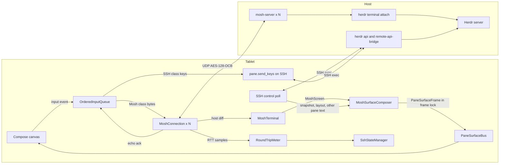

# Plan: Mosh UDP backbone (issue #22)

This plan gives the design and the delivery order for
[issue #22](https://github.com/ToxicBakery/BisonHerdr/issues/22). The user decided to build the full Mosh
path. The plan uses upstream Herdr 0.9.5 at
[`2713feb`](https://github.com/herdrdev/herdr/tree/2713feb56e9c9db33992db0a262c68f7426d46dd) and
`mosh-server` 1.4.0. Each decision gives the evidence, the result, and the reasons.

Line references to this repository are at `03363f5`, which is `main` after pull request #39. A reference
with the label "at `ad4af8f`" is at the older commit.

This is revision 3. Two review rounds and the decisions of the user changed it. The sections
[Changes after review round 1](#changes-after-review-round-1) and
[Changes after review round 2](#changes-after-review-round-2) list each change.

## Summary of decisions

| # | Question | Decision |
|---|----------|----------|
| 1 | What `mosh-server` runs | One `mosh-server` for each visible pane. It runs `herdr terminal attach <terminal_id>` after a UDP gate. The Mosh screen is exactly one Herdr pane. The app never takes a pane from a different attach client. |
| 2 | Language and place | Pure Kotlin. A new KMP module `:core:mosh` holds the wire format, the SSP, the emulator, the frame composer, and the key encoder. `:platform:android:ssh` holds the start over SSH, the Android network bind, and the engine. The plan has no Rust, JNI, NDK, or Zig. |
| 3 | VT emulator | A new Kotlin emulator for the small set of controls that `mosh-server` sends in its diffs. Its screen state is copy-on-write. |
| 4 | Crypto | BouncyCastle `OCBBlockCipher` with `AESEngine.newInstance()`. BouncyCastle 1.86 is already a dependency. |
| 5 | Keys | Hybrid. Text, Enter, Backspace, Tab, Esc, Ctrl keys, PageUp, PageDown, Delete, Insert, Home, and End go over Mosh. Arrows, F-keys, and keys with Alt, Super, or Shift go over SSH `pane.send_keys`. An order barrier keeps the two paths in sequence. |
| 6 | Integration | `negotiateBackbone` returns `ActiveBackbone.MoshUdp` only after a decrypted reply and a successful attach. When no reply comes in 3 s, the app uses the SSH endpoint path and shows the reason. The SSH control lane of a Mosh machine reconnects lazily in the background, and 5 s after a network change in the foreground. A feature flag keeps Mosh off in release builds until the last pull request. |
| 7 | Session policy | Short and polite. No `--takeover`. The app detaches a pane that leaves the screen, and all panes 3 minutes after it goes to the background. `MOSH_SERVER_NETWORK_TMOUT=900`. The UI shows the size lock. |
| 8 | Tests | JVM tests against a real local `mosh-server`, and key tests against real Herdr 0.9.5 and 0.9.0 binaries, on Linux CI. |

The plan has 14 pull requests and 34.5 engineer-days. An independent clean-room review before the last pull
request adds about 1 day.

## Decisions of the user

The user made the decisions in the first six rows. The coordinator made D1 to D4 within the earlier
choices of the user.

| Topic | Decision |
|-------|----------|
| Keys | Hybrid, with an order barrier. Mode-dependent keys go over SSH. While the SSH lane is closed, these keys go over Mosh in CSI form as a best effort. |
| Kitty mode | Esc and the Ctrl keys stay on Mosh. A kitty flag 1 program gets their legacy bytes. This is a known limit with a test. Shift+Enter and the other modified keys stay on SSH. |
| Network change | Lazy reconnect in the background. Mosh panes continue with no SSH. The app opens SSH again at the first SSH-only operation, or when the app comes to the foreground. |
| Network change in the foreground | A visible app must not show old agent status and layout. The app reconnects the control lane after the new network is stable for 5 s. |
| Session policy | No `--takeover`. A pane in use by a different attach client uses the `pane.read` path and shows a mark. Detach 3 minutes after the app goes to the background. `MOSH_SERVER_NETWORK_TMOUT=900`. Show the size lock. |
| Versions and scope | Herdr 0.9.0 or later. Speculative local echo is a follow-up issue. Pull request #44 raises the target SDK to 37 with `ACCESS_LOCAL_NETWORK`, which the Mosh UDP socket to a LAN host also needs. |
| D1, Home and End | Herdr `pane.send_keys` has no names for Home, End, PageUp, PageDown, Delete, and Insert. PageUp, PageDown, Delete, and Insert go over Mosh as `CSI 5~`, `CSI 6~`, `CSI 3~`, and `CSI 2~`. Home and End go over Mosh as `CSI H` and `CSI F`, as a known limit. |
| D2, session loss in the foreground | With no network change, the app reconnects at once with the normal backoff. |
| D3, Esc before an SSH key | Accept about 200 ms more delay after a lone Esc before an SSH key. Correct order comes first. |
| D4, UDP loss in a session | After a network change, when no authentic reply comes in 3 s and SSH is `Live`, the panes move to `pane.read` with a reason. The app stores the failure and tries Mosh again at the next network change. |

A separate pull request fixes the same key name defect on the SSH path of `main`:
`mapKeyEventToHerdrKeySpec` sends `Home`, `End`, `PageUp`, `PageDown`, and `Delete` today. Its issue gets
a link here when it exists. Pull request 3 reuses its key-to-bytes table.

## Evidence

### How the app gets a pane today

The SSH path does not open a Herdr client connection. It polls.

- `RealHerdrSshClient` keeps two persistent `sh` channels for each machine: `WorkerLane.Input` and
  `WorkerLane.Poll` (`RealHerdrSshClient.kt:161`, `2385`). Pull request #12 added these lanes.
- The poll loop runs each 400 ms (`LIVE_POLL_INTERVAL_MS`, `RealHerdrSshClient.kt:3265`). It runs
  `herdr api snapshot`, and one `herdr remote-api-bridge` call for each visible pane with
  `pane.read { source: "visible", format: "ansi" }` (`RealHerdrSshClient.kt:754`, `1884`).
- `buildCompositeSurfaceFrame` parses the ANSI text of each pane into one `PaneSurfaceFrame`
  (`RealHerdrSshClient.kt:2793`).
- A keystroke goes out as `pane.send_text`, `pane.send_keys`, or `pane.send_input` on the input lane
  (`RealHerdrSshClient.kt:1054`). A key chord and a literal text from the key bar go out as a
  `pane.send_keys` RPC on the control queue (`AgentActionDelegate.kt:195-202`,
  `WorkspaceTerminalViewModel.kt:566-568`, `641-643`, `BisonSessionService.kt:217-227`).
- A scroll gesture goes out as a `pane.scroll` RPC with an absolute offset
  (`MachineViewModelDelegate.kt:201-206`, `RealHerdrSshClient.kt:1042`).
- `ClientKeyCode` has no F1 to F12, Insert, or Space. Its only character codes are C, B, D, Z, Y, and N
  (`EndpointAndInputModels.kt:83-140`).
- The app never runs `herdr remote-client-bridge`. `setSurfaceLease` only writes
  `client_shell.surface.set` to the debug log (`SshTransportManager.kt:364-372`).
- Seven functions publish frames on `PaneSurfaceBus` through `framePublisher` in the frame lock of the
  machine (`RealHerdrSshClient.kt:159`, `397`, `420`). See [decision 6](#decision-6-integration).
- The control lane never passes `--session` to `herdr`, also for a machine with `herdrSessionName`. Only the
  old Mosh start command uses the name (`SshTransportManager.kt:858-865`).
- The pane object of `herdr api snapshot` has a `terminal_id` field
  ([`panes.rs:499-501`](https://github.com/herdrdev/herdr/blob/2713feb56e9c9db33992db0a262c68f7426d46dd/src/api/schema/panes.rs#L499-L501)).
  The app model `ClientShellPane` does not read it yet (`ShellSnapshotModels.kt:130-141`).

### How Herdr shows a terminal to a client

- A plain `herdr` command starts a server or attaches a thin client
  ([`main.rs:802`](https://github.com/herdrdev/herdr/blob/2713feb56e9c9db33992db0a262c68f7426d46dd/src/main.rs#L802)).
  The thin client gets rendered frames from the server
  ([`client/mod.rs:1-13`](https://github.com/herdrdev/herdr/blob/2713feb56e9c9db33992db0a262c68f7426d46dd/src/client/mod.rs#L1-L13)).
  Its `TerminalHello` message has no UI configuration
  ([`wire.rs:466-473`](https://github.com/herdrdev/herdr/blob/2713feb56e9c9db33992db0a262c68f7426d46dd/src/protocol/wire.rs#L466-L473)).
- In a black-box test, `mosh-server new -- env HERDR_CONFIG_PATH=tablet.toml herdr` showed pane borders.
  `tablet.toml` set `pane_borders = "off"`. Thus the server drew the chrome from its own configuration.
- `herdr terminal attach <terminal_id> [--takeover]` attaches a client to one terminal
  ([`cli.rs:555-565`](https://github.com/herdrdev/herdr/blob/2713feb56e9c9db33992db0a262c68f7426d46dd/src/cli.rs#L555-L565)).
  The server draws only that terminal, with no chrome
  ([`render_stream.rs:578`](https://github.com/herdrdev/herdr/blob/2713feb56e9c9db33992db0a262c68f7426d46dd/src/server/render_stream.rs#L578)).
- At attach, the server resizes the terminal to the size of the client and locks that size
  ([`headless.rs:1817-1838`](https://github.com/herdrdev/herdr/blob/2713feb56e9c9db33992db0a262c68f7426d46dd/src/server/headless.rs#L1817-L1838)).
  The lock goes away when the attach client exits
  ([`headless.rs:972-980`](https://github.com/herdrdev/herdr/blob/2713feb56e9c9db33992db0a262c68f7426d46dd/src/server/headless.rs#L972-L980)).
- One terminal has one attach client. Without `--takeover`, a second attach fails with "already has an
  attached client; retry with --takeover". With a read in progress, an attach fails with "has a read in
  progress; retry"
  ([`headless.rs:1770-1811`](https://github.com/herdrdev/herdr/blob/2713feb56e9c9db33992db0a262c68f7426d46dd/src/server/headless.rs#L1770-L1811)).
- In an attach client, Ctrl+B (`0x02`) is a prefix. `0x02` and then `q` detaches. Two `0x02` bytes send one
  `0x02`. A complete bracketed paste skips this rule
  ([`attach.rs:63-125`](https://github.com/herdrdev/herdr/blob/2713feb56e9c9db33992db0a262c68f7426d46dd/src/client/attach.rs#L63-L125)).
- The server sends a complete bracketed paste to the pane as one paste. It sends other attach input as raw
  bytes
  ([`pane_input.rs:187-200`](https://github.com/herdrdev/herdr/blob/2713feb56e9c9db33992db0a262c68f7426d46dd/src/server/pane_input.rs#L187-L200)).
  One input message holds at most 1 MB
  ([`client_transport.rs:48`](https://github.com/herdrdev/herdr/blob/2713feb56e9c9db33992db0a262c68f7426d46dd/src/server/client_transport.rs#L48)).
- Mouse capture is on by default
  ([`config/model.rs:1207`](https://github.com/herdrdev/herdr/blob/2713feb56e9c9db33992db0a262c68f7426d46dd/src/config/model.rs#L1207)),
  and the attach client uses it
  ([`client/mod.rs:463`](https://github.com/herdrdev/herdr/blob/2713feb56e9c9db33992db0a262c68f7426d46dd/src/client/mod.rs#L463)).
  With mouse capture on, the input framer holds a lone ESC for 150 ms
  ([`raw_input.rs:44`](https://github.com/herdrdev/herdr/blob/2713feb56e9c9db33992db0a262c68f7426d46dd/src/raw_input.rs#L44)).
  It also holds a bracketed paste until its end marker.
- `pane.send_keys` encodes each key with the key modes of the pane, for example DECCKM and the kitty
  keyboard flags
  ([`panes.rs:2035-2057`](https://github.com/herdrdev/herdr/blob/2713feb56e9c9db33992db0a262c68f7426d46dd/src/app/api/panes.rs#L2035-L2057),
  [`api_helpers.rs:34-46`](https://github.com/herdrdev/herdr/blob/2713feb56e9c9db33992db0a262c68f7426d46dd/src/app/api_helpers.rs#L34-L46)).
- The key name parser has names for the arrows, Enter, Esc, Tab, Backspace, Space, and F-keys. It has no
  names for Home, End, PageUp, PageDown, Delete, and Insert
  ([`keybinds.rs:1281-1349`](https://github.com/herdrdev/herdr/blob/2713feb56e9c9db33992db0a262c68f7426d46dd/src/config/keybinds.rs#L1281-L1349)).
  One bad name fails the full call: "Up Home" sent nothing.
- Herdr 0.5.10 added terminal attach. Herdr 0.6.3 added scrollback with the mouse wheel and PageUp. Herdr
  0.9.0 added the `ui.mouse_capture` rule for an attach. Herdr 0.9.2 and 0.9.3 changed the Esc rules
  ([`CHANGELOG.md`](https://github.com/herdrdev/herdr/blob/2713feb56e9c9db33992db0a262c68f7426d46dd/CHANGELOG.md)).
- Direct terminal attach works on Unix hosts only
  ([`platform/mod.rs:318`](https://github.com/herdrdev/herdr/blob/2713feb56e9c9db33992db0a262c68f7426d46dd/src/platform/mod.rs#L318)).
- Herdr publishes `herdr-linux-x86_64` for each release. CI can download it.

### Black-box tests against `mosh-server` 1.4.0

Three independent test clients in scratch directories talked to a real local `mosh-server` and to an
isolated Herdr 0.9.5 server. The clients are not in the repository. Each test used `127.0.0.1`.

1. The server accepted the first packet of the client. The first authentic reply came after 5 ms.
2. Keystrokes, a resize, and a change to a new client socket (a new local port) worked. After the socket
   change, the next reply came in 12 ms.
3. With `herdr terminal attach`, the Mosh screen held only the pane shell, at the 60x12 size that the
   client sent.
4. When the application exits, the server sends the target state `2^64 - 1`.
5. The test program printed one line each second. While the client sent nothing, the server sent about one
   datagram each second, with new frames and resends, for about 40 s. Then it stopped. One datagram from a
   new socket started the replies again.
6. With `MOSH_SERVER_NETWORK_TMOUT=5`, a server with a silent client exited between 3 s and 9 s. A server
   with no client at all exits about 60 s after its start.
7. The server changes `ESC O A` to `ESC [ A` when its application did not set DECCKM. Its application is
   the attach client, not the pane program. A curses program in keypad mode got `ESC [ A` as three bytes,
   not `KEY_UP`.
8. A kitty-mode program got `CSI 13;2u` for Shift+Enter through `pane.send_keys`.
9. A bracketed paste with 400 `0x02` bytes reached the pane as one paste with all 400 bytes. `ESC 0x02` and
   then `q` outside a paste detached the attach client.
10. A census of the host bytes from random output, `htop`, and `vim` found only the controls in the
    table of [decision 3](#decision-3-the-vt-emulator).
11. A 300x150 truecolor full paint after a silence and a new socket was one instruction of 474 fragments
    (1,767,396 bytes). With the default receive buffer (212,992 bytes), each resend arrived with only 415
    to 417 fragments, and nothing completed in 6 s. With an 8 MiB buffer, it completed at once.
12. A client that always sent the acknowledged state 0 got diffs from state 1, not a full paint. A resize
    to the same size gave only an echo ack. A resize to a new size gave a full paint.
13. A program in `mosh-server` asked for the cursor position (`CSI 6n`) after each test character. With
    glibc 2.43, the regional indicators U+1F1E6 to U+1F1FF had width 1. U+00AD had width 1. U+1160 and
    U+1E5EE had width 0.
14. With an attach failure, `mosh-server` still replied. It sent the error text and then the end state. At
    40 columns, the text "already has an attached client" wrapped to the next row.
15. `mosh-server new -- sh -c 'IFS= read -r _ && exec <command>'` ran the command only after the first
    authentic reply and one gate key from the client.
16. Esc over Mosh and then Up over SSH arrived in the wrong order in 4 of 4 runs. Up (`1b 5b 41`) arrived
    at +67 ms and the ESC at +150 ms. The echo ack came at about 62 ms.

### The Zig build of `libghostty-vt`

- The vendored copy in `8cf8063` cannot build from a clean checkout. The `.gitignore` rule `**/build/`
  dropped `vendor/libghostty-vt/src/build/`, and `build.zig:4` imports `src/build/main.zig`.
- The upstream Ghostty source at the vendored commit `44f2a44d` fails with Zig 0.17.0. Its `requireZig`
  check refuses all versions other than 0.16.
- With Zig 0.16.0, the same source built `libghostty-vt.so` for `aarch64-linux-android` in 108 s with a
  cold cache. The stripped library is 1.9 MB (0.8 MB with gzip) for one ABI.
- The C API in `terminal.h` has no function that copies a terminal state.

## Decision 1: What `mosh-server` runs

**Decision.** Start one `mosh-server` for each visible pane of the tablet. Each server runs a gate and
then `herdr terminal attach <terminal_id>`. The Mosh screen is then the screen of one Herdr pane, at the
size that the tablet gives to that pane.

| Option | Result |
|--------|--------|
| A. `mosh-server new -- herdr` (a full thin client, the design in `01-core-app-design.md:455-482`) | Rejected. In the test, the server drew its own chrome from its own configuration. The app must cut panes out of one screen. A focus RPC on `herdr.sock` moves all clients of the user. |
| B. `mosh-server new -- herdr terminal attach <terminal_id>`, one for each visible pane | **Selected.** The test showed the exact pane screen with no chrome. The tablet keeps control of the layout. Herdr keeps the pane state, so a Mosh session is a view only. |
| C. `mosh-server new -- herdr remote-client-bridge` | Rejected. The bridge sends a `bincode` stream, not a terminal screen. |

**The start script.** The app runs one script on a one-shot `exec` channel for each batch of panes. The
pull request writes the exact text and its tests. The script has these parts:

- Export the same `PATH` as the persistent workers (`RealHerdrSshClient.kt:2397`, `2530`). Herdr installs
  to `~/.local/bin`.
- Use the server path of the machine: `HostMachine.moshServerPath`, else `mosh-server`.
- Use `-l LANG=C.UTF-8`. When the output has the locale error of `mosh-server`, run the batch again with
  `-l LANG=en_US.UTF-8`.
- Use `-s` only when `SSH_CONNECTION` is set. Set `MOSH_SERVER_NETWORK_TMOUT=900`. Use the port range of
  the machine (`HostMachine.DEFAULT_MOSH_UDP_PORT_RANGE` is `60000:61000`).
- Run this command in each server:
  `sh -c 'IFS= read -r _ && exec herdr [--session <name>] terminal attach <terminal_id>'`.
  The command waits for one gate key, so no attach occurs before UDP works.
- Use the same `--session <name>` as the control lane. Pull request 2 makes the control lane use it.
- Do not use `--takeover`.
- Write the pane ID before each output line, and send stderr to stdout. The app reads
  `MOSH CONNECT <port> <key>` and `[mosh-server detached, pid = <pid>]` for each pane. Extend the current
  `MoshBootstrapConfig.parseMoshConnectLine` for the pane tag.

**Old servers of this install.** A stale attach of this tablet can stay after Doze or a lost network.
Then the next attach fails with "already has an attached client". Thus:

- The PID file is `$HOME/.cache/bison-herdr/mosh-<installId>-<machineKey>.pids`, with one line for each
  terminal ID and PID. `installId` is the `device.id` marker of `MachineStore` (`MachineStore.kt:261-298`).
  `machineKey` is a hex hash of the machine ID.
- Before each start for a terminal, the script stops the old PID of this install for that terminal.
- On a full connect, the script stops all PIDs in the file.
- Stop a PID only when `ps -p <pid> -o args=` shows `mosh-server` and `terminal attach <terminal_id>`.
  After a host restart, the system can give an old PID to a different process.

**Attach check.** A decrypted reply proves only that UDP works. For each session, the client does these
steps:

1. Send the first state with the size of the pane. Send it again each 250 ms. Wait for the first authentic
   reply for at most 3 s.
2. Send the gate key `\n`.
3. Wait 500 ms. Join the soft-wrapped rows of the screen before each text match.
4. "already has an attached client": stop the session. The pane uses the `pane.read` path and shows the
   mark "pane in use on another device". Do not try again until the pane leaves the screen. This text also
   has the word "retry", so match it first.
5. "has a read in progress": start that session again, at most 3 times, 200 ms apart.
6. An end state, or other text with "terminal attach failed" or "failed to connect to server": the class
   `Failed`. The pane uses the `pane.read` path and shows the mark "Mosh failed".
7. Else the attach works. An end state after these 500 ms is a session end (see the lifecycle rules).

**Size.** The tablet computes the cell rectangle of each pane from `pane.layout`, scaled to its viewport,
as `buildCompositeSurfaceFrame` does today. The client sends that size before the gate and after each
change. Herdr then resizes the pane and locks the size while the attach client runs. Each Mosh pane shows a
lock mark with the text "size set by this tablet".

**Lifecycle rules.**

- A pane can leave the screen by a tab change, a zoom, or a close on the host. When it does not come back
  in 15 s, detach its session.
- A session that ends while its pane stays visible: start it again, with the attach check. A start that
  gets "already has an attached client" gives the in-use mark.
- At most 8 Mosh sessions for each machine. A pane over the limit uses `pane.read` on SSH.
- The detach sends `0x02` and then `q` over Mosh, and waits up to 2 s for the end state.

**What stays on SSH.**

| Operation | Path with Mosh |
|-----------|----------------|
| Screen of a visible pane | Mosh |
| The Mosh keys of [decision 5](#decision-5-keys-and-input), paste up to 128 KiB, and mouse events | Mosh |
| Arrows, F-keys, and the other SSH keys of decision 5 | SSH `pane.send_keys` |
| A paste from 128 KiB to 1 MB | SSH `pane.send_text`, with the order barrier |
| Pane size | Mosh resize. Herdr locks the size. |
| Scroll of a pane | Mosh wheel events when the Mosh screen shows a mouse mode and mode `?1006`. Else SSH `pane.scroll`. |
| A composer prompt to a pane with a Mosh session | Mosh, as a bracketed paste and `\r` |
| A prompt to a named agent (`agent.prompt`) | SSH |
| Input from a notification action (Approve sends Enter, Reject sends Esc) | SSH `pane.send_keys`, because the app is in the background |
| Snapshot, layout, tabs, agents, agent status | SSH poll each 1 s, with no `pane.read` for a pane with a Mosh session |
| Focus, split, close, zoom, rename, split ratio | SSH (`herdr remote-api-bridge`) |
| Start of `mosh-server`, and a stop by PID | SSH |
| Detach of an attach client | Mosh |
| Agent text for notifications | The Mosh screen for a pane with a Mosh session. Else `pane.read`. |

**Limits.** Herdr 0.9.0 or later, which the app reads with `herdr --version`. A Unix host, because direct
attach does not work on Windows. No ProxyJump, because UDP cannot pass the SSH bastion. Such a machine uses
the SSH endpoint path with the reason "Mosh cannot pass a ProxyJump bastion".

## Decision 2: Language and place

**Decision.** Write the Mosh client in Kotlin. Put the logic in a new KMP module `:core:mosh`. Put the
Android parts in `:platform:android:ssh`.

| Criterion | Kotlin in `:core:mosh` | Rust prototype over JNI |
|-----------|------------------------|-------------------------|
| Build | Gradle only | `cargo-ndk`, rustup Android targets, a Gradle native step, and Zig 0.16 for the emulator |
| CI time | `apt-get install mosh` (about 15 s), two Herdr downloads, and JVM tests | A Rust and Zig build for each ABI (108 s cold for `libghostty-vt` alone), and caches |
| Tests with a real `mosh-server` | JVM unit tests on Linux CI | Cargo tests for the codec. The JNI path needs a device or a host build of the library. |
| APK size | About 0.2 MB of DEX. BouncyCastle is already in the APK. | 1.9 MB stripped for each ABI for `libghostty-vt`, plus the Rust library |
| Module rules | `:core:mosh` imports no `:platform:*` module | The JNI bridge must live in `:platform:*` |

**Module layout.**

- `:core:mosh` targets `android` and `jvm`, as the other `:core:*` modules do. `commonMain` holds all
  logic and takes the time from an injected `TimeSource`.
- Two platform parts use JVM APIs: the OCB cipher (BouncyCastle) and zlib (`java.util.zip`). Declare each
  as a common interface with an `expect fun` factory, as `:core:common` does (`ClipEntries.kt:6`). Do not
  use an `expect class`, because Kotlin marks it as Beta with a warning.
- Put the `actual fun` factories and the UDP port in an intermediate source set `jvmSharedMain`, which
  `jvmMain` and `androidMain` depend on. Make the group with the default hierarchy template. Pull request 4
  finds the exact Gradle API for the Android KMP library target, with zero warnings. When that fails, add
  one shared directory to both source sets with `kotlin.srcDir`, or keep two copies.
- The UDP port class `JvmDatagramPort` uses a plain `java.net.DatagramSocket`. It asks for a receive buffer
  of 8 MiB (`SO_RCVBUF`), at least 4 MiB, and logs the size that the system gives. A dedicated thread reads
  the socket. The port takes a `socketBinder` function, which Android uses for
  `Network.bindSocket(DatagramSocket)`.

## Decision 3: The VT emulator

**Decision.** Write a new Kotlin emulator, `MoshTerminal`, for the controls that `mosh-server` sends in
its diffs. Do not write a full xterm emulator.

The server runs the application in its own emulator. It sends a diff that changes the old client screen
into the new screen. Thus the client never sees the raw output of the application. It sees only the
controls that the server uses to draw a diff, and the census found a small, fixed set.

| Option | Result |
|--------|--------|
| New Kotlin emulator for the diff controls | **Selected.** Small, JVM-testable, and copy-on-write for the received states. |
| `libghostty-vt` over Zig and JNI (MIT) | Rejected. It needs Zig 0.16 exactly, a JNI bridge, and 1.9 MB for each ABI. Its C API cannot copy a state. |
| JediTerm (Apache-2.0 option of an LGPLv3 or Apache-2.0 dual license) | Rejected. It is a full xterm emulator for a Swing UI. We found no API for a cheap copy of a screen state. |
| ConnectBot `termlib` (Apache-2.0) over libvterm (MIT) | Rejected. It needs JNI and an NDK build, and it brings its own Compose view. |
| Termux `terminal-emulator` | Rejected. The `termux-app` repository is GPLv3-only. Its exception gives Apache-2.0 only to the code from Jackpal Android-Terminal-Emulator, so the license of each Termux change is not clear. It is also a full emulator with no state copy. |

**Controls that the emulator must apply** (census of `mosh-server` 1.4.0 host bytes):

| Kind | Controls |
|------|----------|
| C0 | BEL `0x07`, BS `0x08`, LF `0x0A`, CR `0x0D` |
| Cursor | CUP `CSI row;col H` and `CSI H` |
| Erase | EL `CSI K`, ED `CSI 2 J` (in a full repaint), ECH `CSI n X` |
| Scroll | DECSTBM `CSI top;bottom r` and `CSI r`. LF at the bottom margin scrolls the region up. |
| SGR | `0`, `1`, `2`, `3`, `4`, `5`, `7`, `8`, `9`, `21`, `30`-`37`, `40`-`47`, `38;5;n`, `48;5;n`, `38;2;r;g;b`, `48;2;r;g;b`. Each SGR starts with `0`. |
| Modes | `?25` cursor, `?5` reverse video, `?1000` `?1001` `?1002` `?1003` `?1004` `?1005` `?1006` `?1015` mouse, `?2004` bracketed paste |
| OSC | `0`, `1`, `2` (title), `52` (clipboard), each with BEL at the end |
| Text | UTF-8, wide cells (2 columns), zero-width characters on the cell before, autowrap at the right margin |

**Rules for the emulator.**

- Apply the standard ECMA-48 and xterm function of each control in the table. Accept the other SGR values
  (`22`-`29`, `39`, `49`, `90`-`97`, `100`-`107`) with the xterm function.
- Ignore each other control, and count it in a debug counter. Never throw on input from the network.
- Keep the xterm "last column" state: a character in the last column sets a wrap flag. The next printable
  character wraps. CR, BS, and CUP clear the flag. The emulator oracle test checks this rule.
- Keep the title, the bell count, the clipboard writes, and the modes in the state. A clipboard write needs
  a user option (default off), because a host can put text on the device clipboard.

**Width rules.** The server computes each width with its own libc. The client must agree.

- Width 2: the code points with East_Asian_Width W or F.
- Width 0: General_Category Mn, Me, and Cf, except U+00AD. Also U+200B, the medial and final jamo
  U+1160 to U+11FF, and U+D7B0 to U+D7FF.
- Width 1: all other code points, also U+00AD and the regional indicators U+1F1E6 to U+1F1FF.
- A code point that is not assigned in the Unicode data of the app has width 1.
- Use the newest Unicode data files at the time of the pull request. An older glibc on a host can give a
  different width for a new code point, for example U+1E5EE of Unicode 16.0 before glibc 2.41.

**State model.** `MoshScreen` is an immutable value: a list of rows, the cursor, the pen, the modes, and
the title. A row is an immutable array of cells. `MoshTerminal.apply(screen, hostBytes)` returns a new
screen. It copies the row list and only the rows that the diff changes. Each kept state thus costs one row
list, not a full screen.

**Recovery.** The protocol has no request for a full paint (black-box fact 12). The "Refresh pane" action
sends a resize to one row less, and then the correct size, over Mosh. The second resize gives a full paint
and needs no SSH. The pane program gets two size changes, and most programs then draw their screen again.

## Decision 4: Crypto and wire format

**Crypto.** Use `org.bouncycastle.crypto.modes.OCBBlockCipher` with two `AESEngine.newInstance()` values.
The constructor `new AESEngine()` is deprecated in BouncyCastle 1.86 and gives a warning. Use a 12-byte
nonce and a 128-bit tag. BouncyCastle 1.86 (`bcprov-jdk18on`, the MIT-style Bouncy Castle Licence) is
already in `libs.versions.toml`. Android and the JDK have no public OCB in their JCA providers. The tests
check BouncyCastle against the sample results in Appendix A of
[RFC 7253](https://www.rfc-editor.org/rfc/rfc7253).

**Names.** The wire has field numbers, not names. The code of this app uses its own names:

| Field | Our name | Role (from black-box tests) |
|-------|----------|-----------------------------|
| 1 | `version` | Always 2 |
| 2 | `fromState` | The state that the diff starts from |
| 3 | `toState` | The state that the diff makes |
| 4 | `ackState` | The newest state of the peer that the sender has |
| 5 | `keepState` | The oldest state that the sender can still use as `fromState` |
| 6 | `diff` | The diff |
| 7 | `noise` | Random bytes with a random length |

**Wire facts.** Each fact has a source. P is the [Mosh paper](https://mosh.org/mosh-paper.pdf) (USENIX ATC
2012). B is a black-box test. M is the `mosh-server` banner and its man page. The prototype in `8cf8063` is
not a source (see [Clean-room rules](#clean-room-rules)).

| # | Fact | Source |
|---|------|--------|
| 1 | `mosh-server new` prints `MOSH CONNECT <port> <key>` on stdout and `[mosh-server detached, pid = <pid>]` on stderr. The key is 22 base64 characters with no `=` at the end: 16 bytes. | B, M |
| 2 | A datagram is an 8-byte header, the OCB ciphertext, and a 16-byte tag. Header bit 63 is the direction: 0 from the client, 1 from the server. Bits 0-62 are the sequence number. The header is big-endian. | B |
| 3 | The nonce is 4 zero bytes and then the 8-byte header. The mode is AES-128-OCB with no associated data. | B, P 2.2 |
| 4 | The plaintext is a 16-bit timestamp (milliseconds modulo 65536), a 16-bit timestamp reply (`0xFFFF` for none), and one fragment. | B, P 2.2 |
| 5 | A fragment is a 64-bit instruction ID, a 16-bit fragment number with bit 15 as the "final" flag, and the content. The content of all fragments of one ID, in order, is the zlib stream of one instruction. Each resend of an instruction has a new ID. | B |
| 6 | The instruction is a protobuf message with fields 1 to 7 of the names table. The numbers are unsigned varints. | B |
| 7 | The client diff has field 1 repeated. Each entry has field 2 (keys: field 4, bytes) or field 3 (size: field 5 columns, field 6 rows). | B |
| 8 | The server diff has field 1 repeated. Each entry has field 2 (bytes: field 4), field 3 (size: fields 5 and 6), or field 7 (echo ack: field 8). | B |
| 9 | The host bytes are a diff between two screens, not the raw output of the application. | P 2.3, B |
| 10 | The server sends to the source address of each authentic datagram with a sequence number higher than all before. The client keeps one sequence counter for the session, also across sockets. | P 2.2, B |
| 11 | The target state `2^64 - 1` tells that the session ended. | B |
| 12 | While the screen does not change and the server gets datagrams, the server sends a heartbeat about each 3 s. While the screen changes, it sends frames and resends. It stops about 40 s after the last client datagram. `MOSH_SERVER_NETWORK_TMOUT` stops a server with a silent client. | B, P 2.2 |
| 13 | The RTT estimate is the TCP algorithm with a minimum RTO of 50 ms. The timestamp reply includes the time that the peer held the timestamp. | P 2.2 |
| 14 | Delayed ack: 100 ms. The server waits a collection interval of 8 ms after the first change. Minimum frame interval: SRTT / 2. Maximum frame rate: 50 Hz. | P 2.3 |
| 15 | The echo ack is the newest user state that the application of the server got at least 50 ms before. Its value is a user state number. | P 3.2, B |
| 16 | The server changes `ESC O A`-`D` to `ESC [ A`-`D` when its application did not set DECCKM. | B |
| 17 | The server can diff from a state that it sent but that the client did not acknowledge. | B |

**Values that this plan selects.** These values are not from Mosh. They are the choices of this client.

| Value | Choice | Reason |
|-------|--------|--------|
| Maximum RTO | 1000 ms | A keystroke does not wait more than 1 s for a retransmission. |
| Maximum frame interval | 250 ms | The paper uses this value in its traces. |
| New socket after silence | 10 s with no authentic datagram | A NAT can drop the old port entry. A new local port gets a new entry. |
| UDP budget | 3 s, with a send each 250 ms | A cellular RTT can be more than 1 s under load. |
| Received states kept | All states at or after the `keepState` of the server, at most 32 | The server can diff from a state that the client did not acknowledge (fact 17). |
| Size limits | 1024 fragments, 8 MiB after zlib, and the parts of the 4 newest instruction IDs | A 300x150 truecolor paint used 474 fragments (fact 11). Only an authentic packet gets to zlib. |
| Receive buffer | 8 MiB asked, at least 4 MiB | With 212,992 bytes, a large paint never completed (fact 11). |

**Sender rules (client to server).** The user state is the list of the user events (keys and sizes). The
state number increases by one for each sent state that adds events.

1. A state with new events: `fromState` is the newest state that the server acknowledged. `toState` is the
   current state. The diff holds all events after `fromState`.
2. The real-server test with loss must prove that each event reaches the pane one time.
3. A heartbeat or an ack: `fromState` and `toState` are the newest state that the server acknowledged.
4. `keepState` is the newest state that the server acknowledged.
5. Send again after the RTO while the server did not acknowledge the current state.
6. Send a new user state at once when the last send is older than the frame interval. Else send it at the
   end of the interval. The frame interval is SRTT / 2, in the range 20 ms to 250 ms.

**Receiver rules (server to client).**

1. Drop each datagram that does not decrypt. Do not log its content.
2. Take the timestamp, the timestamp reply, and `ackState` from each authentic datagram. Do this also when
   the client cannot apply the diff.
3. Apply the diff only when the client has `fromState` and does not have `toState`. Keep the new state.
4. Remove the states before the `keepState` of the server.
5. Acknowledge the newest state after the delayed ack interval, or at once with the next user state.
6. Take an RTT sample from each timestamp reply that is less than 5 s old.

## Decision 5: Keys and input

**Decision.** Hybrid keys. A key goes over Mosh when its bytes do not depend on the modes of the pane. A
key also goes over Mosh when Herdr has no name for it. Each other key goes over SSH `pane.send_keys`, and
Herdr encodes it for the pane.

**Why.** The attach client sends raw bytes to the pane. The tablet sees only the modes of the attach
client in the Mosh screen, not the modes of the pane. A curses program in keypad mode thus got `ESC [ A`
as three bytes (black-box fact 7). `pane.send_keys` encodes the key with the DECCKM and kitty flags of the
pane (black-box fact 8).

**Classes.**

| Class | Keys | Path and bytes |
|-------|------|----------------|
| Mosh | Text from the keyboard or the composer | UTF-8 bytes |
| Mosh | Paste up to 128 KiB | `CSI 200~` text `CSI 201~`. Remove each `ESC [201~` from the text first. |
| Mosh | Enter, Backspace, Tab, Esc | `\r`, `0x7F`, `\t`, `0x1B` |
| Mosh | Ctrl+A to Ctrl+Z, Ctrl+Space, Ctrl+`[` `\` `]` `^` `_` | The C0 byte |
| Mosh | PageUp, PageDown, Delete, Insert, with or without modifiers | `CSI 5~`, `CSI 6~`, `CSI 3~`, `CSI 2~`, or the `CSI n;m~` form with the xterm modifier value `m` |
| Mosh (best effort) | Home, End | `CSI H`, `CSI F`. Known limit 2. |
| Mosh | Mouse click and wheel, when the Mosh screen shows a mouse mode and `?1006` | SGR mouse events. The attach client changes them for the pane, or scrolls the scrollback. |
| SSH | Arrows, F1 to F12, with or without modifiers | `pane.send_keys` |
| SSH | Shift+Tab, Shift+Enter, Ctrl+Enter, and each key with Alt, Super, or a Ctrl or Shift that is not in the Mosh rows | `pane.send_keys` |
| SSH | Paste from 128 KiB to 1 MB | `pane.send_text`. Herdr wraps it as a paste for the pane. |
| Refused | Paste over 1 MB | The UI shows "The paste is too large". One Herdr input message holds at most 1 MB. |

**The `0x02` rule.** Outside a complete paste, the encoder doubles each `0x02` byte of a Mosh state, not only
the byte of Ctrl+B. The attach client then sends one `0x02` to the pane, and `ESC 0x02 q` cannot detach
(black-box fact 9). Inside a paste, the encoder does not double `0x02`.

**Paste size.** A Mosh paste of 128 KiB is about 100 fragments. That fits in the default receive buffer of
`mosh-server` (212,992 bytes on Linux). A larger paste goes over SSH with the order barrier.

**Known limits.**

1. Kitty mode. Kitty keyboard flag 1 changes the bytes of Esc and of the Ctrl keys to `CSI u` forms. Over
   Mosh, a kitty flag 1 program gets the legacy bytes, for example `0x1B` for Esc and `0x01` for Ctrl+A. Most
   programs accept the legacy bytes. A test on a real Herdr records the bytes.
2. Home and End. In application cursor mode, a program expects `SS3 H` and `SS3 F`. Over Mosh, it gets
   `CSI H` and `CSI F`. Herdr has no key names for Home and End, so `pane.send_keys` cannot encode them for
   the pane. When a later Herdr adds these names, these keys move to the SSH class.

**Order barrier.** One ordered input queue for each pane holds both classes. `S` is the user state number
of the last Mosh byte in the queue.

1. A Mosh key goes into the Mosh user stream at once, when no SSH key is in the queue or in flight for the
   pane.
2. Before an SSH key, the queue waits for an echo ack of `S` or higher (fact 15).
3. When the state `S` ends with a lone ESC or holds a paste, the queue waits 200 ms more after the echo
   ack. The attach client holds a lone ESC for 150 ms, and it holds a paste until its end marker.
4. Sometimes the server acknowledges `S`, but no echo ack comes in 1 s. Then the queue continues as if
   the echo ack came, with the rule of step 3.
5. When the server did not acknowledge `S` in 1 s, the queue sends the SSH key over Mosh in CSI form. One
   stream keeps the order.
6. The queue merges only SSH keys that are next to each other in the queue into one `pane.send_keys` call.
   "Up, x, Down" stays three steps.
7. Later Mosh keys stay in the queue until the call returns or its deadline ends.
8. For a pane with a Mosh session, no `pane.read` follows the call. The Mosh screen shows the result.

**Deadline of an SSH key call.** `runCommandsOnWorker` blocks in `readLine()` with no timeout
(`RealHerdrSshClient.kt:2495`). JSch finds a dead path only after 3 keepalive messages 10 s apart
(`RealHerdrSshClient.kt:2180-2181`). Thus:

- Each SSH key call has a deadline of 1 s plus the current Mosh SRTT.
- At the deadline, the queue closes the input worker, so that the blocked read ends. It starts the liveness
  check of the control lane.
- Until the check passes, the queue sends SSH keys over Mosh in CSI form.
- The queue does not send the keys of a call that passed its deadline again, because the call can have
  reached Herdr. The user sees the result on the Mosh screen and can press the key again.

**SSH lane closed.** The SSH lane is closed when the supervisor is in `NetworkSettle`, `Dormant`,
`Reconnecting`, `NeedsLogin`, or `Stopped` (decision 6). Then an SSH key goes over Mosh at once, in the
xterm form for a terminal with no special modes. Examples: `CSI A` for Up, `CSI 1;5C` for Ctrl+Right,
`CSI 15~` for F5, `CSI Z` for Shift+Tab, and `ESC x` for Alt+x. This is a best effort: a curses program in
keypad mode does not read `CSI A` as an arrow. In `Dormant`, the key also starts a reconnect.

**Latency cost.** RTT is the round trip time, and H is the run time of the Herdr command on the host.

| Case | Added delay |
|------|-------------|
| SSH key with no recent Mosh key | 1 RTT + H, the same as the SSH path today |
| SSH key just after a Mosh key | Up to 1 RTT + 50 ms for the echo ack, then 1 RTT + H |
| SSH key just after a lone Esc or a paste | 200 ms more (D3) |
| Mosh key just after an SSH key | The rest of the SSH call, then 0.5 RTT |
| Text with no SSH key near it | 0.5 RTT to the server, the normal Mosh delay |

**Other input paths.** For a pane with a Mosh session, all input goes through the per-pane queue:

- Key chords and text with an active modifier use `sendKeyChord` today, which sends a `pane.send_keys` RPC
  on the control queue. Pull request 3 changes these to `SendPaneInput` key events. It extends
  `ClientKeyEvent` with F1 to F12, Insert, Space, and a general character code with modifiers.
- A scroll request is a `pane.scroll` RPC with an absolute offset. When the Mosh screen shows a mouse mode
  and `?1006`, it becomes wheel events for the difference of offsets. Else it stays a `pane.scroll` RPC.
- A notification action in the background (Approve, Reject) goes over SSH `pane.send_keys`
  (`BisonSessionService.kt:352-378`).

## Decision 6: Integration

**Connect.** `SshTransportManager.runConnectSteps` stays the same (`SshTransportManager.kt:266`).
`RealSshBackend.negotiateBackbone` (`RealSshBackend.kt:134`) gets a Mosh branch:

1. When the flag is off or the mode is `SshEndpointOnly`, return `SshEndpoint` as today.
2. When the route has a bastion, return `SshEndpoint` with the bastion reason.
3. When UDP failed on this network to this host in the last 10 minutes, return `SshEndpoint` with the
   stored reason. The key of the memory is the Android `Network` and the host IP address.
4. Check the server path and `herdr --version` in one batch. When a check fails, return `SshEndpoint` with
   the reason, for example "Herdr 0.8.2 is too old for Mosh (needs 0.9.0)".
5. Read the snapshot. Find the visible panes and their `terminal_id` values.
6. Run the start script for the visible panes. Parse the port, the key, and the PID of each pane.
7. Open a `MoshConnection` for each pane to the IP address of the SSH socket peer, not to a new DNS result.
8. Do the attach check of decision 1 for each session.
9. Return `ActiveBackbone.MoshUdp` when the focused pane passes the check. The `rttMs` is the first
   measured RTT. A pane that fails the check uses the `pane.read` path with its mark.
10. When no session gets an authentic reply in 3 s, stop the servers by PID over SSH. Store the UDP failure
    for this network. Return `SshEndpoint` with the reason "No UDP reply from `<ip>:<port>` in 3 s. The
    network can block UDP."
11. A `MoshOnly` machine returns `null` in the case of step 10. The manager shows the same text in
    `NeedsUserCause.Other`.

No pane gets a size lock on a network that blocks UDP, because the gate key never arrives. The servers
exit about 60 s after their start with no client, also when the stop by PID fails.

`ActiveBackbone.MoshUdp` gets `sessionCount`, with a default value so that old JSON still loads. A new
`MoshMachineState` in `SshStateManager` holds the state of the control lane: `Open`, `Offline`,
`NeedsLogin`, or `Stopped`. It also holds a mark for each pane: `Mosh`, `InUseElsewhere`, `OverLimit`,
`UdpBlocked`, or `Failed`.

**UDP loss in a session (D4).** This rule applies after a network change. When no authentic reply comes
in 3 s and the SSH lane is `Live`, the engine does these steps:

1. Stop the Mosh servers of the machine by PID over SSH, so that Herdr removes the size locks.
2. Move the panes to the `pane.read` path with the mark `UdpBlocked` and the reason "No UDP reply after the
   network change".
3. Set the backbone to `SshEndpoint` with the same reason, and store the failure for this network.
4. At the next network change, try Mosh again with new sessions.

**Frames.** For a Mosh machine, the engine is the only source of frame content. It publishes in the frame
lock of the machine (`backend.withFrameLock`, pull request #39, `RealHerdrSshClient.kt:420`), at most each
16 ms. Each current publisher gets a rule:

| Publisher | Today | Rule for a Mosh machine |
|-----------|-------|-------------------------|
| `RealHerdrSshClient.resizeViewport` (`RealHerdrSshClient.kt:714`) | Publishes the cached frame at the new size | Gives the viewport to the engine. Publishes nothing. |
| `refreshSnapshotAndSurface` (`754`) | Publishes the frame of the poll | Control mode. Publishes the snapshot only. Gives the layout and the `pane.read` text of the other panes to the engine. Records no poll time. |
| `sendPaneInput` (`1193`) | Publishes an optimistic edit | No optimistic edit. The input queue of decision 5 takes the event. |
| `republishCachedSurface` (`1678`) | Publishes after a scroll | A Mosh pane scrolls with wheel events. For a different pane, gives the new text to the engine. |
| `updateFocusedPaneSurfaceFromInput` (`1714`) | Publishes the `pane.read` after an input | No `pane.read` after a key to a Mosh pane. For a different pane, gives the text to the engine. |
| `applyOptimisticPaneFocus` (`1750`) | Publishes a focus change | The engine applies the focus. |
| `SshTransportManager.setSurfaceLease` (`SshTransportManager.kt:364`) | Publishes a copy with a new epoch | Keep. In the frame lock, it copies the newest frame on the bus, which is an engine frame. |

The old `MoshUdpEngine.synthesizeAndPublishFrame` (`MoshUdpEngine.kt:257-353`) goes away. Pull request #39
merged, so the frame lock is on `main`.

**RTT.** Each session gives its RTT samples to the current `RoundTripMeter` (`RoundTripMeter.kt:25-70`).
The meter publishes at most one value each second through `SshStateManager.setRoundTripTime`.

- The control-mode poll of a `MoshUdp` machine records no poll time (`RealHerdrSshClient.kt:1021`).
- An SSH reconnect of a `MoshUdp` machine does not reset the meter. Today `onReconnected` resets it
  (`RealHerdrSshClient.kt:319-323`).
- The meter starts a new average only when the backbone changes.
- The UI shows "RTT n ms" for `MoshUdp` and "poll n ms" for `SshEndpoint`. When no authentic datagram came
  for 5 s and the session is not parked, the UI shows "Last reply n s ago".

**Foreground and background.** In this plan, the app is in the foreground for a machine when its surface
lease is on (`SshRequest.SetSurfaceLease`, `active = true`). The app is in the background when the lease is
off. The lease follows the start and the stop of the activity.

**Lazy control lane.** For a Mosh machine, `SessionSupervisor` gets a lazy mode with these states. The
UI state of `MoshMachineState` follows them: `Live` is `Open`, `NeedsLogin` is `NeedsLogin`, and `Stopped`
is `Stopped`. All other states are `Offline`.

| State | The supervisor | Next state |
|-------|----------------|------------|
| `Live` | The SSH session is open. The control poll runs. | When the session closes: `Reconnecting` in the foreground (D2), `Dormant` in the background. `NetworkSettle` on a network change in the foreground. |
| `Dormant` | No session and no attempt. The control poll pauses. The UI shows "control lane offline", and the agent status shows as old. | `Reconnecting` on a trigger. `NetworkSettle` on a network change in the foreground. |
| `NetworkSettle` | The app is in the foreground, and the default network changed. A 5 s timer runs. | A new timer on each new network change, up to 15 s in all. When the timer ends: a liveness check from `Live`, or `Reconnecting` from `Dormant`. `Reconnecting` at once on a trigger. The earlier state when the app goes to the background. `Dormant` when the network is lost. |
| `Reconnecting` | The current loop of attempts with the current delays, through the control-lane login | `Live` on success. `NeedsLogin` or `Stopped` by the cause class below. `Dormant` when the app is in the background and no SSH-only operation waits. |
| `NeedsLogin` | No attempt. The UI shows "control lane needs login". | `Reconnecting` on a tap on the mark, on an SSH-only operation in the foreground, or when the app comes to the foreground. |
| `Stopped` | No attempt. The UI shows the `NeedsUserCause` and the `HostKeyPrompt`, as today (`SshTransportManager.kt:318-328`). | A connect or a disconnect from the user. A foreground move does not start an attempt. |

- A network change is `onAvailable` or `onLinkPropertiesChanged`. `onLost` gives `Dormant`.
- The liveness check is the current check: a keepalive message and one `exec true`, with a 3 s limit. When
  it fails, the supervisor goes to `Reconnecting`. When it passes, the state goes back to `Live`.
- When the app comes to the foreground in `Live`, the manager runs the liveness check once.
- These triggers start a reconnect:
  - An RPC through `sendEndpointCommand` that is not input to or a scroll of a Mosh pane.
  - A prompt to a named agent, or an SSH key.
  - The start of a Mosh session for a new visible pane, or a `pane.read` for a pane with no Mosh session.
  - A tap on the mark, or the move of the app to the foreground.
- The paused control poll does not start a reconnect.

**Cause classes.** The current supervisor sends each result that is not a network error to `onNeedsUser`
(`SessionSupervisor.kt:215-219`). For a Mosh machine:

- `UserAuthRequired`, `InputRequired`, and the password cause `PasswordMissing` give `NeedsLogin`. A
  prompt can fix them.
- `HostKeyUnknown`, `HostKeyChanged`, `AuthFailed`, `KeyMissing`, and `Failed` give `Stopped`. The UI keeps
  the cause and the host key prompt of today. The app does not try again at each foreground move.
- In both cases, the Mosh sessions stay open. `releaseConnection` splits into `releaseControlLane` and the
  full release. `onNeedsUser` uses only `releaseControlLane`.

**The control-lane login.** `reconnectAttempt` never shows the biometric prompt
(`RealHerdrSshClient.kt:2005`). Only `RealSshBackend.authenticate` does (`RealSshBackend.kt:88-114`). A
full `connect()` would run `negotiateBackbone` again and start new Mosh sessions. Thus:

- Add `RealSshBackend.reconnectControlLane(machine, route)`. It runs the user-auth step of
  `authenticate`, and then opens a new SSH session only. It runs no `negotiateBackbone`.
- The supervisor of a Mosh machine uses it as its attempt function.
- In the background, it shows no prompt. A key that needs a prompt then gives `NeedsLogin`.

**Network events.** `BisonSessionService` gives the `Network` object of each callback to the manager
(`BisonSessionService.kt:95-110`). Pull request 10 adds this, because the UDP failure memory and the socket
bind need it.

- `onAvailable` and `onLinkPropertiesChanged`: the engine opens a new socket for each Mosh session. It
  binds the socket with `Network.bindSocket` and sends one datagram at once. A parked session changes its
  socket at the next unpark.
- In the background, the manager does not run the SSH liveness check and does not call `reconnectNow` for a
  Mosh machine. In the foreground, the supervisor goes to `NetworkSettle`.
- `onLost`: the Mosh sessions stay open, and their timers continue. The manager closes the SSH sockets as
  today (`SshTransportManager.kt:619`).

**Connected state.** A Mosh machine with a closed control lane stays in `connectedMachines`. Else
`ServiceStopPolicy` stops the service after 30 s with no connected machine. `RoamingStatus` follows the Mosh
sessions: `Healthy` while they get replies, `SurfaceParked` while the lease is off, and `RoamingReconnect`
only when all sessions get no reply. `submitAgentPrompt` queues a prompt to a named agent when the control
lane is not `Open`. A prompt to a Mosh pane goes over Mosh.

**Background.** `setSurfaceLease(active = false)` parks the sessions. A parked session sends nothing, and
the server stops after about 40 s (fact 12). `client_shell.surface.set` has no effect on this path,
because the tablet has no thin client.

**Detach.** After 3 minutes in the background, the engine detaches each session over Mosh. The attach
client exits, Herdr removes the size lock, and `mosh-server` ends. A session with no reply ends after
`MOSH_SERVER_NETWORK_TMOUT` (900 s). In CPU sleep, the timer can fire late. The next foreground move
reconnects SSH and starts new sessions.

**Target SDK 37.** Pull request #44 raises the target SDK to 37 and adds `ACCESS_LOCAL_NETWORK`. On target
37, a socket to a local network address needs that permission. This applies to the SSH socket and to the
Mosh UDP socket. When the permission is denied, the engine returns `SshEndpoint` with the reason "Local
network access is off".

**Feature flag.** The flag has two cases:

- Pull request #43 adds `FeatureFlags` in `:core:model`. A Gradle property sets each field, and a release
  build with the property stops. When #43 merges first, add the field `moshTransport` to `FeatureFlags`,
  with the Gradle property `bison.moshTransport`.
- When #43 does not merge first, add `MoshFeatureFlag(enabled: Boolean)` with the same Gradle property and
  the same release check. When #43 merges later, move the flag into `FeatureFlags`.
- With the flag off, the code path is the code path of today. The tests construct the backend with the flag
  on.
- The last pull request turns the flag on in release, removes its release check, and enables the
  `MoshOnly` choice (`ConfigureMachineScreen.kt:261`).

## Decision 7: Tests and CI

**Unit tests for each layer** (`:core:mosh` `commonTest`, virtual time):

- Wire: the RFC 7253 sample results and datagram round trips. Fragment split and join with order, loss,
  duplicates, new IDs for resends, and limits. The protobuf codec with unknown fields. The zlib limit. A
  bad tag, a short packet, and fuzz input.
- SSP: a simulated network that drops, delays, duplicates, and reorders datagrams. Assert these results:
  - The timers: heartbeat 3 s, delayed ack 100 ms, RTO bounds, and frame interval.
  - Each key reaches the server one time, and the screen converges.
  - The count of kept states stays in its bound.
  - A new socket opens after 10 s of silence, and the end state stops the session.
- Emulator: one test for each control in the decision 3 table, with streams from the census. Tests for the
  wrap flag, wide characters, zero-width characters, and the scroll region.
- Keys: each row of the class table, the `0x02` rule, the paste rules, and the CSI forms.
- Order barrier, with a fake Mosh session and a fake SSH call: mixed sequences, a lone ESC, and a paste.
  Also a late echo ack, no ack in 1 s, the merge rule, the deadline, and auto-repeat.
- Surface: layout to rectangles, colors to `CellData`, the cursor, the modes, and the pane marks.

**Real `mosh-server` tests** (`:core:mosh` `jvmTest`). A `MoshServerFixture` starts
`mosh-server new -i 127.0.0.1 -- <command>`, parses the banner, and stops the PID at the end. The server
picks a free port. The tests:

1. Handshake: the first authentic reply has version 2 and host bytes.
2. Keys: `echo` output shows on the screen. A test with loss proves that each event arrives one time.
3. Size: a resize to a new size gives a full paint. "Refresh pane" gives a full paint.
4. Socket change: in the middle of the session, close the socket and open a new one on a new local port.
   The output continues. A second variant sends through a local UDP relay that changes its source port.
5. Blocked UDP: a `DatagramPort` that drops all datagrams. The connect fails after 3 s with the reason.
6. Silence and wake: no sends for 2 s, then one datagram from a new socket. The replies start again.
7. End of session: `exit` in the shell gives the end state.
8. Emulator oracle: run a seeded generator of random output in two sessions. Client A acknowledges each
   state. Client B never acknowledges a host state. B keeps all received states, because the server can
   diff from a state that B did not acknowledge (fact 17). The final screens of A and B must be equal.
9. Width probe: a program in `mosh-server` writes each test code point and asks for the cursor position
   (`CSI 6n`). The program prints the width that the server gives, and the test compares it with
   `CellWidth`. The sample has U+00AD, U+200B, U+200D, U+0301, U+20DD, U+FE0F, U+1160, U+11A8, U+D7B0,
   U+1E5EE, U+1F1E6, U+1F1FA, U+231A, U+4E00, U+AC00, U+FF21, U+1F600, U+1F3FB, U+00B7, and U+E000.
10. Large paint: after 2 s of silence and a new socket, a 300x150 truecolor full paint arrives complete.
    The test logs the receive buffer size that the system gives.

Tests 8 to 10 need the emulator and the connection, so they come with pull request 8.

**Width on CI.** Pin the runner image to `ubuntu-24.04` (glibc 2.39). The probe on CI is the judge for the
code points that glibc 2.39 knows. A newer code point, for example U+1E5EE, gets its expected width from a
probe on a newer host. The pull request records that width as a fixture with the glibc version.

**Integration tests** (`:platform:android:ssh` `test`, JVM). They use the current `TestSshServer`, a real
`mosh-server`, and a fake `herdr` script in `TestSshServer.binDirectory`. The fake script answers
`--version`, `api snapshot` (a fixture with `terminal_id`), `remote-api-bridge`, and `terminal attach`. Its
attach runs `sh` with a known prompt, or prints a chosen attach error. The tests:

1. With the flag on, `negotiateBackbone` returns `MoshUdp` only after a decrypted reply and a successful
   attach. A key shows on the published `PaneSurfaceFrame`.
2. With the flag off, the result is the same as today.
3. Blocked UDP gives `SshEndpoint` with the reason, and no gate key goes out. `MoshOnly` gives the
   `NeedsUser` cause. A second connect on the same network uses the stored failure.
4. Attach errors at 40 columns, with the soft wrap: "already has an attached client" gives the
   `InUseElsewhere` mark with no second attempt. "has a read in progress" gives a second attempt. "failed to
   connect to server" gives `Failed`. No test sends `--takeover`.
5. Frames: a `PaneSurfaceBus` that records each frame. Run the poll, a resize, Mosh keys, SSH keys, a
   scroll, and a focus change on a Mosh machine. Each frame for the machine on the bus must be an engine
   frame or its lease copy.
6. Lifecycle: a pane leaves the screen and its session detaches after 15 s. A session ends while its pane
   is visible and starts again. A stale server of this install for the same terminal stops before the
   start.
7. UDP loss after a network change: a relay drops all datagrams after the change. After 3 s, the panes use
   `pane.read` with the `UdpBlocked` mark, and the servers stop.
8. Network change in the background and in the foreground (see below).
9. Login that needs the user: a `TimeBound` key and a closed SSH session. In the background, no prompt
   shows, and the Mosh session continues. In the foreground, the control-lane login asks for the prompt,
   and `negotiateBackbone` does not run again. A changed host key gives `Stopped` with the host key prompt.
10. Background: no datagram goes out while parked. After 3 minutes (virtual time for the timer), the engine
    sends the detach, and the fake attach exits.
11. The bastion route and an old Herdr version give the reasons.

**The network change tests.** A localhost test with no change of path proves nothing, so the tests change
the path. The SSH session goes through a local TCP relay, and the Mosh datagrams go through a local UDP
relay. The test counts the SSH sessions that `TestSshServer` opens. The "IP change" kills the SSH path and
moves the UDP relay to a new source port. Then the test calls `onNetworkAvailable`.

The "IP change" has two variants. Each test runs with both:

- Reset: the TCP relay closes the connection hard.
- Silent drop: the TCP relay keeps the socket but drops all bytes, with no reset.

*Foreground run.*

1. The surface lease is on. The test makes the IP change.
2. The test types text and Enter. The output shows on the frame within 2 s. At that time, the session
   count has not changed. This proves that the terminal needs no SSH.
3. 5 s after the change, the session count increases by exactly one.

*Foreground run with two changes.* This is a separate run. A second IP change 3 s after the first one
starts the timer again. The count increases by exactly one, 5 s after the second change.

*Background run.*

1. The surface lease is off. The test makes the IP change.
2. For 10 s, the test does no SSH-only operation. The session count does not change, and the supervisor
   makes no attempt. A unit test with virtual time covers a longer time.
3. The test sets the lease on. The Mosh screen paints after one datagram, and the session count increases
   by exactly one.

A unit test with virtual time covers each transition of the state table, the 15 s limit of
`NetworkSettle`, and each cause class.

**Key tests on a real Herdr.** CI downloads the pinned `herdr-linux-x86_64` assets of v0.9.5 and v0.9.0,
and checks their SHA-256. The test starts an isolated Herdr server with its own config directory and a
short socket path. The panes run small probe programs. Each order test runs 50 times, with a UDP relay
that delays each datagram 100 ms:

- A Python curses program in keypad mode gets "ab", Up, "c" in order, with `KEY_UP`.
- The same program gets "Esc, Up" and "Esc, F5" in order.
- A raw-mode program gets a 64 KiB paste and then Up, in order.
- A kitty flag 1 program gets `CSI 13;2u` for Shift+Enter, with the text and Enter in order. It also
  records the legacy bytes `0x1B` for Esc and `0x01` for Ctrl+A over Mosh (known limit 1).
- Each SSH-class key name goes out once in its own call, and Herdr returns no `invalid_key`.
- A run with the SSH lane closed checks that Up arrives as `CSI A` over Mosh.
- A smoke test on Herdr 0.9.0 runs the attach, the gate, text, and "Esc, Up".

**Tests that need `mosh-server` or Herdr.** When `BISON_REQUIRE_MOSH` is `1`, a test fails when
`mosh-server` is absent. When `BISON_HERDR_BIN` is set, the real Herdr tests run, and CI sets it. Else a
test skips with a message. CI never skips.

**CI changes** (`.github/workflows/validation.yml`).

```yaml
    runs-on: ubuntu-24.04
    steps:
      # The real mosh-server tests need mosh-server on the runner.
      - name: Install mosh
        run: sudo apt-get update && sudo apt-get install -y --no-install-recommends mosh

      # The key tests need real Herdr binaries. Pin the releases and their SHA-256 values.
      - name: Download Herdr
        if: matrix.target == 'android'
        run: |
          for v in 0.9.5 0.9.0; do
            curl -fsSL -o "$RUNNER_TEMP/herdr-$v" "https://github.com/herdrdev/herdr/releases/download/v$v/herdr-linux-x86_64"
            chmod +x "$RUNNER_TEMP/herdr-$v"
          done
          sha256sum -c .github/herdr.sha256
          echo "BISON_HERDR_BIN=$RUNNER_TEMP/herdr-0.9.5" >> "$GITHUB_ENV"
          echo "BISON_HERDR_090_BIN=$RUNNER_TEMP/herdr-0.9.0" >> "$GITHUB_ENV"

      - name: Build ${{ matrix.target }}
        env:
          BISON_REQUIRE_MOSH: '1'
        run: ./gradlew ${{ matrix.tasks }} --stacktrace -Dorg.gradle.console=plain
```

- Add `:core:mosh:check` to the task list of the `jvm` target.
- The `android` target already runs `:platform:android:ssh:testDebugUnitTest`. Add
  `:app:android:licenseeRelease` (pull request 1).
- The plan adds no native code, so CI needs no NDK, Rust, or Zig step.

## Clean-room rules

The `mosh` source is GPLv3. This app is Apache-2.0. These rules apply to each pull request of this plan.

**The prototype.** The provenance of `rust/herdr-mobile-core/src/mosh_ssp.rs` in `8cf8063` is unknown. One
commit (`4792096`) added it, with no record of its sources. Its comments use the names of the Mosh schema
(`mosh_ssp.rs:68-84`). Thus:

- Do not copy, port, or read its code for the implementation.
- Use a fact from it only after a black-box test confirms the fact again.
- Use the names of the names table in decision 4, not the names of the prototype or of Mosh.

**Permitted sources.**

- The Mosh paper (USENIX ATC 2012) and the pages on [mosh.org](https://mosh.org).
- The `mosh-server` and `mosh-client` man pages and banner text.
- RFC 7253 (OCB), RFC 6298 (RTT), the
  [Protocol Buffers wire format](https://protobuf.dev/programming-guides/encoding/) page, and ECMA-48.
- Black-box tests: our own client against a real `mosh-server`, and the bytes that the server sends.
- The Herdr source (Apache-2.0).

**Prohibited.**

- Do not open, copy, translate, or paraphrase any file of the `mosh` source tree. This includes the
  `.proto` files and the `src/network`, `src/statesync`, `src/terminal`, and `src/frontend` directories.
- Do not paste `mosh` source into a prompt, an issue, or a review.
- Do not ship or link any part of the `mosh` package or the Termux emulator. The tests run `mosh-server`
  as a separate process only.
- Do not add a GPL, AGPL, or LGPL-only dependency.

**Process.**

- The wire facts table of decision 4 is the specification. Each pull request that adds a protocol fact
  adds it to that table with its source.
- A fact with no public source must have a black-box test before the code uses it.
- Each pull request description has the line "No GPL Mosh source was read or copied for this change."
- Pull request 1 adds a license check that stops the build on a dependency without an allowed license.

**Independent review.** Before pull request 14, an independent reviewer compares `:core:mosh` with the Mosh
source tree.

- The reviewer is a separate agent or a person. The reviewer writes no code for this work, before or after
  the review.
- The reviewer reads the Mosh 1.4.0 source and `:core:mosh`. The comparison covers the SSP, the fragment
  code, the emulator, and the key encoder. In each part, the reviewer compares the structure, the names,
  the constants, the comments, the text literals, and the control flow.
- The reviewer records a table in pull request 14: each file of `:core:mosh`, the Mosh files that the
  reviewer compared, each similarity, and its resolution.
- A similarity that is not a fact of the wire format gets a rewrite by a different implementer, from the
  facts table only.

## Architecture

**Modules.**

```
:core:mosh (new, KMP: android + jvm)
  wire/     MoshKey, Datagram, Fragment, FragmentAssembler, ProtoReader, ProtoWriter,
            Instruction, UserDiff, HostDiff, MoshCipher and Zlib (interfaces with expect fun factories)
  ssp/      RttEstimator, UserStream, HostStateStore, SspTransport (pure state machine),
            MoshConnection (coroutine loop), DatagramPort (interface)
  term/     MoshTerminal (parser), MoshScreen (copy-on-write state), CellWidth
  surface/  MoshSurfaceComposer (screens, pane text, and layout -> PaneSurfaceFrame)
  input/    KeyClassifier, MoshKeyEncoder, CsiFallbackEncoder, OrderedInputQueue
  jvmSharedMain: actual fun factories (BouncyCastle, java.util.zip), JvmDatagramPort
  depends on :core:protocol, kotlinx-coroutines, bcprov (jvm and android)

:platform:android:ssh
  MoshBootstrap      start script, banner parser, attach check, stop by PID
  MoshUdpEngine      rewrite: sessions, lifecycle, frames in the frame lock, input queues, park, detach
  RealSshBackend     Mosh branch of negotiateBackbone, UDP failure memory, reconnectControlLane
  RealHerdrSshClient one-shot exec, peer IP, control-mode poll, the publisher rules, SSH key calls
  SessionSupervisor  lazy mode with the Dormant, NetworkSettle, NeedsLogin, and Stopped states
  SshTransportManager lease to park, network events, cause classes, releaseControlLane

:core:ssh       MoshSessionEngine contract with pane IDs, MoshMachineState in SshStateManager
:core:protocol  ClientShellPane.terminalId, the larger ClientKeyEvent; delete the tablet config and the
                Mosh focus rule
:core:common    key chords as key events, scroll requests for Mosh panes, the new UI marks
:core:model     ActiveBackbone.MoshUdp.sessionCount, and the feature flag
```

**Data flow.**



## Risks

| # | Risk | Effect | Mitigation |
|---|------|--------|------------|
| 1 | The width table and the libc of a host do not agree | A cell moves until the next full paint | Width rules from fact 13. Width probe on CI. "Refresh pane". |
| 2 | An emulator rule differs from the server rule | A wrong screen until the next full paint | Emulator oracle test. "Refresh pane". |
| 3 | Known limits 1 and 2 of decision 5 | A kitty program or an application cursor program can read a different key | Tests on a real Herdr document the bytes. Home and End move to SSH when Herdr gets names for them. |
| 4 | The order barrier adds delay | An SSH key after text waits up to 1 RTT + 50 ms, and 200 ms more after a lone Esc | The latency table. Only mixed sequences pay it. |
| 5 | The SSH key call hangs on a dead path | Input stalls | The deadline of 1 s + SRTT, then CSI form over Mosh. |
| 6 | A desktop client sees the pane at the tablet size | The desktop layout looks wrong | The UI shows the lock. Detach a hidden pane after 15 s and all panes after 3 minutes in the background. No `--takeover`. |
| 7 | A `mosh-server` stays on the host | Processes and ports on the host | 60 s exit with no client, `MOSH_SERVER_NETWORK_TMOUT=900`, the detach, and the PID file for each terminal with the `ps` check |
| 8 | A network blocks UDP, or a NAT drops the port entry | No Mosh, or a stall | The gate, the 3 s budget, the UDP loss rule, the failure memory, the heartbeat, and a new socket after 10 s |
| 9 | Android limits the receive buffer below 4 MiB | A large paint does not complete | The log of the given size. The device test card checks it. |
| 10 | A later Herdr changes the attach client | Wrong keys or a failed attach | The version check, the tests with pinned 0.9.0 and 0.9.5 binaries, and the device test card |
| 11 | An implementer writes `mosh` code from memory | GPL code in an Apache-2.0 app | Clean-room rules and the independent review before pull request 14 |
| 12 | `Network.bindSocket` with the UDP socket does not work on a device | The socket uses the old network | A plain `DatagramSocket`. The device test card checks it. |
| 13 | Licensee does not work with AGP 9.4.1 or 9.5.0, or it does not know the license names of JSch ("Revised BSD", ISC) | Pull request 1 fails or warns | Pull request 1 checks both. Fallback: a script that reads the POM licenses. |
| 14 | The intermediate source set gives a build warning or a bad IDE import | Zero-warning rule fails, or a confused IDE | The `srcDir` method, or two copies |
| 15 | R8 removes a class that the Mosh path needs | A release build fails at run time | The device test card runs a minified release build. |
| 16 | The 3-minute detach fires late in CPU sleep | The size lock stays longer | The 900 s server timeout bounds it. The device test card checks it. |

## Order of pull requests

Each pull request comes from its own worktree and branch, as `CLAUDE.md` requires. Each one keeps `main`
green with zero warnings. Until pull request 14, the flag keeps Mosh off in release builds. Pull request
#39 merged as `03363f5`, so its frame lock is ready.

| Order | Branch | Scope | Size | Depends on |
|-------|--------|-------|------|------------|
| 1 | `chore/license-guard` | License check for all dependencies | 1 day | none |
| 2 | `fix/herdr-session-name` | The control lane passes `--session` | 0.5 day | none |
| 3 | `refactor/key-events` | Larger key model, chords as key events | 1.5 days | the SSH key name fix |
| 4 | `feat/mosh-wire` | `:core:mosh` module, wire format, crypto, first real-server test | 2 days | none |
| 5 | `feat/mosh-ssp` | SSP state machine, timers, RTT | 3 days | 4 |
| 6 | `feat/mosh-connection` | UDP port with a large buffer, connection loop, real-server tests | 2.5 days | 5 |
| 7 | `feat/mosh-terminal` | Kotlin emulator, width rules, screen state | 3 days | 4 |
| 8 | `feat/mosh-surface-input` | Composer, key classes, encoders, order queue, real-server tests 8 to 10 | 3 days | 3, 6, 7 |
| 9 | `feat/mosh-bootstrap` | Start script, gate, attach check, PID file, stop by PID | 3 days | 2, 6 |
| 10 | `feat/mosh-engine` | Engine, `negotiateBackbone`, frames, lifecycle, UDP loss, `Network`, flag | 4 days | 8, 9 |
| 11 | `feat/mosh-hybrid-keys` | Barrier with SSH keys, deadline, other input paths, real Herdr tests | 3.5 days | 10 |
| 12 | `feat/mosh-lazy-control` | Supervisor states, cause classes, control-lane login, settle | 4 days | 10 |
| 13 | `feat/mosh-ui` | RTT and contact text, marks, size lock, "Refresh pane" | 2 days | 10 |
| 14 | `feat/mosh-enable` | Flag on, documents, device test card, clean-room record | 1.5 days | 11, 12, 13, the independent review, and #44 when it merges first |

**Lanes that can run in parallel.**

| Lane | Pull requests in order |
|------|------------------------|
| Preparation | 1, 2, and 3, each alone |
| Transport | 4, 5, 6, 9 |
| Terminal | 7 (after 4), then 8 (after 3, 6, and 7) |
| App | 10, then 11, 12, and 13 in parallel, then 14 |

Pull requests 11 and 12 both change `SshTransportManager` and `MoshUdpEngine`. Expect small merge conflicts.
Pull request 10 adds `MoshMachineState`, so that 11, 12, and 13 do not wait for each other.

### 1. `chore/license-guard`

- **Files.** `gradle/libs.versions.toml`, `app/android/build.gradle.kts`, `.github/workflows/validation.yml`.
- **Scope.** Add the Licensee Gradle plugin (`app.cash.licensee`, Apache-2.0) to `:app:android`. Allow
  Apache-2.0, MIT, BSD-2-Clause, BSD-3-Clause, ISC, and the Bouncy Castle Licence URL. Add `allowUrl`
  entries for the license names of JSch. Add `:app:android:licenseeRelease` to the `android` CI target.
- **Checks.** Run the plugin with AGP 9.4.1 and 9.5.0. When it fails or warns, use a small script that
  reads the POM licenses of the release runtime classpath.
- **Tests.** The task passes on `main`. A test commit with a GPL dependency fails the task. Do not merge
  the test commit.
- **Done.** CI runs the check. The check lists no unknown license.

### 2. `fix/herdr-session-name`

- **Files.** `RealHerdrSshClient.kt` (poll, API bridge, one-shot exec), tests.
- **Scope.** Each `herdr` command of the control lane passes `--session <name>` when the machine has
  `herdrSessionName`. Today a named session gets a terminal ID from a different session.
- **Tests.** The batch script text with and without a name. A test with the fake `herdr` that records its
  arguments.
- **Done.** All `herdr` commands of a named machine carry the name.

### 3. `refactor/key-events`

- **Files.** `core/protocol/.../EndpointAndInputModels.kt` (`ClientKeyCode` and `ClientKeyEvent`),
  `core/common/.../AgentActionDelegate.kt`, `WorkspaceTerminalViewModel.kt`, `RealHerdrSshClient.kt`
  (`mapKeyEventToHerdrKeySpec`), tests.
- **Scope.** Add F1 to F12, Insert, Space, and a general character code with modifiers. Keep the old codes
  for old JSON. The key bar sends chords and text with an active modifier as `SendPaneInput` key events,
  not as `pane.send_keys` RPCs. The SSH path maps the new codes with the key-to-bytes table of the SSH key
  name fix.
- **Tests.** View-model tests for each key bar button with and without modifiers. Tests of the SSH key name
  for each new code.
- **Done.** No path of the key bar sends a `pane.send_keys` RPC. All current tests pass.

### 4. `feat/mosh-wire`

- **Files.** `settings.gradle.kts`, `core/mosh/build.gradle.kts`, `core/mosh/src/commonMain/.../wire/*`,
  `core/mosh/src/jvmSharedMain/...` (cipher and zlib factories), `core/mosh/src/commonTest/...`,
  `core/mosh/src/jvmTest/.../MoshServerFixture.kt` and `HandshakeTest.kt`, `validation.yml`.
- **Scope.** Facts 1 to 8 of decision 4 with the names table. Key parse, datagram seal and open,
  fragments, protobuf codec, and zlib with the limits. The intermediate source set. Add `:core:mosh:check`,
  the "Install mosh" step, and the pinned runner image.
- **Tests.** RFC 7253 sample results. Round trips. Bad input. One real-server test with a plain
  `java.net.DatagramSocket`: the client sends one size state and decrypts the first reply.
- **Done.** The first real-server test passes on CI. No production code calls the module.

### 5. `feat/mosh-ssp`

- **Files.** `core/mosh/src/commonMain/.../ssp/*` except `MoshConnection`, `commonTest`.
- **Scope.** `SspTransport` as a pure state machine with the time as input. `UserStream`, `HostStateStore`
  (generic over the host state), and `RttEstimator`. The sender and receiver rules and the timer values of
  decision 4.
- **Tests.** The simulated network tests of decision 7 with virtual time.
- **Done.** All timer and loss tests pass. The module has no I/O.

### 6. `feat/mosh-connection`

- **Files.** `ssp/MoshConnection.kt`, `ssp/DatagramPort.kt`, `jvmSharedMain/.../JvmDatagramPort.kt`,
  `jvmTest/...`.
- **Scope.** The coroutine loop over `SspTransport` and a `DatagramPort`. The receive thread and the
  receive buffer rule. Flows for the host state, the echo ack, the RTT samples, the last contact time, and
  the end of session. `roam()` opens a new socket with the same sequence counter. `park(Boolean)`.
- **Tests.** Real-server tests 1 to 7 of decision 7.
- **Done.** The socket change and the blocked UDP tests pass on CI.

### 7. `feat/mosh-terminal`

- **Files.** `core/mosh/src/commonMain/.../term/*`, `commonTest`.
- **Scope.** `MoshTerminal`, `MoshScreen`, `CellWidth`, and the recovery resize of decision 3.
- **Tests.** One test for each control, with hand-written streams from the census table.
- **Done.** Each control of the table has a test.

### 8. `feat/mosh-surface-input`

- **Files.** `core/mosh/src/commonMain/.../surface/*`, `input/*`, `commonTest`, `jvmTest` for the oracle,
  the width probe, and the large paint, fixture files with recorded diff streams and newer-host widths.
- **Scope of the composer.** `MoshSurfaceComposer` uses the layout scale of `buildCompositeSurfaceFrame`.
  It puts each Mosh screen or pane text into its rectangle, and adds splits from `deriveSplitsFromLayout`.
  It sets the cursor of the focused pane, the title, reverse video, and the pane marks.
- **Scope of the input.** `KeyClassifier`, `MoshKeyEncoder`, and `CsiFallbackEncoder` per the class table,
  with the `0x02` and paste rules. `OrderedInputQueue` with the barrier and deadline rules, behind
  interfaces for the Mosh session and the SSH call.
- **Tests.** Unit tests for each rule. Real-server tests 8, 9, and 10 of decision 7. A test that compares
  the composer frame and the frame of `buildCompositeSurfaceFrame` for one layout.
- **Done.** The oracle test passes with three seeds. The width probe shows no difference on the CI host for
  the code points that its glibc knows.

### 9. `feat/mosh-bootstrap`

- **Files.**
  - `platform/android/ssh/build.gradle.kts` (`implementation(projects.core.mosh)`).
  - `platform/android/ssh/.../MoshBootstrap.kt`, and `RealHerdrSshClient.kt` (one-shot exec, peer IP).
  - `core/store/.../MachineStore.kt` (read the `device.id` marker as the install ID).
  - `core/protocol/.../ShellSnapshotModels.kt` (`terminalId`), and `MoshBootstrapConfig.kt`
    (`parseMoshConnectLine` with the pane tag; delete `buildTabletHerdrConfigToml`).
  - `SshTransportManager.kt`: delete `buildMoshServerBootstrapCommand` and `REMOTE_TABLET_CONFIG_PATH`
    (`SshTransportManager.kt:824`, `858-865`).
  - Tests and a fake `herdr` script.
- **Scope.** The start script, the PID file, the attach check, and the lifecycle start rules of decision 1.
  The stop by PID with the `ps` check. The version and path checks, and the bastion rule. Keep
  `isFocusRpcRequiringApiSocketInMoshMode`, because `SshTransportManager.kt:418` uses it until pull request
  10.
- **Tests.** Script text tests (`PATH`, quotes, server path, session name, port range, locale). Parser tests
  with server error text. An integration test with `TestSshServer`, the fake `herdr`, and a real
  `mosh-server`. It covers two panes, the gate, and a decrypted reply from each. It also covers the attach
  errors, a stale server of this install, and the stop of both PIDs.
- **Done.** No `mosh-server` process stays after the tests.

### 10. `feat/mosh-engine`

- **Files.**
  - `MoshUdpEngine.kt`: replace it. Delete the old prediction, layout, and frame code
    (`MoshUdpEngine.kt:40-378`).
  - The eight test files that construct `MoshUdpEngine`: `ProxyJumpTest.kt`, `SshPlatformTest.kt`,
    `HardwareSecurityKeyRefusalTest.kt`, `SshTransportManagerTest.kt`, `UserAuthLoginTest.kt`,
    `SessionReconnectTest.kt`, `ConnectionPathsE2ETest.kt` (`testDebug`), and
    `AgyCursorPlacementE2ETest.kt` (`androidTest`, which CI compiles).
  - `RealSshBackend.kt`, and `RealHerdrSshClient.kt` (control-mode poll, the publisher rules, the RTT rules).
  - `SshTransportManager.kt`: replace the old Mosh branches at lines `418`, `533`, `575`, and `685`.
  - `MoshBootstrapConfig.kt`: delete `isFocusRpcRequiringApiSocketInMoshMode` with its use.
  - `core/ssh/.../SshDebugLogAndEngines.kt` (`MoshSessionEngine` with pane IDs) and `SshStateManager.kt`
    (`MoshMachineState`).
  - `core/model/.../AppSettingsAndTransport.kt` (`sessionCount`), and the feature flag.
  - The users of `NOT_AVAILABLE`, `MOSH_SERVER_FOUND`, and `fallbackReasonFor`: `SimulatedSshBackend.kt`,
    `FakeHerdrServer.kt`, `ConnectionPathsE2ETest.kt`, `BackboneReportTest.kt`, and `SshPlatformTest.kt`.
  - `BisonSessionService.kt` (pass the `Network`), `platform/android/di/.../SshModule.kt`, and
    `AppModule.kt` or both `DebugModule.kt` files for the flag.
- **Scope.** These parts of decision 6: the connect steps, the frame rules in the frame lock, and the RTT
  rules. Also the UDP failure memory, the UDP loss rule, the lifecycle rules, the connected state, and the
  fallback. Mosh keys only: SSH keys go over SSH with no barrier until pull request 11.
- **Tests.** Integration tests 1 to 7 and 11 of decision 7.
- **Done.** With the flag on, a test connects through SSH and Mosh and shows a key on the frame. With the
  flag off, all current tests pass with no change.

### 11. `feat/mosh-hybrid-keys`

- **Files.**
  - `MoshUdpEngine.kt`, and `RealHerdrSshClient.kt` (SSH key calls with the deadline, and no `pane.read`
    for a Mosh pane).
  - `SshTransportManager.kt` (input and scroll requests of a Mosh pane go to its queue).
  - `core/common/.../MachineViewModelDelegate.kt` (scroll requests).
  - `BisonSessionService.kt` (notification input over SSH).
  - `validation.yml` and `.github/herdr.sha256` (Herdr downloads), and tests with a `HerdrFixture`.
- **Scope.** Connect `OrderedInputQueue` to the Mosh sessions and to `pane.send_keys`. The deadline, the
  closed-lane fallback, and the other input paths of decision 5.
- **Tests.** The key tests on a real Herdr of decision 7.
- **Done.** Each order test passes 50 runs on CI. No key name gives `invalid_key`. The 0.9.0 smoke test
  passes.

### 12. `feat/mosh-lazy-control`

- **Files.** `SessionSupervisor.kt`, `SshTransportManager.kt`, `RealSshBackend.kt`
  (`reconnectControlLane`), `RealHerdrSshClient.kt`, `MoshUdpEngine.kt`, and tests with the TCP and UDP
  relays.
- **Scope.** The state table of the lazy control lane, with `NetworkSettle` and `Stopped`. The cause
  classes, `releaseControlLane`, and the control-lane login. The network events and the background detach
  of decision 6. Composer prompts to a Mosh pane go over Mosh.
- **Tests.** Integration tests 8, 9, and 10 of decision 7, and the unit tests of the state table.
- **Done.** The network change tests pass on CI with both variants of the "IP change". The foreground run
  gives exactly one new SSH session after the 5 s settle. The background run gives none until the lease is
  on.

### 13. `feat/mosh-ui`

- **Files.** `core/common/.../PollTimeText.kt` (rename to `BackboneLatencyText.kt`), the HUD pill, the pane
  header, `ConfigureMachineScreen.kt`, `core/resources/.../values/strings.xml`.
- **Scope.** "RTT n ms" for Mosh and "poll n ms" for SSH. "Last reply n s ago". The marks "control lane
  offline", "control lane needs login", "pane in use on another device", "Mosh failed", and the UDP loss
  reason. The size lock mark, the "Refresh pane" action, and the paste size message. The `MoshOnly`
  choice when the flag is on.
- **Tests.** Unit tests of the text functions and the view-model state. The view-model changes use the MVI
  pattern of `ConfigureMachineViewModel`.
- **Done.** `:core:resources:localizationCheck` and `lint` pass.

### 14. `feat/mosh-enable`

- **Files.** The flag value, `ConfigureMachineScreen.kt`, `app/android/proguard-rules.pro`, `README.md`,
  `CLAUDE.md`, `docs/plans/01-core-app-design.md`, `scripts/e2e/` (a manual test card).
- **Scope.** Turn the flag on in release builds and remove its release check. Delete the JNI rule and its
  comment at `proguard-rules.pro:1-3`, because the app has no native code. Correct the documents (see
  below). Record the result of the independent clean-room review.
- **Device test card.** A minified release build. Wi-Fi to cellular with a real Herdr host, in the
  foreground and in the background. A LAN host on a target SDK 37 build. A curses program and a kitty-mode
  program. The detach of a hidden pane and the background detach after 3 minutes, also in CPU sleep. The
  receive buffer size that the device gives.
- **Tests.** The full CI suite. A person runs the device test card and adds the result to the pull request.
- **Done.** The CI suite and the device test card pass for each acceptance item of issue #22.

**Follow-up issue.** Speculative local echo from section 3.2 of the paper, with epochs and the echo ack.
The app has the `predictiveEchoUnderlines` option already. This work is not in issue #22.

## Acceptance map

| Acceptance item of issue #22 | Pull request |
|------------------------------|--------------|
| The app connects to an unmodified `mosh-server` and shows the terminal output. | 10 (protocol proof in 4 and 6) |
| `negotiateBackbone` returns `ActiveBackbone.MoshUdp` only after the client decrypts a reply from `mosh-server`. | 10 |
| The RTT on the backbone comes from measured round trips, not from a fixed value. | 5 (estimator), 10 (backbone), 13 (text) |
| **Text changed.** See the new text below. | 12 (test), 14 (device test card) |
| When the network blocks UDP, the app uses the SSH endpoint path and shows the reason. | 10 |
| CI builds all native code and runs a test against a real `mosh-server`. | 4 (first test), 6, 8, 10. The plan adds no native code. |
| The code contains no GPL Mosh code. Each dependency has a permissive license. | 1 (check), 14 (independent review record), and the clean-room rules in all |
| All Gradle and Cargo builds complete with zero warnings. | All |

**New text for the network change item.** The old text is "The session continues after a change from
Wi-Fi to cellular. The app does not open a new SSH connection." The new text:

> After a change from Wi-Fi to cellular, each pane on the Mosh backbone continues to show output and to
> accept text input. The app opens no new SSH connection for this. The app opens a new SSH connection only
> in three cases. The first case is the first operation that needs SSH. The second case is a move of the
> app to the foreground. The third case is a new network that is stable for 5 s while the app is in the
> foreground.

## Corrections to other documents

Pull request 14 makes these corrections.

- `01-core-app-design.md:455-482` and `493-495`: replace the full thin client and the tablet config with
  one `herdr terminal attach` session for each visible pane. Remove the claim that a client
  `HERDR_CONFIG_PATH` hides the chrome. Remove the rule that sends focus RPCs to `herdr.sock` in Mosh mode.
- `01-core-app-design.md:543-546`: the server stops about 40 s after the last client datagram, not at once.
- `01-core-app-design.md:481`: the emulator is `MoshTerminal` in Kotlin, not `libghostty-vt`.
- `README.md:18`, `20`, `29`, and `39`: Mosh is in the app. The emulator is Kotlin.
- `CLAUDE.md` section 2: Mosh is no longer planned. Keep "planned" for `libghostty-vt`.
- The KDoc of `SshTransportManager` (`SshTransportManager.kt:36-65`) and of `RealHerdrSshClient`
  (`RealHerdrSshClient.kt:367`): the real path polls with `pane.read`, and the frame lock covers the
  engine frames.

## Changes after review round 1

| Review item | Change |
|-------------|--------|
| B1, keys | Hybrid keys with an order barrier and a CSI fallback |
| M1, network change | Lazy reconnect, the new acceptance text, and relay tests |
| M2, login that needs the user | Keep Mosh on `NeedsUser`, `releaseControlLane`, no prompt in the background |
| M3, size limits | 1024 fragments and 8 MiB |
| M4, session policy | No `--takeover`, the in-use mark, the detach, `MOSH_SERVER_NETWORK_TMOUT=900`, the lock mark |
| M5, publishers | A rule for each publisher in the frame lock, and a test |
| M6, clean room | The prototype is not a source. Our own names. An independent review. |
| m1 to m9, nits | Width rules, paste, attach check, RTT, oracle, recovery, UDP gate, deprecation, file lists |
| Answers to two questions | Esc and Ctrl keys stay on Mosh. The 5 s settle in the foreground. |

## Changes after review round 2

| Review item | Change | Where |
|-------------|--------|-------|
| PR #39 | Line references at `03363f5`. The dependency is met. | All |
| M1, Esc and paste order | 200 ms more after a lone ESC or a paste (D3). New order tests. The false claim is gone. | Decision 5, decision 7 |
| M2, barrier rules | Rules 1, 5, and 6. The deadline. The closed-lane states. | Decision 5 |
| M3, key names | PageUp, PageDown, Delete, Insert, Home, and End over Mosh (D1). A key name test. | Decision 5, decision 7 |
| M4, other input paths | Chords as key events, scroll as wheel events, notification input over SSH | Decision 5, pull requests 3 and 11 |
| M5, lazy lane | Foreground loss reconnects (D2). Cause classes, `Stopped`, the control-lane login, the settle limit. | Decision 6 |
| M6, UDP loss | The D4 rule and a relay test | Decision 6, decision 7 |
| M7, large paint | Receive buffer of 8 MiB, a receive thread, and a 300x150 test | Decisions 2, 4, and 7 |
| M8, lifecycle | Hidden pane detach, restart, stale server stop, notification input | Decisions 1 and 5 |
| M9, order | Real-server tests 8 to 10 move to pull request 8 | Order of pull requests |
| Minors 1 to 5 | Soft wrap, `Failed` class, the `0x02` rule, paste limits, `--session`, `PATH`, the PID file | Decisions 1 and 5, pull request 2 |
| Minors 6 to 9 | Compile order of the deletions, the `Network` in pull request 10, the RTT reset, the connected state | Decision 6, pull requests 9 and 10 |
| Minors 11 to 14 | Both flag cases. The runner pin and the unknown code points. The 0.9.0 test. The relay variants. | Decisions 3, 6, and 7 |
| Minors 15 to 17 | The late detach. The mouse mode rule. The source set. The reviewer. | Decisions 2, 5, and 6, clean-room rules |
| Nit 18 | Black-box fact 5 and wire fact 12 agree | Evidence, decision 4 |
| Estimate | 34.5 engineer-days, 5 more than revision 2 | Order of pull requests |

## Open questions

None. The decisions D1 to D4 answer the questions of review round 2.
