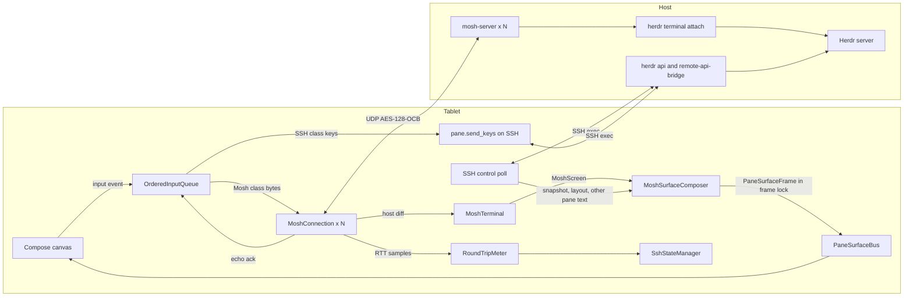

# Plan: Mosh UDP backbone (issue #22)

This plan gives the design and the delivery order for
[issue #22](https://github.com/ToxicBakery/BisonHerdr/issues/22). The user decided to build the full Mosh
path. Each decision gives the evidence, the result, and the reasons.

- Line references to this repository are at `e95a280`, which is `main` after pull requests #39 and #41.
  `main` is now `5c84151`, after #42, #43, #44, #47, #52, #57, and #58. A line can have moved since
  `e95a280`.
- Line references to Herdr are at the tag
  [`v0.9.5`](https://github.com/herdrdev/herdr/tree/v0.9.5). A review found the cited facts the same in
  v0.9.0, v0.9.5, and the master branch.
- The `mosh-server` version is 1.4.0.

This is revision 7. Six review rounds, the decisions of the user, and pull request #52 changed it. The
sections that start at [Changes after review round 1](#changes-after-review-round-1) list each change.

## Summary of decisions

| # | Question | Decision |
|---|----------|----------|
| 1 | What `mosh-server` runs | One `mosh-server` for each pane on the screen. It runs `herdr terminal attach <terminal_id>` after a UDP gate. The Mosh screen is exactly one Herdr pane. The app never takes a pane from a different attach client. |
| 2 | Language and place | Pure Kotlin. A new KMP module `:core:mosh` holds the wire format, the SSP, the emulator, the frame composer, and the key encoder. `:platform:android:ssh` holds the start over SSH, the Android network bind, and the engine. The plan has no Rust, JNI, NDK, or Zig. |
| 3 | VT emulator | A new Kotlin emulator for the small set of controls that `mosh-server` sends in its diffs. Its screen state is copy-on-write. |
| 4 | Crypto | BouncyCastle `OCBBlockCipher` with `AESEngine.newInstance()`. Pull request #52 has it. |
| 5 | Keys | Hybrid. Text, Enter, Backspace, Tab, Esc, Ctrl keys, PageUp, PageDown, Delete, Insert, Home, and End go over Mosh. Arrows, F-keys, and keys with Alt, Super, or Shift go over SSH `pane.send_keys`. An order barrier keeps the two paths in sequence. |
| 6 | Integration | `negotiateBackbone` returns `ActiveBackbone.MoshUdp` only after a decrypted reply and a successful attach. When no reply comes in 3 s, the app uses the SSH endpoint path and shows the reason. The SSH control lane of a Mosh machine reconnects lazily in the background, and after a stable network in the foreground. A feature flag keeps Mosh off in release builds until the last pull request. |
| 7 | Session policy | Short and polite. No `--takeover`. The app detaches a pane that leaves the screen, and all panes 3 minutes after it goes to the background. `MOSH_SERVER_NETWORK_TMOUT=900`. The UI shows the size lock. |
| 8 | Tests | JVM tests against a real local `mosh-server`, and key tests against real Herdr 0.9.5 and 0.9.0 binaries, on Linux CI. |

The plan has 15 pull requests and 41 engineer-days. An independent clean-room review before the last pull
request adds about 1 day.

**Status of the work.**

| Plan pull request | GitHub | State |
|-------------------|--------|-------|
| 2, `fix/herdr-session-name` | #47 (fixes #46) | Merged |
| 4, `feat/mosh-wire` | #52 | Merged, with the real `mosh-server` tests on CI |
| The SSH key name fix that pull requests 3 and 9 need | #49 (fixes #48 and #55) | In review (head `433845a`). It refuses a paste whose request line is over the Herdr limit, with no split. It logs a debug error, because no UI makes a `Paste` yet. |
| 5, `feat/mosh-ssp` | #60 | In review, round 2. It adds wire facts 23 to 29, and an ack for a repeated or unapplicable host state. Its smaller or growing user-diff cap lets a 128 KiB paste complete under 10 percent loss. |
| 7, `feat/mosh-terminal` | #64 | In review. It adds the emulator facts of decision 3 and `scripts/generate_cell_width.py` (UCD 18.0.0). |
| 1, `chore/license-guard` | #69 | In review |
| Target SDK 37, and `FeatureFlags` | #44, #43 | Merged |

## Decisions of the user

The user made the decisions in the first six rows. The coordinator made the other decisions within the
earlier choices of the user.

| Topic | Decision |
|-------|----------|
| Keys | Hybrid, with an order barrier. Mode-dependent keys go over SSH. While the SSH lane is closed, these keys go over Mosh in CSI form as a best effort. |
| Kitty mode | Esc and the Ctrl keys stay on Mosh. A kitty flag 1 program gets their legacy bytes. This is a known limit with a test. Shift+Enter and the other modified keys stay on SSH. |
| Network change | Lazy reconnect in the background. Mosh panes continue with no SSH. The app opens SSH again at the first SSH-only operation, or when the app comes to the foreground. |
| Network change in the foreground | A visible app must not show old agent status and layout. The app reconnects the control lane after the new network is stable for 5 s. |
| Session policy | No `--takeover`. A pane in use by a different attach client uses the `pane.read` path and shows a mark. Detach 3 minutes after the app goes to the background. `MOSH_SERVER_NETWORK_TMOUT=900`. Show the size lock. |
| Versions and scope | Herdr 0.9.0 or later. Speculative local echo is a follow-up issue. Pull request #44 raises the target SDK to 37 with `ACCESS_LOCAL_NETWORK`, which the Mosh UDP socket to a LAN host also needs. |
| D1, key names | Herdr has no key names for Home, End, PageUp, PageDown, Delete, and Insert. These keys go over Mosh in `CSI` form. Home and End are a known limit. |
| D2, session loss in the foreground | The first attempt starts after 2 s in `LossHold`, and then the normal backoff applies. A network event in these 2 s makes the loss part of that network change. |
| D3, Esc before an SSH key | Accept about 200 ms more delay after a lone Esc before an SSH key. Correct order comes first. |
| D4, UDP loss in a session | This rule applies after a network change. With no reply for 3 s and a `Live` SSH lane, the panes move to `pane.read` with a reason. The app tries Mosh again at the next network change. |
| R1, large paste over SSH | A paste over 128 KiB goes over SSH `pane.send_input` with `keys: []`. The limit is the size of the JSON request line, not the text. An empty reply is a failure. |
| R2, composer submit | The composer sends `\r` as a separate Mosh state, 300 ms after the echo ack of the paste. |
| R3, `Failed` cause | The app tries again at the next foreground move, as for `NeedsLogin`. |
| R4, SSH key name fix | Pull request #49 (issue #48). Pull request 3 depends on it. |
| R5, SSH keys in a stall | An SSH key goes over Mosh in CSI form also while the lane is `Live`, in four stall cases (decision 5). |
| R6, SSH keys in `NetworkSettle` | An SSH key goes over Mosh in CSI form and does not start a reconnect. |
| R7, paste over the request limit | The app refuses it on the Mosh path and on the SSH path. This applies to all machines, also SSH endpoint machines. One shared constant holds the limit (decision 5). The UI message comes with the first pull request that makes a `Paste` from the UI. Typed text can split into more raw-byte lines, in order. |
| R8, SSH keys in `LossHold` | An SSH key goes over Mosh in CSI form and does not start a reconnect, as in `NetworkSettle`. Other SSH-only operations still start a reconnect. |
| R9, held composer Enter | The queue always drops the held `\r` at a D4 switch, a fallback to `pane.read`, a session end, or a stop of the session. This is also true when the server acknowledged the paste. The `\r` counts in `NotConfirmed`, and the UI shows "The prompt was not sent". |
| R10, input after a wake limit | The app never delivers it later. It drops the held `\r`, never unparks that session, and stops it by PID at the next SSH contact. The held `\r` also has a general time limit. |

## Evidence

### How the app gets a pane today

The SSH path does not open a Herdr client connection. It polls.

- `RealHerdrSshClient` keeps two persistent `sh` channels for each machine: `WorkerLane.Input` and
  `WorkerLane.Poll` (`RealHerdrSshClient.kt:161`, `2385`). Pull request #12 added these lanes.
- The poll loop runs each 400 ms (`LIVE_POLL_INTERVAL_MS`, `RealHerdrSshClient.kt:3265`). It runs
  `herdr api snapshot`, and one `herdr remote-api-bridge` call for each visible pane with
  `pane.read { source: "visible", format: "ansi" }` (`RealHerdrSshClient.kt:754`, `1884`).
- `buildCompositeSurfaceFrame` is private. It parses the ANSI text of each pane into one
  `PaneSurfaceFrame` (`RealHerdrSshClient.kt:2793`).
- A keystroke goes out as `pane.send_text`, `pane.send_keys`, or `pane.send_input` on the input lane
  (`RealHerdrSshClient.kt:1054`). A key chord and a literal text from the key bar take a different path.
  They go out as a `pane.send_keys` RPC on the control queue (`AgentActionDelegate.kt:195-202`,
  `WorkspaceTerminalViewModel.kt:566-568`, `641-643`, `BisonSessionService.kt:222-232`).
- When a batch on a lane fails, `executeBatchOnLane` runs the commands again on a new worker. Then it runs
  them on a one-shot channel (`RealHerdrSshClient.kt:2424`, `2449`, `2457`). A key can thus go out more than one
  time. All panes of a machine share the lock of the input lane.
- A scroll gesture goes out as a `pane.scroll` RPC with an absolute offset
  (`MachineViewModelDelegate.kt:201-206`, `RealHerdrSshClient.kt:1042`).
- `ClientKeyCode` has no F1 to F12, Insert, or Space. Its only character codes are C, B, D, Z, Y, and N
  (`EndpointAndInputModels.kt:83-140`).
- The app never runs `herdr remote-client-bridge`. `setSurfaceLease` only writes
  `client_shell.surface.set` to the debug log (`SshTransportManager.kt:368-376`).
- `MainActivity.onStart` turns the surface lease on for each connected machine
  (`MainActivity.kt:117-134`).
- A notification action sends `SendPaneInput` key events (Approve: Enter, Reject: Esc). An inline reply
  sends `SubmitAgentPrompt` (`BisonSessionService.kt:356-399`).
- No UI makes a `Paste` event yet (#49). The paste rules apply to the composer prompt and the inline
  reply, and to a later paste action.
- Seven functions publish frames on `PaneSurfaceBus` through `framePublisher` in the frame lock of the
  machine (`RealHerdrSshClient.kt:159`, `397`, `420`). See [decision 6](#decision-6-integration).
- A machine with no stored password gives `SshAuthResult.Failed` with a `MissingSecretException`, not a
  class of its own (`SshAuthResult.kt:108`). Other results are `InputRequired`, `InputCancelled`, and
  `UserAuthRequired` with `keyNeedsUserForEachSign`. Pull request #44 adds `LocalNetworkBlocked`.
- The pane object of `herdr api snapshot` has a `terminal_id` field
  ([`panes.rs:449-451`](https://github.com/herdrdev/herdr/blob/v0.9.5/src/api/schema/panes.rs#L449-L451)).
  The app model `ClientShellPane` does not read it yet (`ShellSnapshotModels.kt:130-141`).

### How Herdr shows a terminal to a client

- A plain `herdr` command starts a server or attaches a thin client
  ([`main.rs:802`](https://github.com/herdrdev/herdr/blob/v0.9.5/src/main.rs#L802)). The thin client gets
  rendered frames from the server
  ([`client/mod.rs:1-13`](https://github.com/herdrdev/herdr/blob/v0.9.5/src/client/mod.rs#L1-L13)). Its
  `TerminalHello` message has no UI configuration
  ([`wire.rs:466-473`](https://github.com/herdrdev/herdr/blob/v0.9.5/src/protocol/wire.rs#L466-L473)).
- In a black-box test, `mosh-server new -- env HERDR_CONFIG_PATH=tablet.toml herdr` showed pane borders.
  `tablet.toml` set `pane_borders = "off"`. Thus the server drew the chrome from its own configuration.
- `herdr terminal attach <terminal_id> [--takeover]` attaches a client to one terminal
  ([`cli.rs:535-545`](https://github.com/herdrdev/herdr/blob/v0.9.5/src/cli.rs#L535-L545)). The server
  draws only that terminal, with no chrome
  ([`render_stream.rs:578`](https://github.com/herdrdev/herdr/blob/v0.9.5/src/server/render_stream.rs#L578)).
- At attach, the server resizes the terminal to the size of the client and locks that size
  ([`headless.rs:1817-1838`](https://github.com/herdrdev/herdr/blob/v0.9.5/src/server/headless.rs#L1817-L1838)).
  The lock goes away when the attach client exits
  ([`headless.rs:972-980`](https://github.com/herdrdev/herdr/blob/v0.9.5/src/server/headless.rs#L972-L980)).
- One terminal has one attach client. Without `--takeover`, a second attach fails with "already has an
  attached client; retry with --takeover". With a read in progress, an attach fails with "has a read in
  progress; retry"
  ([`headless.rs:1770-1811`](https://github.com/herdrdev/herdr/blob/v0.9.5/src/server/headless.rs#L1770-L1811)).
- In an attach client, Ctrl+B (`0x02`) is a prefix. `0x02` and then `q` detaches. Two `0x02` bytes send one
  `0x02`. A complete bracketed paste skips this rule
  ([`attach.rs:63-125`](https://github.com/herdrdev/herdr/blob/v0.9.5/src/client/attach.rs#L63-L125)).
- In some pane states, the attach client changes a plain PageUp or PageDown into a scroll of the Herdr
  scrollback. The pane must not be on the alternate screen and must have no mouse mode. Application cursor
  mode stops this, unless bracketed paste is on
  ([`attach.rs:227-246`](https://github.com/herdrdev/herdr/blob/v0.9.5/src/client/attach.rs#L227-L246),
  [`terminal.rs:155-162`](https://github.com/herdrdev/herdr/blob/v0.9.5/src/pane/terminal.rs#L155-L162),
  [`pane_input.rs:140-152`](https://github.com/herdrdev/herdr/blob/v0.9.5/src/server/pane_input.rs#L140-L152)).
- The server sends a complete bracketed paste to the pane as one paste. It sends other attach input as raw
  bytes
  ([`pane_input.rs:187-200`](https://github.com/herdrdev/herdr/blob/v0.9.5/src/server/pane_input.rs#L187-L200)).
  One attach input message holds at most 1 MB
  ([`client_transport.rs:48`](https://github.com/herdrdev/herdr/blob/v0.9.5/src/server/client_transport.rs#L48)).
- Mouse capture is on by default
  ([`model.rs:1207`](https://github.com/herdrdev/herdr/blob/v0.9.5/src/config/model.rs#L1207)), and the
  attach client uses it
  ([`client/mod.rs:462`](https://github.com/herdrdev/herdr/blob/v0.9.5/src/client/mod.rs#L462)). With
  mouse capture on, the input framer holds a lone ESC for 150 ms
  ([`raw_input.rs:44`](https://github.com/herdrdev/herdr/blob/v0.9.5/src/raw_input.rs#L44)). It also holds a
  bracketed paste until its end marker.
- One wheel event moves `ui.mouse_scroll_lines` lines, from the configuration of the host
  ([`model.rs:1238-1242`](https://github.com/herdrdev/herdr/blob/v0.9.5/src/config/model.rs#L1238-L1242)).
- `pane.send_keys` encodes each key with the key modes of the pane, for example DECCKM and the kitty
  keyboard flags
  ([`panes.rs:2035-2057`](https://github.com/herdrdev/herdr/blob/v0.9.5/src/app/api/panes.rs#L2035-L2057),
  [`api_helpers.rs:34-46`](https://github.com/herdrdev/herdr/blob/v0.9.5/src/app/api_helpers.rs#L34-L46)).
- `pane.send_text` sends the text as raw bytes
  ([`panes.rs:1912-1928`](https://github.com/herdrdev/herdr/blob/v0.9.5/src/app/api/panes.rs#L1912-L1928)).
  `pane.send_input` wraps its text as a bracketed paste when the pane turned on bracketed paste
  ([`api_helpers.rs:25-32`](https://github.com/herdrdev/herdr/blob/v0.9.5/src/app/api_helpers.rs#L25-L32),
  [`panes.rs:1930`](https://github.com/herdrdev/herdr/blob/v0.9.5/src/app/api/panes.rs#L1930)).
- The API server drops a request line over 1,048,576 bytes with no error
  ([`api/server.rs:34`](https://github.com/herdrdev/herdr/blob/v0.9.5/src/api/server.rs#L34),
  [`735`](https://github.com/herdrdev/herdr/blob/v0.9.5/src/api/server.rs#L735)).
- `agent.prompt` waits 300 ms between the text and the Enter key
  ([`agents.rs:13`](https://github.com/herdrdev/herdr/blob/v0.9.5/src/app/api/agents.rs#L13)). Herdr issue
  #1878 is the reason.
- The key name parser has names for the arrows, Enter, Esc, Tab, Backspace, Space, and F-keys. It has no
  names for Home, End, PageUp, PageDown, Delete, and Insert
  ([`keybinds.rs:1281-1349`](https://github.com/herdrdev/herdr/blob/v0.9.5/src/config/keybinds.rs#L1281-L1349)).
  One bad name fails the full call: "Up Home" sent nothing.
- Herdr 0.5.10 added terminal attach. Herdr 0.6.3 added scrollback with the mouse wheel and PageUp. Herdr
  0.9.0 added the `ui.mouse_capture` rule for an attach. Herdr 0.9.2 and 0.9.3 changed the Esc rules
  ([`CHANGELOG.md`](https://github.com/herdrdev/herdr/blob/v0.9.5/CHANGELOG.md)).
- Direct terminal attach works on Unix hosts only
  ([`platform/mod.rs:252`](https://github.com/herdrdev/herdr/blob/v0.9.5/src/platform/mod.rs#L252)).
- Herdr publishes `herdr-linux-x86_64` for each release. CI can download it.
- An inherited `HERDR_SOCKET_PATH` overrides `XDG_CONFIG_HOME` for the client socket
  ([`socket_paths.rs:23-33`](https://github.com/herdrdev/herdr/blob/v0.9.5/src/server/socket_paths.rs#L23-L33)).
  In a review, a probe with this variable reached the live Herdr of the user.

### Black-box tests against `mosh-server` 1.4.0

Four independent test clients in scratch directories talked to a real local `mosh-server` and to an
isolated Herdr 0.9.5 server. The tests of pull request #52 did the same. Each test used `127.0.0.1`.

1. The server accepted the first packet of the client. The first authentic reply came after 5 ms.
2. Keystrokes, a resize, and a change to a new client socket (a new local port) worked. After the socket
   change, the next reply came in 12 ms.
3. With `herdr terminal attach`, the Mosh screen held only the pane shell, at the 60x12 size that the
   client sent.
4. When the application exits, the server sends the target state `2^64 - 1`.
5. The test program printed one line each second. While the client sent nothing, the server sent about one
   datagram each second, with new frames and resends, for about 40 s. Then it stopped. One datagram from a
   new socket started the replies again.
6. With `MOSH_SERVER_NETWORK_TMOUT=5`, a server with a silent client exited between 3 s and 9 s. A server
   with no client at all exits about 60 s after its start. A server exits about 4 s after SIGTERM.
7. The server changes `ESC O A` to `ESC [ A` when its application did not set DECCKM. Its application is
   the attach client, not the pane program. A curses program in keypad mode got `ESC [ A` as three bytes,
   not `KEY_UP`.
8. A kitty-mode program got `CSI 13;2u` for Shift+Enter through `pane.send_keys`.
9. A bracketed paste with 400 `0x02` bytes reached the pane as one paste with all 400 bytes. `ESC 0x02` and
   then `q` outside a paste detached the attach client.
10. A census of the host bytes from random output, `htop`, and `vim` found only the controls in the
    table of [decision 3](#decision-3-the-vt-emulator).
11. A 300x150 truecolor full paint after a silence and a new socket was one instruction of 474 fragments
    (1,767,396 bytes). With the default receive buffer (212,992 bytes) and a dedicated reader thread, it
    completed in 0.04 s to 0.05 s. With a reader that polled each 2 ms, it failed one time and took 3.5 s
    one time.
12. A client that always sent the acknowledged state 0 got diffs from state 1, not a full paint. A resize
    to the same size gave only an echo ack. A resize to a new size gave a full paint.
13. A program in `mosh-server` asked for the cursor position (`CSI 6n`) after each test character. With
    glibc 2.43, the regional indicators U+1F1E6 to U+1F1FF had width 1. U+00AD had width 1. U+1160 and
    U+1E5EE had width 0.
14. With an attach failure, `mosh-server` still replied. It sent the error text and then the end state. At
    40 columns, the text "already has an attached client" wrapped to the next row.
15. A test server ran `sh -c 'IFS= read -r _ && exec <command>'`. The command ran only after the first
    authentic reply and one gate key from the client.
16. Esc over Mosh and then Up over SSH arrived in the wrong order in 4 of 4 runs. Up (`1b 5b 41`) arrived
    at +67 ms and the ESC at +150 ms. The echo ack came at about 62 ms.
17. A multi-line text through `pane.send_text` at a shell prompt ran each line as a command.
18. A text of 1,000,000 bytes with many tabs, quotes, and backslashes gave a JSON line of 1,625,086 bytes.
    `herdr remote-api-bridge` gave an empty reply and exit status 0, and the pane got 0 bytes.
19. The test stopped a server with SIGTERM while its client was silent for 0 s to 30 s. A new attach to
    the same terminal then failed with "already has an attached client" until about +4.4 s. After 45 s of
    silence, with a connected client, or after SIGKILL, a new attach worked at once.
20. The time of the echo ack depends on the screen (wire fact 22). The client send interval had no effect.

### The Zig build of `libghostty-vt`

- The vendored copy in `8cf8063` cannot build from a clean checkout. The `.gitignore` rule `**/build/`
  dropped `vendor/libghostty-vt/src/build/`, and `build.zig:4` imports `src/build/main.zig`.
- The upstream Ghostty source at the vendored commit `44f2a44d` fails with Zig 0.17.0. Its `requireZig`
  check refuses all versions other than 0.16.
- With Zig 0.16.0, the same source built `libghostty-vt.so` for `aarch64-linux-android` in 108 s with a
  cold cache. The stripped library is 1.9 MB (0.8 MB with gzip) for one ABI.
- The C API in `terminal.h` has no function that copies a terminal state.

## Decision 1: What `mosh-server` runs

**Decision.** Start one `mosh-server` for each pane on the screen. Each server runs a gate and then
`herdr terminal attach <terminal_id>`. The Mosh screen is then the screen of one Herdr pane, at the size
that the tablet gives to that pane.

| Option | Result |
|--------|--------|
| A. `mosh-server new -- herdr` (a full thin client, the old design in `01-core-app-design.md:461-499`) | Rejected. In the test, the server drew its own chrome from its own configuration. The app must cut panes out of one screen. A focus RPC on `herdr.sock` moves all clients of the user. |
| B. `mosh-server new -- herdr terminal attach <terminal_id>`, one for each pane on the screen | **Selected.** The test showed the exact pane screen with no chrome. The tablet keeps control of the layout. Herdr keeps the pane state, so a Mosh session is a view only. |
| C. `mosh-server new -- herdr remote-client-bridge` | Rejected. The bridge sends a `bincode` stream, not a terminal screen. |

**Panes on the screen.** Only the panes of the visible tab of the machine that the screen shows get Mosh
sessions. `MainActivity.onStart` turns the lease on for each connected machine, so the lease alone does not
decide. Pull request 10 adds the shown machine to the input of the engine. A connected machine that the
screen does not show has no Mosh session and no size lock.

**The start script.** The app runs one script on a one-shot `exec` channel for each batch of panes. The
pull request writes the exact text and its tests. The script has these parts:

- Export the same `PATH` as the persistent workers (`RealHerdrSshClient.kt:2397`, `2530`). Herdr installs
  to `~/.local/bin`.
- Use the server path of the machine: `HostMachine.moshServerPath`, else `mosh-server`.
- Use `-l LANG=C.UTF-8`. When the output has the locale error of `mosh-server`, run the batch again with
  `-l LANG=en_US.UTF-8`.
- Use `-s` only when `SSH_CONNECTION` is set. Set `MOSH_SERVER_NETWORK_TMOUT=900`. Use the port range of
  the machine (`HostMachine.DEFAULT_MOSH_UDP_PORT_RANGE` is `60000:61000`).
- Run this command in each server:
  `sh -c 'IFS= read -r _ && exec herdr [--session <name>] terminal attach <terminal_id>'`.
  The command waits for one gate key, so no attach occurs before UDP works.
- Use the same `--session <name>` as the control lane. Pull request #47 makes the control lane use it.
- Do not use `--takeover`.
- Write the pane ID before each output line, and send stderr to stdout. The app reads
  `MOSH CONNECT <port> <key>` and `[mosh-server detached, pid = <pid>]` for each pane. Pull request 9
  extends `MoshBootstrapConfig.parseMoshConnectLine` for the pane tag.

**Old servers of this install.** A stale attach of this tablet can stay after Doze or a lost network.
Then the next attach fails with "already has an attached client". Thus:

- The PID file is `$HOME/.cache/bison-herdr/mosh-<installId>-<machineKey>.pids`, with one line for each
  terminal ID and PID. `installId` is the `device.id` marker of `MachineStore` (`MachineStore.kt:261-298`).
  `machineKey` is a hex hash of the machine ID.
- Two scripts can change the file at the same time. Each script holds a lock on the file with `flock` when
  the host has it. Else it uses a lock directory, because `mkdir` is atomic.
- The lock directory holds the PID of its script. A later script breaks a lock with a dead PID, or a lock
  that is older than 60 s. Thus a lost session cannot keep the lock.
- To break a stale lock, a script renames the lock directory to a name of its own with `mv`, and then
  removes it. The rename is atomic, so only one of two scripts breaks the lock.
- Before each start for a terminal, the script stops the old PID of this install for that terminal.
- On a full connect, the script stops all PIDs in the file.
- Each stop by PID uses SIGKILL. The script then waits up to 6 s until the PID and its attach child exit.
  After SIGTERM, Herdr keeps the old attach for about 4 s (black-box fact 19).
- Stop a PID only when `ps -p <pid> -o args=` shows `mosh-server` and `terminal attach <terminal_id>`.
  After a host restart, the system can give an old PID to a different process.

**Attach check.** A decrypted reply proves only that UDP works. For each session, the client does these
steps:

1. Send the first state with the size of the pane. Send it again each 250 ms. Wait for the first authentic
   reply for at most 3 s.
2. Send the gate key `\n`.
3. Wait 500 ms from the first host frame that carries or follows the server acknowledgment of the state
   with the gate key. Join the soft-wrapped rows of the screen before each text match.
4. "already has an attached client": when the script stopped a PID of this install for this terminal, try
   again 3 times in 5 s. Else, or after these tries, stop the session. The pane uses the `pane.read` path and
   shows the mark "pane in use on another device". Do not try again until the pane leaves the screen. This
   text also has the word "retry", so match it first.
5. "has a read in progress": start that session again, at most 3 times, 200 ms apart.
6. An end state, or other text with "terminal attach failed" or "failed to connect to server": the class
   `Failed`. The pane uses the `pane.read` path and shows the mark "Mosh failed".
7. Else the attach works. At each later end state, match the texts of steps 4 to 6 on the last screen
   first. Else it is a session end, and the restart uses the backoff of the lifecycle rules of
   [decision 6](#decision-6-integration).

**Size.** The tablet computes the cell rectangle of each pane from `pane.layout`, scaled to its viewport.
Pull request 8 moves the scale function out of `buildCompositeSurfaceFrame` into `:core:protocol`, so that
both paths use it. The client sends the size before the gate and after each change. Herdr then resizes
the pane and locks the size while the attach client runs. Each Mosh pane shows a lock mark with the text
"size set by this tablet".

**What stays on SSH.**

| Operation | Path with Mosh |
|-----------|----------------|
| Screen of a pane on the screen | Mosh |
| The Mosh keys of [decision 5](#decision-5-keys-and-input), a paste up to 128 KiB, and mouse events | Mosh |
| Arrows, F-keys, and the other SSH keys of decision 5 | SSH `pane.send_keys` |
| A paste over 128 KiB | SSH `pane.send_input` with `keys: []`, with the order barrier |
| Pane size | Mosh resize. Herdr locks the size. |
| Scroll of a pane | Mosh wheel events when the Mosh screen shows a mouse mode and mode `?1006`. Else SSH `pane.scroll`. |
| A composer prompt or an inline reply to a pane with a Mosh session, also for a named agent | Mosh: a paste, and then `\r` as a separate state (decision 5) |
| A prompt to a named agent in a pane with no Mosh session | SSH (`agent.prompt`) |
| Input from a notification action (Approve sends Enter, Reject sends Esc) | Mosh, with a wake of a parked session, when the pane has a session. Else SSH. |
| Snapshot, layout, tabs, agents, agent status | SSH poll each 1 s, with no `pane.read` for a pane with a Mosh session |
| Focus, split, close, zoom, rename, split ratio | SSH (`herdr remote-api-bridge`) |
| Start of `mosh-server`, and a stop by PID | SSH |
| Detach of an attach client | Mosh |
| Agent text for notifications | The Mosh screen for a pane with a Mosh session. Else `pane.read`. |

**Limits.** Herdr 0.9.0 or later, which the app reads with `herdr --version`. A Unix host, because direct
attach does not work on Windows. No ProxyJump, because UDP cannot pass the SSH bastion. Such a machine uses
the SSH endpoint path with the reason "Mosh cannot pass a ProxyJump bastion".

## Decision 2: Language and place

**Decision.** Write the Mosh client in Kotlin. Put the logic in a new KMP module `:core:mosh`. Put the
Android parts in `:platform:android:ssh`.

| Criterion | Kotlin in `:core:mosh` | Rust prototype over JNI |
|-----------|------------------------|-------------------------|
| Build | Gradle only | `cargo-ndk`, rustup Android targets, a Gradle native step, and Zig 0.16 for the emulator |
| CI time | `apt-get install mosh` (about 15 s), two Herdr downloads, and JVM tests | A Rust and Zig build for each ABI (108 s cold for `libghostty-vt` alone), and caches |
| Tests with a real `mosh-server` | JVM unit tests on Linux CI | Cargo tests for the codec. The JNI path needs a device or a host build of the library. |
| APK size | About 0.2 MB of DEX. BouncyCastle is already in the APK. | 1.9 MB stripped for each ABI for `libghostty-vt`, plus the Rust library |
| Module rules | `:core:mosh` imports no `:platform:*` module | The JNI bridge must live in `:platform:*` |

**Module layout** (pull request #52 has the first part).

- `:core:mosh` targets `android` and `jvm`, as the other `:core:*` modules do. `commonMain` holds all
  logic and takes the time from an injected `TimeSource`.
- Two platform parts use JVM APIs: the OCB cipher (BouncyCastle) and zlib (`java.util.zip`). Each is a
  common interface with an `expect fun` factory, as `:core:common` does (`ClipEntries.kt:6`). Do not use an
  `expect class`, because Kotlin marks it as Beta with a warning.
- The `actual fun` factories and the UDP port are in the intermediate source set `jvmSharedMain`. Pull
  request #52 makes it with the default hierarchy template. Its group selects the JVM target and the
  compilations with the platform type `androidJvm`. `withAndroidTarget()` does not find the target of the
  Android KMP library plugin. The block needs an opt-in of `ExperimentalKotlinGradlePluginApi`, and the
  build gives no warning.
- The UDP port class `JvmDatagramPort` uses a plain `java.net.DatagramSocket` and a dedicated reader
  thread. It asks for a receive buffer of 8 MiB (`SO_RCVBUF`) and logs the size that the system gives. The
  system caps the size at `net.core.rmem_max`, so the app cannot depend on 8 MiB. The port takes a
  `socketBinder` function, which Android uses for `Network.bindSocket(DatagramSocket)`.

## Decision 3: The VT emulator

**Decision.** Write a new Kotlin emulator, `MoshTerminal`, for the controls that `mosh-server` sends in
its diffs. Do not write a full xterm emulator.

The server runs the application in its own emulator. It sends a diff that changes the old client screen
into the new screen. Thus the client never sees the raw output of the application. It sees only the
controls that the server uses to draw a diff, and the census found a small, fixed set.

| Option | Result |
|--------|--------|
| New Kotlin emulator for the diff controls | **Selected.** Small, JVM-testable, and copy-on-write for the received states. |
| `libghostty-vt` over Zig and JNI (MIT) | Rejected. It needs Zig 0.16 exactly, a JNI bridge, and 1.9 MB for each ABI. Its C API cannot copy a state. |
| JediTerm (Apache-2.0 option of an LGPLv3 or Apache-2.0 dual license) | Rejected. It is a full xterm emulator for a Swing UI. We found no API for a cheap copy of a screen state. |
| ConnectBot `termlib` (Apache-2.0) over libvterm (MIT) | Rejected. It needs JNI and an NDK build, and it brings its own Compose view. |
| Termux `terminal-emulator` | Rejected. The `termux-app` repository is GPLv3-only. Its exception gives Apache-2.0 only to the code from Jackpal Android-Terminal-Emulator, so the license of each Termux change is not clear. It is also a full emulator with no state copy. |

**Controls that the emulator must apply** (census of `mosh-server` 1.4.0 host bytes):

| Kind | Controls |
|------|----------|
| C0 | BEL `0x07`, BS `0x08`, LF `0x0A`, CR `0x0D` |
| Cursor | CUP `CSI row;col H` and `CSI H` |
| Erase | EL `CSI K`, ED `CSI 2 J` (in a full repaint), ECH `CSI n X` |
| Scroll | DECSTBM `CSI top;bottom r` and `CSI r`. LF at the bottom margin scrolls the region up. |
| SGR | `0`, `1`, `3`, `4`, `5`, `7`, `8`, `30`-`37`, `40`-`47`, `38;5;n`, `48;5;n`, `38;2;r;g;b`, `48;2;r;g;b`. Each SGR starts with `0`. `mosh-server` 1.4.0 drops `2`, `9`, and `21`, so its diffs never have them (#64). |
| Modes | `?25` cursor, `?5` reverse video, `?1000` `?1001` `?1002` `?1003` `?1004` `?1005` `?1006` `?1015` mouse, `?2004` bracketed paste |
| OSC | `0`, `1`, `2` (title), `52` (clipboard), each with BEL at the end |
| Text | UTF-8, wide cells (2 columns), zero-width characters on the cell before, autowrap at the right margin |

**Rules for the emulator.**

- Apply the standard ECMA-48 and xterm function of each control in the table. Accept the other SGR values
  (`2`, `9`, `21`-`29`, `39`, `49`, `90`-`97`, `100`-`107`) with the xterm function.
- Ignore each other control, and count it in a debug counter. Never throw on input from the network.
- Keep the xterm "last column" state: a character in the last column sets a wrap flag. The next printable
  character wraps. Each control clears the flag, except SGR, DECSET, DECRST, HT, DEL, and an OSC string. BS
  in the wrap state keeps the cursor in the last column (#64). The emulator oracle test checks this rule.

**Facts from #64** (black-box, `mosh-server` 1.4.0 on glibc 2.43):

- An erase, the cell after a wide character, and a new row from a scroll get only the background of the
  pen.
- A character in the right half of a wide character does not remove the wide character.
- A wide character that does not fit in the last column erases that cell, and then wraps.
- A zero-width character with no base comes as U+00A0 and then that character.
- One mouse report mode and one mouse report format are on at a time. A set replaces the earlier mode, and a
  reset of any one turns the mode off.
- Keep the title, the bell count, the clipboard writes, and the modes in the state. A clipboard write needs
  a user option (default off), because a host can put text on the device clipboard.

**Width rules.** The server computes each width with its own libc. The client must agree.

- Width 2: the code points with East_Asian_Width W or F.
- Width 0: General_Category Mn, Me, and Cf, except U+00AD. Also U+200B, the medial and final jamo
  U+1160 to U+11FF, and U+D7B0 to U+D7FF.
- Width 1: all other code points, also U+00AD and the regional indicators U+1F1E6 to U+1F1FF.
- A code point that is not assigned in the Unicode data of the app has width 1.
- The glibc exceptions (#64): the Prepended_Concatenation_Mark code points U+0600 to U+0605, U+06DD, U+070F,
  U+0890 to U+0891, U+08E2, U+110BD, and U+110CD have width 1. U+FFF9 to U+FFFB and U+13430 to U+1343F have
  width 1. U+3164 and U+FFA0 have width 0. U+3248 to U+324F have width 2.
- Pull request #64 makes the table with `scripts/generate_cell_width.py` from UCD 18.0.0.
- Use the newest Unicode data files at the time of the pull request. An older glibc on a host can give a
  different width for a new code point. An example is U+1E5EE of Unicode 16.0 before glibc 2.41.

**State model.** `MoshScreen` is an immutable value: a list of rows, the cursor, the pen, the modes, and
the title. A row is an immutable array of cells. `MoshTerminal.apply(screen, hostBytes)` returns a new
screen. It copies the row list and only the rows that the diff changes. Each kept state thus costs one row
list, not a full screen.

**Recovery.** The protocol has no request for a full paint (black-box fact 12). The "Refresh pane" action
sends a resize to one row less over Mosh. After the host diff shows that size, it sends the correct size in
a new user state. Two sizes in one user state give no full paint (#64). The second resize gives a full
paint and needs no SSH. The pane program gets two size changes, and most programs then draw their screen
again.

## Decision 4: Crypto and wire format

**Crypto.** Use `org.bouncycastle.crypto.modes.OCBBlockCipher` with two `AESEngine.newInstance()` values.
The constructor `new AESEngine()` is deprecated in BouncyCastle 1.86 and gives a warning. Use a 12-byte
nonce and a 128-bit tag. BouncyCastle 1.86 (`bcprov-jdk18on`, the MIT-style Bouncy Castle Licence) is
already in `libs.versions.toml`. Android and the JDK have no public OCB in their JCA providers. Pull request
#52 checks BouncyCastle against the six samples with no associated data in Appendix A of
[RFC 7253](https://www.rfc-editor.org/rfc/rfc7253). It also checks one datagram against an independent OCB
code.

**Names.** The wire has field numbers, not names. The code of this app uses its own names:

| Field | Our name | Role (from black-box tests) |
|-------|----------|-----------------------------|
| 1 | `version` | Always 2 |
| 2 | `fromState` | The state that the diff starts from |
| 3 | `toState` | The state that the diff makes |
| 4 | `ackState` | The newest state of the peer that the sender has |
| 5 | `keepState` | The oldest state that the sender can still use as `fromState` |
| 6 | `diff` | The diff |
| 7 | `noise` | Random bytes with a random length |

**Wire facts.** Each fact has a source. The sources are P (the [Mosh paper](https://mosh.org/mosh-paper.pdf),
USENIX ATC 2012), B (a black-box test), and M (the `mosh-server` banner and its man page). The prototype in
`8cf8063` is not a source (see [Clean-room rules](#clean-room-rules)). Pull request #52 confirms wire facts 1
to 8 and adds facts 18 to 21. Pull request #60 adds facts 23 to 29.

| # | Fact | Source |
|---|------|--------|
| 1 | `mosh-server new` prints `MOSH CONNECT <port> <key>` on stdout and `[mosh-server detached, pid = <pid>]` on stderr. The key is 22 base64 characters with no `=` at the end: 16 bytes. | B, M |
| 2 | A datagram is an 8-byte header, the OCB ciphertext, and a 16-byte tag. Header bit 63 is the direction: 0 from the client, 1 from the server. Bits 0-62 are the sequence number. The header is big-endian. The server sequence starts at 0 and increases by 1. | B |
| 3 | The nonce is 4 zero bytes and then the 8-byte header. The mode is AES-128-OCB with no associated data. | B, P 2.2 |
| 4 | The plaintext is a 16-bit timestamp (milliseconds modulo 65536), a 16-bit timestamp reply (`0xFFFF` for none), and one fragment. The timestamp reply of the first reply is the timestamp of the client. | B, P 2.2 |
| 5 | A fragment is a 64-bit instruction ID and a 16-bit word, both big-endian, with the "final" flag in bit 15. The content of all fragments of one ID, in order, is the zlib stream (RFC 1950) of one instruction. A resend usually has a new ID, but not always: two server datagrams with different content had the same ID. The server joins a client instruction of several fragments. | B |
| 6 | The instruction is a protobuf message with fields 1 to 7 of the names table. The numbers are unsigned varints. The server always sends field 7. | B |
| 7 | The client diff has field 1 repeated. Each entry has field 2 (keys: field 4, bytes) or field 3 (size: field 5 columns, field 6 rows). | B |
| 8 | The server diff has field 1 repeated. Each entry has field 2 (bytes: field 4), field 3 (size: fields 5 and 6), or field 7 (echo ack: field 8). The first reply has a size entry and host bytes, except at a client size of 80x24. Then it has neither, and state 0 is a blank 80x24 screen (#64). | B |
| 9 | The host bytes are a diff between two screens, not the raw output of the application. | P 2.3, B |
| 10 | The server sends to the source address of each authentic datagram with a sequence number higher than all before. The client keeps one sequence counter for the session, also across sockets. | P 2.2, B |
| 11 | The target state `2^64 - 1` tells that the session ended. | B |
| 12 | While the screen does not change and the server gets datagrams, the server sends a heartbeat about each 3 s. While the screen changes, it sends frames and resends. It stops about 40 s after the last client datagram. `MOSH_SERVER_NETWORK_TMOUT` stops a server with a silent client. | B, P 2.2 |
| 13 | The RTT estimate is the TCP algorithm with a minimum RTO of 50 ms. The timestamp reply includes the time that the peer held the timestamp. | P 2.2 |
| 14 | Delayed ack: 100 ms. The server waits a collection interval of 8 ms after the first change. Minimum frame interval: SRTT / 2. Maximum frame rate: 50 Hz. | P 2.3 |
| 15 | The echo ack is the newest user state that the application of the server got at least 50 ms before. Its value is a user state number. | P 3.2, B |
| 16 | The server changes `ESC O A`-`D` to `ESC [ A`-`D` when its application did not set DECCKM. | B |
| 17 | The server can diff from a state that it sent but that the client did not acknowledge. | B |
| 18 | The server gives its instructions the IDs 1, 2, 3, and so on. | B (#52) |
| 19 | The server accepts a heartbeat with an empty field 6, and also with no field 6. After a heartbeat, the server uses the `ackState` of the client as its next `fromState`. | B (#52) |
| 20 | The largest server datagram in the probes had 1,252 bytes, with 1,214 bytes of fragment content. | B (#52) |
| 21 | `mosh-server` exits about 4 s after SIGTERM. | B (#52) |
| 22 | The time of the echo ack varies, so the plan uses it only in the latency table. One probe set gave the times (ack, echo ack) in ms at an RTT of 0, 50, 200, and 600 ms. With a screen change, they were (9, 259), (60, 310), (210, 460), and (610, 860). With no change, they were (60, 60), (110, 110), (260, 260), and (660, 660). A later probe gave the ack, the echo ack, and the screen change together, about 106 ms after the gate key. | B (review) |
| 23 | The server holds a client timestamp for about 0.9 s to 2.9 s, and then drops it. A server datagram in that time has the timestamp reply, and an idle heartbeat after it has none. One idle reply had a hold time of 878 ms. | B (#60) |
| 24 | The timestamp reply includes the hold time, except in the first reply of a session (an error of 6 ms to 22 ms). | B (#60) |
| 25 | An idle server makes a new state about each 3 s. | B (#60) |
| 26 | Detail of fact 17: the server makes each diff from its newest sent state. After a timeout, it makes the diff from the client acknowledgment, and its `keepState` is that acknowledgment. | B (#60) |
| 27 | After the client acknowledges the end state, the server exits in about 0.2 s. Else it exits in about 4 s. | B (#60) |
| 28 | When `MOSH_SERVER_NETWORK_TMOUT` ends after the client acknowledged a host state, the server sends the end state and exits. With no client acknowledgment at all, it exits with no end state. | B (#60) |
| 29 | The server joined a burst of 220 fragments (256 KiB). | B (#60) |

**Values that this plan selects.** These values are not from Mosh. They are the choices of this client.

| Value | Choice | Reason |
|-------|--------|--------|
| Maximum RTO | 1000 ms | A keystroke does not wait more than 1 s for a retransmission. |
| RTO back-off | The RTO doubles after each resend, up to 1000 ms. A new RTT sample resets it. | #60 |
| Before the first RTT sample | RTO 250 ms and frame interval 250 ms | #60 |
| Data with no acknowledgment | At most 192 KiB of user data, with keys in parts of 16 KiB | #60. A paste of 128 KiB fits, and the server joins such a burst (wire fact 29). |
| Maximum frame interval | 250 ms | The paper uses this value in its traces. |
| New socket after silence | 10 s with no authentic datagram | A NAT can drop the old port entry. A new local port gets a new entry. |
| UDP budget | 3 s, with a send each 250 ms | A cellular RTT can be more than 1 s under load. |
| Received states kept | All states at or after the `keepState` of the server, at most 32 | The server can diff from a state that the client did not acknowledge (wire fact 17). |
| Client datagram size | At most 1,232 bytes, so a fragment holds at most 1,194 bytes of content | The UDP payload of the IPv6 minimum MTU (#52) |
| Size limits | 1024 fragments, 8 MiB for the joined zlib stream, 8 MiB after zlib, and the parts of the 4 newest instruction IDs | A 300x150 truecolor paint used 474 fragments (black-box fact 11). The highest IDs are the newest IDs (wire fact 18). Only an authentic packet gets to zlib. |
| Receive buffer | 8 MiB asked, the given size logged, and a dedicated reader thread | The reader thread is the condition that the test showed (black-box fact 11). The system can give less than 8 MiB. |

**Sender rules (client to server).** The user state is the list of the user events (keys and sizes). The
state number increases by one for each sent state that adds events.

1. A state with new events: `fromState` is the newest state that the server acknowledged. `toState` is the
   current state. The diff holds all events after `fromState`.
2. The real-server test with loss must prove that each event reaches the pane one time.
3. A heartbeat or an ack: `fromState` and `toState` are the newest state that the server acknowledged. The
   diff field can be empty or absent (wire fact 19).
4. `keepState` is the newest state that the server acknowledged.
5. Send again after the RTO while the server did not acknowledge the current state. A state that the
   server never acknowledged stays in the stream, and each later send carries it again. Thus R10 and the
   long background rule stop such a session by PID.
6. Send a new user state at once when the last new user state is older than the frame interval. Else send
   it at the end of the interval. The frame interval is SRTT / 2, in the range 20 ms to 250 ms.
7. `UserStream` gives the event count of each state. The input queue of pull request 8 and the
   `NotConfirmed` count of pull request 11 use it.

**Receiver rules (server to client).**

1. Drop each datagram that does not decrypt. Do not log its content.
2. Take `ackState` from each authentic datagram, also when the client cannot apply the diff. Take the
   timestamp and the timestamp reply only from a datagram with a sequence number higher than all before.
3. Apply the diff only when the client has `fromState` and does not have `toState`. Keep the new state.
4. Remove the states before the `keepState` of the server.
5. Acknowledge the newest state after the delayed ack interval, or at once with the next user state.
   Acknowledge the end state at once, so that the server exits in about 0.2 s (wire fact 27).
6. Take an RTT sample from each timestamp reply that is less than 5 s old. Send one timestamp reply for each
   server timestamp (wire fact 23).

## Decision 5: Keys and input

**Decision.** Hybrid keys. A key goes over Mosh when its bytes do not depend on the modes of the pane. A
key also goes over Mosh when Herdr has no name for it. Each other key goes over SSH `pane.send_keys`, and
Herdr encodes it for the pane.

**Why.** The attach client sends raw bytes to the pane. The tablet sees only the modes of the attach
client in the Mosh screen, not the modes of the pane. A curses program in keypad mode thus got `ESC [ A`
as three bytes (black-box fact 7). `pane.send_keys` encodes the key with the DECCKM and kitty flags of the
pane (black-box fact 8).

**Classes.**

| Class | Keys | Path and bytes |
|-------|------|----------------|
| Mosh | Text from the keyboard | UTF-8 bytes |
| Mosh | Paste up to 128 KiB | `CSI 200~` text `CSI 201~`. Remove each `ESC [201~` from the text first. |
| Mosh | Enter, Backspace, Tab, Esc | `\r`, `0x7F`, `\t`, `0x1B` |
| Mosh | Ctrl+A to Ctrl+Z, Ctrl+Space, Ctrl+`[` `\` `]` `^` `_` | The C0 byte |
| Mosh | PageUp, PageDown, Delete, Insert, with or without modifiers | `CSI 5~`, `CSI 6~`, `CSI 3~`, `CSI 2~`, or the `CSI n;m~` form with the xterm modifier value `m` |
| Mosh (best effort) | Home, End, with or without modifiers | `CSI H`, `CSI F`, or `CSI 1;m H`, `CSI 1;m F`. Known limit 2. |
| Mosh | Mouse click and wheel, when the Mosh screen shows a mouse mode and `?1006` | SGR mouse events. The attach client changes them for the pane, or scrolls the scrollback. |
| SSH | Arrows, F1 to F12, with or without modifiers | `pane.send_keys` |
| SSH | Shift+Tab, Shift+Enter, Ctrl+Enter, and each key with Alt, Super, or a Ctrl or Shift that is not in the Mosh rows | `pane.send_keys` |
| SSH | Paste over 128 KiB | `pane.send_input` with the text and `keys: []`, on the single-shot path. Herdr wraps it as a paste when the pane turned on bracketed paste. |
| Refused (R7) | A paste whose JSON request line is greater than `HerdrLimits.MAX_REQUEST_BYTES` (1,048,576 bytes), on the Mosh path and on the SSH path | Herdr drops such a line with no error (black-box fact 18). |

**Paste rules.**

- A Mosh paste of 128 KiB is about 110 fragments. That fits in the default receive buffer of
  `mosh-server` (212,992 bytes on Linux).
- The app computes the size of the JSON request line after the JSON escape, before it sends a large paste.
  A text with many escape characters can grow by more than 60 percent (black-box fact 18).
- An empty reply of `remote-api-bridge` is a failure. The UI then shows that the paste did not arrive.
  Today an empty output counts as success, so the new path changes this.
- Do not use `pane.send_text` for a paste. It sends raw bytes, so a shell runs each line (black-box fact 17).
- A large paste over SSH uses the single-shot path of the SSH key calls: no new worker, no one-shot channel,
  and no second send. Today `executeBatchOnLane` runs a failed batch again (`RealHerdrSshClient.kt:2449`,
  `2457`), so a lost reply can give two or three pastes.
- The deadline after the write grows with the size. It is 2 s, plus 2 x SRTT, plus 1 s for each 32 KiB of
  the line. A 1 MB line thus gets about 33 s. A passed deadline is a failure, and the app does not send again.
- Typed text over the request limit goes out as more raw-byte lines, in order (#49). Only a paste is
  refused (R7).
- The limit is one shared constant, `HerdrLimits.MAX_REQUEST_BYTES` (1,048,576 bytes) in `:core:protocol`.
  A line is too large when its size is greater than the constant, as Herdr compares. Pull request 8 moves
  `MAX_HERDR_REQUEST_BYTES` of #49 there.
- When the large paste cannot go out, the app refuses it and releases the queue. A paste has no CSI form.
  These are the cases:
  - The wait for the lock passes its deadline.
  - The call fails before the write.
  - The SSH lane is closed.
  - The server did not acknowledge `S` in 1 s (barrier step 5).
- No UI makes a `Paste` event yet. Until a pull request adds a paste action, a refused paste gives a debug
  error, as in #49. That pull request adds the messages "The paste is too large" and "The paste did not
  arrive".
- A composer prompt or an inline reply over the limit is refused with "The prompt was not sent".

**The `0x02` rule.** Outside a complete paste, the encoder doubles each `0x02` byte of a Mosh state, not
only the byte of Ctrl+B. The attach client then sends one `0x02` to the pane, and `ESC 0x02 q` cannot
detach (black-box fact 9). Inside a paste, the encoder does not double `0x02`.

**Composer submit (R2).** A composer prompt or an inline reply to a Mosh pane goes out as two Mosh states.
The first state is the paste. The second state is `\r`, 300 ms after the echo ack of the first state. The
held `\r` is a queue item, and it holds all later input of the pane until it goes or the queue drops it.
When the paste changes the screen, the Enter thus goes about 1 RTT + 550 ms after the paste (wire fact 22).
Herdr waits 300 ms in `agent.prompt` for the same reason (Herdr issue #1878).

The held `\r` has a time limit of 10 s from the first send of the paste state. At the limit, the queue drops
it, counts it in `NotConfirmed`, and shows "The prompt was not sent". On a lossy link, a resend of the full
diff can make a 128 KiB paste slow. The user-diff cap of #60 helps this paste complete under loss.

The current SSH path sends the text and the Enter key in one `pane.send_input` call. A separate fix for
`main` comes after #49, and pull request 12 does not need it.

**Known limits.**

1. Kitty mode. Kitty keyboard flag 1 changes the bytes of Esc and of the Ctrl keys to `CSI u` forms. Over
   Mosh, a kitty flag 1 program gets the legacy bytes, for example `0x1B` for Esc and `0x01` for Ctrl+A. Most
   programs accept the legacy bytes. A test on a real Herdr records the bytes.
2. Home and End. In application cursor mode, a program expects `SS3 H` and `SS3 F`. Over Mosh, it gets
   `CSI H` and `CSI F`. Herdr has no key names for Home and End, so `pane.send_keys` cannot encode them for
   the pane. When a later Herdr adds these names, these keys move to the SSH class.
3. PageUp and PageDown. With no modifier, the attach client scrolls the Herdr scrollback in some pane
   states (see the evidence). The tests and the scroll state of the app expect this.

**Order barrier.** One ordered input queue for each pane holds both classes. `S` is the user state number
of the last Mosh byte in the queue.

1. A Mosh key goes into the Mosh user stream at once. The condition: no SSH key, held composer Enter, or
   detach of the pane is in the queue or in flight.
2. Before an SSH key, the queue waits for an echo ack of `S` or higher (wire fact 15).
3. When the state `S` ends with a lone ESC or holds a paste, the queue waits 200 ms more after the echo
   ack. The attach client holds a lone ESC for 150 ms, and it holds a paste until its end marker.
4. Sometimes the server acknowledges `S`, but no echo ack comes in 1 s from the arrival of that
   acknowledgment. Then the queue continues as if the echo ack came, with the rule of step 3.
5. When the server did not acknowledge `S` in 1 s, the queue sends the SSH key over Mosh in CSI form. The
   1 s starts at the first send of `S`. One stream keeps the order.
6. When the wait ends, the queue reads the state of the SSH lane. When the lane is closed, the key goes
   over Mosh in CSI form.
7. The queue merges only SSH keys that are next to each other in the queue into one `pane.send_keys` call.
   "Up, x, Down" stays three steps.
8. Later Mosh keys stay in the queue until the call ends (see the call rules), or until the queue refuses
   a paste.
9. For a pane with a Mosh session, no `pane.read` follows the call. The Mosh screen shows the result.

**SSH key calls.** A failed batch on a lane runs again today (`RealHerdrSshClient.kt:2449`, `2457`), so a
key can go out two or three times. An SSH key call thus has its own path:

- No retry on a new worker and no one-shot channel. The call runs one time, or not at all.
- Before the write: the call waits for the input lane lock, which all panes of the machine share. The
  write must occur in 1 s plus the Mosh SRTT. Else the queue cancels the call and sends its keys over Mosh
  in CSI form.
- A call that fails before the write, for example with `SessionUnavailableException`, also sends its keys
  in CSI form. The queue never drops them.
- After the write: the deadline is 1 s plus the Mosh SRTT, from the time of the write. At the deadline, the
  queue closes the input worker, so that the blocked `readLine()` ends (`RealHerdrSshClient.kt:2495`). In
  `Live`, it also starts the liveness check of the control lane. In the other states, the state table
  decides the check, and the deadline starts no reconnect.
- When no reply came, the queue never sends the written call again, because it can have reached Herdr. The
  user sees the result on the Mosh screen and can press the key again.
- An error reply, for example `invalid_key`, had no effect. Its keys go over Mosh in CSI form.
- Until the liveness check passes, the queue sends SSH keys over Mosh in CSI form.

**CSI form while the lane is `Live` (R5).** An SSH key goes over Mosh in CSI form in four stall cases:

1. The server did not acknowledge `S` in 1 s (barrier step 5).
2. The call waited for the lock past its deadline.
3. The call failed before the write.
4. A deadline after a write occurred, and no liveness check or connect passed after it.

**SSH lane closed.** The SSH lane is closed when the supervisor is not in `Live` (decision 6). Then an SSH
key goes over Mosh at once, in the xterm form for a terminal with no special modes. Examples: `CSI A` for
Up, `CSI 1;5C` for Ctrl+Right, `CSI 15~` for F5, `CSI Z` for Shift+Tab, and `ESC x` for Alt+x. This is a
best effort: a curses program in keypad mode does not read `CSI A` as an arrow. In `Dormant`, the key also
starts a reconnect. In `LossHold` (R8), `NetworkSettle` (R6), `NeedsLogin`, and `Failed`, it does not.

**Latency cost.** RTT is the round trip time, and H is the run time of the Herdr command on the host.

| Case | Added delay |
|------|-------------|
| SSH key with no recent Mosh key | 1 RTT + H, the same as the SSH path today |
| SSH key just after a Mosh key that changed the screen | Up to 1 RTT + 260 ms for the echo ack (wire fact 22), then 1 RTT + H |
| SSH key just after a Mosh key that did not change the screen | Up to 1 RTT + 60 ms, then 1 RTT + H |
| SSH key just after a lone Esc or a paste | 200 ms more (D3) |
| Mosh key just after an SSH key | The rest of the SSH call, then 0.5 RTT |
| Text with no SSH key near it | 0.5 RTT to the server, the normal Mosh delay |
| Composer submit | The Enter goes about 1 RTT + 550 ms after the paste, when the paste changes the screen |

**Other input paths.** For a pane with a Mosh session, all input goes through the per-pane queue:

- Key chords and text with an active modifier use `sendKeyChord` today, which sends a `pane.send_keys` RPC
  on the control queue. Pull request 3 changes these to `SendPaneInput` key events. It extends
  `ClientKeyEvent` with F1 to F12, Space, and a general character code with modifiers. Pull request #49
  adds Insert.
- A scroll request is a `pane.scroll` RPC with an absolute offset. When the Mosh screen shows a mouse mode
  and `?1006`, it becomes wheel events. One wheel event moves 3 lines, the Herdr default. The next snapshot
  gives the true offset, and the app sets its scroll state from it. Else the request stays a `pane.scroll`
  RPC.
- A notification action (Approve sends Enter, Reject sends Esc) and an inline reply go over Mosh when the
  pane has a Mosh session. This is also true in the background. A parked session wakes for this (decision
  6), so it needs no login. Else the input goes over SSH. When that needs a login in the background, the
  notification shows "Open the app to answer" and sends nothing.

**Input with no acknowledgment.** At a D4 switch or at the stop of a session, the server can still lack
some Mosh user states. The app does not send these bytes again over SSH, because some of them can have
arrived. The pane shows the mark "N keys were not confirmed".

**Input during transitions.**

- While a session starts, starts again, or waits for its attach check, the queue of the pane holds the
  input. When the attach works, the queue sends it over Mosh.
- When the pane falls back to `pane.read`, the queue sends the held input over SSH in order, in the forms
  of #49.
- At a D4 switch, queued input that never went to Mosh goes over SSH in order. It cannot be a duplicate.
- All held input that goes over SSH uses the single-shot path, with no retry.
- When no echo ack of the composer paste comes in 1 s from the server acknowledgment, the Enter goes 300 ms
  later. The Enter never goes before the server acknowledged the paste state.
- At a D4 switch, a fallback to `pane.read`, a session end, or a stop of the session, the queue drops the
  held `\r` (R9). This is also true when the server acknowledged the paste, because the paste can be lost
  between the ack and the echo ack. The `\r` counts in `NotConfirmed`, and the UI shows "The prompt was not
  sent". A lone Enter can approve a permission prompt of an agent, so it must not go out.
- A composer prompt over 128 KiB: the paste goes over SSH `pane.send_input`. The Enter goes over Mosh
  300 ms after a success reply, and not after a failure.
- The detach is a queue item. Its bytes `0x02 q` skip the `0x02` rule and go in a state of their own. Later
  input waits for the end state, and then goes out as for a pane with no Mosh session.
- An accepted risk: after the deadline of a written call, a later Mosh key can arrive before the late SSH
  key.

## Decision 6: Integration

**Connect.** `SshTransportManager.runConnectSteps` stays the same (`SshTransportManager.kt:268`).
`RealSshBackend.negotiateBackbone` (`RealSshBackend.kt:134`) gets a Mosh branch:

1. When the flag is off or the mode is `SshEndpointOnly`, return `SshEndpoint` as today.
2. When the route has a bastion, return `SshEndpoint` with the bastion reason.
3. When UDP failed on this network to this host in the last 10 minutes, return `SshEndpoint` with the
   stored reason. The key of the memory is the Android `Network` and the host IP address.
4. Check the server path and `herdr --version` in one batch. When a check fails, return `SshEndpoint` with
   the reason, for example "Herdr 0.8.2 is too old for Mosh (needs 0.9.0)".
5. Read the snapshot. Find the panes on the screen and their `terminal_id` values.
6. Run the start script for these panes. Parse the port, the key, and the PID of each pane.
7. Open a `MoshConnection` for each pane to the IP address of the SSH socket peer, not to a new DNS result.
8. Do the attach check of decision 1 for each session.
9. Return `ActiveBackbone.MoshUdp` when at least one pane passes the check. The `rttMs` is the first
   measured RTT. A pane that fails the check uses the `pane.read` path with its mark, also the focused pane.
   When UDP works but no pane passes, return `SshEndpoint` with the reason "Mosh attach failed".
10. When no session gets an authentic reply in 3 s, stop the servers by PID over SSH. Store the UDP failure
    for this network. Return `SshEndpoint` with the reason "No UDP reply from `<ip>:<port>` in 3 s. The
    network can block UDP."
11. A `MoshOnly` machine returns `null` in the case of step 10. The manager shows the same text in
    `NeedsUserCause.Other`.

No pane gets a size lock on a network that blocks UDP, because the gate key never arrives. The servers
exit about 60 s after their start with no client, also when the stop by PID fails.

`ActiveBackbone.MoshUdp` gets `sessionCount`, with a default value so that old JSON still loads. A new
`MoshMachineState` in `SshStateManager` holds the state of the control lane: `Open`, `Offline`,
`NeedsLogin`, or `Stopped`. It also holds a mark for each pane: `Mosh`, `InUseElsewhere`, `OverLimit`,
`UdpBlocked`, `Failed`, or `NotConfirmed`. It also holds the time of the last authentic reply of each
session, for the contact text of the UI.

**Lifecycle of a session.**

- A pane can leave the screen by a tab change, a zoom, or a close on the host. When it does not come back
  in 15 s, the engine detaches its session.
- A session that ends while its pane stays on the screen starts again, with the attach check and the
  restart backoff. A start that gets "already has an attached client" gives the in-use mark, after the
  tries of attach check step 4.
- A server can die with no end state. Examples are a kill, an out-of-memory stop on the host, and
  `MOSH_SERVER_NETWORK_TMOUT` after 15 minutes offline.
- The restart rule has three conditions. The session is on the screen and not parked. It got no reply for
  10 s, also after one new socket. The SSH lane is `Live`. Then the engine stops that server by PID and
  starts a new one.
- After a network change, the D4 rule below applies first. The restart rule applies only when no network
  change occurred in the last 10 s.
- A restart waits 5 s, then 30 s, then 120 s. After two failed starts in 10 minutes, the pane uses
  `pane.read` with the mark "Mosh failed" and the reason. The next network change or foreground move
  resets the count.
- At most 8 Mosh sessions for each machine. A pane over the limit uses `pane.read` on SSH.
- The detach sends `0x02` and then `q` over Mosh, and waits up to 2 s for the end state.

**UDP loss in a session (D4).** This rule applies after a network change or an unpark.

- The 3 s window starts at the first datagram that the client sends from the new socket.
- The engine never acts on a parked session. In the background, all sessions are parked and send nothing,
  so the rule cannot act there.
- The engine acts at the first time that two conditions are true. No authentic reply came since the start
  of the window. The SSH lane is `Live`, and a liveness check or a connect passed after the change.
- A reply at any time before the lane is `Live` cancels D4.
- Before it marks `UdpBlocked`, the engine checks the server PIDs with `ps -p`. A dead PID gives the restart
  rule, not D4.
- When the stop by PID fails, the engine repeats it at the next `Live`.
- In the foreground, the lane comes back to `Live` only after the 5 s settle and the liveness check, so the
  rule acts then.

The engine does these steps:

1. Stop the Mosh servers of the machine by PID over SSH, so that Herdr removes the size locks.
2. Move the panes to the `pane.read` path with the mark `UdpBlocked` and the reason "No UDP reply after the
   network change". A pane with input that the server did not acknowledge also gets `NotConfirmed`.
3. Set the backbone to `SshEndpoint` with the same reason, and store the failure for this network.
4. At the next network change, try Mosh again with new sessions.

**Frames.** For a Mosh machine, the engine is the only source of frame content. It publishes in the frame
lock of the machine (`backend.withFrameLock`, pull request #39, `RealHerdrSshClient.kt:420`), at most each
16 ms. Each current publisher gets a rule:

| Publisher | Today | Rule for a Mosh machine |
|-----------|-------|-------------------------|
| `RealHerdrSshClient.resizeViewport` (`RealHerdrSshClient.kt:714`) | Publishes the cached frame at the new size | Gives the viewport to the engine. Publishes nothing. |
| `refreshSnapshotAndSurface` (`754`) | Publishes the frame of the poll | Control mode. Publishes the snapshot only. Gives the layout and the `pane.read` text of the other panes to the engine. Records no poll time. |
| `sendPaneInput` (`1193`) | Publishes an optimistic edit | No optimistic edit. The input queue of decision 5 takes the event. |
| `republishCachedSurface` (`1678`) | Publishes after a scroll | A Mosh pane scrolls with wheel events. For a different pane, gives the new text to the engine. |
| `updateFocusedPaneSurfaceFromInput` (`1714`) | Publishes the `pane.read` after an input | No `pane.read` after a key to a Mosh pane. For a different pane, gives the text to the engine. |
| `applyOptimisticPaneFocus` (`1750`) | Publishes a focus change | The engine applies the focus. |
| `SshTransportManager.setSurfaceLease` (`SshTransportManager.kt:368`) | Publishes a copy with a new epoch | Keep. In the frame lock, it copies the newest frame on the bus, which is an engine frame. |

The old `MoshUdpEngine.synthesizeAndPublishFrame` (`MoshUdpEngine.kt:257-353`) goes away.

**RTT.** Each session gives its RTT samples to the current `RoundTripMeter` (`RoundTripMeter.kt:25-70`).
The meter publishes at most one value each second through `SshStateManager.setRoundTripTime`.

- The control-mode poll of a `MoshUdp` machine records no poll time (`RealHerdrSshClient.kt:1021`).
- An SSH reconnect of a `MoshUdp` machine does not reset the meter. Today `onReconnected` resets it
  (`RealHerdrSshClient.kt:319-323`).
- The meter starts a new average only when the backbone changes.
- The UI shows "RTT n ms" for `MoshUdp` and "poll n ms" for `SshEndpoint`. When no authentic datagram came
  for 5 s and the session is not parked, the UI shows "Last reply n s ago".

**Foreground and background.** In this plan, the app is in the foreground for a machine when its surface
lease is on (`SshRequest.SetSurfaceLease`, `active = true`). The app is in the background when the lease is
off. The lease follows the start and the stop of the activity.

**Lazy control lane.** For a Mosh machine, `SessionSupervisor` gets a lazy mode with these states. The UI
state of `MoshMachineState` follows them: `Live` is `Open`, `NeedsLogin` is `NeedsLogin`, and `Stopped`
is `Stopped`. All other states are `Offline`, and `Failed` also shows its cause.

| State | The supervisor | Next state |
|-------|----------------|------------|
| `Live` | The SSH session is open. The control poll runs. | On a session close or a failed liveness check: `LossHold` in the foreground, `Dormant` in the background. `NetworkSettle` on a network change in the foreground. |
| `LossHold` | The session closed in the foreground. A 2 s timer runs (D2). | `NetworkSettle` on a network event. `Reconnecting` when the timer ends or on a trigger other than an SSH key (R8). `Dormant` when the app goes to the background. |
| `Dormant` | No session and no attempt. The control poll pauses. The UI shows "control lane offline", and the agent status shows as old. | `Reconnecting` on a trigger. `NetworkSettle` on a network change in the foreground. |
| `NetworkSettle` | The app is in the foreground, and the default network changed. A 5 s timer runs. A session close does nothing in this state. | A new timer on each new network change, up to 15 s in all. When the timer ends: a liveness check when the session is open, or `Reconnecting` when it is closed. `Reconnecting` at once on a trigger other than an SSH key (R6). When the app goes to the background: `Live` when the session is open, else `Dormant`. `Dormant` when the network is lost. |
| `Reconnecting` | The current loop of attempts with the current delays, through the control-lane login | `Live` on success. `NetworkSettle` on a network change in the foreground. A cause class below on a failure that is not a network error. `Dormant` when the app is in the background and no SSH-only operation waits. |
| `NeedsLogin` | No attempt. The UI shows "control lane needs login". | `Reconnecting` on a tap on the mark, or when the app comes to the foreground. |
| `Failed` | No attempt. The UI shows the cause. | `Reconnecting` on a tap on the mark, or when the app comes to the foreground (R3). |
| `Stopped` | No attempt. The UI shows the `NeedsUserCause` and the `HostKeyPrompt`, as today (`SshTransportManager.kt:320-330`). | A connect or a disconnect from the user. A foreground move does not start an attempt. |

- A network event is `onAvailable` or `onLinkPropertiesChanged`. `onLost` gives `Dormant`.
- The liveness check is the current check: a keepalive message and one `exec true`, with a 3 s limit. When
  it fails in the foreground, the supervisor goes to `LossHold`. When it passes, the state goes back to
  `Live`.
- When the app comes to the foreground in `Live`, the manager runs the liveness check once.
- These triggers start a reconnect from `Dormant`, `LossHold`, and `NetworkSettle`:
  - An RPC through `sendEndpointCommand` that is not input to or a scroll of a Mosh pane.
  - A prompt to a named agent in a pane with no Mosh session.
  - An SSH key, only in `Dormant` (R6, R8).
  - The start of a Mosh session for a new pane on the screen.
  - A pane with no Mosh session that comes on the screen and needs `pane.read`.
  - A tap on the mark, or the move of the app to the foreground.
- In `NeedsLogin` and `Failed`, only a tap on the mark or a foreground move starts an attempt. A user who
  declined the prompt thus does not see it again at each arrow key.
- The control poll runs only in `Live`. The poll and its `pane.read` never start a reconnect.

**Cause classes.** The current supervisor sends each result that is not a network error to `onNeedsUser`
(`SessionSupervisor.kt:215-219`). For a Mosh machine, the class comes from the result and its cause chain:

| Class | Results |
|-------|---------|
| `NeedsLogin` | `UserAuthRequired` with `keyNeedsUserForEachSign = false`. `InputRequired`. `InputCancelled`. `Failed` with a `MissingSecretException` in the cause chain. |
| `Stopped` | `HostKeyUnknown`, `HostKeyChanged`, `AuthFailed`, and `KeyMissing`. `UserAuthRequired` with `keyNeedsUserForEachSign = true`, because one prompt cannot fix it. `LocalNetworkBlocked` of #44, because the user must turn on the permission. |
| `Failed` | Each other `Failed` result. |

In each class, the Mosh sessions stay open. `releaseConnection` (`SshTransportManager.kt:333`) splits into
`releaseControlLane` and the full release. `onNeedsUser` uses only `releaseControlLane`.

**The control-lane login.** `reconnectAttempt` never shows the biometric prompt
(`RealHerdrSshClient.kt:2005`). Only `RealSshBackend.authenticate` does (`RealSshBackend.kt:88-114`). A
full `connect()` would run `negotiateBackbone` again and start new Mosh sessions. Thus:

- Add `RealSshBackend.reconnectControlLane(machine, route)`. It runs the user-auth step of
  `authenticate`, and then opens a new SSH session only. It runs no `negotiateBackbone`.
- The supervisor of a Mosh machine uses it as its attempt function.
- In the background, it shows no prompt. A key that needs a prompt then gives `NeedsLogin`.

**Network events.** `BisonSessionService` gives the `Network` object of each callback to the manager
(`BisonSessionService.kt:99-114`). Pull request 11 adds this, because the UDP rules and the socket bind need
it.

- `onAvailable` and `onLinkPropertiesChanged`: the engine opens a new socket for each Mosh session. It
  binds the socket with `Network.bindSocket` and sends one datagram at once. A parked session changes its
  socket at the next unpark.
- In the background, the manager does not run the SSH liveness check and does not call `reconnectNow` for a
  Mosh machine. In the foreground, the supervisor goes to `NetworkSettle`.
- `onLost`: the Mosh sessions stay open, and their timers continue. The manager closes the SSH sockets as
  today (`SshTransportManager.kt:621`).

**Connected state.** A Mosh machine with a closed control lane stays in `connectedMachines`, so that a
foreground move can reconnect it. `ServiceStopPolicy` counts a machine as active only when its lane is
`Live` or it has a Mosh session. After the background detach, a machine with a closed lane is thus not
active, and the service can stop after 30 s.

`RoamingStatus` follows the Mosh sessions. It is `Healthy` while they get replies, and `SurfaceParked`
while the lease is off. It is `RoamingReconnect` only when all sessions get no reply. `submitAgentPrompt`
queues a prompt to a named agent when the control lane is not `Open`. A prompt to a Mosh pane goes over
Mosh.

**Background.** `setSurfaceLease(active = false)` parks the sessions. A parked session sends nothing, and
the server stops after about 40 s (wire fact 12). `client_shell.surface.set` has no effect on this path,
because the tablet has no thin client.

**Wake of a parked session.** A new user state on a parked session wakes it. The session opens a socket on
the current network and sends the state until the server acknowledges it. It waits for the echo ack where
the input rules need it, and then it parks again. A notification action or an inline reply thus reaches the
pane in the background, with no login and a few datagrams. The other choice, SSH while parked, needs the
control lane, and a login in the background can stop it.

Limits of the wake:

- During a wake, the session stays parked for D4 and for the restart rule.
- When the server gives no acknowledgment in 10 s, the input is `NotConfirmed`. The notification then
  shows "Open the app to answer".
- With no network, the wake waits for `onAvailable` within the same 10 s.
- After the limit, the app never delivers that input (R10). The queue drops a held `\r`. The engine never
  unparks that session, because its stream still holds the state, and an unpark or a detach diff would send
  it later.
- At the next SSH contact, the engine stops that session by PID and starts a new one, as the long
  background rule does. When the lane is open at the background detach, the detach of that session is a
  stop by PID.

**Long background.** In CPU sleep, the 3-minute detach can fire hours late, and a server exits after 900 s
of silence. At each move to the foreground, the engine reads the background time with
`SystemClock.elapsedRealtime()`. When the time is 3 minutes or more, the engine does not unpark. It stops
the servers by PID and starts new sessions.

The engine gets the clock as an injected function, because `SystemClock` throws "not mocked" in the JVM
tests of `:platform:android:ssh`. In the same way, a network event carries a network key that a test can
make. Only the Android adapter reads the `Network` object.

**Detach.** After 3 minutes in the background, the engine detaches each session over Mosh. The attach
client exits, Herdr removes the size lock, and `mosh-server` ends. A session with no reply ends after
`MOSH_SERVER_NETWORK_TMOUT` (900 s). In CPU sleep, the timer can fire late. The next foreground move
reconnects SSH and starts new sessions.

**A `MoshOnly` machine.** D4, the restart fallback, and the attach fallback do not use `pane.read`. The
pane keeps its last screen, with the mark and the reason. The engine tries Mosh again at the next network
change or foreground move, with the restart backoff. The control lane still serves the snapshot, the
layout, and the RPCs.

**Target SDK 37.** Pull request #44 raises the target SDK to 37 and adds `ACCESS_LOCAL_NETWORK`. On target
37, a socket to a local network address needs that permission. This applies to the SSH socket and to the
Mosh UDP socket. When the permission is denied, the engine returns `SshEndpoint` with the reason "Local
network access is off".

**Feature flag.** Pull request #43 added `FeatureFlags` in `:core:model`. A Gradle property sets each
field, and a release build with the property stops (`checkReleaseFeatureFlags`).

- Add the field `moshTransport` to `FeatureFlags`, with the Gradle property `bison.moshTransport`.
- With the flag off, the code path is the code path of today. The tests construct the backend with the flag
  on.
- The last pull request turns the flag on in release and removes its release check. Pull request 14 shows
  the `MoshOnly` choice (`ConfigureMachineScreen.kt:264`) when the flag is on.

## Decision 7: Tests and CI

**Unit tests for each layer** (`:core:mosh` `commonTest`, virtual time):

- Wire (#52): the RFC 7253 sample results and datagram round trips. Fragment split and join with order,
  loss, duplicates, new IDs for resends, and limits. The protobuf codec with unknown fields. The zlib
  limit. A bad tag, a short packet, and fuzz input.
- SSP: a simulated network that drops, delays, duplicates, and reorders datagrams. Assert these results:
  - The timers: heartbeat 3 s, delayed ack 100 ms, RTO bounds, and frame interval.
  - Each key reaches the server one time, and the screen converges.
  - The count of kept states stays in its bound.
  - A new socket opens after 10 s of silence, and the end state stops the session.
- Emulator: one test for each control in the decision 3 table, with streams from the census. Tests for the
  wrap flag, wide characters, zero-width characters, and the scroll region.
- Keys: each row of the class table, the `0x02` rule, the paste rules, and the CSI forms.
- Order barrier, with a fake Mosh session and a fake SSH call: mixed sequences, a lone ESC, and a paste.
  Also a late echo ack, no ack in 1 s, the lane check, the merge rule, and auto-repeat.
- SSH key calls: a call that waits for the lock past its deadline goes out in CSI form. A call that fails
  before the write goes out in CSI form. A written call is never sent again.
- Surface: layout to rectangles, colors to `CellData`, the cursor, the modes, and the pane marks.

**Real `mosh-server` tests** (`:core:mosh` `jvmTest`). The `MoshServerFixture` of #52 starts
`mosh-server new -i 127.0.0.1 -- <command>`, parses the banner, and stops the server and its child
processes at the end. The server picks a free port. The tests:

1. Handshake (#52): the first authentic reply has version 2, a size entry, and host bytes.
2. Keys: `echo` output shows on the screen. A test with loss proves that each event arrives one time.
3. Size: a resize to a new size gives a full paint. "Refresh pane" gives a full paint.
4. Socket change: in the middle of the session, close the socket and open a new one on a new local port.
   The output continues. A second variant sends through a local UDP relay that changes its source port.
5. Blocked UDP: a `DatagramPort` that drops all datagrams. The connect fails after 3 s with the reason.
6. Silence and wake: no sends for 2 s, then one datagram from a new socket. The replies start again.
7. End of session: `exit` in the shell gives the end state.
8. Emulator oracle: run a seeded generator of random output in two sessions. Client A acknowledges each
   state. Client B never acknowledges a host state. B keeps all received states, because the server can
   diff from a state that B did not acknowledge (wire fact 17). The final screens of A and B must be equal.
9. Width probe: a program in `mosh-server` writes each test code point and asks for the cursor position
   (`CSI 6n`). The program prints the width that the server gives, and the test compares it with
   `CellWidth`. The sample has U+00AD, U+200B, U+200D, U+0301, U+20DD, U+FE0F, U+1160, U+11A8, U+D7B0,
   U+1E5EE, U+1F1E6, U+1F1FA, U+231A, U+4E00, U+AC00, U+FF21, U+1F600, U+1F3FB, U+00B7, and U+E000.
10. Large paint: after 2 s of silence and a new socket, a 300x150 truecolor full paint arrives complete. The
    port uses its dedicated reader thread. The test logs the receive buffer size, but it does not require a
    size.

Tests 8 to 10 need the emulator and the connection, so they come with pull request 8.

**Width on CI.** The runner image is `ubuntu-24.04` (glibc 2.39), as #52 sets. The probe on CI is the judge
for the code points that glibc 2.39 knows. A newer code point, for example U+1E5EE, gets its expected width
from a probe on a newer host. The pull request records that width as a fixture with the glibc version.

**Integration tests** (`:platform:android:ssh` `test`, JVM). They use the current `TestSshServer`, a real
`mosh-server`, and a fake `herdr`. Pull request #49 makes `TestSshServer` run each command with `env -i`, and
it puts a stub `herdr` first on `PATH`. Thus each test installs its fake with `TestSshServer.installHerdr`,
not in `binDirectory`.

The fake answers `--version`, `api snapshot` (a fixture with `terminal_id`), `remote-api-bridge`, and
`terminal attach`. Its attach runs `sh` with a known prompt, or prints a chosen attach error. The fake has no
rule of one attach client for each terminal, so the real Herdr tests cover that rule.

| # | Test | Pull request |
|---|------|--------------|
| 1 | With the flag on, `negotiateBackbone` returns `MoshUdp` only after a decrypted reply and a successful attach. A key shows on the published `PaneSurfaceFrame`. | 10 |
| 2 | With the flag off, the result is the same as today. | 10 |
| 3 | Blocked UDP at connect gives `SshEndpoint` with the reason, and no gate key goes out. `MoshOnly` gives the `NeedsUser` cause. A second connect on the same network uses the stored failure. | 10 |
| 4 | Attach errors at 40 columns, with the soft wrap: "already has an attached client" gives the in-use mark with no second attempt. "has a read in progress" gives a second attempt. "failed to connect to server" gives `Failed`. No test sends `--takeover`. | 10 |
| 5 | Frames: a `PaneSurfaceBus` that records each frame. Run the poll, a resize, Mosh keys, SSH keys, a scroll, and a focus change. Each frame for the machine must be an engine frame or its lease copy. | 10 |
| 6 | A connected machine that the screen does not show gets no Mosh session, also with the lease on. | 10 |
| 7 | The bastion route and an old Herdr version give the reasons. | 10 |
| 8 | Lifecycle: a pane leaves the screen, and its session detaches after 15 s. A session ends while its pane is on the screen, and it starts again. A stale server of this install for the same terminal stops before the start. | 11 |
| 9 | A dead server: SIGKILL of `mosh-server` while its pane is on the screen. The engine starts a new server after the silence rule. After two failed starts, the pane uses `pane.read` with the reason. | 11 |
| 10 | UDP loss after a network change, with the lease on: a relay drops all datagrams after the change. 3 s after the first datagram from the new socket, the panes use `pane.read` with the `UdpBlocked` mark, and the servers stop. A key with no acknowledgment gives `NotConfirmed`. A dead server PID gives the restart rule, not D4. | 11, and again in 13 with the settle |
| 11 | Background: no datagram goes out while parked, except for a wake by a new user state. After 3 minutes (virtual time), the engine sends the detach, and the fake attach exits. `ServiceStopPolicy` then counts the machine as not active. | 11 |
| 12 | The network change tests (see below). | 13 |
| 13 | Cause classes: a `TimeBound` key and a closed SSH session. In the background, no prompt shows, and the Mosh session continues. In the foreground, the control-lane login asks for the prompt, and `negotiateBackbone` does not run again. A declined prompt does not come back at the next arrow key. A changed host key gives `Stopped`. No stored password gives `NeedsLogin`. | 13 |
| 14 | A network change in the background with a `Live` lane gives no D4. The unpark gives a reply and no D4. The test then keeps the app in the background for 3 minutes or more, with the injected clock. At the move to the foreground, the engine stops the servers and starts new sessions, with no D4. | 11 |
| 15 | With the lease off, a notification Enter reaches the pane within 3 s, through a wake of the parked session. An inline reply arrives as a paste and then Enter. With no acknowledgment in 10 s, the input is `NotConfirmed`, and the notification shows "Open the app to answer". With no network, the wake waits for `onAvailable` within the 10 s. After the limit, the session is never unparked. At the next SSH contact, the engine stops it by PID and starts a new one, and the old input never arrives. | 12 |
| 16 | Input while a session starts again, and before the attach check passes, arrives in order after the attach. When the pane falls back to `pane.read`, it arrives over SSH in order. At a D4 switch, queued keys that never went to Mosh arrive over SSH in order, on the single-shot path. | 12 |
| 17 | A key typed during the wait for the composer Enter arrives after the Enter. At a D4 switch, a fallback, and a session end, the queue drops the Enter and shows "The prompt was not sent". One case has the ack of the paste, no echo ack, and then an end state. A takeover from a different device or a Herdr restart can give this case. The Enter also drops at its 10 s limit. Input after a detach waits for the end state. | 12 |

**The network change tests.** A localhost test with no change of path proves nothing, so the tests change
the path. The SSH session goes through a local TCP relay, and the Mosh datagrams go through a local UDP
relay. The test counts the SSH sessions that `TestSshServer` opens. The "IP change" kills the SSH path and
moves the UDP relay to a new source port. The test controls the order of the session loss and the network
event.

The "IP change" has two variants. Each run uses both:

- Reset: the TCP relay closes the connection hard.
- Silent drop: the TCP relay keeps the socket but drops all bytes, with no reset.

*Foreground run.*

1. The surface lease is on. The test makes the IP change, and calls `onNetworkAvailable` at once.
2. The test types text and Enter. The output shows on the frame within 2 s. At that time, the session
   count has not changed. This proves that the terminal needs no SSH.
3. With the reset variant, the session count increases by exactly one, 5 s to 6 s after the change. With
   the silent drop, it increases by exactly one between 5 s and 9 s. This time holds the settle, a liveness
   check of up to 3 s, and the connect.

*Foreground run with the loss first.* This is a separate run. The SSH session closes 500 ms before the test
calls `onNetworkAvailable`. No attempt occurs before the settle ends. The count then increases by exactly
one.

*Foreground run with two changes.* This is a separate run. A second IP change 3 s after the first one
starts the timer again. The count increases by exactly one, 5 s or more after the second change.

*Foreground loss with no network change.* This is a separate run. The SSH session closes, and no network
event follows. The first attempt starts 2 s later (D2).

*Background run.*

1. The surface lease is off. The test makes the IP change.
2. For 10 s, the test does no SSH-only operation. The session count does not change, and the supervisor
   makes no attempt. A unit test with virtual time covers a longer time.
3. The test sets the lease on. The Mosh screen paints after one datagram, D4 does not act, and the session
   count increases by exactly one.

A unit test with virtual time covers each transition of the state table, the 15 s limit of
`NetworkSettle`, and each cause class.

**Key tests on a real Herdr** (pull request 12). CI downloads the pinned `herdr-linux-x86_64` assets of
v0.9.5 and v0.9.0, and checks their SHA-256. The test starts an isolated Herdr server with its own config
directory and a short socket path. The panes run small probe programs. Each order test runs 50 times, with
a UDP relay that delays each datagram 100 ms:

- A Python curses program in keypad mode gets "ab", Up, "c" in order, with `KEY_UP`.
- The same program gets "Esc, Up" and "Esc, F5" in order.
- A raw-mode program gets a 64 KiB paste and then Up, in order.
- A kitty flag 1 program gets `CSI 13;2u` for Shift+Enter, with the text and Enter in order. It also
  records the legacy bytes `0x1B` for Esc and `0x01` for Ctrl+A over Mosh (known limit 1).
- Each SSH-class key name goes out once in its own call, and Herdr returns no `invalid_key`.
- A multi-line paste of 200 KiB at a `bash` prompt goes over `pane.send_input`. No line runs as a command.
- A paste of 1,000,000 bytes with many tabs, quotes, and backslashes is refused before the send, because
  its JSON line is too large.
- A composer prompt to a raw-mode program: the `\r` arrives after the paste end marker, 300 ms or more
  later.
- A plain PageUp at a shell prompt scrolls the Herdr scrollback (known limit 3).
- A blocked input worker: the call passes its deadline, and the fake host gets exactly one `pane.send_keys`
  line.
- A blocked input worker during a large paste: the fake host gets exactly one `pane.send_input` line. The
  UI shows that the paste did not arrive.
- A stale server of this install: the test stops it while its client is silent. At once, it starts a new
  attach for the same terminal. The new attach works within 6 s, and the pane gets no in-use mark.
- A run with the SSH lane closed checks that Up arrives as `CSI A` over Mosh.
- A smoke test on Herdr 0.9.0 runs the attach, the gate, text, and "Esc, Up".

**Tests that need `mosh-server` or Herdr.** When `BISON_REQUIRE_MOSH` is `1`, a test fails when
`mosh-server` is absent. When `BISON_HERDR_BIN` is set, the real Herdr tests run, and CI sets it. Else a
test skips with a message. CI never skips.

- Pull request #52 makes `BISON_REQUIRE_MOSH` an input of `:core:mosh:jvmTest`. Thus a run with the value 1
  does not use a cached result of a skipped run.
- Pull requests 9 and 12 make `BISON_REQUIRE_MOSH`, `BISON_HERDR_BIN`, and `BISON_HERDR_090_BIN` inputs of
  `:platform:android:ssh:testDebugUnitTest` in the same way.

**Isolation from the live Herdr.** Each test and each probe that runs Herdr removes all `HERDR_*`
variables, with `env -i` or an explicit `unset`. An inherited `HERDR_SOCKET_PATH` overrides
`XDG_CONFIG_HOME` for the client socket, and in a review it reached the live Herdr of the user. The test
also sets its own config directory and a short socket path.

**CI changes** (`.github/workflows/validation.yml`).

- Pull request #52: the `validate` job uses `ubuntu-24.04`. The `jvm` target installs `mosh` and runs with
  `BISON_REQUIRE_MOSH=1`. The `jvm` task list has `:core:mosh:check`.
- Pull request 9: the `android` target also installs `mosh` and runs with `BISON_REQUIRE_MOSH=1`, because
  the integration tests of `:platform:android:ssh` start `mosh-server`.
- Pull request 12: the `android` target downloads the two Herdr binaries and checks
  `.github/herdr.sha256`.
- Pull request 1: the `android` target runs `:app:android:licenseeRelease`.
- The plan adds no native code, so CI needs no NDK, Rust, or Zig step.

```yaml
      - name: Download Herdr
        if: matrix.target == 'android'
        run: |
          for v in 0.9.5 0.9.0; do
            curl -fsSL -o "$RUNNER_TEMP/herdr-$v" "https://github.com/herdrdev/herdr/releases/download/v$v/herdr-linux-x86_64"
            chmod +x "$RUNNER_TEMP/herdr-$v"
          done
          (cd "$RUNNER_TEMP" && sha256sum -c "$GITHUB_WORKSPACE/.github/herdr.sha256")
          echo "BISON_HERDR_BIN=$RUNNER_TEMP/herdr-0.9.5" >> "$GITHUB_ENV"
          echo "BISON_HERDR_090_BIN=$RUNNER_TEMP/herdr-0.9.0" >> "$GITHUB_ENV"
```

**CI time.** The `jvm` target gets about 1 to 2 minutes more: the `mosh` install and the real-server tests.
The `android` target gets about 4 to 6 minutes more. This time holds the `mosh` install, the Herdr
downloads, the integration tests, and the order tests with 50 runs each.

## Clean-room rules

The `mosh` source is GPLv3. This app is Apache-2.0. These rules apply to each pull request of this plan.

**The prototype.** The provenance of `rust/herdr-mobile-core/src/mosh_ssp.rs` in `8cf8063` is unknown. One
commit (`4792096`) added it, with no record of its sources. Its comments use the names of the Mosh schema
(`mosh_ssp.rs:68-84`). Thus:

- Do not copy, port, or read its code for the implementation.
- Use a fact from it only after a black-box test confirms the fact again.
- Use the names of the names table in decision 4, not the names of the prototype or of Mosh.

**Permitted sources.**

- The Mosh paper (USENIX ATC 2012) and the pages on [mosh.org](https://mosh.org).
- The `mosh-server` and `mosh-client` man pages and banner text.
- RFC 7253 (OCB), RFC 1950 (zlib), RFC 6298 (RTT), the
  [Protocol Buffers wire format](https://protobuf.dev/programming-guides/encoding/) page, and ECMA-48.
- Black-box tests: our own client against a real `mosh-server`, and the bytes that the server sends.
- The Herdr source (Apache-2.0).

**Prohibited.**

- Do not open, copy, translate, or paraphrase any file of the `mosh` source tree. This includes the
  `.proto` files and the `src/network`, `src/statesync`, `src/terminal`, and `src/frontend` directories.
- Do not paste `mosh` source into a prompt, an issue, or a review.
- Do not ship or link any part of the `mosh` package or the Termux emulator. The tests run `mosh-server`
  as a separate process only.
- Do not add a GPL, AGPL, or LGPL-only dependency.

**Process.**

- The wire facts table of decision 4 is the specification. Each pull request that adds a protocol fact
  adds it to that table with its source. Pull requests #52 and #60 found wire facts 18 to 21 and 23 to
  29, and the table has them.
- A fact with no public source must have a black-box test before the code uses it.
- Each pull request description has the line "No GPL Mosh source was read or copied for this change."
- Pull request 1 adds a license check that stops the build on a dependency without an allowed license.

**Independent review.** Before pull request 15, an independent reviewer compares `:core:mosh` with the Mosh
source tree.

- The reviewer is a separate agent or a person. The reviewer writes no code for this work, before or after
  the review.
- The reviewer reads the Mosh 1.4.0 source and `:core:mosh`. The comparison covers the SSP, the fragment
  code, the emulator, and the key encoder. In each part, the reviewer compares the structure, the names,
  the constants, the comments, the text literals, and the control flow.
- Pull request 15 records a table. It lists each file of `:core:mosh`, the Mosh files that the reviewer
  compared, each similarity, and its resolution.
- A similarity that is not a fact of the wire format gets a rewrite by a different implementer, from the
  facts table only.

## Architecture

**Modules.**

```
:core:mosh (new, KMP: android + jvm)
  wire/     MoshKey, Datagram, Fragment, FragmentAssembler, ProtoReader, ProtoWriter, Instruction,
            UserDiff, HostDiff, DiffFields, BigEndian, MoshCipher and Zlib (interfaces) -- in #52
  ssp/      RttEstimator, UserStream, HostStateStore, SspTransport (pure state machine),
            MoshConnection (coroutine loop), DatagramPort (interface)
  term/     MoshTerminal (parser), MoshScreen (copy-on-write state), CellWidth
  surface/  MoshSurfaceComposer (screens, pane text, and layout -> PaneSurfaceFrame)
  input/    KeyClassifier, MoshKeyEncoder, CsiFallbackEncoder, OrderedInputQueue
  jvmSharedMain: actual fun factories (BouncyCastle, java.util.zip) -- in #52, JvmDatagramPort
  depends on bcprov (jvmSharedMain); later also :core:protocol and kotlinx-coroutines

:platform:android:ssh
  MoshBootstrap      start script, banner parser, attach check, PID file, stop by PID
  MoshUdpEngine      rewrite: sessions, lifecycle, frames in the frame lock, input queues, park, detach
  RealSshBackend     Mosh branch of negotiateBackbone, UDP failure memory, reconnectControlLane
  RealHerdrSshClient one-shot exec, peer IP, control-mode poll, the publisher rules, SSH key call path
  SessionSupervisor  lazy mode with the LossHold, Dormant, NetworkSettle, NeedsLogin, Failed, and Stopped states
  SshTransportManager lease to park, network events, cause classes, releaseControlLane

:core:ssh       MoshSessionEngine contract with pane IDs, MoshMachineState in SshStateManager
:core:protocol  ClientShellPane.terminalId, the larger ClientKeyEvent, the layout scale function;
                delete the tablet config and the Mosh focus rule
:core:common    key chords as key events, scroll requests for Mosh panes, the new UI marks
:core:model     ActiveBackbone.MoshUdp.sessionCount, and the feature flag
```

**Data flow.**



## Risks

| # | Risk | Effect | Mitigation |
|---|------|--------|------------|
| 1 | The width table and the libc of a host do not agree | A cell moves until the next full paint | Width rules from black-box fact 13. Width probe on CI. "Refresh pane". |
| 2 | An emulator rule differs from the server rule | A wrong screen until the next full paint | Emulator oracle test. "Refresh pane". |
| 3 | Known limits 1 to 3 of decision 5 | A program can read a different key, or PageUp scrolls the scrollback | Tests on a real Herdr document the behavior. |
| 4 | The order barrier adds delay | An SSH key after text waits up to 1 RTT + 260 ms, and 200 ms more after a lone Esc | The latency table. Only mixed sequences pay it. |
| 5 | An SSH key call hangs on a dead path | Input stalls | The call path with no retry, the two deadlines, and the CSI form over Mosh |
| 6 | A desktop client sees the pane at the tablet size | The desktop layout looks wrong | The UI shows the lock. Detach a hidden pane after 15 s and all panes after 3 minutes in the background. No `--takeover`. |
| 7 | A `mosh-server` stays on the host | Processes and ports on the host | 60 s exit with no client, `MOSH_SERVER_NETWORK_TMOUT=900`, the detach, and the locked PID file with the `ps` check |
| 8 | A network blocks UDP, or a server dies | No Mosh, or a stall | The gate and the 3 s budget. The D4 rule, the restart rule with its limit, and the failure memory. A new socket after 10 s. |
| 9 | The system gives a small receive buffer | A large paint completes late | The dedicated reader thread. The log of the given size. The device test card checks it. |
| 10 | A later Herdr changes the attach client | Wrong keys or a failed attach | The version check, the tests with pinned 0.9.0 and 0.9.5 binaries, and the device test card |
| 11 | An implementer writes `mosh` code from memory | GPL code in an Apache-2.0 app | Clean-room rules and the independent review before pull request 15 |
| 12 | `Network.bindSocket` with the UDP socket does not work on a device | The socket uses the old network | A plain `DatagramSocket`. The device test card checks it. |
| 13 | Licensee does not work with AGP 9.4.1 or 9.5.0, or it does not know the license names of JSch ("Revised BSD", ISC) | Pull request 1 fails or warns | Pull request 1 checks both. Fallback: a script that reads the POM licenses. |
| 14 | The code shrinker removes a class that the Mosh path needs | A release build fails at run time | The device test card runs a minified release build. |
| 15 | The 3-minute detach fires late in CPU sleep | The size lock stays longer, and the servers can die in the background | The long background rule of decision 6. The 900 s server timeout bounds the lock. The device test card checks it. |
| 16 | The host sets `ui.mouse_scroll_lines` to a value other than 3 | A scroll moves a different count of lines | The next snapshot corrects the scroll state of the app. |

## Order of pull requests

Each pull request comes from its own worktree and branch, as `CLAUDE.md` requires. Each one keeps `main`
green with zero warnings. Until pull request 15, the flag keeps Mosh off in release builds. The frame lock of
#39 is on `main`.

| Order | Branch | Scope | Size | Depends on |
|-------|--------|-------|------|------------|
| 1 | `chore/license-guard` (#69) | License check for all dependencies | 1 day | none |
| 2 | `fix/herdr-session-name` (#47, merged) | The control lane passes `--session` | 0.5 day | none |
| 3 | `refactor/key-events` | Larger key model, chords as key events | 1 day | #49 |
| 4 | `feat/mosh-wire` (#52, merged) | `:core:mosh` module, wire format, crypto, first real-server tests | 2 days | none |
| 5 | `feat/mosh-ssp` (#60) | SSP state machine, timers, RTT | 3 days | 4 |
| 6 | `feat/mosh-connection` | UDP port with a reader thread, connection loop, recovery resize, real-server tests | 3 days | 5 |
| 7 | `feat/mosh-terminal` (#64) | Kotlin emulator, width rules, screen state | 2.5 days | 4 |
| 8 | `feat/mosh-surface-input` | Composer, layout scale, key classes, encoders, order queue, real-server tests 8 to 10 | 3.5 days | 3, 6, 7 |
| 9 | `feat/mosh-bootstrap` | Start script, gate, attach check, locked PID file, stop by PID with the wait | 3.5 days | 2, 6, 7, #49 |
| 10 | `feat/mosh-engine` | Engine, `negotiateBackbone`, frames, shown machine, RTT, flag | 3.5 days | 8, 9 |
| 11 | `feat/mosh-engine-lifecycle` | Lifecycle, restart rule, D4 window and checks, and the wake with its limits (R10). Long background, `MoshOnly` fallbacks, injected clock and network key, detach, and connected state. | 4.5 days | 10 |
| 12 | `feat/mosh-hybrid-keys` | Barrier with SSH keys, the single-shot path, paste, composer item, detach item, input during transitions, other input paths, real Herdr tests | 5 days | 11 |
| 13 | `feat/mosh-lazy-control` | Supervisor states, cause classes, control-lane login, settle | 4.5 days | 11, 12 |
| 14 | `feat/mosh-ui` | RTT and contact text, marks, size lock, "Refresh pane" | 2 days | 10 |
| 15 | `feat/mosh-enable` | Flag on, documents, device test card, clean-room record | 1.5 days | 12, 13, 14, and the independent review |

**Lanes that can run in parallel.**

| Lane | Pull requests in order |
|------|------------------------|
| Preparation | 1, and 3 (after #49). Pull request 2 is merged. |
| Transport | 5, 6, then 9 (after 6, 7, and #49). Pull request 4 is merged. |
| Terminal | 7, then 8 (after 3, 6, and 7) |
| App | 10, then 11 and 14 in parallel, then 12, then 13, then 15 |

Pull requests 11, 12, and 13 change `SshTransportManager` and `MoshUdpEngine`. Expect small merge conflicts.
Pull request 10 adds `MoshMachineState`, so that 11 and 14 do not wait for each other. Pull request 12
needs the park and the wake of pull request 11.

### 1. `chore/license-guard`

- **Files.** `gradle/libs.versions.toml`, `app/android/build.gradle.kts`, `.github/workflows/validation.yml`.
- **Scope.** Add the Licensee Gradle plugin (`app.cash.licensee`, Apache-2.0) to `:app:android`. Allow
  Apache-2.0, MIT, BSD-2-Clause, BSD-3-Clause, ISC, and the Bouncy Castle Licence URL. Add `allowUrl`
  entries for the license names of JSch. Add `:app:android:licenseeRelease` to the `android` CI target.
- **Checks.** Run the plugin with AGP 9.4.1 and 9.5.0. When it fails or warns, use a small script that
  reads the POM licenses of the release runtime classpath.
- **Tests.** The task passes on `main`. A test commit with a GPL dependency fails the task. Do not merge
  the test commit.
- **Done.** CI runs the check. The check lists no unknown license.

### 2. `fix/herdr-session-name` (#47, fixes #46, merged)

- **Scope.** Each `herdr` command of the control lane passes `--session <name>` when the machine has
  `herdrSessionName`. Without it, a named session gets a terminal ID from a different session.
- **Done.** All `herdr` commands of a named machine carry the name.

### 3. `refactor/key-events`

- **Files.** `core/protocol/.../EndpointAndInputModels.kt` (`ClientKeyCode` and `ClientKeyEvent`),
  `core/common/.../AgentActionDelegate.kt`, `WorkspaceTerminalViewModel.kt`, `RealHerdrSshClient.kt`
  (`mapKeyEventToHerdrKeySpec`), tests.
- **Scope.** Add F1 to F12, Space, and a general character code with modifiers. Pull request #49 adds
  Insert. Keep the old codes for old JSON. The key bar sends chords and text with an active modifier as
  `SendPaneInput` key events,
  not as `pane.send_keys` RPCs. The SSH path maps the new codes. The key name work is in #49.
- **Tests.** View-model tests for each key bar button with and without modifiers. Tests of the SSH key
  name for each new code.
- **Done.** No path of the key bar sends a `pane.send_keys` RPC. All current tests pass.

### 4. `feat/mosh-wire` (#52, merged)

- **Scope.** The `:core:mosh` module with the wire format only: key, cipher, datagram, fragments, protobuf
  codec, the messages, and zlib with the limits. The `jvmSharedMain` source set. The `MoshServerFixture`
  and three handshake tests. CI changes of decision 7.
- **Done.** CI is green with the real `mosh-server` tests. No production code calls the module.

### 5. `feat/mosh-ssp` (#60)

- **Files.** `core/mosh/src/commonMain/.../ssp/*` except `MoshConnection`, `commonTest`.
- **Scope.** `SspTransport` as a pure state machine with the time as input. `UserStream`, `HostStateStore`
  (generic over the host state), and `RttEstimator`. The sender and receiver rules and the timer values of
  decision 4.
- **Tests.** The simulated network tests of decision 7 with virtual time.
- **Done.** All timer and loss tests pass. The module has no I/O.

### 6. `feat/mosh-connection`

- **Files.** `core/mosh/build.gradle.kts` (kotlinx-coroutines), `ssp/MoshConnection.kt`,
  `ssp/DatagramPort.kt`, `jvmSharedMain/.../JvmDatagramPort.kt`, `jvmTest/...`.
- **Scope.** The coroutine loop over `SspTransport` and a `DatagramPort`. The dedicated reader thread and
  the receive buffer rule. Flows for the host state, the echo ack, the RTT samples, the last contact time,
  and the end of session. `roam()` opens a new socket with the same sequence counter. `park(Boolean)`,
  and the wake for one user state. `refresh()` sends the recovery resize of decision 3.
- **Tests.** Real-server tests 1 to 7 of decision 7.
- **Done.** The socket change and the blocked UDP tests pass on CI.

### 7. `feat/mosh-terminal`

- **Files.** `core/mosh/src/commonMain/.../term/*`, `commonTest`.
- **Scope.** `MoshTerminal`, `MoshScreen`, and `CellWidth` of decision 3.
- **Tests.** One test for each control, with hand-written streams from the census table.
- **Done.** Each control of the table has a test.

### 8. `feat/mosh-surface-input`

- **Files.**
  - `core/mosh/src/commonMain/.../surface/*`, `input/*`, `commonTest`.
  - `jvmTest` for the oracle, the width probe, and the large paint, with fixture files.
  - `core/mosh/build.gradle.kts` (`:core:protocol`).
  - `core/protocol/...` (the layout scale function, and `HerdrLimits.MAX_REQUEST_BYTES` from the
    `MAX_HERDR_REQUEST_BYTES` of #49), and `RealHerdrSshClient.kt` (`buildCompositeSurfaceFrame` and the
    request limit use them).
- **Scope of the composer.** `MoshSurfaceComposer` uses the shared layout scale. It puts each Mosh screen or
  pane text into its rectangle, and adds splits from `deriveSplitsFromLayout`. It sets the cursor of the
  focused pane, the title, reverse video, and the pane marks.
- **Scope of the input.** `KeyClassifier`, `MoshKeyEncoder`, and `CsiFallbackEncoder` per the class table,
  with the `0x02` and paste rules. `OrderedInputQueue` with the barrier and call rules, behind interfaces
  for the Mosh session and the SSH call. The composer submit rule.
- **Tests.** Unit tests for each rule. Real-server tests 8, 9, and 10 of decision 7. A test that compares
  the composer frame and the frame of `buildCompositeSurfaceFrame` for one layout.
- **Done.** The oracle test passes with three seeds. The width probe shows no difference on the CI host for
  the code points that its glibc knows.

### 9. `feat/mosh-bootstrap`

- **Files.**
  - `platform/android/ssh/build.gradle.kts` (`implementation(projects.core.mosh)`).
  - `platform/android/ssh/.../MoshBootstrap.kt`, and `RealHerdrSshClient.kt` (one-shot exec, peer IP).
  - `core/store/.../MachineStore.kt` (read the `device.id` marker as the install ID).
  - `core/protocol/.../ShellSnapshotModels.kt` (`terminalId`), and `MoshBootstrapConfig.kt`
    (`parseMoshConnectLine` with the pane tag; delete `buildTabletHerdrConfigToml`).
  - `core/protocol/.../ProtocolTest.kt:265-276` (the parser and the tablet config), and
    `platform/android/ssh/.../HerdrCommandTest.kt` (`theMoshStartCommandQuotesTheSessionName` calls
    `buildMoshServerBootstrapCommand`).
  - `SshTransportManager.kt`: delete `buildMoshServerBootstrapCommand` and `REMOTE_TABLET_CONFIG_PATH`
    (`SshTransportManager.kt:822`, `856-863`).
  - The deleted names also leave the profile files. `buildMoshServerBootstrapCommand` is in
    `app/android/src/main/baseline-prof.txt`, `startup-prof.txt`, and their copies in
    `app/android/src/main/generated/baselineProfiles/`. `buildTabletHerdrConfigToml` is in the two
    `baseline-prof.txt` files.
  - `validation.yml` (install `mosh` on the `android` target), `platform/android/ssh/build.gradle.kts`
    (`BISON_REQUIRE_MOSH` as a test input), and tests with `TestSshServer.installHerdr`, which #49 adds.
- **Scope.** The start script, the PID file with its lock, the attach check, and the lifecycle start rules.
  The attach check uses the soft-wrap join of `MoshTerminal`. The stop by PID with SIGKILL, the `ps` check,
  and the wait for the exit. The tries of attach check step 4 after a stop of this install. The version and
  path checks, and the bastion rule. Keep
  `isFocusRpcRequiringApiSocketInMoshMode`, because `SimulatedSshBackend.kt:466` uses it until pull request
  10.
- **Tests.** Script text tests (`PATH`, quotes, server path, session name, port range, locale, lock).
  Parser tests with server error text. An integration test with `TestSshServer`, the fake `herdr`, and a
  real `mosh-server`. It covers two panes, the gate, and a decrypted reply from each. It also covers the
  attach errors, a stale server of this install, two scripts at the same time, and the stop of both PIDs.
- **Done.** No `mosh-server` process stays after the tests.

### 10. `feat/mosh-engine`

- **Files.**
  - `MoshUdpEngine.kt`: replace it. Delete the old prediction, layout, and frame code
    (`MoshUdpEngine.kt:40-378`).
  - The nine test files that construct `MoshUdpEngine`: `ProxyJumpTest.kt`, `SshPlatformTest.kt`,
    `HardwareSecurityKeyRefusalTest.kt`, `SshTransportManagerTest.kt`, `UserAuthLoginTest.kt`,
    `SessionReconnectTest.kt`, `LocalNetworkPermissionTest.kt` (from #44), `ConnectionPathsE2ETest.kt`
    (`testDebug`), and `AgyCursorPlacementE2ETest.kt` (`androidTest`, which CI compiles).
  - `RealSshBackend.kt`, and `RealHerdrSshClient.kt` (control-mode poll, the publisher rules, the RTT rules).
  - `SshTransportManager.kt`: replace the old Mosh code at lines `335`, `370`, `417`, `535-536`, `580`, and
    `688`.
  - `MoshBootstrapConfig.kt`: delete `isFocusRpcRequiringApiSocketInMoshMode`, with its use in
    `SimulatedSshBackend.kt:466`, its test in `ProtocolTest.kt:278-282`, and its lines in the two
    `baseline-prof.txt` files.
  - `core/ssh/.../SshDebugLogAndEngines.kt` (`MoshSessionEngine` with pane IDs) and `SshStateManager.kt`
    (`MoshMachineState`, with the time of the last reply).
  - `core/model/.../AppSettingsAndTransport.kt` (`sessionCount`), and the feature flag.
  - The users of `NOT_AVAILABLE`, `MOSH_SERVER_FOUND`, and `fallbackReasonFor`: `SimulatedSshBackend.kt`,
    `FakeHerdrServer.kt`, `ConnectionPathsE2ETest.kt`, `BackboneReportTest.kt`, and `SshPlatformTest.kt`.
  - `MainActivity.kt` (the shown machine), `platform/android/di/.../SshModule.kt`, and `AppModule.kt` or both
    `DebugModule.kt` files for the flag.
- **Scope.** These parts of decision 6: the connect steps, the frame rules in the frame lock, the shown
  machine, and the RTT rules. Also the UDP failure memory and the fallback. Mosh keys only: SSH keys go over
  SSH with no barrier until pull request 12.
- **Tests.** Integration tests 1 to 7 of decision 7.
- **Done.** With the flag on, a test connects through SSH and Mosh and shows a key on the frame. With the
  flag off, all current tests pass with no change.

### 11. `feat/mosh-engine-lifecycle`

- **Files.** `MoshUdpEngine.kt`, `SshTransportManager.kt`, `BisonSessionService.kt` and
  `NetworkEventQueue.kt` (the events carry the `Network`), `ServiceStopPolicy.kt`, and tests.
- **Scope.** These parts of decision 6:
  - The lifecycle of a session, and the restart rule with its backoff and limit.
  - The D4 rule with its window and its checks, and the input with no acknowledgment.
  - The wake of a parked session for a new user state, with its limits and R10.
  - The long background rule with an injected clock, the network events with a network key, the background
    detach, and the connected state.
  - The fallbacks of a `MoshOnly` machine.
- **Tests.** Integration tests 8 to 11 and 14 of decision 7.
- **Done.** A killed server restarts while its pane is on the screen. The D4 test passes with the lease on.
  A network change in the background with a `Live` lane gives no D4.

### 12. `feat/mosh-hybrid-keys`

- **Files.**
  - `MoshUdpEngine.kt`, and `RealHerdrSshClient.kt` (the SSH key call path with no retry, and no
    `pane.read` for a Mosh pane).
  - `SshTransportManager.kt` (input and scroll requests of a Mosh pane go to its queue).
  - `core/common/.../MachineViewModelDelegate.kt` (scroll requests), and `BisonSessionService.kt`
    (notification input and inline replies).
  - `core/resources/.../values/strings.xml`, with the code that shows each text: "Open the app to answer"
    and "The prompt was not sent". The paste messages come with the first pull request that makes a `Paste`
    from the UI (R7).
  - `validation.yml` and `.github/herdr.sha256` (Herdr downloads), `platform/android/ssh/build.gradle.kts`
    (`BISON_HERDR_BIN` and `BISON_HERDR_090_BIN` as test inputs), and tests with a `HerdrFixture`.
- **Scope.** Connect `OrderedInputQueue` to the Mosh sessions and to `pane.send_keys`. Add these parts of
  decision 5:
  - The call rules, the CSI cases, and the closed-lane fallback.
  - The paste rules with the single-shot path, and the refusal when the paste cannot go out.
  - The composer submit, with the held Enter as a queue item.
  - The detach as a queue item, the input during transitions, and the other input paths.
  - Composer prompts and inline replies to a Mosh pane over Mosh.
- **Tests.** The key tests on a real Herdr, and integration tests 15 to 17, of decision 7.
- **Done.** Each order test passes 50 runs on CI. No key name gives `invalid_key`. The paste tests and the
  0.9.0 smoke test pass.

### 13. `feat/mosh-lazy-control`

- **Files.** `SessionSupervisor.kt`, `SshTransportManager.kt`, `RealSshBackend.kt`
  (`reconnectControlLane`), `RealHerdrSshClient.kt`, `MoshUdpEngine.kt`, and tests with the TCP and UDP
  relays.
- **Scope.** The state table of the lazy control lane, with `LossHold`, `NetworkSettle`, `Failed`, and
  `Stopped`. The cause classes, `releaseControlLane`, the control-lane login, and the rule that the poll
  runs only in `Live`. Test 13 needs the SSH key path of pull request 12.
- **Tests.** Integration tests 12 and 13 of decision 7, test 10 again with the lease on, and the unit tests
  of the state table.
- **Done.** The network change tests pass on CI with both variants of the "IP change". The foreground runs
  give exactly one new SSH session after the settle. The background run gives none until the lease is on.

### 14. `feat/mosh-ui`

- **Files.** `core/common/.../PollTimeText.kt` (rename to `BackboneLatencyText.kt`), the HUD pill, the pane
  header, `ConfigureMachineScreen.kt`, `core/resources/.../values/strings.xml`. For "Refresh pane": a new
  `SshRequest.RefreshPane` in `core/ssh/.../SshRequestManager.kt`, and its path through
  `SshTransportManager.kt` to `MoshUdpEngine.refresh`.
- **Scope.**
  - "RTT n ms" for Mosh and "poll n ms" for SSH. "Last reply n s ago", from the reply time in
    `MoshMachineState`.
  - The marks "control lane offline", "control lane needs login", and "pane in use on another device".
  - The marks "Mosh failed" and "N keys were not confirmed", and the UDP loss reason.
  - The size lock mark, the "Refresh pane" action, and the `MoshOnly` choice when the flag is on.
  - Pull request 12 has the paste message and the notification text.
- **Tests.** Unit tests of the text functions and the view-model state. The view-model changes use the MVI
  pattern of `ConfigureMachineViewModel`.
- **Done.** `:core:resources:localizationCheck` and `lint` pass.

### 15. `feat/mosh-enable`

- **Files.** The flag value, `app/android/proguard-rules.pro`, `README.md`, `CLAUDE.md`,
  `docs/plans/01-core-app-design.md`, `scripts/e2e/` (a manual test card). Pull request 14 has the
  `MoshOnly` choice, which shows when the flag is on.
- **Scope.** Turn the flag on in release builds and remove its release check. Delete the JNI rule and its
  comment at `proguard-rules.pro:1-3`, because the app has no native code. Correct the documents (see
  below). Record the result of the independent clean-room review.
- **Device test card.** A minified release build. Wi-Fi to cellular with a real Herdr host, in the
  foreground and in the background. A LAN host on a target SDK 37 build. A curses program and a kitty-mode
  program. The detach of a hidden pane and the background detach after 3 minutes, also in CPU sleep. The
  receive buffer size that the device gives.
- **Tests.** The full CI suite. A person runs the device test card and adds the result to the pull request.
- **Done.** The CI suite and the device test card pass for each acceptance item of issue #22.

**Follow-up issue.** Speculative local echo from section 3.2 of the paper, with epochs and the echo ack.
The app has the `predictiveEchoUnderlines` option already. This work is not in issue #22.

## Acceptance map

| Acceptance item of issue #22 | Pull request |
|------------------------------|--------------|
| The app connects to an unmodified `mosh-server` and shows the terminal output. | 10 (protocol proof in 4 and 6) |
| `negotiateBackbone` returns `ActiveBackbone.MoshUdp` only after the client decrypts a reply from `mosh-server`. | 10 |
| The RTT on the backbone comes from measured round trips, not from a fixed value. | 5 (estimator), 10 (backbone), 14 (text) |
| **Text changed.** See the new text below. | 13 (test), 15 (device test card) |
| When the network blocks UDP, the app uses the SSH endpoint path and shows the reason. | 10 (at connect), 11 (in a session) |
| CI builds all native code and runs a test against a real `mosh-server`. | 4 (#52, merged), 6, 8, 9, 10. The plan adds no native code. |
| The code contains no GPL Mosh code. Each dependency has a permissive license. | 1 (check), 15 (independent review record), and the clean-room rules in all |
| All Gradle and Cargo builds complete with zero warnings. | All |

**New text for the network change item.** The old text is "The session continues after a change from
Wi-Fi to cellular. The app does not open a new SSH connection." The new text:

> After a change from Wi-Fi to cellular, each pane on the Mosh backbone continues to show output and to
> accept text input. The app opens no new SSH connection for this.
>
> The app opens a new SSH connection only
> in four cases. The first case is the first operation that needs SSH. The second case is a move of the
> app to the foreground. The third case is a network change while the app is in the foreground. The
> connection then opens when the new network is stable for 5 s, or after 15 s of network changes. The
> fourth case is a loss of the SSH session in the foreground with no network event in the next 2 s.

## Corrections to other documents

Pull request 15 makes these corrections.

- `01-core-app-design.md:461`, `486-488`, and `499`: remove the full thin client and the tablet config.
  Use one `herdr terminal attach` session for each pane on the screen. Remove the claim that a client
  `HERDR_CONFIG_PATH` hides the chrome. Remove the rule that sends focus RPCs to `herdr.sock` in Mosh mode.
- `01-core-app-design.md:555`: the server stops about 40 s after the last client datagram, not at once.
- `01-core-app-design.md:487`: the emulator is `MoshTerminal` in Kotlin, not `libghostty-vt`.
- `01-core-app-design.md:1018`: the Mosh start runs `herdr terminal attach`, not `herdr` with a tablet config.
- `README.md:18`, `21`, `30`, and `40`: Mosh is in the app. The emulator is Kotlin.
- `CLAUDE.md` section 2: Mosh is no longer planned. Keep "planned" for `libghostty-vt`.
- The KDoc of `SshTransportManager` (`SshTransportManager.kt:36-67`) and of `RealHerdrSshClient`
  (`RealHerdrSshClient.kt:367`): the real path polls with `pane.read`, and the frame lock covers the
  engine frames.

## Changes after review round 1

| Review item | Change |
|-------------|--------|
| B1, keys | Hybrid keys with an order barrier and a CSI fallback |
| M1, network change | Lazy reconnect, the new acceptance text, and relay tests |
| M2, login that needs the user | Keep Mosh on `NeedsUser`, `releaseControlLane`, no prompt in the background |
| M3, size limits | 1024 fragments and 8 MiB |
| M4, session policy | No `--takeover`, the in-use mark, the detach, `MOSH_SERVER_NETWORK_TMOUT=900`, the lock mark |
| M5, publishers | A rule for each publisher in the frame lock, and a test |
| M6, clean room | The prototype is not a source. Our own names. An independent review. |
| m1 to m9, nits | Width rules, paste, attach check, RTT, oracle, recovery, UDP gate, deprecation, file lists |
| Answers to two questions | Esc and Ctrl keys stay on Mosh. The 5 s settle in the foreground. |

## Changes after review round 2

| Review item | Change |
|-------------|--------|
| M1, Esc and paste order | 200 ms more after a lone ESC or a paste (D3), and new order tests |
| M2, barrier rules | Queue rules, the deadline, and the closed-lane states |
| M3, key names | PageUp, PageDown, Delete, Insert, Home, and End over Mosh (D1), and a key name test |
| M4, other input paths | Chords as key events, scroll as wheel events, and the notification input |
| M5, lazy lane | Foreground loss (D2), cause classes, `Stopped`, the control-lane login, and the settle limit |
| M6 to M9 | The D4 rule, the large paint, the lifecycle rules, and the order of the real-server tests |
| Minors | Soft wrap, `Failed`, the `0x02` rule, `--session`, `PATH`, the PID file, compile order, RTT reset, flags, CI pins, relay variants |

## Changes after review round 3

| Review item | Change | Where |
|-------------|--------|-------|
| M1, large paste | `pane.send_input` with `keys: []`, the JSON line limit, and an empty reply as a failure (R1). New paste tests. | Decision 5, decision 7 |
| M2, key call resend | A call path with no retry. Two deadlines. A written call never goes out again. A test with one `pane.send_keys` line. | Decision 5 |
| M3, D2 | `LossHold` for 2 s, `Reconnecting` to `NetworkSettle`, a session close does nothing in `NetworkSettle`, and a loss-first test | Decision 6, decision 7 |
| M4, D4 and dead servers | D4 acts when both conditions are true. A restart rule with a backoff and a limit. | Decision 6 |
| M5, composer | `\r` as a separate state 300 ms after the echo ack (R2) | Decision 5 |
| Minors 1 to 3 | Cause classes from the cause chain. `Failed` tries again at a foreground move (R3). Only a tap or a foreground move ends `NeedsLogin`. | Decision 6 |
| Minors 4 to 8 | Stop policy, Home and End with modifiers, PageUp scroll, wheel lines, input with no acknowledgment | Decisions 5 and 6 |
| Minors 9 to 13 | Reader thread in place of a buffer size, the shared scale function, `ProtocolTest.kt`, #49, and the split of the engine work | Decisions 2, 4, and 7, pull requests 8 to 11 |
| Minors 14 to 17 | The 5 s to 9 s window. The restart limit. `flock`. Panes on the screen only. | Decisions 1, 6, and 7 |
| Minors 18 to 21 | The lane check. Notification input over Mosh. The `v0.9.5` tag. Sentence length. | Decision 5, evidence |
| Pull request #52 | Facts 18 to 21. The source set, the datagram size, and the CI changes of #52. | Decisions 2, 4, and 7 |
| Pull requests #47 and #49 | Pull request 2 is #47. Pull request 3 depends on #49 and has no key name work. | Order of pull requests |
| Estimate | 38 engineer-days, 3.5 more than revision 3. Pull request 10 is now 10 and 11. | Order of pull requests |

## Changes after review round 4

| Review item | Change | Where |
|-------------|--------|-------|
| M1, D4 in the background | The 3 s window starts at the first datagram from the new socket. No action on a parked session. New test 14. Test 10 runs with the lease on. | Decision 6, decision 7 |
| M2, notification input | A new user state wakes a parked session. A test with the lease off. | Decisions 5 and 6, test 15 |
| M3, large paste resend | The single-shot path with a deadline that grows with the size. An empty reply is a failure. A test with one `pane.send_input` line. | Decision 5 |
| H1, stale server race | Stop by PID with SIGKILL and a wait of up to 6 s. Three tries after a stop of this install. A real Herdr test. | Decision 1, decision 7 |
| Decisions 1 to 4 | The D2 row (2 s `LossHold`). R5, R6, and R7. | Decisions table, decisions 5 and 6 |
| Minor 1 | Wire fact 22. The latency table, the composer Enter, and the start of the 1 s timers. | Decisions 4 and 5 |
| Minor 2 | The attach window starts at the server acknowledgment of the gate key. Error texts at each end state. The restart backoff after a session end. | Decision 1, decision 6 |
| Minor 3 | Pull request 9 depends on 7, and 13 on 12. The recovery resize moves to 6. Build files, strings, the composer prompt, `MoshOnly`, and the profile files. | Order of pull requests |
| Minors 4 to 6 | Insert in #49. `TestSshServer.installHerdr`. No UI makes a `Paste` event yet. Test inputs. The `sha256sum` step. Isolation from the live Herdr. | Evidence, decision 7 |
| Minors 7 to 9 | Input during transitions. `NetworkSettle` to the background. The poll runs only in `Live`. | Decisions 5 and 6 |
| Status | #47 and #52 are merged. `main` is `2d7e2ac`. | Status table |
| Estimate | 39.5 engineer-days, 1.5 more than revision 4 | Order of pull requests |

## Changes after review round 5

| Review item | Change | Where |
|-------------|--------|-------|
| Major 1, composer Enter | The held `\r` is a queue item that holds all later input. The server can lack the paste state at a D4 switch, a fallback, or a session end. Then the queue drops the `\r` and shows "The prompt was not sent". Held input over SSH uses the single-shot path. New test 17. | Decision 5, decision 7 |
| Major 2, order of 11 and 12 | Pull request 12 depends on 11. The queued-key assertion moves from test 10 to test 16. | Order of pull requests |
| R8 and the R7 scope | An SSH key in `LossHold` goes in CSI form with no reconnect. The paste refusal applies to all machines, and #49 does it on the SSH path. | Decisions table, decisions 5 and 6 |
| Pull request #60 | Wire facts 23 to 29, and the client values of #60 | Decision 4 |
| Minors 1 and 2 | The long background rule, the `ps -p` check before D4, and the limits of the wake | Decision 6, tests 10, 14, and 15 |
| Minors 3 and 4 | The detach as a queue item. A large paste that cannot go out is refused, and the queue is released. | Decision 5 |
| Minors 5 and 6 | A call deadline starts the liveness check only in `Live`. D4 needs a passed check or connect after the change, and repeats a failed stop. | Decisions 5 and 6 |
| Minors 8 to 10 | The attach window starts at the first host frame after the gate acknowledgment. The lock directory holds a PID and has an age limit. The acceptance text has the D2 case. | Decision 1, acceptance map |
| Nits | Status values, the ninth test file, the profile files, `NetworkEventQueue.kt`, and the "Refresh pane" path. Risk 4, the fact labels, the error reply rule, `negotiateBackbone` step 9, and the single flag case. | All |
| Estimate | 40.5 engineer-days, 1 more than revision 5 | Order of pull requests |

## Changes after review round 6

| Review item | Change | Where |
|-------------|--------|-------|
| Major 1, R9 | The queue always drops the held `\r` at a D4 switch, a fallback, a session end, or a stop. Test 17 has the case "ack, no echo ack, end state". | Decision 5, decision 7 |
| Major 2, R10 | No late delivery after a wake limit. The session is never unparked and stops by PID. The held `\r` has a 10 s limit. The #60 cap helps a large paste under loss. | Decisions 4, 5, and 6, test 15 |
| Major 3, R7 constant | `HerdrLimits.MAX_REQUEST_BYTES` (1,048,576 bytes, compared with `>`) in `:core:protocol`. The #49 row. The UI messages wait for a paste action. | Decision 5, status table |
| Major 4 | Pull request 9 depends on #49 for `TestSshServer.installHerdr`. | Order of pull requests |
| Minors 5 to 7 | `HerdrCommandTest.kt` in pull request 9. R5 case 4 ends at a passed check or connect. Any reply in the D4 window cancels D4. | Decisions 5 and 6, pull request 9 |
| Minors 8 to 10 | An injected clock and a network key. A failed foreground check goes to `LossHold`, and the acceptance text names the 15 s case. A large paste after barrier step 5 is refused. | Decisions 5 and 6, acceptance map |
| Minor 11 | The fallbacks of a `MoshOnly` machine | Decision 6 |
| Nits | Pull request 7 is #64, and 1 is #69. "The code shrinker" in risk 14. An atomic rename breaks a stale lock. The first frame that carries or follows the gate acknowledgment. | Status, risks, decision 1 |
| Facts | Wire facts 5, 8, 22, 23, and 28 are corrected. The emulator facts and the glibc width exceptions of #64. The recovery resize sends the second size in a new state. | Decisions 3 and 4 |
| Estimate | 41 engineer-days, 0.5 more than revision 6 | Order of pull requests |

## Open questions

None. Decisions R9 and R10 and the R7 constant answer the open points.
