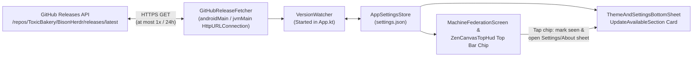

# Release notification plan

This document gives the design and the implementation plan for the new-release notification system
in BisonHerdr (`ToxicBakery/BisonHerdr`).

## 1. Goals and rules

The release notification system has these six properties:

1. **GitHub Release source.** When `.github/workflows/build-release.yml` publishes a release on
   GitHub (`make_latest: true`), the app reads the new version from the public GitHub Releases API
   (`https://api.github.com/repos/ToxicBakery/BisonHerdr/releases/latest`).
2. **All platforms.** The check and the UI run in common code (`core:app-version`, `core:model`,
   `core:store`, `core:common`, `core:di`) on Android (`app:android`) and on JVM.
3. **No disruption.** No dialog, no sound, and no system notification interrupts the user:
   - A compact chip (`UPDATE_AVAILABLE_TAG = "updateAvailable"`) shows in the top bar of
     `MachineFederationScreen` (and `ZenCanvasTopHud`) when an unseen release is available.
   - One tap on the chip marks the version as seen (`notifiedReleaseVersion`), hides the chip, and
     opens the Settings/About sheet.
   - `ThemeAndSettingsBottomSheet` shows an "Update available" card (`ABOUT_UPDATE_AVAILABLE_TAG`)
     with a button (`ABOUT_OPEN_RELEASE_TAG = "about-open-release"`) that opens the GitHub Release
     page in the system browser.
4. **At most one check each day.** The app stores the wall-clock time (`lastReleaseCheckEpochMs`) of
   the last check in `settings.json` (`AppSettingsStore`). The app checks GitHub only when at least
   24 hours (`86_400_000 ms`) passed after the last check. Multiple releases on the same day never
   cause more than one check or more than one notification in a 24-hour window.
5. **At most one notification for each version.** The app stores `notifiedReleaseVersion` in
   `AppSettings`. After the user taps the top-bar chip (or opens the release from the Settings/About
   sheet) for version `X`, the top-bar chip never shows again for version `X`.
6. **User switch.** `ThemeAndSettingsBottomSheet` has a switch (`checkForUpdates`, on by default,
   `CHECK_FOR_UPDATES_TAG = "app-check-updates"`) that turns automatic release checks on or off.

## 2. Architecture



### 2.1 Version parsing and comparison (`core:app-version`)

Calendar versions follow `<year>.<week>.<count>` with integer code:

```
code = (year mod 100) × 100000 + week × 1000 + count
```

`ReleaseVersion` in `core/app-version/src/commonMain/kotlin/com/toxicbakery/app/bison/version/ReleaseVersion.kt`:

- `parseTag(tag: String): String?` accepts only a clean release tag `v<year>.<week>.<count>` (or
  `<year>.<week>.<count>`) and removes the `v` prefix (for example, `"v26.42.2"` gives `"26.42.2"`).
  It gives `null` for each other tag or suffix.
- `codeOf(version: String): Int?` parses `<year>.<week>.<count>` and gives
  `(year % 100) * 100000 + week * 1000 + count`. It gives `null` when `year !in 0..99`,
  `week !in 1..53`, or `count !in 1..999`.
- `isNewer(candidateVersion: String, currentCode: Int = AppVersion.CODE): Boolean` gives `true` when
  `codeOf(candidateVersion)` is not `null` and is greater than `currentCode`.

## 3. Stored state and rate-limit rules (`core:model`, `core:store`, and `core:common`)

### 3.1 `AppSettings` fields (`core/model/src/commonMain/kotlin/com/toxicbakery/app/bison/model/AppSettingsAndTransport.kt`)

Each field has a default value so that existing `settings.json` files load with no migration:

```kotlin
/** True when the app checks GitHub for a new release at most once a day. */
val checkForUpdates: Boolean = true,
/** The wall-clock time in epoch milliseconds of the last release check, or 0 before the first check. */
val lastReleaseCheckEpochMs: Long = 0L,
/** The newest release version found on GitHub (for example "26.42.2"), or null. */
val availableReleaseVersion: String? = null,
/** The URL of the GitHub Release page for [availableReleaseVersion], or null. */
val availableReleaseUrl: String? = null,
/** The last release version whose notification the user already saw. */
val notifiedReleaseVersion: String? = null,
```

### 3.2 Pure rules in `VersionCheck` (`core/common/src/commonMain/kotlin/com/toxicbakery/app/bison/common/version/VersionCheck.kt`)

All timing and notification rules live in pure functions on `VersionCheck`:

| Function | Rule |
|---|---|
| `afterStart(settings, current, currentCode)` | If `availableReleaseVersion` is not newer than `currentCode` (the user installed the update), sets `availableReleaseVersion = null` and `availableReleaseUrl = null`. |
| `shouldCheckRelease(settings, nowEpochMs)` | Gives `true` when `settings.checkForUpdates` is `true` and either `settings.lastReleaseCheckEpochMs <= 0L`, `nowEpochMs < settings.lastReleaseCheckEpochMs` (the system clock moved back), or `nowEpochMs - settings.lastReleaseCheckEpochMs >= CHECK_INTERVAL_MS` (`86_400_000L`, 24 hours). |
| `afterReleaseCheck(settings, remote, nowEpochMs, currentCode)` | Sets `lastReleaseCheckEpochMs = nowEpochMs`. When `remote != null` and `ReleaseVersion.isNewer(remote.version, currentCode)`, sets `availableReleaseVersion = remote.version` and `availableReleaseUrl = remote.htmlUrl`. When `remote != null` and `!ReleaseVersion.isNewer(remote.version, currentCode)`, clears `availableReleaseVersion` and `availableReleaseUrl`. |
| `unseenReleaseVersion(settings, currentCode)` / `shouldShowTopBarNotification(settings, currentCode)` | Gives `availableReleaseVersion` when `settings.checkForUpdates` is `true`, `ReleaseVersion.isNewer(availableReleaseVersion, currentCode)` is `true`, and `availableReleaseVersion != settings.notifiedReleaseVersion`. Else gives `null` / `false`. |
| `effectiveAvailableRelease(settings, currentCode)` | Gives `RemoteRelease(version, url)` when `availableReleaseVersion` is newer than `currentCode`, falling back to `releaseTagUrl(version)` if `availableReleaseUrl` is blank. |
| `acknowledgeRelease(settings)` | Sets `notifiedReleaseVersion = settings.availableReleaseVersion ?: settings.notifiedReleaseVersion`. |

## 4. Network check across platforms (`core:common`)

### 4.1 Endpoint and JSON payload

- **URL:** `https://api.github.com/repos/ToxicBakery/BisonHerdr/releases/latest`
- **Request headers:**
  - `Accept: application/vnd.github+json`
  - `X-GitHub-Api-Version: 2022-11-28`
  - `User-Agent: BisonHerdr`
- **Validation:** `parseLatestReleaseJson(raw: String): RemoteRelease?` refuses a draft or a
  prerelease, parses `tagName` with `ReleaseVersion.parseTag`, and checks that `htmlUrl` starts with
  `https://github.com/ToxicBakery/BisonHerdr/releases/` (or uses
  `https://github.com/ToxicBakery/BisonHerdr/releases/tag/v$version`).

### 4.2 Transport and `VersionWatcher` loop

- `internal expect suspend fun fetchGitHubReleaseJson(url: String, timeoutMs: Int = 5_000): String?`
  runs on `Dispatchers.IO` with a `5_000 ms` timeout and returns `null` on any `IOException` or
  non-200 status.
- `VersionWatcher.start(scope)` loads `AppSettingsStore`, runs `VersionCheck.afterStart`, and then
  runs the 24-hour check loop:
  1. Wait until `settings.checkForUpdates` is `true`.
  2. When `VersionCheck.nextCheckDelayMs(settings, nowEpochMs()) > 0L`, delay until the end of the
     24-hour window.
  3. Call `releaseFetcher.fetchLatest()`.
  4. When the call returns a release, write `VersionCheck.afterReleaseCheck` to `AppSettingsStore`
     and delay `24 hours`.
  5. When the call returns `null` (offline or HTTP failure), do not write `lastReleaseCheckEpochMs`;
     wait `1 hour` in memory before retrying.

## 5. Verification plan

1. **Unit tests (`:core:app-version:check`, `:core:model:check`, `:core:store:check`):**
   - Test `ReleaseVersion.parseTag`, `codeOf`, and `isNewer` on release tags, `-dev` versions, year
     boundaries (`26.52.9` to `27.1.1`), and bad tags.
   - Test `AppSettings` JSON serialization round-trip, defaults, and `AppSettingsStore` update helpers.
2. **Watcher, parser, and HTTP tests (`:core:common:check`):**
   - Test `parseLatestReleaseJson` / `parseGitHubLatestReleaseJson` for clean releases, fallback URLs,
     drafts, prereleases, bad tags, and invalid JSON.
   - Test `VersionCheck` and `VersionWatcher` 24-hour rate limit, `checkForUpdates = false`,
     `notifiedReleaseVersion` deduplication, newer version after notified version, and 1-hour retry on
     network failure.
   - Test `fetchGitHubReleaseJson` on JVM against a local `HttpServer`.
3. **Localization and full build verification:**
   - Run `:core:resources:localizationCheck`, `:core:di:check`, `:app:android:assembleDebug`,
     `:app:android:testDebugUnitTest`, and `lint`.
